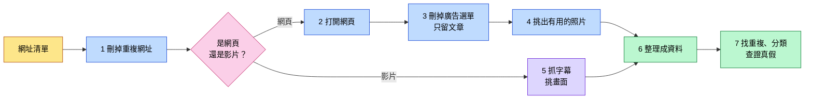
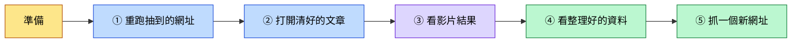

# 觀音地方知識爬蟲

資料庫設計課 第 9 組

> [!NOTE]
> **這個專案在做什麼？**
> 想像你要整理一本「桃園觀音」的資料集：要開幾十個網頁、看幾部影片，把文章複製下來、把廣告刪掉、把照片存好，還要記下每段資料是從哪裡來的。
> 這個專案就是寫一支程式，**把這些事自動做完**。這種程式叫做「爬蟲」。

## 做出了什麼

| 項目 | 結果 |
|---|---|
| 抓了幾個網址 | **37 個全部成功**（老師給 31 個，我們自己找了 6 個） |
| 順著連結多抓的網頁 | **30 頁，成功 29 頁**（有 1 頁對方網站不讓程式進去） |
| 最後整理出的資料 | **67 筆**，每一筆都寫明原始網址 |
| 照片 | 留下 **410 張**，丟掉 432 張（Logo、廣告、重複的，每張都寫了為什麼丟） |
| 影片 | 3 部，抓下字幕 **1,011 句**，每部挑 5 張畫面 |

## 整個過程



## 每一步怎麼做

### 1. 刪掉重複網址

同一篇文章，從 Facebook 點進來和從 Google 點進來，網址後面會多出不一樣的尾巴，但內容其實一樣。程式會先把這些尾巴切掉，**同一篇只抓一次**。

### 2. 打開網頁

> [!IMPORTANT]
> **做個有禮貌的爬蟲**
> 很多網站會放一份給爬蟲看的規定（`robots.txt`），寫著哪些頁面不准抓，我們一律遵守。
> 同一個網站每抓一頁就**休息 1 秒**，不要一次湧進去，把人家的網站拖慢。

大部分網頁，程式直接下載就拿得到內容。但有些網站要等瀏覽器載入完，文字才會出現，直接下載只會拿到一個空殼。碰到這種網站，程式會**自己開一個瀏覽器**，等網頁完全載入後再抓。

如果網站明確表示不讓程式進去，我們**不硬闖**，只把「這頁抓不到、原因是什麼」記下來。

### 3. 刪掉廣告和選單，只留文章

一個網頁上，真正的文章常常只佔一小塊，旁邊都是選單、廣告、分享按鈕、推薦文章。程式分三步清理：

```diff
- 第一步：選單、頁尾這些「一看就不是文章」的部分，直接刪
- 第二步：名字叫「廣告」「分享」「彈出視窗」「側欄」的區塊，也刪
+ 但如果某一塊佔了整頁四成以上的字，就算名字可疑也留下（那多半就是文章本身）
+ 第三步：剩下的區塊裡，字最多、連結最少的那塊，就是文章
```

### 4. 挑出有用的照片

```diff
- 網站 Logo、小圖示、QR code
- 小到看不見的圖（網站用來偷偷統計瀏覽次數的）
- 又扁又長的橫幅廣告
- 前面已經存過的同一張照片
+ 文章裡、夠大張的照片才留下，每頁最多 15 張
```

> [!TIP]
> **怎麼知道兩張照片是同一張？**
> 檔案一模一樣的，比對「檔案指紋」就知道。
> 但同一張照片被不同網站壓縮過、改過大小，檔案就不一樣了。這時候程式會把照片縮成很小的黑白圖再比對，**看起來像就算同一張**。

### 5. 影片：抓字幕、挑畫面

> [!IMPORTANT]
> **影片本身不下載**，只拿文字和幾張畫面。

| 要拿什麼 | 怎麼拿 |
|---|---|
| 標題、頻道、上傳日期 | 直接讀 YouTube 的影片資訊 |
| 字幕 | 抓 YouTube 上公開的字幕，每句都記下是第幾秒講的 |
| 代表畫面 | 把影片平均切成 5 段，每段挑**最清楚、不模糊**的一格 |

有一部影片（video_003）沒有字幕，所以那 5 張畫面我們改成自己用文字描述。

### 6. 網頁永遠抓不完，所以要先決定停在哪

> [!WARNING]
> 網頁裡有連結，點進去又有更多連結。我們的網頁平均每頁有 124 個連結：
> 點 1 層約 **4 千頁**，點 2 層約 **52 萬頁**，點 3 層超過 **6 千萬頁**。
> 而且越點越遠，內容早就跟觀音沒關係了。

所以我們先訂好規則：

| 規則 | 白話說明 |
|---|---|
| **只點 1 層** | 從原本的網頁往外點一次就停 |
| **限制數量** | 每個網頁最多跟 3 個連結，總共最多 30 頁 |
| **只跟相關的** | 連結文字要提到觀音的地名，而且只跟同一個網站、維基百科、政府網站；「標籤」「分類」「搜尋」這種只是文章列表的頁面不跟 |
| **不重複** | 抓過的網址、存過的照片不再抓 |
| **有禮貌** | 遵守網站規定，每頁休息 1 秒 |

```diff
- 第一次跑：沒擋掉「標籤」「搜尋」這種列表頁，白白浪費 6 個名額，只成功 25 頁
+ 第二次跑：把列表頁擋掉，成功 29 頁
```

### 7. 找重複、分類、查證真假

| 做什麼 | 白話說明 |
|---|---|
| **找重複文章** | 比較兩篇文章用了多少一樣的詞，越多越像。結果找到 3 組其實是同一篇，都是維基百科同一篇文章換了網址 |
| **分類** | 分成 6 類：自然生態、歷史信仰、產業、農業飲食、觀光、海洋議題。哪一類的關鍵詞出現最多，就歸哪一類 |
| **抓關鍵字** | 每篇文章挑出 5 個最重要的詞 |
| **查證真假** | 挑 3 個網路上的說法，拿去跟政府或官方資料對照。例如有部落格說甘泉寺是乾隆年間蓋的，但官方資料都寫咸豐年間，我們就判定這個說法**不正確** |

## 用到的工具

| 工具 | 拿來做什麼 |
|---|---|
| **Python** | 寫整支程式的程式語言 |
| **requests** | 下載網頁 |
| **Playwright** | 自動開瀏覽器，抓那些要等載入的網頁 |
| **BeautifulSoup** | 拆開網頁，找出文章、刪掉廣告 |
| **yt-dlp** | 讀 YouTube 影片資訊 |
| **youtube-transcript-api** | 抓 YouTube 字幕 |
| **Pillow、ImageHash** | 看照片大小、比對是不是同一張 |
| **OpenCV** | 判斷影片畫面清不清楚 |
| **scikit-learn** | 比較兩篇文章像不像 |
| **jieba** | 把中文句子切成一個一個詞 |

## 怎麼執行

**第一次使用：安裝需要的工具**

```powershell
python -m venv .venv
.venv\Scripts\python -m pip install -r requirements.txt
.venv\Scripts\python -m playwright install chromium
```

**開始跑**

```powershell
# 全部重新抓一次（大約 20 分鐘）
.venv\Scripts\python crawler\crawler.py

# 只重抓清單上的第 5 和第 26 個（上台展示用）
.venv\Scripts\python crawler\crawler.py --only 5,26

# 抓一個新的網址
.venv\Scripts\python crawler\crawler.py --url "https://zh.wikipedia.org/wiki/白沙岬燈塔"

# 找重複、分類、抓關鍵字
.venv\Scripts\python crawler\analyze.py
```

> [!CAUTION]
> **全部重新抓會把 video_003 的畫面描述洗掉**，抓完要從 git 歷史紀錄把它補回來。

## 上台操作展示流程

老師會現場抽網址，要我們當場重跑，證明資料真的是程式抓的。整個展示大約 3 分鐘，照下面五步做。



> [!IMPORTANT]
> **上台前先準備好**
> 1. 確認電腦有網路
> 2. 開好 VS Code，打開這個資料夾
> 3. 開好 PowerShell，先切到專案資料夾：`cd D:\CS_Work\WebCrawler_Project`
> 4. 先自己完整跑過一次，確定不會出錯

### ① 重跑老師抽到的網址

假設老師抽第 5 個（白沙岬燈塔的部落格文章）和第 26 個（YouTube 影片）：

```powershell
.venv\Scripts\python crawler\crawler.py --only 5,26
```

畫面會一行一行印出正在抓哪個網址，每個後面都會出現 `成功`。這時可以邊等邊說：「程式會先讀網站的規定，每頁間隔 1 秒，不會一直狂抓。」

### ② 打開清好的文章

在 VS Code 打開 `output/articles/page_005.md`，按 `Ctrl+Shift+V` 切到預覽模式，讓老師看三件事：

| 指給老師看 | 要說的話 |
|---|---|
| 最上面的標題、網址、作者、日期 | 「每一篇都能追回原本的網址。」 |
| 正文 | 「原本網頁上的廣告、選單、分享按鈕都刪掉了，只留文章。」 |
| 文章中間的照片 | 「照片放在原本的位置，底下寫著原圖網址。」 |

如果老師想比較，可以在瀏覽器打開原始網址，兩邊並排看差多少。

### ③ 看影片結果

打開 `output/videos/video_001.md`，往下捲到字幕：

- 「每一句字幕前面都有時間，例如 `[00:01:23]`，可以對回影片第幾秒。」
- 再打開 `output/videos/video_001_frames/` 資料夾：「這是程式挑出來的 5 張畫面，檔名最後的數字是時間點，例如 `000159` 就是影片的 0 時 01 分 59 秒。」

### ④ 看整理好的資料

打開 `output/crawl_report.csv`：「每個網址有沒有抓到、用什麼方法抓、沒抓到的原因，都記在這裡。」

再打開 `output/index.jsonl`，按 `Ctrl+F` 搜尋 `page_005`：「這是最後整理好的資料，一行一筆，裡面有標題、網址、正文、照片、連結、抓取時間，資料庫可以直接匯入。」

### ⑤ 抓一個新網址（老師沒指定也可以主動展示）

如果老師給一個清單外的網址，就把它貼進引號裡：

```powershell
.venv\Scripts\python crawler\crawler.py --url "https://zh.wikipedia.org/wiki/白沙岬燈塔"
```

結果會放在 `output/demo/articles/demo_page_001.md`，不會蓋掉原本的資料。

> [!WARNING]
> **不要用「草漯沙丘」的維基頁面示範**，那個條目不存在，會抓到錯誤頁。想用維基示範的話，用「白沙岬燈塔」或「草漯」。

> [!TIP]
> **如果現場抓失敗怎麼辦？**
> 不要慌，打開 `output/crawl_report.csv` 看 `reason` 那一欄，照著念出失敗原因。例如對方網站拒絕程式進去（403），就說：「對方網站不讓自動程式進去，我們不硬闖，只記錄原因。」**能說明失敗原因，本身也是評分重點。**

## 檔案放在哪裡

| 位置 | 裡面是什麼 |
|---|---|
| `urls.csv` | 要抓的網址清單 |
| `crawler/` | 程式 |
| `output/index.jsonl` | **最後整理好的資料**，一行是一筆 |
| `output/crawl_report.csv` | 每個網址有沒有抓到、沒抓到的原因 |
| `output/articles/` | 清理好的文章 |
| `output/images/` | 照片 |
| `output/videos/` | 影片字幕和畫面 |
| `report/report.md` | 完整報告 |

檔名編號：老師給的網頁是 `page_001`～`page_028`，影片是 `video_001`～`video_003`，我們自己找的網頁是 `page_029`～`page_034`，順著連結多抓的是 `ext_001`～`ext_030`。

## 還沒解決的問題

- 維基百科同一篇文章有好幾種網址，程式一開始沒認出來，所以 ext_020、ext_028、ext_030 跟原本的網頁其實是同一篇。後來在「找重複文章」那一步有抓出來。
- ext_027 是機器自動產生的外語維基頁面，內容幾乎沒有用。
