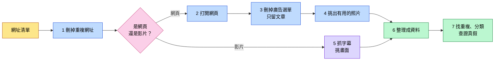
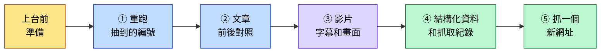

# 觀音地方知識爬蟲

資料庫設計課 第 9 組

> [!NOTE]
> **這個專案在做什麼？**
> 想像你要整理一本「桃園觀音」的資料集：要開幾十個網頁、看幾部影片，把文章複製下來、把廣告刪掉、把照片存好，還要記下每段資料是從哪裡來的。
> 這個專案就是寫一支程式，**把這些事自動做完**。這種程式叫做「爬蟲」。

## 做出了什麼

| 項目 | 結果 |
|---|---|
| 抓了幾個網址 | **37 個全部成功**（老師給 31 個，我們自己找了 6 個） |
| 順著連結多抓的網頁 | **30 頁，成功 29 頁**（有 1 頁對方網站不讓程式進去） |
| 最後整理出的資料 | **67 筆**，每一筆都寫明原始網址 |
| 照片 | 留下 **410 張**，丟掉 432 張（Logo、廣告、重複的，每張都寫了為什麼丟） |
| 影片 | 3 部，抓下字幕 **1,011 句**，每部挑 5 張畫面 |

## 整個過程



## 每一步怎麼做

### 1. 刪掉重複網址

同一篇文章，從 Facebook 點進來和從 Google 點進來，網址後面會多出不一樣的尾巴，但內容其實一樣。程式會先把這些尾巴切掉，**同一篇只抓一次**。

### 2. 打開網頁

> [!IMPORTANT]
> **做個有禮貌的爬蟲**
> 很多網站會放一份給爬蟲看的規定（`robots.txt`），寫著哪些頁面不准抓，我們一律遵守。
> 同一個網站每抓一頁就**休息 1 秒**，不要一次湧進去，把人家的網站拖慢。

大部分網頁，程式直接下載就拿得到內容。但有些網站要等瀏覽器載入完，文字才會出現，直接下載只會拿到一個空殼。碰到這種網站，程式會**自己開一個瀏覽器**，等網頁完全載入後再抓。

如果網站明確表示不讓程式進去，我們**不硬闖**，只把「這頁抓不到、原因是什麼」記下來。

### 3. 刪掉廣告和選單，只留文章

一個網頁上，真正的文章常常只佔一小塊，旁邊都是選單、廣告、分享按鈕、推薦文章。程式分三步清理：

```diff
- 第一步：選單、頁尾這些「一看就不是文章」的部分，直接刪
- 第二步：名字叫「廣告」「分享」「彈出視窗」「側欄」的區塊，也刪
+ 但如果某一塊佔了整頁四成以上的字，就算名字可疑也留下（那多半就是文章本身）
+ 第三步：剩下的區塊裡，字最多、連結最少的那塊，就是文章
```

### 4. 挑出有用的照片

```diff
- 網站 Logo、小圖示、QR code
- 小到看不見的圖（網站用來偷偷統計瀏覽次數的）
- 又扁又長的橫幅廣告
- 前面已經存過的同一張照片
+ 文章裡、夠大張的照片才留下，每頁最多 15 張
```

> [!TIP]
> **怎麼知道兩張照片是同一張？**
> 檔案一模一樣的，比對「檔案指紋」就知道。
> 但同一張照片被不同網站壓縮過、改過大小，檔案就不一樣了。這時候程式會把照片縮成很小的黑白圖再比對，**看起來像就算同一張**。

### 5. 影片：抓字幕、挑畫面

> [!IMPORTANT]
> **影片本身不下載**，只拿文字和幾張畫面。

| 要拿什麼 | 怎麼拿 |
|---|---|
| 標題、頻道、上傳日期 | 直接讀 YouTube 的影片資訊 |
| 字幕 | 抓 YouTube 上公開的字幕，每句都記下是第幾秒講的 |
| 代表畫面 | 把影片平均切成 5 段，每段挑**最清楚、不模糊**的一格 |

有一部影片（video_003）沒有字幕，所以那 5 張畫面我們改成自己用文字描述。

### 6. 網頁永遠抓不完，所以要先決定停在哪

> [!WARNING]
> 網頁裡有連結，點進去又有更多連結。我們的網頁平均每頁有 124 個連結：
> 點 1 層約 **4 千頁**，點 2 層約 **52 萬頁**，點 3 層超過 **6 千萬頁**。
> 而且越點越遠，內容早就跟觀音沒關係了。

所以我們先訂好規則：

| 規則 | 白話說明 |
|---|---|
| **只點 1 層** | 從原本的網頁往外點一次就停 |
| **限制數量** | 每個網頁最多跟 3 個連結，總共最多 30 頁 |
| **只跟相關的** | 連結文字要提到觀音的地名，而且只跟同一個網站、維基百科、政府網站；「標籤」「分類」「搜尋」這種只是文章列表的頁面不跟 |
| **不重複** | 抓過的網址、存過的照片不再抓 |
| **有禮貌** | 遵守網站規定，每頁休息 1 秒 |

```diff
- 第一次跑：沒擋掉「標籤」「搜尋」這種列表頁，白白浪費 6 個名額，只成功 25 頁
+ 第二次跑：把列表頁擋掉，成功 29 頁
```

### 7. 找重複、分類、查證真假

| 做什麼 | 白話說明 |
|---|---|
| **找重複文章** | 比較兩篇文章用了多少一樣的詞，越多越像。結果找到 3 組其實是同一篇，都是維基百科同一篇文章換了網址 |
| **分類** | 分成 6 類：自然生態、歷史信仰、產業、農業飲食、觀光、海洋議題。哪一類的關鍵詞出現最多，就歸哪一類 |
| **抓關鍵字** | 每篇文章挑出 5 個最重要的詞 |
| **查證真假** | 挑 3 個網路上的說法，拿去跟政府或官方資料對照。例如有部落格說甘泉寺是乾隆年間蓋的，但官方資料都寫咸豐年間，我們就判定這個說法**不正確** |

## 用到的工具

| 工具 | 拿來做什麼 |
|---|---|
| **Python** | 寫整支程式的程式語言 |
| **requests** | 下載網頁 |
| **Playwright** | 自動開瀏覽器，抓那些要等載入的網頁 |
| **BeautifulSoup** | 拆開網頁，找出文章、刪掉廣告 |
| **yt-dlp** | 讀 YouTube 影片資訊 |
| **youtube-transcript-api** | 抓 YouTube 字幕 |
| **Pillow、ImageHash** | 看照片大小、比對是不是同一張 |
| **OpenCV** | 判斷影片畫面清不清楚 |
| **scikit-learn** | 比較兩篇文章像不像 |
| **jieba** | 把中文句子切成一個一個詞 |

## 怎麼執行

**第一次使用：安裝需要的工具**

```powershell
python -m venv .venv
.venv\Scripts\python -m pip install -r requirements.txt
.venv\Scripts\python -m playwright install chromium
```

**開始跑**

```powershell
# 全部重新抓一次（大約 20 分鐘）
.venv\Scripts\python crawler\crawler.py

# 只重抓清單上的第 5 和第 26 個（上台展示用）
.venv\Scripts\python crawler\crawler.py --only 5,26

# 抓一個新的網址
.venv\Scripts\python crawler\crawler.py --url "https://zh.wikipedia.org/wiki/白沙岬燈塔"

# 找重複、分類、抓關鍵字
.venv\Scripts\python crawler\analyze.py
```

> [!CAUTION]
> **全部重新抓會把 video_003 的畫面描述洗掉**，抓完要從 git 歷史紀錄把它補回來。

## 上台操作展示流程

> [!NOTE]
> **為什麼要現場展示？**
> 老師會從網址清單裡**隨便抽幾個編號**，要我們當場重跑。目的是確認資料真的是我們的程式抓的，而且程式可以重複執行、結果一樣。
> 整段展示大約 **3～5 分鐘**，分成「上台前準備」和「上台五個步驟」。



### 上台前準備（前一天和上台前 5 分鐘）

| 什麼時候 | 要做的事 |
|---|---|
| 前一天 | 用要上台的那台電腦，把下面五個步驟**完整走一遍**，確定每個指令都跑得動 |
| 上台前 | 確認有網路（學校 Wi-Fi 或手機熱點） |
| 上台前 | 打開 VS Code →「檔案」→「開啟資料夾」→ 選 `WebCrawler_Project` |
| 上台前 | 在 VS Code 按 `` Ctrl+` `` 打開下方的終端機，確認路徑停在 `WebCrawler_Project` |
| 上台前 | 把字放大：按 `Ctrl+=` 兩三下，後排才看得到 |
| 上台前 | 瀏覽器先開好一個分頁，等一下要貼原始網址做對照 |

> [!TIP]
> **老師抽到的編號怎麼對？**
> 編號就是 `urls.csv` 第一欄的 `no`。在 VS Code 打開 `urls.csv` 就看得到每個編號對應哪個網址。
> 跑完之後的檔名請看 `output/crawl_report.csv`：同一列的 `no` 是編號，`id` 就是檔名，例如第 5 個是 `page_005`、第 26 個是 `video_001`。
> 網頁叫 `page_XXX`，影片叫 `video_XXX`，兩種是**分開編號**的，所以編號 26 不會是 `page_026`。

下面用「老師抽第 5 個和第 26 個」當例子。換成別的編號，只要把指令和檔名換掉就好。

### ① 重跑老師抽到的編號

在終端機輸入，多個編號用逗號隔開、中間不要有空格：

```powershell
.venv\Scripts\python crawler\crawler.py --only 5,26
```

畫面會像這樣一行一行跑出來：

```text
[5] page_005 https://natsuphil.com/taoyuan/baisha-cape/
     → 成功
[26] video_001 https://youtu.be/2hbu5n9VLZY?si=JC29M3MbFRsFELoU
     → 成功
完成：2 筆資料，紀錄 2 筆 → ...\output
```

**等待時可以說**：「程式會先看網站的 robots.txt 有沒有禁止，同一個網站每次間隔 1 秒，不會狂抓對方網站。網頁的部分會把照片一起下載下來，影片只抓字幕和畫面，不下載影片本身。」

> [!IMPORTANT]
> 看到 `完成` 才能進下一步。`--only` 只會更新抽到的那幾筆，其他資料不會動。

### ② 文章前後對照

1. 在 VS Code 按 `Ctrl+P`，輸入 `page_005.md`，按 Enter 打開
2. 按 `Ctrl+Shift+V` 切到預覽模式，照片就會直接顯示出來
3. 從檔案最上面的「原始網址」複製網址，貼到瀏覽器打開，跟 VS Code 並排

照下面的順序指給老師看：

| 指哪裡 | 要說的話 |
|---|---|
| 最上面的清單：原始網址、網站名稱、作者、發表日期、爬取時間 | 「每一篇都記下原始網址和抓取時間，可以追回出處。」 |
| 「取得方式：requests」「正文定位：通用規則 .post-content」 | 「這行記錄程式用什麼方法抓、怎麼找到文章的。」 |
| 瀏覽器原網頁的側欄、廣告、分享按鈕 | 「原本網頁上有這些東西……」 |
| VS Code 預覽的正文 | 「……清理後都刪掉了，只留文章本身。」 |
| 正文中間的照片和下面那行「來源：https://...」 | 「照片放在原文的位置，下面寫著原圖網址，這頁留了 15 張。」 |

### ③ 影片：字幕和畫面

1. `Ctrl+P` 輸入 `video_001.md` 打開，一樣按 `Ctrl+Shift+V` 預覽
2. 最上面：「頻道、上傳日期、長度都有記錄，字幕來源是上傳者提供的繁體中文字幕。」
3. 往下捲到「代表畫面」：「這 5 張是程式挑的。影片平均切成 5 段，每段挑最清楚的一格。」
4. 再往下到「逐字稿」：「每一段前面都有時間，例如 `[00:01:19]`，可以對回影片的第 1 分 19 秒。」

可以加一句：「我們完全沒有下載影片檔，只讀 YouTube 公開的資訊和字幕。」

### ④ 結構化資料和抓取紀錄

`index.jsonl` 一行就是一整筆資料，直接打開會很長、很難看，所以用我們寫的小工具只印重點：

```powershell
.venv\Scripts\python crawler\show.py page_005
```

會印出：

```text
{
  "id": "page_005",
  "type": "webpage",
  "title": "桃園觀音景點〡白沙岬燈塔〡……",
  "source_url": "https://natsuphil.com/taoyuan/baisha-cape/",
  "source_name": "小菲親子玩樂生活",
  "crawl_status": "成功",
  "crawled_at": "2026-11-…",
  "category": "觀光景點與休閒",
  "keywords": ["燈塔", "白沙岬燈塔", "台灣", "景點", "縮小版"],
  "content": "正文 2073 字",
  "images": "15 張圖片／畫面",
  "links": "16 條連結",
  "timestamps": "0 段字幕時間戳"
}
```

**要說的話**：「這是存進資料庫的格式。每一筆都有標題、原始網址、來源、正文、圖片、連結、抓取時間，也有分類和關鍵字。影片的話，`timestamps` 存的就是每段字幕的時間。」

想給老師看影片那筆，就把 `page_005` 換成 `video_001`，會看到 1002 段字幕時間戳。

接著打開 `output/crawl_report.csv`：「每個網址用什麼方法抓、HTTP 狀態碼、成功或失敗、失敗原因，全部記在這裡，連失敗的也有。」

### ⑤ 抓一個新網址

如果老師給清單外的網址，或時間還夠，就主動展示：

```powershell
.venv\Scripts\python crawler\crawler.py --url "https://zh.wikipedia.org/wiki/白沙岬燈塔"
```

網址一定要用**雙引號**包起來，不然網址裡的 `&` 會讓 PowerShell 出錯。

跑完後用 `Ctrl+P` 打開 `demo_page_001.md`，如果是影片就打開 `demo_video_001.md`，接著照步驟 ② 的方式展示。新網址的結果放在 `output/demo/`，**不會蓋掉原本的資料**。

> [!WARNING]
> **不要用「草漯沙丘」的維基頁面示範**，那個條目不存在，會抓到錯誤頁。想用維基示範，就用「白沙岬燈塔」或「草漯」。

### 現場出狀況怎麼辦

| 狀況 | 怎麼處理 |
|---|---|
| 畫面出現 `失敗` 或 `無法存取` | 打開 `output/crawl_report.csv`，找到那一列的 `reason` 欄念出來，例如：「對方網站回 403，表示不讓自動程式進去，我們不硬闖，只記錄原因。」 |
| 網路斷了 | 改用手機熱點。真的連不上，就打開之前已經跑好的 `output/articles/` 來展示，並說明現場網路的狀況 |
| 指令打錯 | 按鍵盤 `↑` 叫出上一行指令修改，不用整行重打 |
| 跑很久沒反應 | 網頁照片多的話會比較久，先講解步驟 ① 那段話。超過 2 分鐘就按 `Ctrl+C` 停掉，換一個編號 |

> [!CAUTION]
> 展示時**只用 `--only` 和 `--url`**，不要跑沒有參數的 `crawler.py`。那會把全部 37 個網址重抓一次，要 20 分鐘，還會洗掉 video_003 的人工描述。

## 檔案放在哪裡

| 位置 | 裡面是什麼 |
|---|---|
| `urls.csv` | 要抓的網址清單 |
| `crawler/` | 程式 |
| `output/index.jsonl` | **最後整理好的資料**，一行是一筆 |
| `output/crawl_report.csv` | 每個網址有沒有抓到、沒抓到的原因 |
| `output/articles/` | 清理好的文章 |
| `output/images/` | 照片 |
| `output/videos/` | 影片字幕和畫面 |
| `report/report.md` | 完整報告 |

檔名編號：老師給的網頁是 `page_001`～`page_028`，影片是 `video_001`～`video_003`，我們自己找的網頁是 `page_029`～`page_034`，順著連結多抓的是 `ext_001`～`ext_030`。

## 還沒解決的問題

- 維基百科同一篇文章有好幾種網址，程式一開始沒認出來，所以 ext_020、ext_028、ext_030 跟原本的網頁其實是同一篇。後來在「找重複文章」那一步有抓出來。
- ext_027 是機器自動產生的外語維基頁面，內容幾乎沒有用。
