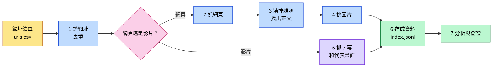

# 觀音地方知識爬蟲

資料庫設計課 第 9 組

> [!NOTE]
> **一句話說明**：把跟「桃園觀音」有關的網頁和 YouTube 影片自動抓回來，**去掉廣告和選單**，只留下**正文、圖片、字幕**，整理成一份**每筆都能追回原始網址**的資料。

## 成果

| 項目 | 結果 |
|---|---|
| 種子網址 | **37 個全部取得**（老師給 31 個，我們自己加 6 個） |
| 延伸探索 | **30 頁，成功 29 頁**（1 頁被對方網站拒絕） |
| 最終資料 | **67 筆**，存在 `output/index.jsonl` |
| 圖片 | 留下 **410 張**，排除 432 張（每張都記錄原因） |
| 影片 | 3 部，字幕 **1,011 段**，每部 5 張代表畫面 |

## 整體流程



## 每一步在做什麼

### 1. 讀網址、去重

同一個網頁常常有好幾種網址寫法，例如後面多一段 `?utm_source=facebook`。程式先把這種追蹤用的尾巴拿掉，**一樣的網址只抓一次**。

### 2. 抓網頁

> [!IMPORTANT]
> **先守規矩再抓**：每個網站都先讀 `robots.txt`（網站寫給爬蟲看的規則），而且同一個網站每次請求**至少間隔 1 秒**。

| 情況 | 做法 |
|---|---|
| 一般網頁 | 用 `requests` 直接抓 |
| 內容要等瀏覽器跑完才出現（例如桃園觀光導覽網） | 用 **Playwright** 開一個真的瀏覽器去抓 |
| 對方明確拒絕（403） | **不繞過**，照實記在 `crawl_report.csv` |

### 3. 清掉雜訊、找出正文

一個網頁裡，真正的文章常常只佔一小塊。清理分三層：

```diff
- 第一層：script、nav、footer 這種本來就不是正文的標籤，直接刪
- 第二層：名字裡有 ad、share、popup、sidebar 的區塊，當雜訊刪
+ 保護：某個區塊如果佔全頁 40% 以上的文字，就算名字可疑也保留
+ 第三層：剩下的區塊裡，文字最多、連結最少的就是正文
```

### 4. 挑圖片

```diff
- 名字有 logo、icon、banner、qrcode 的
- 太小的（追蹤像素、小圖示）
- 太扁長的（橫幅廣告）
- 跟已存的圖片重複的
+ 正文裡、尺寸夠大的圖片才留下，每頁最多 15 張
```

> [!TIP]
> **重複圖片怎麼抓**：完全一樣的檔案用 **SHA-1**（檔案指紋）比對；壓縮過或改過大小的，用 **pHash**（看起來像不像）比對。

### 5. 影片

> [!IMPORTANT]
> **影片本體完全不下載。**

| 要的東西 | 怎麼拿 |
|---|---|
| 標題、頻道、日期 | `yt-dlp`，只讀資料、不下載 |
| 字幕 | `youtube-transcript-api`，每段都保留時間 |
| 代表畫面 | 影片平均切 5 段，每段挑**最清楚**的一格（用 OpenCV 算清晰度） |

video_003 本身沒有字幕，所以那 5 張畫面改成人工描述。

### 6. 為什麼要訂停止規則

> [!WARNING]
> **網頁理論上爬不完。** 我們的種子頁平均每頁有 124 條連結：
> 走 1 層約 **4 千頁**，走 2 層約 **52 萬頁**，走 3 層超過 **6 千萬頁**。

所以我們先決定停在哪裡：

| 規則 | 內容 |
|---|---|
| **深度** | 只往外走 1 層 |
| **數量** | 每個種子最多 3 條，總共最多 30 頁 |
| **範圍** | 連結要跟觀音有關，只限同站、維基、政府網站；**跳過標籤頁、搜尋頁** |
| **去重** | 網址和圖片都不重複抓 |
| **禮貌** | 遵守 robots.txt，同站間隔 1 秒 |

```diff
- 第一輪：沒擋標籤頁、搜尋頁，浪費 6 個名額，成功 25 頁
+ 第二輪：加上排除規則，成功 29 頁
```

### 7. 分析與查證

| 做什麼 | 怎麼做 |
|---|---|
| **找相似文章** | 用 TF-IDF 把文章轉成數字，比較兩篇有多像。結果抓出 3 組重複，都是維基同一篇文章換了網址寫法 |
| **主題分類** | 分成 6 類（生態、歷史、產業、農業、觀光、海洋議題），看哪一類的關鍵詞出現最多 |
| **關鍵字** | 用 `jieba` 斷詞，每篇取 5 個 |
| **人工查證** | 挑 3 個說法對照官方資料。例如部落格說甘泉寺建於乾隆年間，官方寫咸豐年間，判定**不符** |

## 用到的技術

| 技術 | 用途 |
|---|---|
| **Python** | 全部程式 |
| **requests** | 抓一般網頁 |
| **Playwright** | 開真的瀏覽器抓網頁、截圖 |
| **BeautifulSoup** | 拆解 HTML、刪除雜訊 |
| **yt-dlp** | 讀影片資料 |
| **youtube-transcript-api** | 抓字幕 |
| **Pillow、ImageHash** | 看圖片大小、比對重複圖片 |
| **OpenCV** | 挑最清楚的影片畫面 |
| **scikit-learn** | 計算文章相似度 |
| **jieba** | 中文斷詞、抽關鍵字 |

## 怎麼跑

**安裝（只要做一次）**

```powershell
python -m venv .venv
.venv\Scripts\python -m pip install -r requirements.txt
.venv\Scripts\python -m playwright install chromium
```

**執行**

```powershell
# 全部重爬（約 20 分鐘）
.venv\Scripts\python crawler\crawler.py

# 只重跑第 5、26 筆（現場展示用）
.venv\Scripts\python crawler\crawler.py --only 5,26

# 臨時給一個新網址
.venv\Scripts\python crawler\crawler.py --url "https://zh.wikipedia.org/wiki/白沙岬燈塔"

# 分析：相似文章、分類、關鍵字
.venv\Scripts\python crawler\analyze.py
```

> [!CAUTION]
> **全部重爬會蓋掉 video_003 的人工畫面描述**，重爬後要從 git 歷史補回來。

## 檔案在哪

| 路徑 | 內容 |
|---|---|
| `urls.csv` | 網址清單 |
| `crawler/` | 程式 |
| `output/index.jsonl` | **最終資料**，一行一筆 |
| `output/crawl_report.csv` | 每個網址成功或失敗、原因 |
| `output/articles/` | 清理後的文章 |
| `output/images/` | 圖片 |
| `output/videos/` | 影片字幕和代表畫面 |
| `report/report.md` | 完整報告 |

編號：老師給的網頁是 `page_001`～`page_028`，影片是 `video_001`～`video_003`，我們自己加的是 `page_029`～`page_034`，延伸探索的是 `ext_001`～`ext_030`。

## 還沒解決的問題

- 維基同一篇文章有好幾種網址，ext_020、ext_028、ext_030 跟種子頁重複（已經被相似文章偵測抓出來）
- ext_027 是機器自動產生的宿霧語維基條目，內容價值很低
