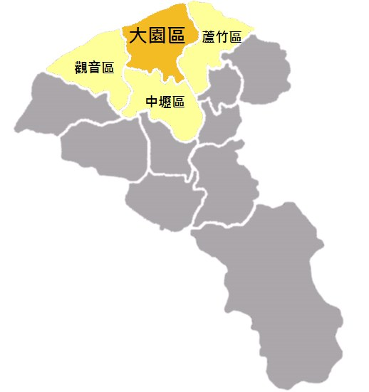
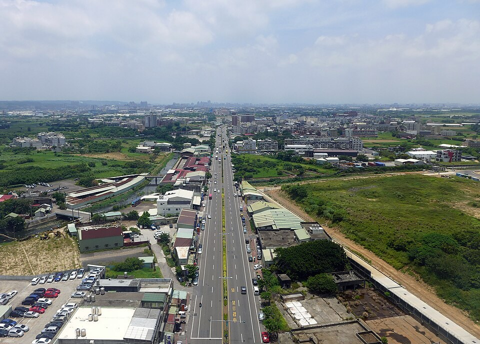
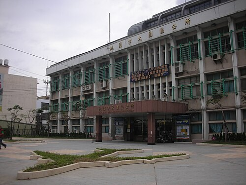
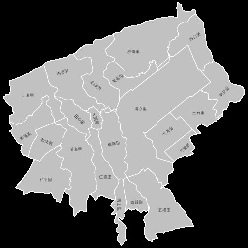
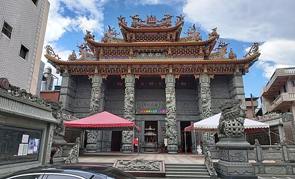
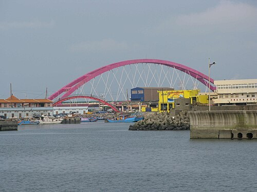
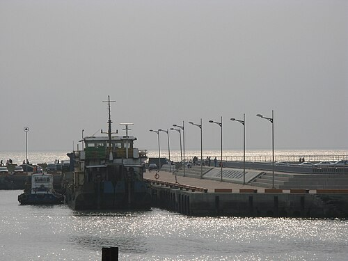
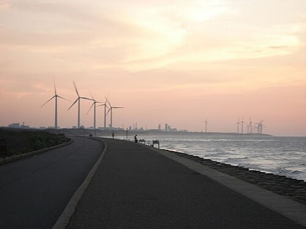

# 大園區

- 原始網址：https://zh.wikipedia.org/wiki/%E5%A4%A7%E5%9C%92%E5%8D%80
- 網站名稱：zh.wikipedia.org
- 作者：維基媒體專案貢獻者
- 發表日期：2005-02-07T12:41:43Z
- 爬取時間：2026-10-29T16:08:50+08:00　取得方式：requests　正文定位：站點規則 #mw-content-text .mw-parser-output
- 圖片：8 張

---

*圖：大園區位置圖｜來源：https://upload.wikimedia.org/wikipedia/commons/8/81/Dayuan_district.png?utm_source=zh.wikipedia.org&utm_campaign=parser&utm_content=thumbnail_unscaled*

| 大園區 Dayuan District 舊稱：大坵園 |  |
|---|---|
| 區 |  |
| 大園區徽 |  |
| 大園區位置圖 |  |
| 坐標： 25°03′N 121°11′E  /  25.05°N 121.18°E |  |
| 國家 | 中華民國 |
| 上級區劃 | 桃園市 |
| 下級區劃 | 22 里 425 鄰 |
| • 區長 | 余誌松 |
| 面積 |  |
| • 總計 | 87.3925平方公里（33.7424平方英里） |
| 海拔 | 31公尺（102英尺） |
| 人口 （2026年7月）（39,241戶） |  |
| • 總計 | 91,294人（10） |
| • 密度 | 1,045人/平方公里（2,706人/平方英里） |
| 時區 | 國家標準時間 （ UTC+08:00 ） |
| 郵遞區號 | 337 |
| 戶政資料代碼 | 68000060 |
| 毗鄰 | 蘆竹區 、 觀音區 、 中壢區 |
| 網站 | www .dayuan .tycg .gov .tw |

| 台灣語言 寫法及拼音 |  |
|---|---|
| 漢字 | 大園區 |
| 注音 | ㄉㄚˋ ㄩㄢˊ ㄑㄩ- |
| 漢語拼音 | Dà Yuán Qū |
| 通用拼音 | Dà Yuán Cyu |
| 台語白話字 | Tōa-hn̂g Khu |
| 台語羅馬字 | Tuā-hn̂g Khu |
| 客語白話字 | Thai-yèn Khî |
| 客羅 | 饒平腔 ：taiˊ vien kiˇ |
| 日語假名 | おおその-く |
| 日語羅馬字 | Ōsono-ku [ 1 ] |

大園區，舊稱「大坵園」，前身「大園鄉」，位於 臺灣 桃園市 西北部，為 桃園國際機場 所在地。全境面積約為87.3925平方公里，人口約有9萬人 [ 2 ]，族群結構上主要為閩南人，客家人則居次 [ 3 ]。

大園區早期原以農業為主要經濟，居民多為務農 [ 4 ]。後隨政府發展工商業，改善投資環境，促進大園區的工業發展與交通建設的推動，且因臺灣北部工業化與都市化的擴展，工業成長迅速 [ 5 ]。而在2010年代左右開始，隨著 桃園市政府 推動 桃園航空城 計畫，成為桃園航空物產西都心的重點發展區域。境內有國巨洋傘文創園區、 橫山書法藝術館 、大園101景觀餐廳等觀光景點。

### 歷史

依據典籍的紀錄，大園鄉境的開墾始於明 永曆 三十五年（1681年） 鄭經 病亡，次子 鄭克塽 即位，並派部將陳絳經略淡水、雞籠（基隆）一帶，以鎮撫土番。並在南崁一帶構築柵欄防守，拓第屯戍。士兵中多有娶原住民婦女為妻，而成為部落。1683年（清 康熙 二二年，明 永曆 三十七年）， 清軍征台，鄭克塽投降。當時桃園縣境地，僅本鄉的 南崁 、許厝兩港，有私渡的 廣東人 、 福建人 和 原住民 貿易，隨即從事拓墾，其他地方仍是一片荒涼之地。

康熙末年，有一群 廣東 嘉應州 人來到此地向土番借租土地，結寨而居，長往來於 竹圍 之南崁港口。每當有船到此地，就購買貨物，與蕃人交易，市利百倍。到了清雍正年間， 福建 漳 、 泉 兩地人民聞風陸續移殖，據居而成村落，順次開闢，南崁即拔仔林一帶，阡陌相連，遂成一片樂土。

清 雍正 三年，福建漳州人郭光天自漳州渡海來台，巡遊北部沿海地區，蔓草荒煙，觸目皆是。但觀察其土地肥沃，於是返回福建呈請准許開墾。總督嘉許其志，於雍正六年（1728年）由同知 尹士俍 率兵丁106名前來驅逐原住民，開始開拓。光天選擇圳頭為中心設館，從事大規模開墾，首先開闢大坵園及許厝港一帶，次而向南往鳳山崎（今新竹縣內之鳳山溪）、洽溪仔、芝芭里、三座屋等地，光天死後（清乾隆十四年），其子等相繼招集內地鄉民族人移往開墾，每開闢一處即給以墾批，付以莊名，如大坵園莊、圳股頭莊、內海墘莊等，而給墾戶（又稱佃戶）居住。

到了清 乾隆 中葉，北部的南崁、竹圍及大坵園一帶，為最先開發，漸至中南部及西部楊梅壢區域。就墾民的籍貫而言：以 閩籍 為最多，閩人當中以漳州、泉州兩府的人最多。 [ 6 ]

### 行政區沿革

大園區在 清朝 雍正 年間屬 淡水廳， 光緒 年間則改為 台北府 淡水縣 、 新竹縣 分轄，其後 日治時期 明治 年間屬 台北縣，後改為 桃園廳， 大正 9年（1920年）為 新竹州 桃園郡 大園庄，1945年 第二次世界大戰 後，改為 新竹縣 桃園區 大園鄉，民國39年（1950年）改為 桃園縣 大園鄉，其後桃園縣於2014年12月25日改制為直轄市，原大園鄉改制為 大園區，同時村改里，目前劃分18里410鄰。

### 地理

*圖：大園區 (2015年)｜來源：https://thumb.wikimedia.org/wikipedia/commons/thumb/3/31/Dayuan_District_201506.jpg/960px-Dayuan_District_201506.jpg?utm_source=zh.wikipedia.org&utm_campaign=parser&utm_content=thumbnail*

大園區位於桃園市轄西北部，鄰近 桃園中壢都會區，東北鄰接蘆竹區，西南與觀音區為界，南連中壢區，西北瀕臨 台灣海峽。地勢自西南向東北傾斜，平均高度約海拔35公尺，區內多為平原、稻田、或是廣闊之平地，西北部則是綿長 沙灘 海岸。一、二、三月時，由於強烈大陸冷氣團的來襲所形成的數波寒流影響，因而潛在著 寒害 的風險，常有數天的低溫比全台平地的月均溫最低的 新北市 淡水區 還要低1至3度不等。

### 人口

| 年份 | 人口 | ±% |
|---|---|---|
| 1946 | 25,477 | — |
| 1951 | 30,741 | +20.7% |
| 1956 | 35,699 | +16.1% |
| 1961 | 41,950 | +17.5% |
| 1966 | 48,413 | +15.4% |
| 1971 | 53,210 | +9.9% |
| 1976 | 51,327 | −3.5% |
| 1981 | 53,550 | +4.3% |
| 1986 | 56,995 | +6.4% |
| 1991 | 61,219 | +7.4% |
| 1996 | 72,138 | +17.8% |
| 2001 | 78,163 | +8.4% |
| 2006 | 79,354 | +1.5% |
| 2011 | 82,136 | +3.5% |
| 2016 | 87,158 | +6.1% |
| 2021 | 92,172 | +5.8% |
| 來源： 大園鄉誌編纂委員會 1978，第123－124頁，第四篇·人民 鄭明枝 2010，第167－168頁，第三篇·人民 內政部統計月報-各鄉鎮市區人口數 . 內政部 . [ 2019-12-19 ] . （ 原始內容 存檔於2021-06-23）. |  |  |

根據桃園市政府民政局及桃園市大園區戶政事務所統計，2025年底大園區戶數約3.8萬戶，人口約9萬人 [ 2 ]，區內人口最多與最少的里分別是南港里與大海里，2025年底兩里人口分別為11,453人與799人，其中南港里也是桃園市人口第七大里 [ 7 ]。自2021年11月起，桃園市政府開始執行桃園航空城的計劃，竹圍里、海口里、沙崙里、後厝里及圳頭里等五里受到土地徵收之影響，以致戶籍人口大幅遷出 [ 8 ]。

### 政治

#### 歷任首長

##### 鄉長

| 任次 | 姓名 | 備註 |
|---|---|---|
| 1 | 李木秀 |  |
| 2 |  |  |
| 3 |  |  |
| 4 | 黃仲秋 |  |
| 5 |  |  |
| 6 | 張茂松 |  |
| 7 |  |  |
| 8 | 林清松 |  |
| 9 | 李金吉 |  |
| 10 | 楊英俊 |  |
| 11 | 陳秋霖 |  |
| 12 | 劉春生 | 中國國民黨 |
| 13 |  |  |
| 14 | 張建隆 |  |
| 15 |  |  |
| 16 | 呂水田 | 末任民選鄉長 中國國民黨 |

##### 區長（指派）

| 任次 | 姓名 | 任職期間 | 備註 |
|---|---|---|---|
| 1 | 呂水田 | 2014年12月25日～2018年12月24日 | 續任；首屆區長，任期屆滿 中國國民黨 |
| 2 | 徐藍科 | 2018年12月25日～2023年7月14日 | 市長指派，原蘆竹區公所主任秘書 |
| 3 | 余誌松 | 2023年7月14日～現任 | 市長指派，原平鎮區公所主任秘書 |

#### 區政組織

*圖：大園區公所｜來源：https://thumb.wikimedia.org/wikipedia/commons/thumb/6/6e/Dayuan_District_Office.jpg/500px-Dayuan_District_Office.jpg?utm_source=zh.wikipedia.org&utm_campaign=parser&utm_content=thumbnail*

大園 區公所 是 桃園市政府 在大園區的派出機關，在中華民國政府架構中為市政府綜理區政的執行機關，上級業務監督機關為桃園市政府。 區長 由 市長 任命，其任期為無任期保障。在區長及主任秘書之下，設有5課4室等9個內部單位 [ 9 ]。大園區為 桃園市議會 第五選區，在市議會的63席市議員中，大園區共選出2席區域市議員（不含平地原住民與山地原住民議員） [ 10 ]。

#### 行政區

*圖：大園區行政區域圖｜來源：https://thumb.wikimedia.org/wikipedia/commons/thumb/7/7b/Dayuan_villages_%2820260301%29.svg/500px-Dayuan_villages_%2820260301%29.svg.png?utm_source=zh.wikipedia.org&utm_campaign=parser&utm_content=thumbnail*

現今大園區行政範圍的確立，來自於1920年，日本將臺灣十二廳改為五州二廳，設大園庄屬新竹州桃園區 [ 11 ] : 232－233。大園庄轄大園、田心子、照鏡、橫山、雙溪口、埔心、五塊厝、內海墘、許厝港、大牛稠、沙崙、圳股頭、竹圍等13個大字 [ 12 ]。1946年2月，改為「大園鄉」，屬新竹縣桃園區。1947年，裁撤桃園區署，大園鄉改直隸於新竹縣。1950年，調整行政區域，大園鄉改隸新成立的桃園縣 [ 11 ] : 233。2014年12月25日，桃園縣改制為直轄市，大園鄉改制為市轄區「大園區」，隸屬桃園市。大園區的行政區劃轄有大園里、大海里、田心里、後厝里、溪海里、五權里、橫峰里、青山里、青峰里、和平里、內海里、南港里、圳頭里、 埔心里 、 竹圍里 、 北港里 、沙崙里、三石里、菓林里、海口里等22個里 [ 13 ]，共計428鄰 [ 7 ]。

#### 立法委員選舉區

- 桃園市第二選舉區

### 教育

大園區現有公私立高級中等學校二所，分別為 桃園市立大園國際高級中等學校 、 桃園市私立大興高級中學。其他公立教育機構計有 桃園市立大園國民中學 、 桃園市立竹圍國民中學 等二所國民中學，桃園市大園區大園國民小學、桃園市大園區內海國民小學、桃園市大園區五權國民小學、桃園市大園區竹圍國民小學、桃園市大園區埔心國民小學、桃園市大園區菓林國民小學、桃園市大園區溪海國民小學、桃園市大園區潮音國民小學等八所國民小學。原有桃園市大園區陳康國民小學、桃園市大園區圳頭國民小學、桃園市大園區後厝國民小學、桃園市大園區沙崙國民小學等四所國民小學，已於2024年裁撤停辦。

### 交通

#### 航空

- 臺灣桃園國際機場

#### 捷運

桃園捷運

- 桃園機場捷運 ： 機場第一航廈站 - 機場第二航廈站 - 機場旅館站 - 大園站 - 橫山站 - 領航站

#### 客運

- 桃園客運大園站
- 桃園客運竹圍站
- 亞通客運 竹圍站
- 統聯客運 大園站

#### 自行車租賃系統

- 桃園市公共自行車租賃系統 至2018年4月，在大園區設有8站： 捷運大園站(A15) 捷運領航站(A17) 大園國際高中 老街溪停車場 華興池 大中華幼兒園 桃禧航空城酒店 大園國中

#### 公路

- 國道二號（桃園內環線） 0 機場端 機場端 1 大園 大園交流道
- 大園支線 0 圳頭 圳頭交流道 2 大園 大園交流道
- 台61線 ：西濱快速公路 24 沙崙 沙崙交流道 29 大園 大園交流道
- 台4線
- 台15線 ：西濱公路
- 台31線 ：高鐵橋下桃園段道路
- 市道110號
- 市道110甲號
- 市道113號

#### 主要道路

- 大觀路：於1973年設立，為大園區與 觀音區 間的交通要道之一，後半段原為「許厝港」，2009年6月15日起許厝港地區整編為大觀路的後半段。 [ 14 ]

#### 捷運（計畫中）

- 桃園機場捷運 ： 機場第三航廈站 （興建中）
- 綠線 （興建中）： 菓林站 ； G16站 – G17站 – G18站 – 橫山站

### 醫療院所

| 名稱 | 醫療劃分 | 地址 | 電話 |
|---|---|---|---|
| 敏盛醫院 | 地區醫院 | 桃園市 大園區華中街2號 | (03)386-7521 |
| 居善醫院 | 地區醫院 | 桃園市 大園區南港里大觀路910號 | (03)386-6511 |
| 聯新國際醫院 桃園國際機場醫療中心 | 區域醫院 | 桃園市 大園區航站南路9號 | (03)398-3456 |

### 旅遊

*圖：大園仁壽宮｜來源：https://thumb.wikimedia.org/wikipedia/commons/thumb/a/ac/Dayuan_Renshou_Temple_20240611.jpg/500px-Dayuan_Renshou_Temple_20240611.jpg?utm_source=zh.wikipedia.org&utm_campaign=parser&utm_content=thumbnail*

*圖：大園竹圍港附近的彩虹橋｜來源：https://thumb.wikimedia.org/wikipedia/commons/thumb/1/1a/Chuwei_Rainbow_Hongqiao.jpg/500px-Chuwei_Rainbow_Hongqiao.jpg?utm_source=zh.wikipedia.org&utm_campaign=parser&utm_content=thumbnail*

*圖：竹圍港碼頭與停泊的船隻｜來源：https://thumb.wikimedia.org/wikipedia/commons/thumb/1/1a/Chuwei_port-2.jpg/500px-Chuwei_port-2.jpg?utm_source=zh.wikipedia.org&utm_campaign=parser&utm_content=thumbnail*

*圖：內海長堤｜來源：https://thumb.wikimedia.org/wikipedia/commons/thumb/6/6d/TAYAUN_NAHIE_BEACH.jpg/500px-TAYAUN_NAHIE_BEACH.jpg?utm_source=zh.wikipedia.org&utm_campaign=parser&utm_content=thumbnail*

- 桃園國際機場公司航空科學館
- 奇跡咖飛場 ：1998年2月16日， 中華航空676號班機 墜毀於此，屋主受災後改建為露天咖啡廳。
- 第三航廈咖啡廳
- 瑞奇牧場
- 大園仁壽宮 ：創建於清道光18年（1838年），地方習稱「大園大廟」，為當地重要的信仰中心，與竹圍福海宮並列為「大園雙廟」。
- 竹圍福海宮 ：創建於清咸豐四年（1854年），地方習稱「竹圍王公廟」，為大園區重要的信仰中心之一，與大園仁壽宮並列為「大園雙廟」。
- 桃園國際機場福德宮 ：位於圳頭里，合祀因興建桃園國際機場而被迫拆遷的三十六尊土地神。
- 貴文宮 ：位於內海里的 王爺廟，祭祀王爺千歲信仰少見的「九府王爺」。
- 富文宮：主祀雷溫蘇 三府王爺。
- 福忠宮：主祀 池府王爺。
- 仁德宮：主祀 天上聖母。
- 五塊厝五福宮：位於五權里，主祀 開漳聖王。
- 乾元宮：主祀雷溫蘇 三府王爺。
- 大園埔心福隆宮 ：主祀 開漳聖王。
- 埔心護天宮：主祀 女媧娘娘。
- 埔心派出所百年老榕樹
- 聖威宮：主祀通天元帥。
- 沙崙里保安宮：主祀 廣澤尊王。
- 沙崙濟聖宮：主祀 濟公禪師。
- 菓林紫竹林觀音寺：主祀 觀音菩薩，係由林口竹林山寺迎奉而來，亦為竹林山寺分寺。
- 雲部準提佛母殿：主祀雲部地藏王菩薩。
- 下厝福德祠
- 同善祠
- 地藏殿
- 竹圍漁港
- 竹圍彩虹橋
- 竹圍漁港遊憩區
- 許厝港濕地
- 內海長堤
- 草漯沙丘地質公園

### 相關條目

- 大園庄

### 注釋

### 參考資料

引用來源

- ↑ 大園鄉誌編纂委員會. 第四篇·人民. 《大園鄉志》. 桃園縣: 桃園縣大園鄉公所. 1978 （中文（臺灣）） . 引用錯誤：在 <references> 標籤中name屬性為「鄉志人民」的參考文獻沒有在文中使用
- ^ 葉高華. 1920年地名大變革 (PDF) . 國立臺灣圖書館. [ 2023-01-22 ] . （原始內容 存檔 (PDF) 於2022-12-25） （中文（臺灣）） .
- ^ 2.0 2.1 人口統計 . 桃園市政府民政局. [ 2020-06-28 ] . （原始內容 存檔 於2021-01-12） （中文（臺灣）） .
- ^ 吳秋蘭. 大園區福佬客族群影響之研究 (PDF) (報告). 客家委員會: 1. 2016年11月 [ 2024-12-24 ] （中文（臺灣）） .
- ^ 施添福 2009，第396頁.
- ^ 施添福 2009，第397－398頁.
- ^ 大園國中 黃淑潔老師. 特別企劃--大園風土歷程 . [ 2021-06-06 ] . （原始內容 存檔 於2021-06-06） （中文（臺灣）） .
- ^ 7.0 7.1 業務資訊-統計資訊-人口統計-歷年各里人口戶數統計 . 桃園市大園區戶政事務所. [ 2020-06-28 ] . （原始內容 存檔 於2022-12-03） （中文（臺灣）） .
- ^ 曾增勳. 大園5里整併 明年仍要選里長 . 聯合新聞網. 2021-09-06 [ 2022-04-03 ] . （ 原始內容 存檔於2022-04-20） （中文（臺灣）） .
- ^ 大園區介紹-本所組織介紹-組織架構圖 . 桃園市政府大園區公所. [ 2021-09-26 ] . （ 原始內容 存檔於2021-01-12） （中文（臺灣）） .
- ^ 議員介紹-本屆議員-第五選區 大園區 . 桃園市議會. [ 2021-09-26 ] . （ 原始內容 存檔於2022-03-19） （中文（臺灣）） .
- ^ 11.0 11.1 大園鄉誌編纂委員會. 第五篇·政事. 《大園鄉志》. 桃園縣: 桃園縣大園鄉公所. 1978 （中文（臺灣）） .
- ^ 施添福 2009，第398－399頁.
- ^ 大園區介紹-認識本區-行政區域圖 . 桃園市政府大園區公所. [ 2022-10-28 ] . （原始內容 存檔 於2022-10-28） （中文（臺灣）） .
- ^ 村里街路門牌查詢 . [ 2019-12-19 ] . （原始內容 存檔 於2018-12-30）.

書籍

- 大園鄉誌編纂委員會. 《大園鄉志》. 桃園縣: 桃園縣大園鄉公所. 1978 （中文（臺灣）） .
- 大園鄉鄉誌續編編纂委員會. 《大園鄉志續篇（一）》. 桃園縣: 桃園縣大園鄉公所. 1993 （中文（臺灣）） .
- 施添福等編纂. 第十五章·大園鄉. 《臺灣地名辭書》. 卷十五·桃園縣（下）. 南投縣: 國史館臺灣文獻館. 2009. ISBN 978-986-02-4388-8 （中文（臺灣）） .
- 鄭明枝等編纂. 《大園鄉志續篇（二）》. 桃園縣: 桃園縣大園鄉公所. 2010. ISBN 978-986-02-2127-5 （中文（臺灣）） .

### 外部連結

- 大園區公所 （ 頁面存檔備份，存於 網際網路檔案館 ） （繁體中文）

25°3′45.52″N 121°11′52.32″E  /  25.0626444°N 121.1978667°E
