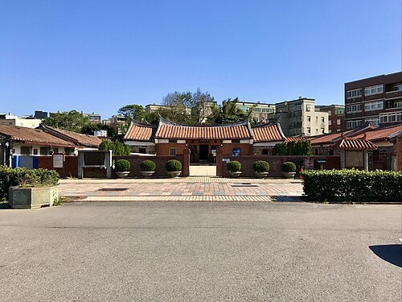
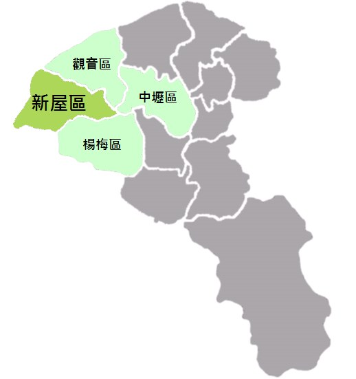
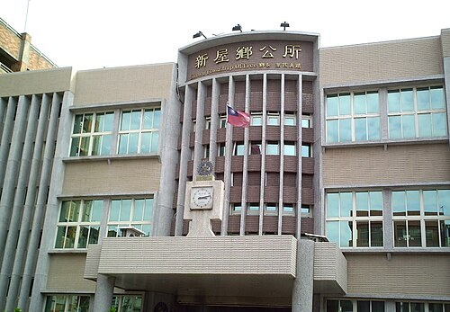
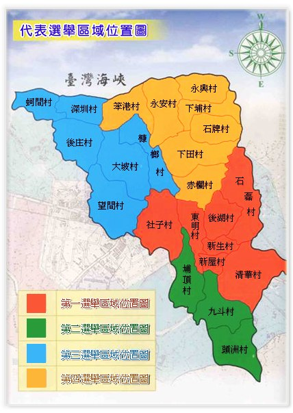
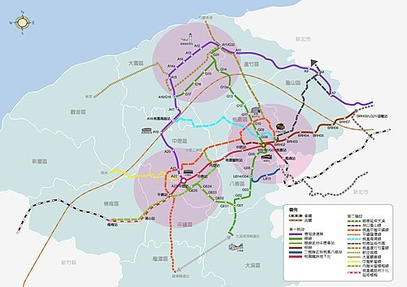
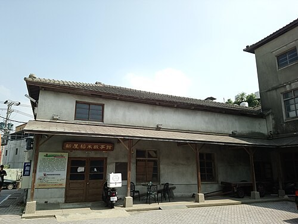

# 新屋區

- 原始網址：https://zh.wikipedia.org/wiki/%E6%96%B0%E5%B1%8B%E5%8D%80
- 網站名稱：zh.wikipedia.org
- 作者：維基媒體專案貢獻者
- 發表日期：2005-02-06T10:07:10Z
- 爬取時間：2026-10-29T16:09:40+08:00　取得方式：requests　正文定位：站點規則 #mw-content-text .mw-parser-output
- 圖片：6 張

---
24°58′17.78″N 121°6′17.61″E  /  24.9716056°N 121.1048917°E

*圖：新屋范姜祖堂｜來源：https://thumb.wikimedia.org/wikipedia/commons/thumb/0/0d/%E6%96%B0%E5%B1%8B%E8%8C%83%E5%A7%9C%E7%A5%96%E5%A0%82%E9%81%A0%E7%85%A7.jpg/500px-%E6%96%B0%E5%B1%8B%E8%8C%83%E5%A7%9C%E7%A5%96%E5%A0%82%E9%81%A0%E7%85%A7.jpg?utm_source=zh.wikipedia.org&utm_campaign=parser&utm_content=thumbnail*

*圖：新屋區位置圖｜來源：https://upload.wikimedia.org/wikipedia/commons/f/f6/Xinwu_district.png?utm_source=zh.wikipedia.org&utm_campaign=parser&utm_content=thumbnail_unscaled*

| 新屋區 Xinwu District |  |
|---|---|
| 區 |  |
| 新屋范姜祖堂 |  |
| 新屋區位置圖 |  |
| 坐標： 25°00′N 121°06′E  /  25°N 121.1°E |  |
| 國家 | 中華民國 |
| 上級區劃 | 桃園市 |
| 下級區劃 | 23 里 270 鄰 |
| • 區長 | 鄭詩鈿 |
| 面積 |  |
| • 總計 | 85.0166平方公里（32.8251平方英里） |
| 海拔 | 51公尺（167英尺） |
| 人口 （2026年7月）（20,299戶） |  |
| • 總計 | 49,788人（桃園市的第12位） |
| • 密度 | 586人/平方公里（1,517人/平方英里） |
| 時區 | 國家標準時間 （ UTC+08:00 ） |
| 郵遞區號 | 327 |
| 戶政資料代碼 | 68000110 |
| 毗鄰 | 觀音區 、 中壢區 、 楊梅區 ； 臺灣省 （ 新竹縣 新豐鄉 、 湖口鄉 ） |
| 網站 | www .xinwu .tycg .gov .tw |

新屋區 （ 海陸腔 客家語拼音 ： sinˋ vug kiˋ ； 臺羅 ： Sin-ok-khu ），前身「新屋鄉」，位於 臺灣 桃園市 西端，東北方臨 觀音區 、 中壢區，東南方臨 楊梅區，西南邊與 臺灣省 新竹縣 新豐鄉 相臨，西濱 臺灣海峽，為典型的農業鄉。全境耕地面積廣大，並有半數以上人口從事農業，水稻為主要作物，是 北臺灣地區 的重要稻米產區。在桃園市國土計畫草案中屬於鄉村發展區域，產業功能主要為農業發展地區第一類 [ 1 ]。

境內居民主要為 客家 族群，客家人比例約佔全區人口的88%左右 [ 2 ]，2011年 行政院客家委員會 公告新屋區為 臺灣客家文化重點發展區。當地主要姓氏有 徐 、 黃 、 葉 、 姜 、 羅 、 陳 等。此外新屋區也是 范姜 姓氏的起源地。

### 歷史

#### 地名由來

清初 乾隆 年間，范姜一氏來臺拓墾，取得墾照，建立「 姜勝本 」墾號後，逐步向內地開拓廣大土地：南以 社子溪 為界，東至 營盤腳 （今楊梅區上田里），西抵 石牌嶺 （今新屋區石牌里），北達 大堀坑 （今觀音區大堀里）。經過百餘年的努力，范姜一族不但使荒野變田園，而且吸引了拓荒者遷入此地。

在范姜先祖胼手胝足，耕墾得法之下，范姜家族短短數年已有田產處處。開墾有成的范姜族人於 咸豐 四年（西元1854年）興建祖堂，其後陸續起造不少新屋，當地人引為盛事，以 客語 稱其為「起新屋」。因此「新屋」便成為當地的地名，沿用至今。鄰近的 閩南人，因臺灣話較常使用「厝」字指稱房舍，故稱新屋為 新厝仔 （sin-chhù-á）。

「新屋」一名，來自於范姜公廳新建時，其嶄新的建築，使該地得名。五棟范姜老屋群 [ 3 ] 中的 范姜公廳，於1985年8月19日經內政部評定為第三級 古蹟，是新屋區最珍貴之古宅（註： 客語 「公廳」指祭拜祖先的 祠堂 ）。區內詳細地名由來可參見《新屋鄉志·拓墾篇》 [ 4 ] [ 5 ]。

#### 沿革

1895年4月17日，清日簽訂〈 馬關條約 〉， 將臺灣、澎湖群島割讓給日本 ；6月28日，臺灣改設3縣1廳，新屋隸屬 臺北縣 新竹支廳竹北二堡。1897年，改為6縣3廳，屬 新竹縣 新埔辦務署 [ 6 ] : 687。1898年，改為3縣3廳，屬臺北縣新埔辦務署楊梅壢支廳。1899年裁併新埔辦務署，新屋改隸臺北縣桃仔園辦務署楊梅壢支廳。1901年11月9日，全臺設20廳，新屋隸屬 桃仔園廳 楊梅壢支廳第19區、第20區 [ 6 ] : 688。1905年3月29日，桃仔園廳改名桃園廳 [ 6 ] : 689。1909年10月23日，全臺20廳改設12廳，新屋一部分屬大坡區，一部分屬新屋區 [ 6 ] : 690。1920年10月1日，廢廳設州，州下設郡、市，郡下設街、庄， 新屋庄 屬 新竹州 中壢郡。新屋庄轄犁頭洲、九斗、上青埔、北勢、石磊子、新屋、東勢、埔頂、社子、番婆坟、十五間、大坡、后庄、蚵殼港、笨子港、槺榔、下田心子、崁頭厝、大牛欄、石牌嶺等20個大字 [ 6 ] : 692。

戰後 1945年12月27日，改5州3廳為8縣，隸屬 新竹縣 中壢區新屋鄉 [ 6 ] : 698。1946年10月，新屋鄉公所正式成立 [ 6 ] : 699。1950年10月25日，調整行政區域，新屋鄉改隸 桃園縣 [ 6 ] : 701。1959年2月2日，崁頭村因諧音與臺語「砍頭」近似，改名「永安村」 [ 6 ] : 706－707。1974年12月1日，大欄村改名「永興村」 [ 6 ] : 712。1983年8月8日，平均村改名「清華村」 [ 6 ] : 715。2014年12月25日，因應桃園縣改制為直轄市，新屋鄉改為「新屋區」 [ 7 ]。

### 地理

#### 地形

新屋區位於桃園市西端，西臨 臺灣海峽，東毗 中壢區，北接 觀音區，東南與南鄰 楊梅區 及 臺灣省 新竹縣 湖口鄉 、 新豐鄉。全區東西長約18.5公里，南北寬約9.2公里，土地面積約85平方公里，佔全市土地總面積的6.96% [ 8 ] : 51。全區地勢為自東緣交界的楊梅地區向西漸緩傾斜至臺灣海峽的平地，整體地形呈現斜三角形狀，北端窄而南半部寬，海拔高度介於5至100公尺間。新屋區地形由東至西大致可分為三個地形區，一為東側的臺地丘陵區，一為中部的沖積平原區，一為西部的海岸砂丘區 [ 8 ] : 54－55。

#### 氣候

新屋區位於 北回歸線 以北，氣候屬於潮濕 副熱帶季風 型，夏季高溫，冬季寒冷潮濕，由於該區西面濱臨海域且境內缺乏山嶺屏障的緣故，故夏季相較於鄰近的楊梅、中壢兩區稍顯溫和涼爽，然有時可能會受到颱風（主要為由東往西移動者）造成過山沉降的效應影響，而出現全臺灣最高溫 [ 9 ] [ 10 ] ；冬季時則因有東北季風侵襲，全境氣溫驟降，加上 輻射冷卻 的影響，常出現全臺灣平地最低溫 [ 11 ] [ 8 ] : 58－59。新屋區冬季的月均溫介於攝氏15至18度之間，春季後逐漸回暖，至夏秋兩季處暑期間，月均溫達到攝氏24至29度。年均溫約攝氏22.2度，月均溫最高為7月的28.8度，最低為1月的攝氏15.1度 [ 8 ] : 59－60。年平均降雨量約達1,500毫米，6月雨量最多，10月最少 [ 8 ] : 60。因風力可位居全台首位，也吸引風力發電廠的設立 [ 12 ]，2016年梅雨季曾創下單日全台灣最多雨量的紀錄 [ 13 ]。

#### 人口

| 年份 | 人口 | ±% |
|---|---|---|
| 1951 | 31,429 | — |
| 1956 | 34,894 | +11.0% |
| 1961 | 39,381 | +12.9% |
| 1966 | 43,807 | +11.2% |
| 1971 | 46,534 | +6.2% |
| 1976 | 47,154 | +1.3% |
| 1981 | 46,080 | −2.3% |
| 1986 | 45,050 | −2.2% |
| 1991 | 45,750 | +1.6% |
| 1996 | 48,998 | +7.1% |
| 2001 | 49,131 | +0.3% |
| 2006 | 49,844 | +1.5% |
| 2011 | 48,652 | −2.4% |
| 2016 | 48,772 | +0.2% |
| 2021 | 49,094 | +0.7% |
| 來源： 新屋區歷年人口數統計表 (PDF) . 桃園市新屋區戶政事務所. 2020-05-08 [ 2021-03-26 ] . （原始內容 存檔 (PDF) 於2021-05-19） （中文（臺灣）） . 內政部統計月報-各鄉鎮市區人口數 . 內政部 . [ 2019-12-19 ] . （原始內容 存檔 於2021-06-23）. |  |  |

根據新屋區戶政事務所及桃園市政府民政局人口統計，2025年底新屋區戶數約2萬戶，人口約5萬人，為桃園市平地地區人口最少的行政區，男女性人數分別約是2.6萬人與2.4萬人，性別比約為111.58%，是桃園市性別比最高的行政區。區內人口最多與最少的里分別是頭洲里與深圳里，2025年底兩里人口分別為6,121人與655人，其中深圳里也是桃園市人口最少的里 [ 14 ] [ 15 ]。

新屋區的 人口老化 與 少子化 問題嚴重，由於發展緩慢，且土地主要仍為農業區，年輕人口不斷外流 [ 16 ]。2025年底時，新屋區人口中0至14歲人口佔比約為10.79%，15至64歲人口佔比約為67.74%，65歲以上人口佔比約為21.47%，老化指數約為198.96%，是桃園市青壯年人口佔比最低、人口老化程度最高的行政區，也是桃園市唯一已進入超高齡社會的行政區 [ 17 ]。

### 政治

#### 歷任首長

##### 鄉長

| 任次 | 姓名 | 備註 |
|---|---|---|
| 1 | 范姜德 |  |
| 2 | 范姜德 |  |
| 3 | 徐阿職 |  |
| 4 | 范姜新鱉 |  |
| 5 | 黃禮醮 |  |
| 6 | 黃禮醮 |  |
| 7 | 姜仁平 |  |
| 8 | 姜仁平 |  |
| 9 | 葉倫境 |  |
| 10 | 葉倫境 |  |
| 11 | 黃水銀 |  |
| 12 | 陳江順 |  |
| 13 | 陳江順 |  |
| 14 | 葉佐禹 |  |
| 15 | 葉佐禹 |  |
| 16 | 徐同治 | 末任民選鄉長 |

##### 區長（指派）

| 任次 | 姓名 | 任職期間 | 備註 |
|---|---|---|---|
| 1 | 徐同治 | 2014年12月25日～2018年12月24日 | 續任；首屆區長，任期屆滿 |
| 2 | 姜義坤 | 2018年12月25日～2022年12月24日 | 市長指派，原平鎮區長，回任參議 |
| 3 | 鄭詩鈿 | 2022年12月25日～現任 | 市長指派，原中壢區長 |

#### 區政組織

*圖：2010年9月底的新屋鄉公所（現已改制為新屋區公所）｜來源：https://thumb.wikimedia.org/wikipedia/commons/thumb/f/f2/Sinwu_Township_Office_front_view_20100929.jpg/500px-Sinwu_Township_Office_front_view_20100929.jpg?utm_source=zh.wikipedia.org&utm_campaign=parser&utm_content=thumbnail*

新屋區公所 是 桃園市政府 在新屋區的派出機關，在中華民國政府架構中為市政府綜理區政的執行機關，上級業務監督機關為桃園市政府。 區長 由 市長 任命，其任期為無任期保障。在區長及主任秘書之下，設有5課4室等9個內部單位 [ 18 ]。新屋區為 桃園市議會 第十一選區，在市議會的63席市議員中，新屋區共選出1席區域市議員（不含平地原住民與山地原住民議員） [ 19 ]。

#### 行政區

現今新屋區行政範圍的確立，來自於1920年，日本將臺灣十二廳改為五州二廳，設新屋庄屬新竹州中壢郡。新屋庄轄犁頭洲、九斗、上青埔、北勢、石磊子、新屋、東勢、埔頂、社子、番婆坟、十五間、大坡、后庄、蚵殼港、笨子港、槺榔、下田心子、崁頭厝、大牛欄、石牌嶺等20個大字 [ 20 ] : 220。1945年12月27日，改為「新屋鄉」，屬新竹縣中壢區 [ 20 ] : 228。1950年，調整行政區域並裁撤區署，新屋鄉改隸新成立的桃園縣 [ 20 ] : 230。2014年12月25日，桃園縣改制為直轄市，新屋鄉改制為市轄區「新屋區」，隸屬桃園市 [ 7 ]。

新屋區共轄23 里 [ 21 ]，依原新屋鄉代表會選舉區可區分為四個次分區：

*圖：改制前的新屋鄉行政區劃｜來源：https://upload.wikimedia.org/wikipedia/commons/e/e0/Simwu_secondary_partition.jpg?utm_source=zh.wikipedia.org&utm_campaign=parser&utm_content=thumbnail_unscaled*

| 次分區 | 里名 |  |  |  |  |  |  |  |
|---|---|---|---|---|---|---|---|---|
|  | 新屋區 | 新屋里 | 新生里 | 後湖里 | 清華里 | 社子里 | 東明里 | 石磊里 |
|  | 永安區 | 下埔里 | 下田里 | 石牌里 | 赤欄里 | 永興里 | 永安里 | 笨港里 |
|  | 大坡區 | 深圳里 | 蚵間里 | 槺榔里 | 後庄里 | 大坡里 | 望間里 |  |
|  | 頭洲區 | 頭洲里 | 埔頂里 | 九斗里 |  |  |  |  |

新屋都市計畫區 範圍包含新生、新屋兩里。 頭洲都市計畫區 由於毗鄰 中壢區，故被劃為 中壢都會區都市計畫區 的一部分。

#### 警政消防機關

警政

- 桃園市政府警察局 楊梅分局 新屋分駐所 永安派出所 大坡派出所 頭洲派出所

消防

- 桃園市政府消防局 第二大隊 新屋分隊 永安分隊

### 文化

#### 地方語言

新屋的本土語言雖以 臺灣客家語 海陸腔為主，但西南角蚵間里為臺灣西部臺語泉腔的最北端的分布區，此外，新屋地區存在許多 方言島，如 大牛欄 地區有漳腔臺語（類似於 海陸豐話，有受 潮州話 以及 海陸客語 影響），而石磊里西部有 水流軍話 等。 [ 22 ] [ 23 ] [ 24 ]

#### 石滬文化

2015年，桃園市政府首次舉辦石滬文化節，活動地點在綠色隧道南端點忘憂門廣場，在桃園市長鄭文燦的帶領下奠下第一塊基石，完成第一波重建石滬奠基行動。石滬是先民捕魚的方式，外島的 澎湖石滬 出名已久，而在台灣本島最多石滬群的地方就在新屋區，已有300多年的歷史。 [ 25 ] [ 26 ] [ 27 ]

#### 牽罟文化

2016年， 桃園市政府客家事務局 在 永安漁港 笨港灣 重現先民智慧捕魚的「 牽罟 文化」，重現先民利用 舢舨 將 曳地網 撒到海裡，魚群被圍住後，再由沙灘上的人力將漁網拉上岸的作業模式。2020年6月，海洋客家牽罟文化館（因其建築形體，常稱作「海螺館」）開幕。 [ 28 ] [ 29 ]

#### 廟宇

- 新屋天后宮 ：於1826年創立，乃 北港朝天宮 分靈廟。有全台灣最高的青銅媽祖神像新建完成，高一百台尺，重達120噸。守護著台灣海峽海域。
- 貝殼伯公廟
- 長祥宮 ：有目前全台灣最高的 神農大帝 青銅像，每逢假日會有許多香客前來進香祭拜，是新屋地區重要的信仰中心之一。
- 新屋福興宮 ：主祀七夫人媽，於1900年改建磚牆建築。位在自行車道終點，名氣漸為人知。
- 蚵殼港昭靈宮 ：主祀七夫人媽，廟名乃得名自光緒年間輪值主辦送王船的泉州府廟宇之名。
- 十五王公廟 ：是位於臺灣桃園市新屋區蚵間里的 陰廟，祭祀十五位海難者。
- 新屋永安保生宮
- 新屋八路財神廟
- 深圳玄天宮
- 玉皇大帝宮
- 八卦祖師廟
- 大坡路地藏寺
- 北龍代天府
- 三福宮
- 新屋廣濟堂
- 范姜觀音寺

#### 文化資產

- 新屋區農會倉庫 （含稻米博物館）
- 新屋范姜祖堂

### 教育

#### 高級中等學校

- 桃園市立新屋高級中等學校
- 桃園市私立清華高級中學

#### 國民中學

- 桃園市立新屋高級中等學校國中部
- 桃園市永安實驗中學
- 桃園市立大坡國民中學
- 桃園市私立清華高級中學國中部

#### 國民小學

- 桃園市新屋區新屋國民小學
- 桃園市新屋區啟文國民小學
- 桃園市新屋區東明國民小學
- 桃園市新屋區頭洲國民小學
- 桃園市新屋區永安國民小學
- 桃園市新屋區笨港國民小學
- 桃園市新屋區北湖國民小學
- 桃園市新屋區大坡國民小學
- 桃園市新屋區蚵間國民小學
- 桃園市新屋區社子國民小學
- 桃園市新屋區埔頂國民小學

### 交通

#### 省道

- 台15線 ：西濱公路
- 台31線 ： 高鐵 橋下桃園段道路
- 台61線 ：西濱快速公路 47 永安 永安交流道
- 台66線 ：東西向快速公路—觀音大溪線 10 新屋 新屋交流道 13 新屋一 新屋一交流道

#### 市道

- 市道114號 ：中山西路一段部分路段，因道路兩側住戶對道路中心線有爭議而無法徵收拓寬，導致車道縮減，車禍頻傳。 [ 30 ] [ 31 ] [ 32 ]
- 市道115號 ：觀音區－新屋區－楊梅區－ 新竹縣 新埔鎮 ㄧ 新竹縣 芎林鄉

#### 外環道

- 三民路：

#### 公車

##### 桃園市市區公車

- 桃園客運 5027B 新屋-後湖 5027C 新屋-後湖（繞駛永安漁港） 5031A 新屋-蚵間里福興宮 5032 中壢－石磊－石橋－觀音（經過嶺、新屋） 5033 中壢－保生－觀音（經過嶺、新屋） 5035 中壢－新屋（經過嶺） 5039 中壢－崁觀（經新屋、永安漁港、觀音）
- 捷乘客運 5028 新屋－下北湖
- 亞通客運 5649 龍潭－埔心－楊梅－新屋 5650B 新屋-楊梅 5654 中壢－埔心－楊梅－新屋

##### 桃園市樂活巴免費公車

| 編號 | 路線名／起訖站 | 經營業者 | 備註 |
|---|---|---|---|
| L601 | 新屋一線 | 桃園客運 | 新屋區公所－富岡火車站 |
| L602 | 新屋二甲線 | 桃園客運 | 富岡火車站－蚵間，部分車次行經永安漁港 |
| L603 | 新屋二乙線 | 桃園客運 | 富岡火車站－蚵間，部分車次行經永安漁港 |
| L605 | 高鐵線 | 桃園客運 | 新屋區公所－高鐵桃園站 |
| L605A | 高鐵線（延駛長庚醫院） | 桃園客運 | 新屋區公所－高鐵桃園站－林口長庚醫院 |
| L617 | 東明大坡線 | 桃園客運 | 新榮路82巷口－新屋區公所－蚵間里福興宮 |

#### 軌道運輸

新屋區無鐵路經過，居民多前往 楊梅區 之 富岡車站 搭乘。

*圖：桃園捷運路網2.0｜來源：https://thumb.wikimedia.org/wikipedia/commons/thumb/6/6b/Taoyuan_MRT_2.0.jpg/500px-Taoyuan_MRT_2.0.jpg?utm_source=zh.wikipedia.org&utm_campaign=parser&utm_content=thumbnail*

遠期則有 桃園捷運 中壢新屋線，以 輕軌 系統規劃，從 桃園機場捷運 A22 老街溪站 經 過嶺 至 頭洲。 [ 33 ] [ 34 ]

### 醫療

| 名稱 | 醫療劃分 | 地址 | 電話 |
|---|---|---|---|
| 衛生福利部桃園醫院新屋分院 | 地區醫院 | 桃園市新屋區新褔二路6號 | (03)497-1989 |

### 觀光

*圖：新屋稻米故事館｜來源：https://thumb.wikimedia.org/wikipedia/commons/thumb/c/c8/%E6%96%B0%E5%B1%8B%E7%A8%BB%E7%B1%B3%E6%95%85%E4%BA%8B%E9%A4%A8.jpg/500px-%E6%96%B0%E5%B1%8B%E7%A8%BB%E7%B1%B3%E6%95%85%E4%BA%8B%E9%A4%A8.jpg?utm_source=zh.wikipedia.org&utm_campaign=parser&utm_content=thumbnail*

#### 景點

- 永安漁港
- 新屋綠色走廊 [ 35 ]
- 新屋溪候鳥觀賞區（位於 新屋溪 出海口）
- 新屋環埤水圳步道
- 新屋濱海植物園 [ 36 ]
- 桃園市立圖書館新屋分館
- 桃園市動物保護教育園區（新屋收容所）
- 新屋蓮園
- 活力健康農場
- 九斗休閒農場
- 太平洋自行車博物館 [ 37 ]
- 新屋區棒壘球場
- 桃園青年體驗學習園區 [ 38 ]

#### 特產

- 稻米
- 西瓜
- 火龍果
- 鵝肉
- 客家美食

### 污染

- 新屋區外環道三民路北側農田，常露天焚燒雜草產生濃煙或是施加惡臭肥料，使鄰近之 新屋國中 校園師生健康受到威脅。
- 社子溪 常有工廠違法排放廢水，造成溪內及出海口污染 [ 39 ]。
- 部分農田及道路被傾倒廢土，污染水源地或是妨礙交通 [ 40 ] [ 41 ]。

### 參見

- 新屋庄
- 桃園市立法委員第二選舉區
- 2013桃園縣地景廣場藝術節
- 桃園市新屋保齡球館火災

### 參考資料

#### 腳註

- ^ 桃園市國土計畫資訊網 . [ 2019-04-26 ] . （原始內容 存檔 於2019-04-25）.
- ^ 各鄉鎮客家人口統計 (PDF) . [ 2017-10-11 ] . （ 原始內容 (PDF) 存檔於2017-10-10）.
- ^ 《新屋鄉公所-人文古蹟-范姜老屋群》
- ^ 新屋鄉志拓墾篇 . [ 2016-12-08 ] . （ 原始內容 存檔於2016-12-20）.
- ^ 桃園市新屋區地名沿革 . [ 2016-12-08 ] . （原始內容 存檔 於2017-08-09）.
- ^ 6.00 6.01 6.02 6.03 6.04 6.05 6.06 6.07 6.08 6.09 6.10 尹章義等編纂. 第十二篇·大事篇. 《新屋鄉志》. 桃園縣: 桃園縣新屋鄉公所. 2008 （中文（臺灣）） .
- ^ 7.0 7.1 本區介紹-認識本區-疆域沿革 . 桃園市政府-新屋區公所. [ 2023-01-17 ] . （原始內容 存檔 於2023-01-17） （中文（臺灣）） .
- ^ 8.0 8.1 8.2 8.3 8.4 尹章義等編纂. 第一篇·地理篇. 《新屋鄉志》. 桃園縣: 桃園縣新屋鄉公所. 2008 （中文（臺灣）） .
- ^ 李容萍. 屢登高溫、低溫觀測榜首 新屋人最「有感」 . 自由時報. 2016-08-01 [ 2016-08-02 ] . （原始內容 存檔 於2020-11-30） （中文（臺灣）） .
- ^ 葉立斌. 中午新屋最熱37.9度 高雄37.6度熱破82年紀錄 . NOWnews. 2014-09-15 [ 2015-01-16 ] . （原始內容 存檔 於2015-11-17） （中文（臺灣）） .
- ^ 許瀚分. 新屋7.1度 創入冬最低溫 . 好房網News. 2015-01-25 [ 2015-01-26 ] . （原始內容 存檔 於2020-08-09） （中文（臺灣）） .
- ^ 楊綿傑. 離岸風電開發 新屋民意兩極 . 自由時報. 2017-09-14 [ 2017-10-05 ] . （原始內容 存檔 於2020-11-30） （中文（臺灣）） .
- ^ 李容萍、鄭淑婷. 新屋昨天雨量近200毫米 全台之冠 . 自由時報. 2016-06-15 [ 2016-06-22 ] . （原始內容 存檔 於2020-11-30） （中文（臺灣）） .
- ^ 各里人口/戶數月統計 . 桃園市新屋區戶政事務所. [ 2021-03-26 ] . （原始內容 存檔 於2020-07-02） （中文（臺灣）） .
- ^ 統計資訊-人口統計 . 桃園市政府民政局. （原始內容 存檔 於2021-01-24） （中文（臺灣）） .
- ^ 蔡明亘. 桃園這區40年沒發展致人口外移？ 市府提都市計畫解方 . 中時新聞網. 2023-12-05 [ 2025-01-15 ] （中文（臺灣）） .
- ^ 內政部戶政司. 人口統計資料 . 中華民國 內政部戶政司 全球資訊網. [ 2025-01-15 ] . （原始內容 存檔 於2011-01-20） （中文（臺灣）） .
- ^ 本區介紹-本所組織介紹-本所組織介紹 . 桃園市政府新屋區公所. [ 2021-09-26 ] . （原始內容 存檔 於2021-06-12） （中文（臺灣）） .
- ^ 議員介紹-本屆議員-第十一選區 新屋區 . 桃園市議會. [ 2021-09-26 ] . （原始內容 存檔 於2021-09-26） （中文（臺灣）） .
- ^ 20.0 20.1 20.2 尹章義等編纂. 第四篇·政事篇. 《新屋鄉志》. 桃園縣: 桃園縣新屋鄉公所. 2008 （中文（臺灣）） .
- ^ 機關通訊錄-聯絡資訊 . 桃園市政府-新屋區公所. [ 2023-01-17 ] . （原始內容 存檔 於2023-02-08） （中文（臺灣）） .
- ^ 台灣閩南語常用詞辭典 - 海口腔 . 教育部. [ 2013-10-02 ] . （ 原始內容 存檔於2013-10-04）.
- ^ 楊明龍. 獎助客家研究優良博碩士論文 - 新屋水流軍話與海陸客語雙方言現象研究 . 客家委員會. 2005 [ 2013-10-02 ] . （ 原始內容 存檔於2015-09-24）.
- ^ 洪惟仁. 台灣西北海岸的語言分佈與閩客互動 (PDF) . 2011 [ 2013-10-02 ] . （ 原始內容 (PDF) 存檔於2019-05-02）.
- ^ 2015石滬文化節 鄭市長：保存新屋石滬文化資產，推動社區營造及海洋文化 . [ 2015-10-29 ] . （原始內容 存檔 於2020-08-09）.
- ^ 2015桃園石滬文化祭 新屋愛鄉協會社造有成
- ^ 40年首見！新屋蚵間里石滬湧入千條魚 . [ 2020-07-14 ] . （原始內容 存檔 於2021-03-24）.
- ^ 海洋客家牽罟文化館開幕，保存及推廣珍貴的海客文化 . [ 2020-07-14 ] . （原始內容 存檔 於2020-12-01）.
- ^ 海客文化 新屋重現牽罟捕魚 . [ 2016-08-11 ] . （原始內容 存檔 於2020-08-09）.
- ^ 地方意見喬不定 道路拓寬延宕30年 . [ 2016-04-09 ] . （原始內容 存檔 於2020-11-26）.
- ^ 新屋中山路道路縮減 又傳車禍 . [ 2020-02-28 ] . （原始內容 存檔 於2020-11-30）.
- ^ 新屋中山路車道縮減屢傳車禍 交通局決定這樣做！ . [ 2020-12-03 ] . （原始內容 存檔 於2021-05-19）.
- ^ 三心六線軌道建設再延伸 (北區場)桃園捷運路網2.0說明會 . [ 2020-07-07 ] . （原始內容 存檔 於2020-07-07）.
- ^ 桃園捷運路網2.0擘劃未來30年願景，最快今年底送交通部審議 . [ 2020-07-07 ] . （原始內容 存檔 於2020-07-07）.
- ^ 原 縣道114號 新屋－永安路段有長達數公里之綠色隧道，1991年間，黃水銀鄉長任內因道路拓寬而砍伐，現今僅存海岸邊新開闢之綠色走廊。
- ^ 「新屋濱海植物園」結合手機APP體驗自然生態之美 . [ 2020-10-21 ] . （原始內容 存檔 於2020-11-22）.
- ^ 太平洋自行車博物館開幕 . [ 2015-01-09 ] . （原始內容 存檔 於2020-08-09）.
- ^ 3項高低空設施桃園青年體驗學習園區明年寒假開幕 . [ 2018-11-02 ] . （原始內容 存檔 於2020-11-28）.
- ^ 新屋社子溪染紅 禍首砂石廠揪出 . [ 2012-10-22 ] . （原始內容 存檔 於2012-10-03）.
- ^ 新屋鄉受污染嚴重 邱佳亮質疑：環保局稽查不力！
- ^ 新屋農地供倒廢土 縣府大掃蕩 . [ 2012-10-22 ] . （原始內容 存檔 於2011-09-14）.

#### 文獻

- 尹章義等編纂. 《新屋鄉志》. 桃園縣: 桃園縣新屋鄉公所. 2008. ISBN 978-986-7369-59-8 （中文（臺灣）） .
- 施添福等編纂. 第四章·新屋鄉. 《臺灣地名辭書》. 卷十五·桃園縣（上）. 南投縣: 國史館臺灣文獻館. 2009. ISBN 978-986-01-8864-6 （中文（臺灣）） .

### 外部連結

- 新屋區公所 （ 頁面存檔備份，存於 網際網路檔案館 ）
