# 白沙岬燈塔

- 原始網址：https://travel.tycg.gov.tw/zh-tw/travel/attraction/276
- 網站名稱：桃園觀光導覽網
- 作者：（未標示）
- 發表日期：（未標示）
- 爬取時間：2026-10-29T16:10:08+08:00　取得方式：playwright　正文定位：站點規則 main
- 圖片：15 張

---
### 白沙岬燈塔

- 濱海追風
- 歷史人文

從日治時期便屹立於此的老燈塔和老苦楝樹，數年如一日的持續守望著出外人回家的路，廣場設有步道、涼亭，漫步其中感受悠悠時光。

- 台灣歷史建築百景！保存最完整的日治時期燈塔
- 原來燈塔園區是這樣！揭開百年燈塔面紗
- 鐘塔廣場夯打卡！一秒來到地中海
- 浪漫三月天，苦楝花紫韻風采

白沙岬燈塔位於觀音海岸，周邊設有環形步道，還可順遊觀音濱海遊憩區。白沙岬燈塔雪白的塔身在蔚藍海天之間顯得更為耀眼，西元1901年點燈啟用後，在日治時期就已是台灣著名勝景，歷經百年以上的歲月洗禮，在2001年獲選入列文建會「台灣歷史建築百景」，燈塔建築本體、圍牆與日治時期的日晷儀隔年公告成為桃園第一座縣定古蹟，2021年5月公告為桃園第二座國定古蹟，是目前保存最完整的日治初期燈塔。

白沙岬燈塔塔高約27.7公尺，塔身採用磚造二重殼複合構造，為日本人於臺灣首座採用該構造之燈塔，塔身上段以大塊石材砌成12組托架承托花崗石平台及燈室，並以石材製作窗框及窗台，是少數塔身混合紅磚與石頭建造而成之燈塔，燈塔頂部並有全國唯一以法文方位縮寫N(Nord)、S(Sud)、E(Est)、O(Ouest)之塔頂風向儀，歷經二次大戰的戰機掃射，以及多次地震風災而無嚴重損傷。

燈塔迄今仍屹立不搖，照亮臺灣海峽，守護海上往來船隻。塔身建築與內部設施跨越一世紀，同時還保存著包括日治時期的日晷，可根據太陽照射後所留下的影子判斷時間、方位與緯度，曾有著決定燈塔開關燈的重要地位。

這座臺灣海峽的明燈，周遭環境整理得十分幽靜，除了有小橋流水、稻田與池塘，還有木棧道與清涼曲徑，燈塔本身就是入鏡的好背景，自行車可停在路邊再步行進入園區。

燈塔旁設有環形步道、公園、涼亭、廣場和兒童遊戲設施，步道沿著觀音溪畔修築，除了有小橋流水、稻田與池塘，還可遠眺觀音海濱著名的風車景觀；鐘塔廣場及觀音溪人形拱橋則是拍攝婚紗照的好去處。

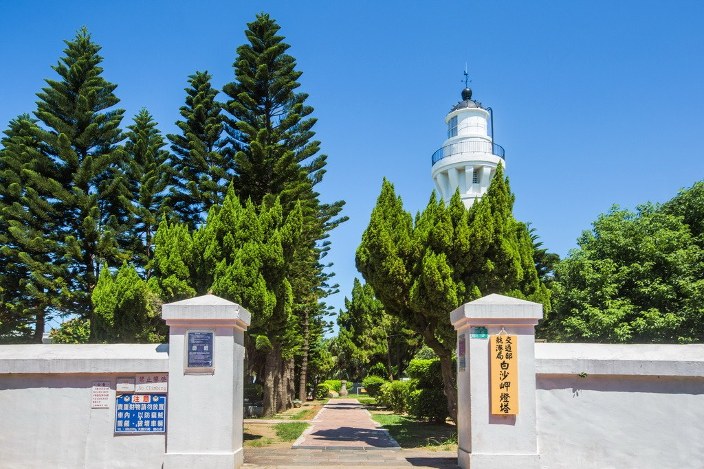

*圖：白沙岬燈塔｜來源：https://travel.tycg.gov.tw/content/images/attractions/48707/1024x768_attractions-image-uoane3hfy0ginrdhrd8nqq.jpg*

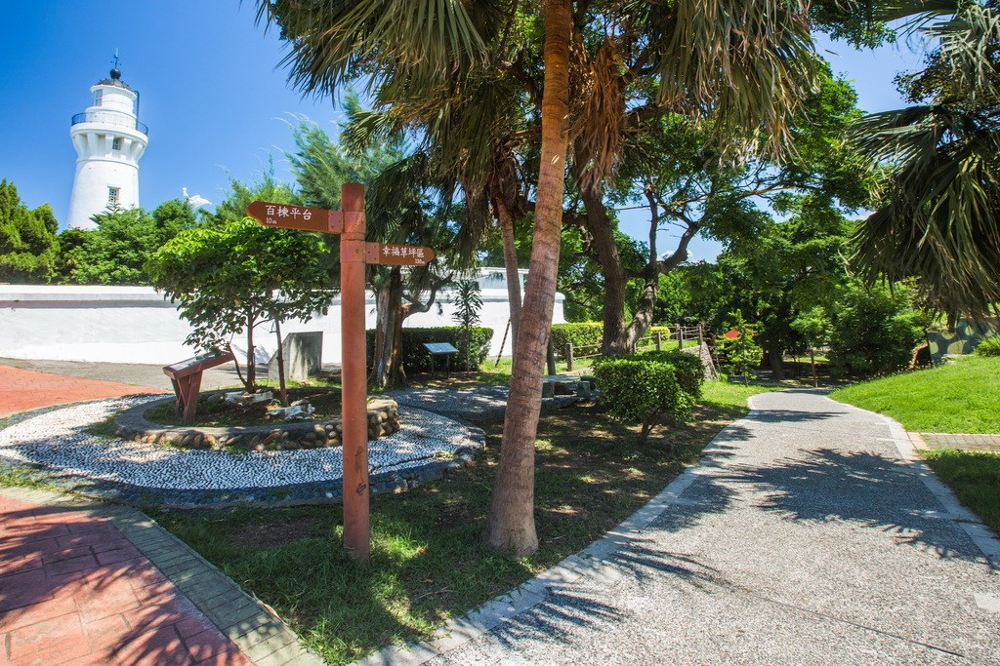

*圖：白沙岬燈塔｜來源：https://travel.tycg.gov.tw/content/images/attractions/48708/1024x768_attractions-image-eighv2vjykezetd7dj-wbw.jpg*

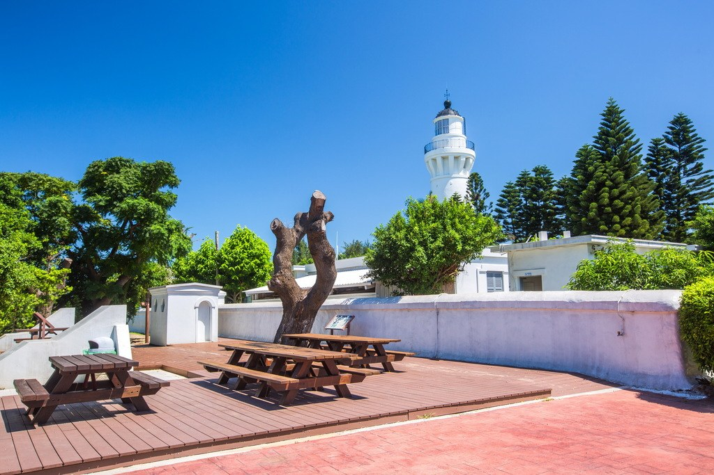

*圖：白沙岬燈塔｜來源：https://travel.tycg.gov.tw/content/images/attractions/48709/1024x768_attractions-image-apxwwfrok0cof1w1tr9zna.jpg*

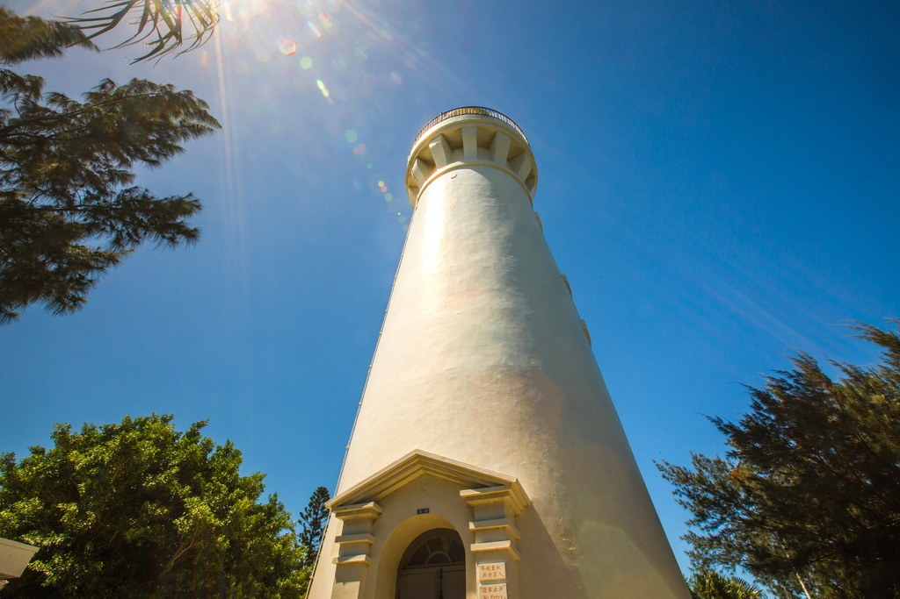

*圖：白沙岬燈塔｜來源：https://travel.tycg.gov.tw/content/images/attractions/48694/1024x768_attractions-image-nfnuld2glu2ko2rkdgo5vq.jpg*

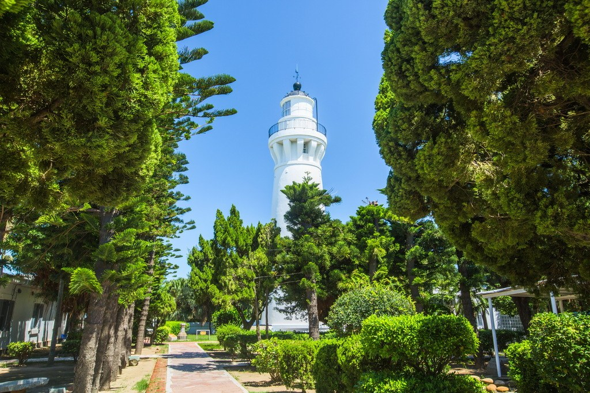

*圖：白沙岬燈塔｜來源：https://travel.tycg.gov.tw/content/images/attractions/48695/1024x768_attractions-image-hvlaxlcm4ukpausx0tt0ag.jpg*

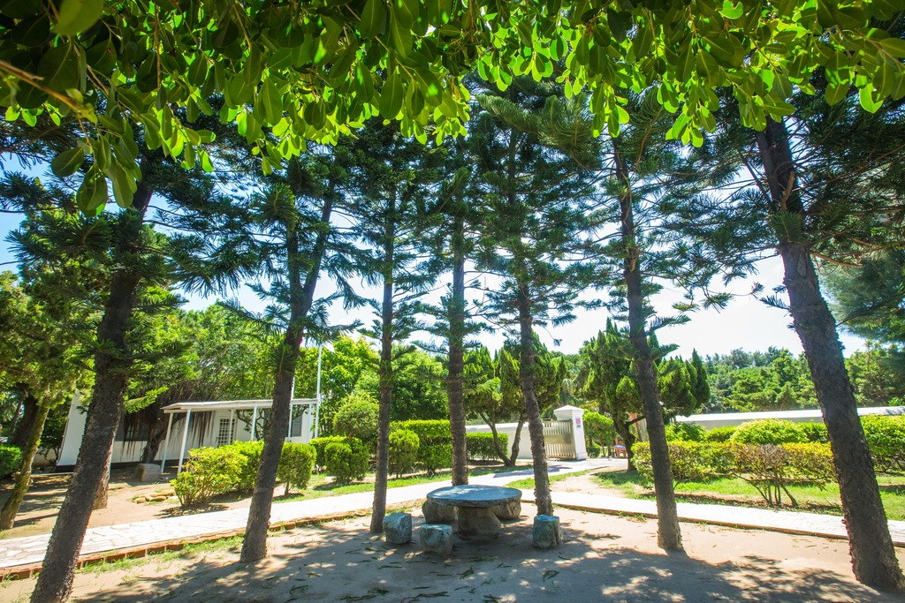

*圖：白沙岬燈塔｜來源：https://travel.tycg.gov.tw/content/images/attractions/48697/1024x768_attractions-image-a5yczrgttew_qqxjt4rekw.jpg*

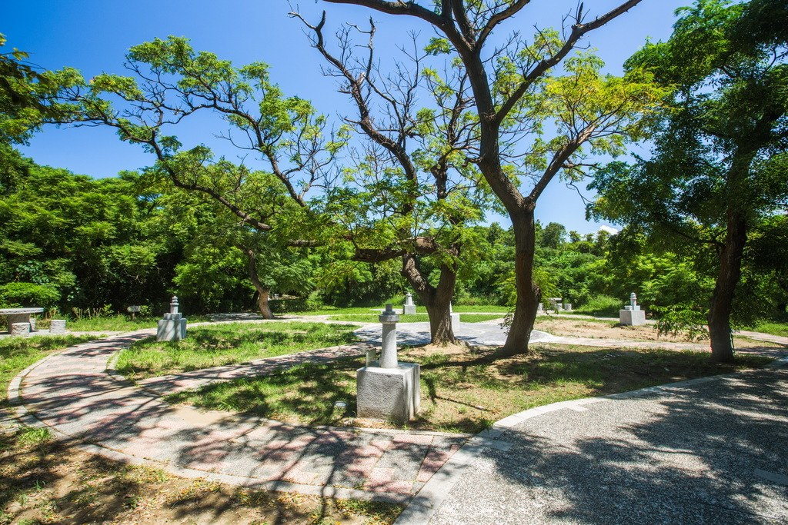

*圖：白沙岬燈塔｜來源：https://travel.tycg.gov.tw/content/images/attractions/48698/1024x768_attractions-image-wzjd3huc10qyny90-gurcq.jpg*

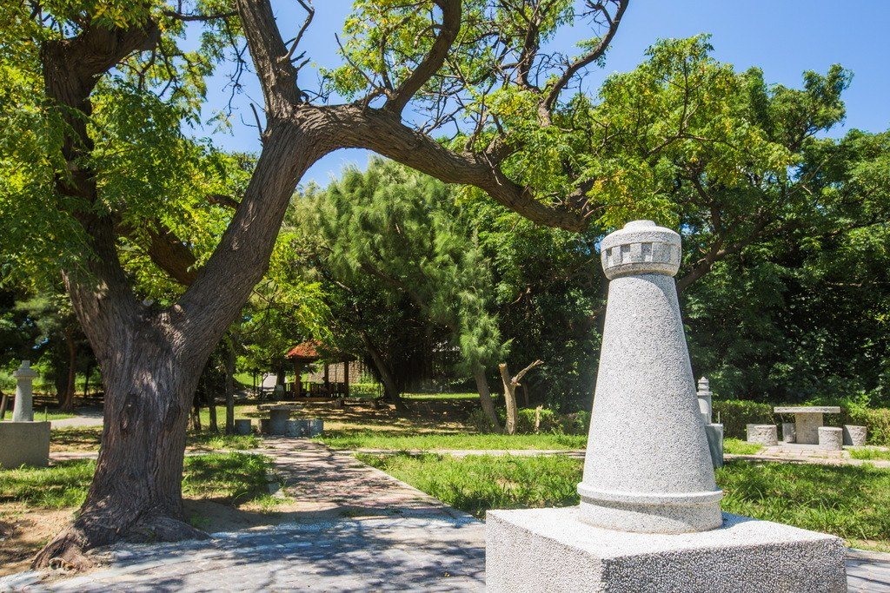

*圖：白沙岬燈塔｜來源：https://travel.tycg.gov.tw/content/images/attractions/48703/1024x768_attractions-image-3_ntwqp3cusodqmbsje4lq.jpg*

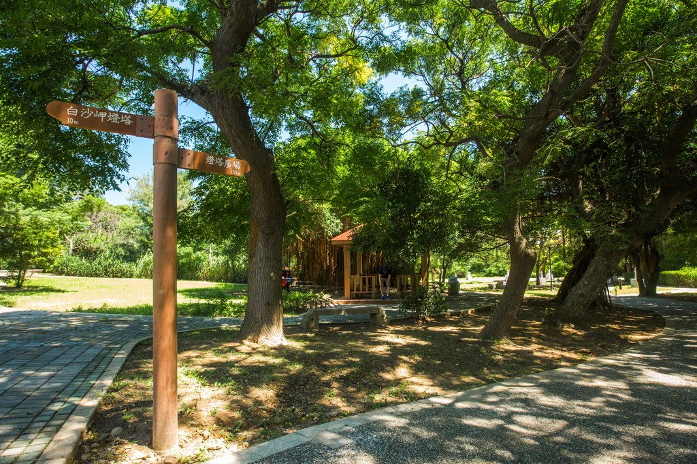

*圖：白沙岬燈塔｜來源：https://travel.tycg.gov.tw/content/images/attractions/48704/1024x768_attractions-image-dvd_1zsnjembx-wl9zwurq.jpg*

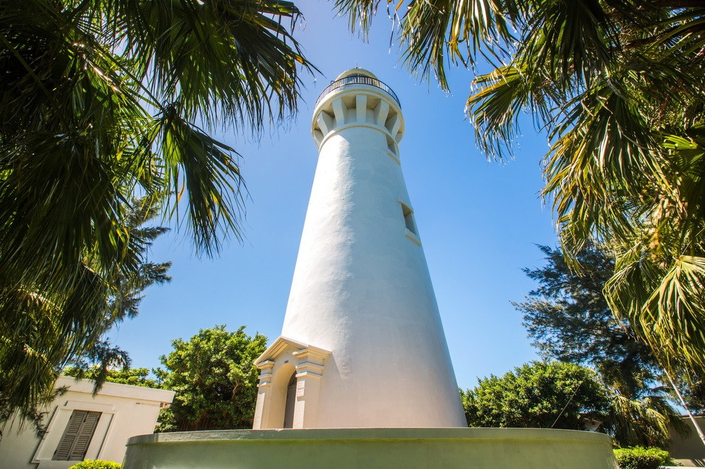

*圖：白沙岬燈塔｜來源：https://travel.tycg.gov.tw/content/images/attractions/48705/1024x768_attractions-image-e-ldxtddsksexlh6unczjg.jpg*

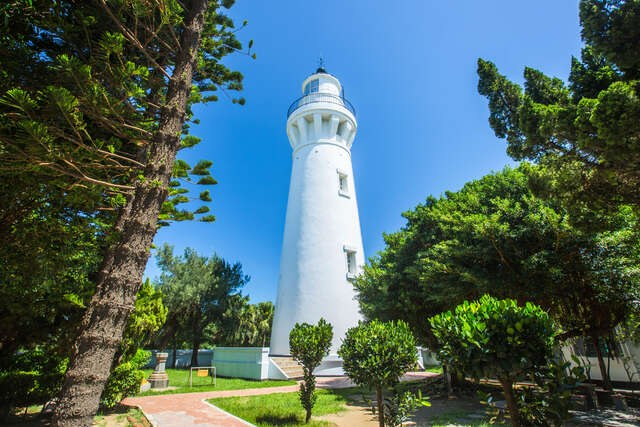

*圖：白沙岬燈塔｜來源：https://travel.tycg.gov.tw/content/images/attractions/48706/1024x768_attractions-image-xvozh_nsruy9cgmgbo8-na.jpg*

夏令時間(4月~10月)：09:00~18:00、冬令時間(11月~隔年3月)：09:00~17:00

週一公休，遇國定假日或連續假期則調整為收假次日不開放

- 觀景台
- 公車站
- 廁所
- 停車場
- 步道

開放範圍為燈塔內部庭院設施，不含主燈塔室。

- 觀音鄉中興停車場 (00:00-24:00 每 30 分鐘 10 元) 導航
- 台灣中油觀音站 導航
- 江華玉林停車場 (全時段每小時 100 元) 導航
- 台灣中油觀音三和站 導航

### 周邊景點

*圖：（原文無圖片說明）｜來源：https://travel.tycg.gov.tw/content/images/attractions/59742/480x360_attractions-image-a2zbkqjt90g9kf-ixbp5yg.jpg*

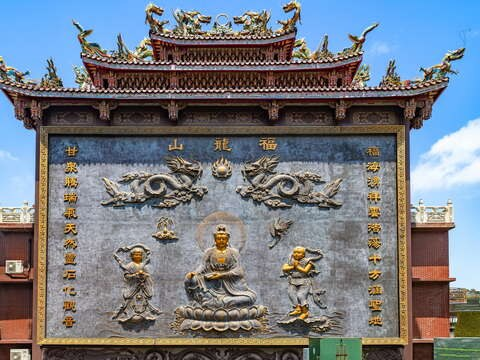

*圖：（原文無圖片說明）｜來源：https://travel.tycg.gov.tw/content/images/attractions/111538/480x360_attractions-image-vycy4rfaieymidkotojfpq.jpg*

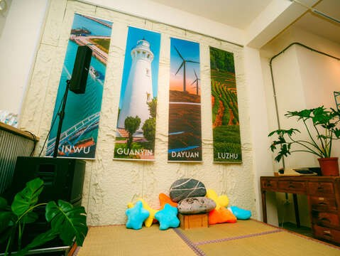

*圖：（原文無圖片說明）｜來源：https://travel.tycg.gov.tw/content/images/attractions/115945/480x360_attractions-image-hgdunund-0ie1ecgoiegdw.jpg*

*圖：（原文無圖片說明）｜來源：https://travel.tycg.gov.tw/content/images/attractions/18626/480x360_files636173223402389856.jpg*

- 4.4 觀音濱海遊憩區 星期四：24 小時營業 人氣 128199
- 4.6 甘泉寺 星期四：06:00 - 21:00 人氣 118228
- 沿海生活實驗室(珍珠海岸改造共創基地) 開館日 週四至週一 10:30 -17:30 (中午12:30-13:30不開放) 假日及國定假日:09:30-17:30 (中午12:30-13:30不開放) 公休日 週二及週三休館 人氣 800
- 2.6 中台環境資源教育中心 星期四：09:00 - 12:00、13:30 - 17:00 人氣 40700
