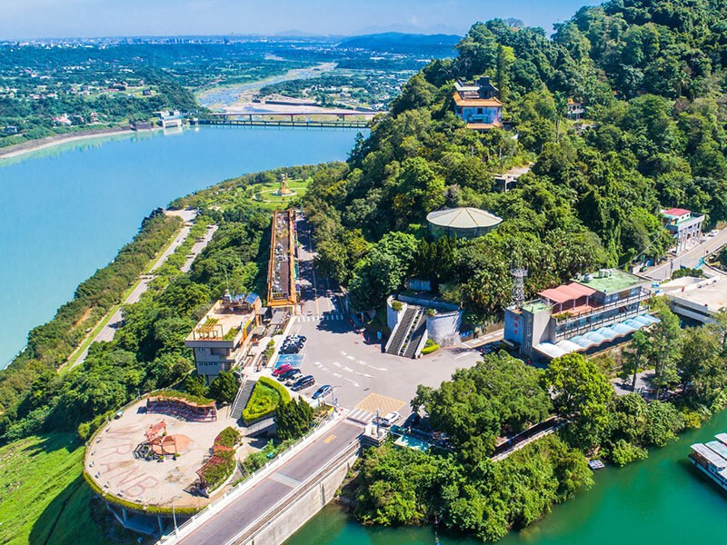
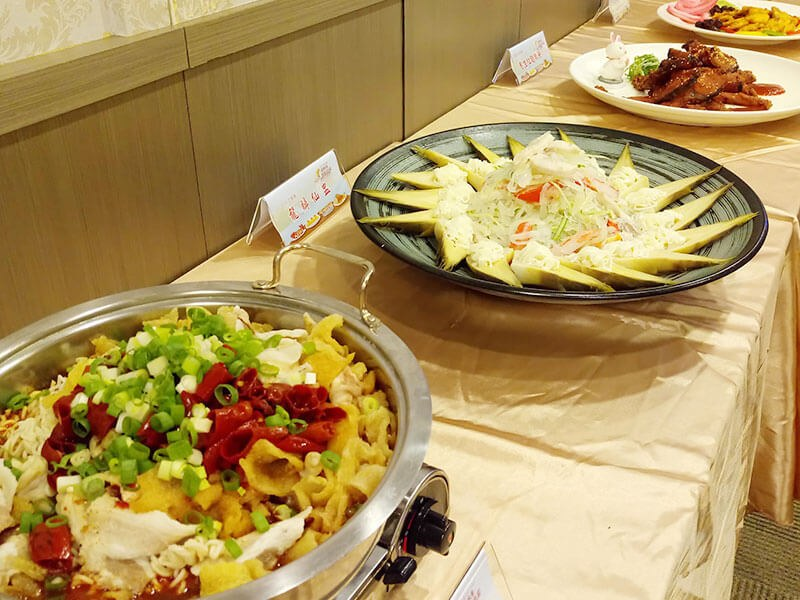
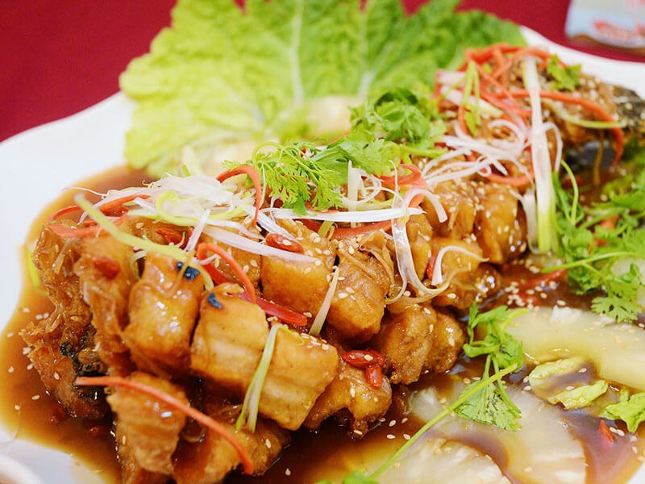
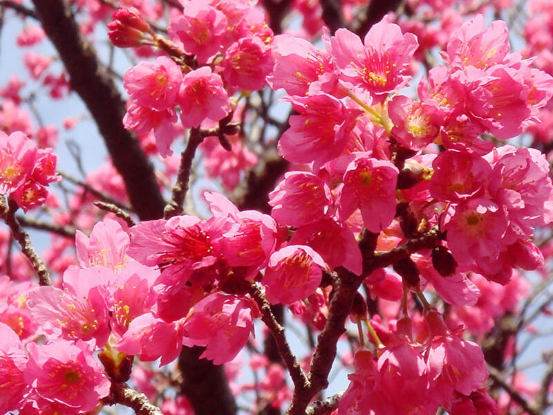
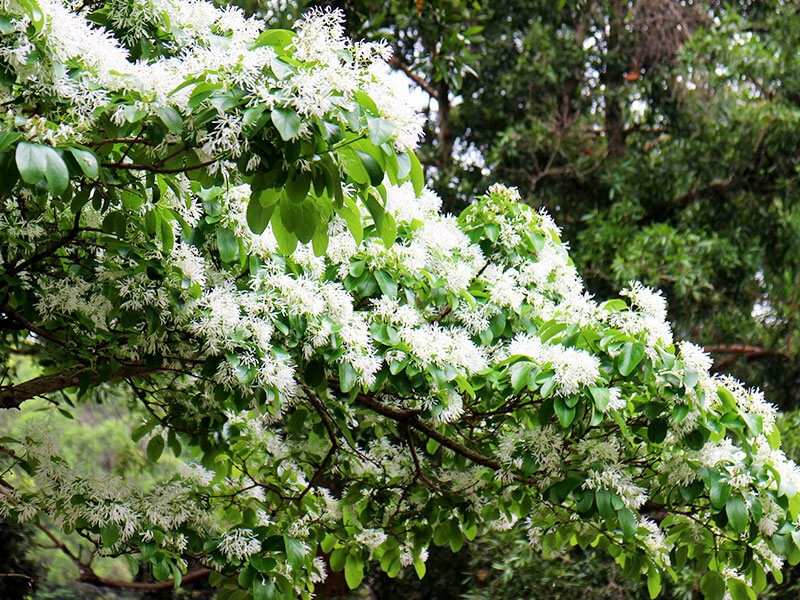
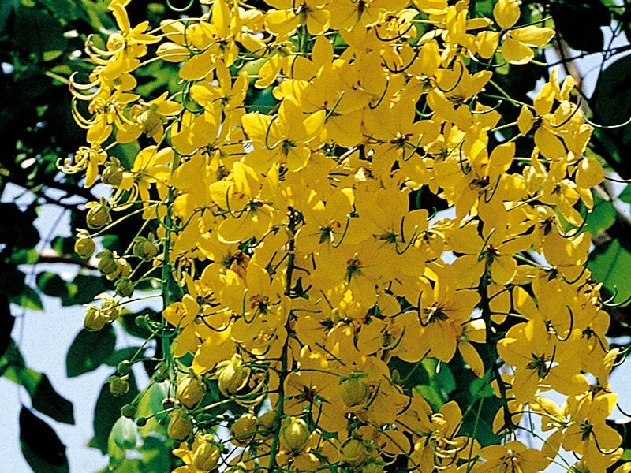
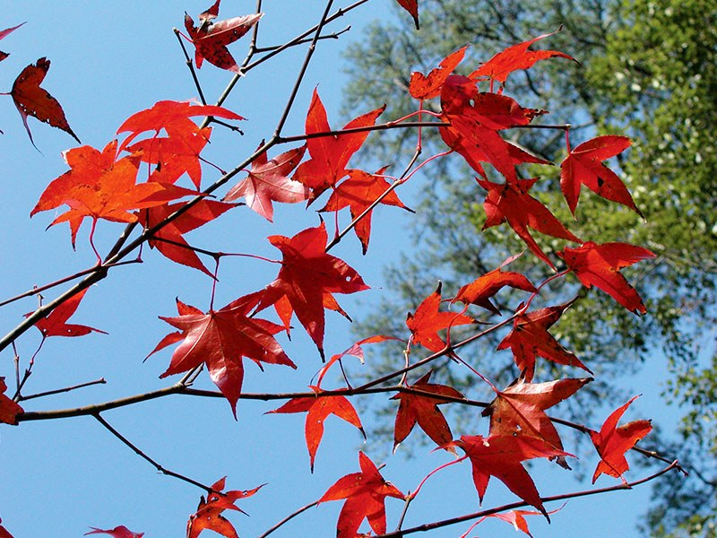
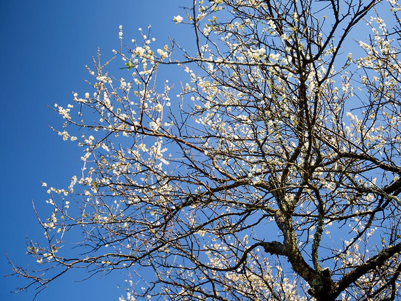

# 石門水庫行

- 原始網址：https://travel.tycg.gov.tw/zh-tw/travel/shihmen-reservoir-tour
- 網站名稱：桃園觀光導覽網
- 作者：（未標示）
- 發表日期：（未標示）
- 爬取時間：2026-11-05T16:40:37+08:00　取得方式：playwright　正文定位：文字密度評分
- 圖片：11 張

---
#### 石門水庫 一年四季皆有不同風情

水庫北岸位在大漢溪中游，不僅提供蓄水功能，兼設有環湖公路，提供旅客自行開車或騎單車，飽覽酷似歐洲湖泊風景的山水風光，因此從以前到現在都是非常熱門的景點。 大部分的旅客來石門水庫，以自駕遊玩為主，也較為方便，如果沒有開車的旅客，也能搭乘公車前來，來一趟低碳樂活之旅。

#### 水庫限定！必玩必看的特色

*圖：石門大壩洩洪｜來源：https://travel.tycg.gov.tw/content/images/theme-tour/theme-w800-shihmen-11.jpg*

*圖：一定要拍的經典景色｜來源：https://travel.tycg.gov.tw/content/images/theme-tour/theme-w800-shihmen-12.jpg*

*圖：必玩遊湖行程｜來源：https://travel.tycg.gov.tw/content/images/theme-tour/theme-w800-shihmen-13.jpg*

- 石門大壩洩洪 石門大壩一帶是遊客最多的地方，在壩頂的觀洪平台上，可以欣賞壯觀的溢洪道，當雨季來臨時，只要水庫一洩洪，總是吸引許多人前來一睹巨流奔騰的震撼景象。 若是前來石門水庫恰好碰上洩洪時，絕對不能錯過這水庫限定的壯麗景色。
- 一定要拍的經典景色 石門水庫最經典的景色，便是站在制高點嵩台上，俯瞰彎曲S型的壩頂大道隔開水面，一邊是碧波蕩漾的山水景致，另一邊是氣勢磅礡的溢洪道，構成視覺上既衝突又和諧的石門水庫經典景色，也是許多攝影師來石門水庫必拍的美麗風景！
- 必玩遊湖行程 來到石門水庫，一定要試試看非常熱門的遊湖行程。 從石門大壩碼頭或阿姆坪碼頭搭船，順著蜿蜒的水道，行經龍珠灣、石秀灣瀑布等景點，欣賞兩旁壯觀的峽谷，曲折的河流，彷彿置身於迷你版的長江三峽，絕對令人驚嘆不已。

#### 石門水庫必吃美食

每提到石門水庫必吃的美食，在地人第一個想到的便是石門活魚，個頭碩大肥美的草魚、烏鰱等淡水活魚，經由店家現宰現殺，烹煮成糖醋魚尾、椒鹽魚塊或清蒸魚，吃起來都毫無一絲土腥味，肉質細緻鮮美，而那多樣吃法的活魚料理絕對是石門水庫極具代表性的美食。

*圖：活魚料理餐廳一條街｜來源：https://travel.tycg.gov.tw/content/images/theme-tour/theme-w800-shihmen-31.jpg*

*圖：如何點石門活魚｜來源：https://travel.tycg.gov.tw/content/images/theme-tour/theme-w800-shihmen-32.jpg*

*圖：一個人、兩個人也能吃活魚料理嗎？｜來源：https://travel.tycg.gov.tw/content/images/theme-tour/theme-w800-shihmen-33.jpg*

- 活魚料理餐廳一條街 由於石門水庫孕育出肉質肥美的淡水魚，帶動遊客前來一嚐在地限定的美食料理，而大多數活魚餐廳皆集中在文化路、中正路三坑段，形成有趣的石門活魚料理餐廳一條街。
- 如何點石門活魚 來到活魚餐廳，店家會請顧客挑選活生生的草魚、大頭鰱等淡水魚，顧客選擇好想要的重量、魚種之後，店家依據魚的大小推薦點什麼菜色，或是顧客自行選好想吃的料理後，廚師就會現場料理活魚，端出一道道令人口水直流的美食料理。 推薦必點： 椒鹽魚塊、糖醋魚尾、砂鍋魚頭、松阪魚、活魚三吃
- 一個人、兩個人也能吃活魚料理嗎？ 一般活魚料理餐廳以合菜為主，適合團體客、家庭前來品嘗，若是獨自一人或人數較少的，餐廳也有提供兩人、三人、四人等套餐，提供遊客選擇。

#### 四季賞花情報

風景優美的石門水庫，景區遼闊、休閒活動多，一年皆有不同的時節風貌，十分適合出遊踏青賞花，現在就來看看石門水庫四季可以賞什麼花！

*圖：山櫻｜來源：https://travel.tycg.gov.tw/content/images/theme-tour/theme-w800-shihmen-41.jpg*

*圖：流蘇花｜來源：https://travel.tycg.gov.tw/content/images/theme-tour/theme-w800-shihmen-42.jpg*

*圖：阿勃勒｜來源：https://travel.tycg.gov.tw/content/images/theme-tour/theme-w800-shihmen-43.jpg*

*圖：秋楓｜來源：https://travel.tycg.gov.tw/content/images/theme-tour/theme-w800-shihmen-44.jpg*

*圖：寒梅｜來源：https://travel.tycg.gov.tw/content/images/theme-tour/theme-w800-shihmen-45.jpg*

- 賞山櫻 最佳觀賞時間： 每年約2-3月 哪裡賞花： 溪州公園、北水局、石門大圳 照片來源：經濟部水利署北區水資源局
- 賞流蘇花 最佳觀賞時間： 每年3-4月 哪裡賞花： 石門水庫大草坪
- 賞阿勃勒 最佳觀賞時間： 約每年5-6月 哪裡賞花： 南苑生態公園
- 賞秋楓 最佳觀賞時間： 每年11-12月 哪裡賞楓： 高線公路、槭樹公園、楓林步道
- 賞寒梅 最佳觀賞時間： 約每年11-1月 哪裡賞花： 槭樹公園、溪州公園、槭林步道
