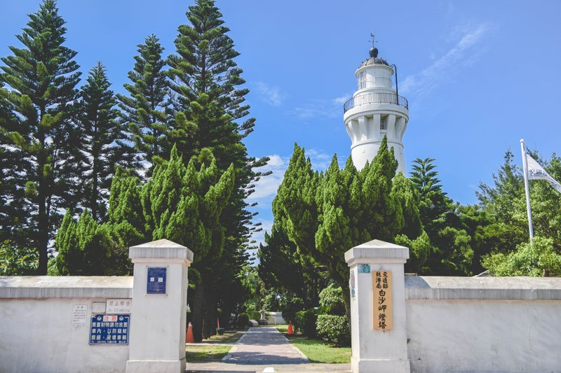
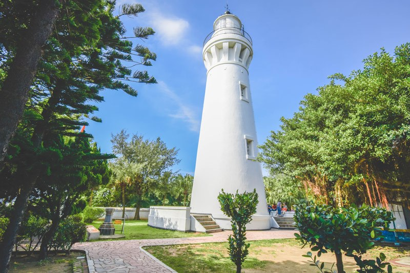
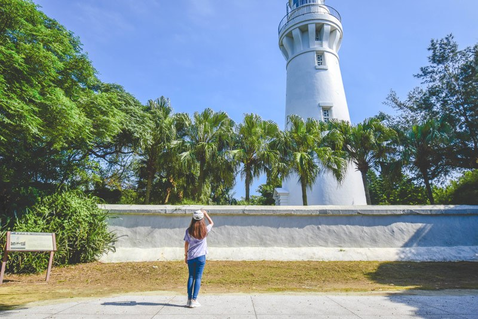
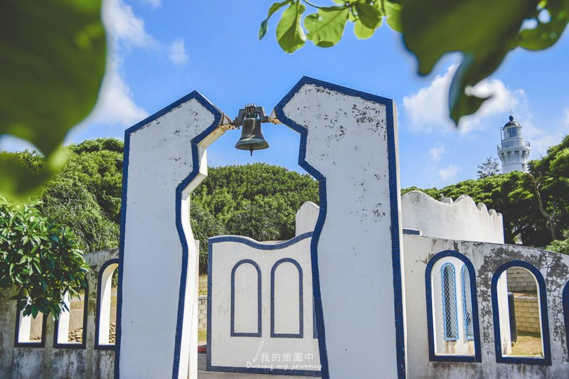
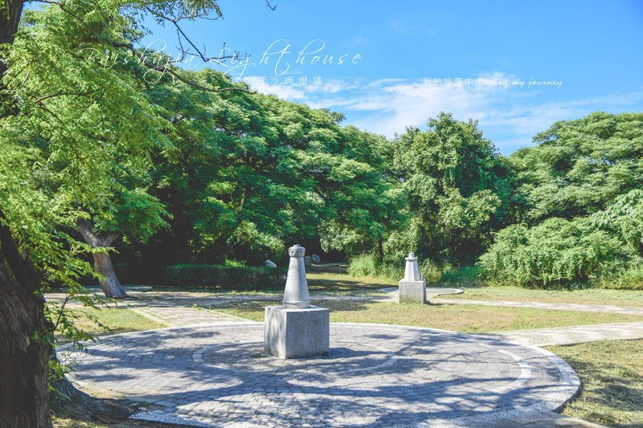
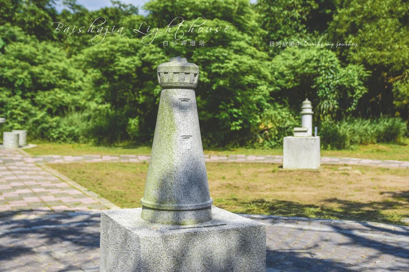
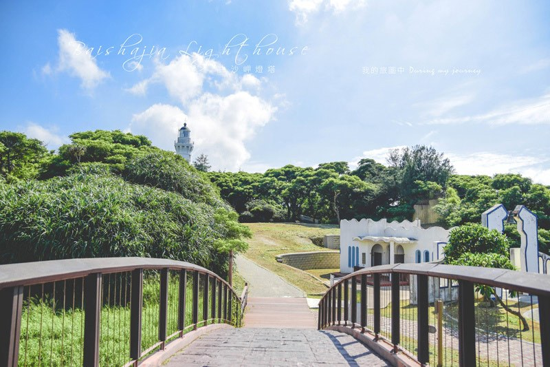

# 藍天下的低調美 桃園觀音白沙岬燈塔，走過百年歲月的台灣歷史建築百景 - 我的旅圖中 - 微笑台灣 - 用深度旅遊體驗鄉鎮魅力

- 原始網址：https://smiletaiwan.cw.com.tw/article/3012
- 網站名稱：微笑台灣
- 作者：https://www.facebook.com/smiletaiwan319
- 發表日期：2019-05-31T00:00:00+08:00
- 爬取時間：2026-10-29T16:11:17+08:00　取得方式：requests　正文定位：站點規則 article
- 圖片：9 張

---
之前蒐集了兩個北部燈塔：富貴角燈塔、三貂角燈塔，除了剩下還未開放的鼻頭角燈塔，意外發現桃園也有個相當低調的白沙岬燈塔。

白沙岬燈塔與其它燈塔相比，沒有遼闊的大海景觀、沒有壯麗的山景，只是被樹叢包圍著，靜靜地聳立在清澈的藍天下，格外低調，卻也多了一些清幽靜謐的氣氛。

*圖：（原文無圖片說明）｜來源：https://cdn-smiletaiwan.cw.com.tw/ckeditor/202002/ckeditor-5e57638b8a345.jpg*

白沙岬燈塔曾經被票選為台灣歷史建築百景之一，是保存最完整的日治時期燈塔，有別於其他用水泥製成的燈塔，是台灣唯一使用紅磚和石頭建造而成的燈塔，到現在仍默默守護著台灣海峽的船隻。 （延伸閱讀： 龍潭大平紅橋 台灣歷史建築百景，三坑遙慕古風之旅 ）

*圖：（原文無圖片說明）｜來源：https://cdn-smiletaiwan.cw.com.tw/ckeditor/202002/ckeditor-5e5763a7daf60.jpg*

當天來的時候燈塔周遭在進行維修，不過卻不影響前來觀賞燈塔的興致，有不少單車族以燈塔為打卡點，由最北部的燈塔為起點一路騎單車過來，很佩服他們的毅力。潔白高聳的燈塔被包圍在綠意繚繞的空間裡，與藍色的天空互相襯托，還隱約能看到燈塔後方被曬到閃閃發光的大海。

*圖：（原文無圖片說明）｜來源：https://cdn-smiletaiwan.cw.com.tw/ckeditor/202002/ckeditor-5e5764e50ae35.jpg*

接著往北區的觀景台移動，發現這邊也是很好取景的位置，白色燈塔的窗戶和圓弧狀的塔頂構造一目了然，燈塔前方排排站的幾棵棕櫚樹帶來夏日的活力和熱情，熱烈的陽光穿透樹木形成明顯的光影變化，似乎早已揭開了夏天的序曲。

*圖：（原文無圖片說明）｜來源：https://cdn-smiletaiwan.cw.com.tw/ckeditor/202002/ckeditor-5e5763c5ba943.jpg*

再來是到燈塔必拍的打卡景點「鐘塔廣場」，使用藍白色彩和簡單的線條與燈塔的景色相呼應，從牆面斑駁老舊的痕跡來看似乎沒有特別維護，真的很可惜啊。

*圖：（原文無圖片說明）｜來源：https://cdn-smiletaiwan.cw.com.tw/ckeditor/202002/ckeditor-5e5763d7d8e3b.jpg*

接著我選擇另一條路往回走，出現了這座燈塔廣場，還以為是紀念碑之類的東西，沒特別留意就想快速經過，眼角餘光才發現有熟悉的燈塔樣貌，「這不是富貴角燈塔嗎！」我內心出現了驚嘆號，仔細觀察，台灣的燈塔都被做成石雕放在這裡，並以白沙岬燈塔為中心點，形成巨石陣的概念，真的很可愛！（延伸閱讀： 為漁船點亮回家的路 三十年如一日，富貴角燈塔守尤義華 ）

*圖：（原文無圖片說明）｜來源：https://cdn-smiletaiwan.cw.com.tw/ckeditor/202002/ckeditor-5e5763e2898ca.jpg*

*圖：（原文無圖片說明）｜來源：https://cdn-smiletaiwan.cw.com.tw/ckeditor/202002/ckeditor-5e5763e9e2349.jpg*

白沙岬燈塔並不大，或許待上20到30分鐘就夠了。對於喜歡燈塔的人，很推薦來探訪一下，因為樹蔭較多也不用擔心會被陽光直曬，適合夏日午後來散步，順便算一下自己到目前為止總共蒐集多少座燈塔呢？

*圖：（原文無圖片說明）｜來源：https://cdn-smiletaiwan.cw.com.tw/ckeditor/202002/ckeditor-5e57641346a65.jpg*

*本文轉載自《 我的旅圖中 》，非經同意請勿轉載。

>>

更多燈塔旅行

桃園 ▶ 漁港 石滬 綠色隧道，無麥之鄉有桃園最美的海岸 彰化 ▶ 來珍珠蚵的故鄉—王功，做一份屬於自己的蚵藝品 台南 ▶ 逆風跨越七股大沙漠，只為一探台灣極西點「國聖燈塔」 馬祖 ▶ 日出拍東莒燈塔、日落拍福正沙灘，馬祖旅行推薦取景地點

資訊

白沙岬燈塔 地址：桃園市觀音區新坡下16號（有停車場） 開放時間：4月~10月 09:00~18:00；11月~隔年3月 09:00~17:00（週一皆公休）

責任編輯：黃佩瑄 核稿編輯：張惠萱

- 桃園
- 觀音區
- 建築
- 燈塔
- 單車旅行

*圖：我的旅圖中｜來源：https://cdn-smiletaiwan.cw.com.tw/article/201912/article-5dfc6bcb65b57.jpg*

### 我的旅圖中

原本是藝術設計領域出身的設計師，後來愛上了攝影，喜歡拿台單眼探索旅行和日常，從中記錄下自然、美的事物，於是在2014年開啟了部落格的第一章，並且結合了設計和攝影，將部落格當作是揮灑創作的舞台。

目前著有《我們的私房漫旅：100個旅拍玩家嚴選的絕美IG打卡秘境》一書。

部落格 ｜ FB粉絲專頁
