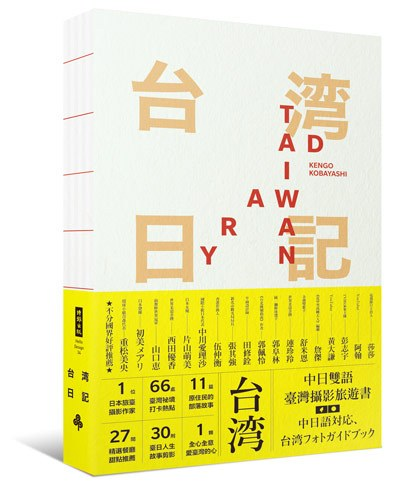
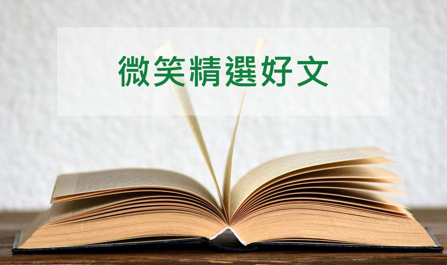

# 真的是臺灣！隱藏在桃園海岸的「草漯沙丘」 4平方公里的遼闊奇景 - 微笑精選好文 - 微笑台灣 - 用深度旅遊體驗鄉鎮魅力

- 原始網址：https://smiletaiwan.cw.com.tw/article/1902
- 網站名稱：微笑台灣
- 作者：https://www.facebook.com/smiletaiwan319
- 發表日期：2019-04-23T00:00:00+08:00
- 爬取時間：2026-10-29T16:11:25+08:00　取得方式：requests　正文定位：站點規則 article
- 圖片：3 張

---
這一大片位於桃園北岸沿海，全長約8公里、面積約4平方公里的遼闊奇景，是現今全臺灣海岸中保留最完整的沙丘。 從入口處穿越小徑後，映入眼簾的是一望無垠的沙海藍天。站在沙丘高處，望著這長年來，潮汐與海風的精雕細琢下，大自然鬼斧神工的藝術神作，令人讚嘆不已。不禁開始懷疑，「這裡真的是臺灣嗎？」

### 不是鳥取砂丘，是臺灣桃園

*圖：（原文無圖片說明）｜來源：https://cdn-smiletaiwan.cw.com.tw/ckeditor/201906/ckeditor-5cf637f367d62.jpg*

超乎想像的廣闊沙山，草漯沙丘。是什麼原因讓這裡出現沙丘呢？我滿腦子的疑問， 但是好奇心使得我無法多想，立刻脫下鞋子跟襪子，一味地往沙丘上跑。一到上面發現，原來這裡是可以180度眺望大海及風車的祕密基地。

宛如在剛下過雪的雪地上走路一般，無人走過的沙丘上留下了我一步一步的足跡。強勁的海風在細沙上畫下波紋，讓巨大的風車不停的轉動。夕陽照在沙丘上，細沙閃閃發光，這個景色無論從哪個角度，都能欣賞到非凡美景。

祕境總會在意想不到的地方出現，臺灣的鳥取沙丘就在這裡。

※注意事項※

①自己的垃圾，請自己帶走。

②沒有廁所。

③強風颳起時，要小心沙塵捲起。

④建議穿著舒適、不怕進沙的鞋子。

⑤要注意防曬，並補充水分，建議午後傍晚陽光較柔和時再前來。

⑥沙丘有高低落差，要注意腳步。

⑦需在外停車後，再往內步行約10 分鐘左右。

>>

桃園順遊 桃園二十七公里海岸線，千年的藻礁奇蹟 漁港 石滬 綠色隧道，無麥之鄉有桃園最美的海岸

>>

### 景點資訊

草漯沙丘 桃園市觀音區許厝港和白玉里之間

交通方式： ①開車前往，行經台61線西濱快速道路南向，於西濱路三段靠右走外側，過潮音北路後繼續直行，到忠孝路右轉後岔路左轉小徑，走到底會有鐵柵門，這邊就是觀音草漯沙丘入口，可以路邊停車，步行穿過鐵柵門前進即可抵達「觀音草漯沙丘」。 ②車用導航機搜尋「草漯沙丘」導航；但如果圖資較舊搜尋不到，則可輸入門牌地址「桃園市觀音區忠孝路259號」就可以抵達通往沙丘附近小徑。

*本文摘錄自《 台湾日記 Taiwan Diary：我能做的，就是告訴全世界臺灣的美！ 》，出版社：時報出版，出版日期：2019年4月。

*圖：（原文無圖片說明）｜來源：https://cdn-smiletaiwan.cw.com.tw/ckeditor/201906/ckeditor-5d007491484bc.jpg*

責任編輯：陳介雯

- 桃園
- 觀音
- 地形景觀
- 海岸
- 大自然
- 外國人在台灣

*圖：微笑精選好文｜來源：https://cdn-smiletaiwan.cw.com.tw/article/201811/article-5bdbf00b03598.jpg*

### 微笑精選好文

微笑台灣特別精選各路出版好書、刊物與網路數位內容，分享在台灣旅行與生活的相關摘錄轉載。 提供更多不同角度的在地觀察、記錄或記憶。

歡迎好書推薦，可email至： [email protected]
