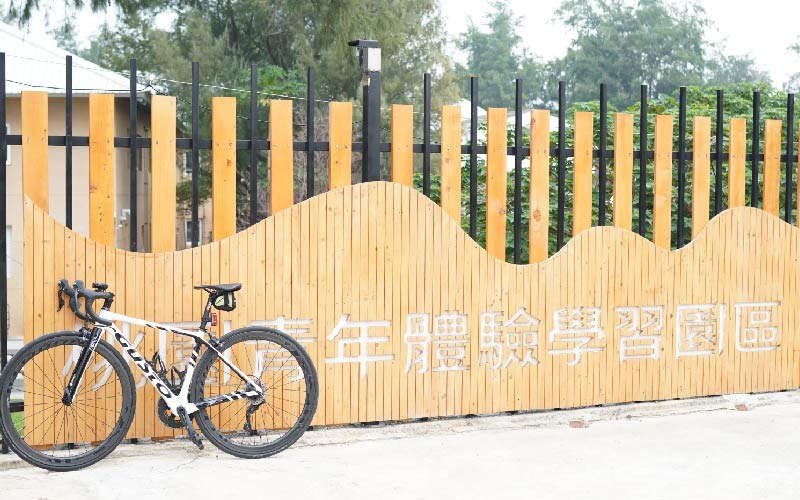
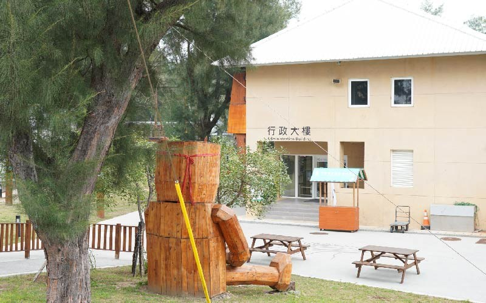
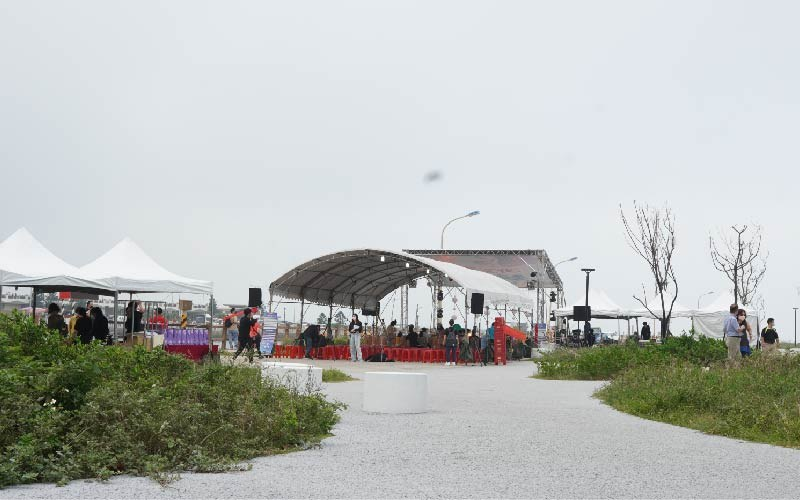
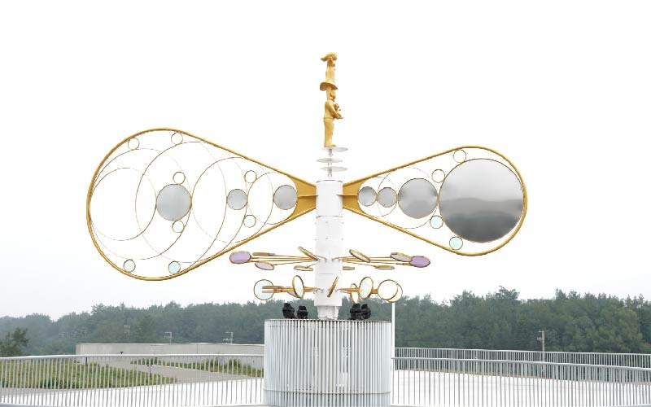

# 騎單車暢遊桃園新屋一日遊，拜訪永安漁港新景點海螺館，看見客家文化魅力 - 熊愛趴趴走 - 微笑台灣 - 用深度旅遊體驗鄉鎮魅力

- 原始網址：https://smiletaiwan.cw.com.tw/article/4989
- 網站名稱：微笑台灣
- 作者：https://www.facebook.com/smiletaiwan319
- 發表日期：2021-11-30T00:00:00+08:00
- 爬取時間：2026-10-29T16:11:28+08:00　取得方式：requests　正文定位：站點規則 article
- 圖片：5 張

---
今晚是車友解鎖一日北高及雙塔的日子，雖然身心還沒準備好接受這樣的終極挑戰，但精神上應與大家站在同一陣線，於是心中燃起陪騎的念頭。

一大清早天尚未亮， 便從桃園自家出發，沿著熟悉不過的南崁溪自行車道往海的方向騎，路過經國河濱公園，驚訝發現才一段時間沒來，已經建置健身廣場及林蔭平台等設施，再往下游去，來到光明河濱公園，湊近剛完工的賞鳥平台，不經意發現東方環頸鴴已經來報到，更別提沿路三三兩兩出門運動的人們，也紛紛穿上了外衣，再再訴說著冬天好像悄悄地來臨了。

以飛快的速度離開了南崁溪自行車道，進到大園的農田區域，遍地荒煙蔓草，實際耕作的農田仍舊是少數，只是東北季風已經來到，不知現在大園的鳥況如何？倏忽一隻白腹秧雞突然闖入我的視線，飛到馬路對面長滿野草的休耕農田，留下一臉驚恐的我，回過神來，農田景觀已轉變成橋梁及道路，吹海風的路——西濱濱海公路就這麼到了。

踩踏越來越吃力，原來今天吹的是逆風，只好騎騎停停，幸運地仍有不少車友不畏逆風，仍舊享受一起騎車的歡樂並沿路幫我加油打氣，在接近圳頭村軍史公園時，我停下來喘口氣，突然抬頭一看一隻黑翅鳶正環顧四周，大概在尋找獵物的蹤跡，只是急著趕路已無暇觀察後續的進展了。（延伸推薦： 精選台北賞鳥好地點 在山邊、水邊、公園看見多種鳥類的身影，城市中也能親近自然 ）

*圖：（原文無圖片說明）｜來源：https://cdn-smiletaiwan.cw.com.tw/ckeditor/202111/ckeditor-6193140f418a5.jpg*

*圖：（原文無圖片說明）｜來源：https://cdn-smiletaiwan.cw.com.tw/ckeditor/202111/ckeditor-619314e78ce9a.jpg*

永安漁港入口處的桃園青年體驗學習園區，以及內部空間一隅。

緊接著路過許厝港濕地、潮音海風車、觀音草漯沙丘及白沙岬燈塔等桃園知名的海岸線景點後，終於來到了永安漁港，漁港入口處的青年體驗學習園區，是充滿冒險與挑戰的活動體驗場域，路過時，已經好幾台大巴士載著一大群年輕人，前來參加各種體驗活動。

*圖：（原文無圖片說明）｜來源：https://cdn-smiletaiwan.cw.com.tw/ckeditor/202111/ckeditor-6193142edc2c5.jpg*

即將開幕的永安海螺文化體驗園區已經在網路上爆紅，成為民眾熱門的打卡景點，繞近漁港內部，女主持人以熱情洋溢的聲音，正在彩排接下來的正式開幕活動，我站在前方的草坪望著身後的體驗園區， 海螺的曲線造型為建築設計概念，1樓規劃為展覽空間，展示客家海洋文化意象，2樓為一個半戶外的景觀平台，可以在此欣賞永安漁港美麗的夕陽。 （延伸閱讀： 精選全台10+個日落景點推薦 靜看美麗晚霞夕照，每天都不同 ）

*圖：（原文無圖片說明）｜來源：https://cdn-smiletaiwan.cw.com.tw/ckeditor/202111/ckeditor-6193143e5320a.jpg*

園區內的藝術品「在海的叮嚀聲中·誕生」。

最讓人驚訝的是，造型特殊的海螺館已成為攝影人口中的知名景點，我再次無償當起畫面中的點景，就像 永安海螺文化體驗園區 一樣，不僅展現客家文化的魅力，也是永安漁港的新亮點。這次的騎行，多了新發現。

### 順遊桃園

- 在八德埤塘生態公園，感受初冬陽光的溫度
- 千塘之鄉，騎單車、賞鳥、生態教育的好所在
- 隱藏在桃園海岸的「草漯沙丘」 4平方公里的遼闊奇景
- 單車暢騎 南崁溪自行車步道，幸褔可以很簡單

### 光點

圳頭村軍史公園 桃園市大園區西部濱海公路76號

永安漁港 地址：桃園市新屋區中山西路三段1165號 電話：03-4861017

桃園青年體驗學習園區 地址：桃園市新屋區新港路16號 電話：03-4862200

責任編輯：詹和臻 核稿編輯：張惠萱

- 桃園
- 新屋
- 大園
- 桃園景點
- 永安漁港
- 單車旅行

*圖：王心妙｜來源：https://cdn-smiletaiwan.cw.com.tw/article/201812/article-5c10f2f48f6e7.jpg*

### 熊愛趴趴走

王心妙 （熊熊）

出生於嘉義太保，曾經留學美國波士頓，喜歡烹飪及騎單車；因為熱愛臺灣這塊所生長的土地，希望透過紀錄生活點滴及人文風情，好讓每一段停留都有不同的回憶與收穫！
