# 桃園觀音景點〡觀音濱海遊憩區〡風車搭配唯美夕陽, 平坦沙灘輕鬆抓蟹, 遠眺白沙岬燈塔, 楊柳淨瓶廣場, 觀龍步道賞石觀音 @小菲親子玩樂生活

- 原始網址：https://natsuphil.com/taoyuan/guanyin-sea/
- 網站名稱：小菲親子玩樂生活
- 作者：natsuphil0222@gmail.com
- 發表日期：2026-09-28T17:50:24+08:00
- 爬取時間：2026-11-05T16:41:26+08:00　取得方式：requests　正文定位：通用規則 .post-content
- 圖片：15 張

---
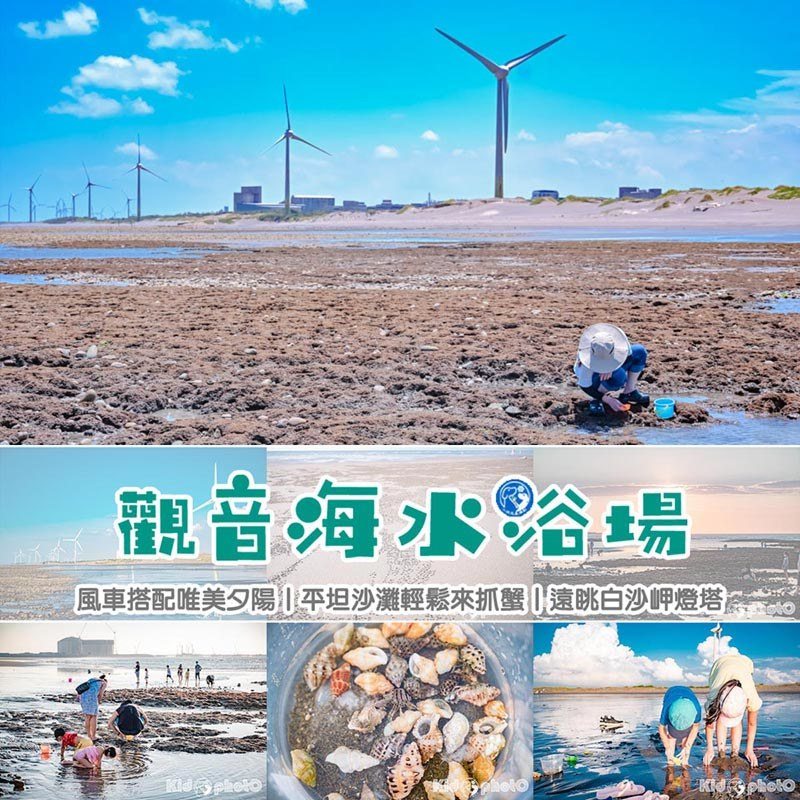

*圖：guanyin-sea_F1｜來源：https://natsuphil.com/wp-content/uploads/2024/07/guanyin-sea_F1.jpg*

位在桃園觀音的 「 觀音濱海遊憩區 」，是由原先的「 觀音海水浴場 」轉型而成。這裡有一望無際的大海、寬廣遼闊的沙灘，加上一排排白色的風車，結合起來就像一幅美麗的畫作。日落時分陽光斜照時，形成一面鏡面沙灘，宛如天空之鏡，將風車、白雲、藍天的倒影，印在上面，真的超美。平坦的沙灘、超長的海岸線，也讓小朋友們可以方便觀察小蟹、小魚，是一個適合親子同遊，觀察潮間帶的好地方，一旁的室內「 草漯沙丘觀音展示館 」順遊也很方便。【2026桃園地景藝術節，此區也有展品喔！(歸海)、(大珠小珠落玉盤)】

觀音濱海遊憩區〡相關資訊

- 景點位置：桃園市觀音區中興路469號。 [Google導航地圖]
- 停車資訊：觀音濱海遊憩區停車場。 [Google導航地圖]
- 營業時間：全天開放
- 潮汐預報：進入「 交通部中央氣象局 」網站，點選「 新竹鹿港沿海 – 桃園市觀音 」，「乾潮」前後兩小時為觀察生態最佳時機。
- 公共設施：[有] 公共廁 所〡[有] 洗腳區〡[有] 免費盥洗室(有熱水)〡[有] 休憩區

桃園還有哪裡好玩

桃園市景點 桃園觀音區懶人包 白沙岬燈塔 觀新藻礁生態區 蓮荷園休閒農場 草漯沙丘觀音展示館 羊稠森林步道 大有梯田生態公園 竹圍漁港 水之丘主題公園 桃園立市兒童美術館 大溪老街 大嵙崁親水園區 許厝港濕地 永安海螺文化館 永安漁港 龍潭運動公園 華興池公園 光明公園 平鎮運動公園 四維兒童公園 陽明運動公園

全台好玩懶人包

全台灣燈塔懶人包 全台灣漁港懶人包 台61線濱海懶人包 北部室內樂園懶人包 北部海邊戲水懶人包

> 小菲兒童親子隨拍

### 停車場〡草漯沙丘展示館

- 從西濱公路台61線彎進中興路後，左轉是到 白沙岬燈塔 [ 文章連結：白沙岬燈塔〡百年日治時代燈塔 ]，右轉開到西濱公路台61線馬路下，在沿著路直走到底，就能到「觀音濱海遊憩區 – 停車場區」。

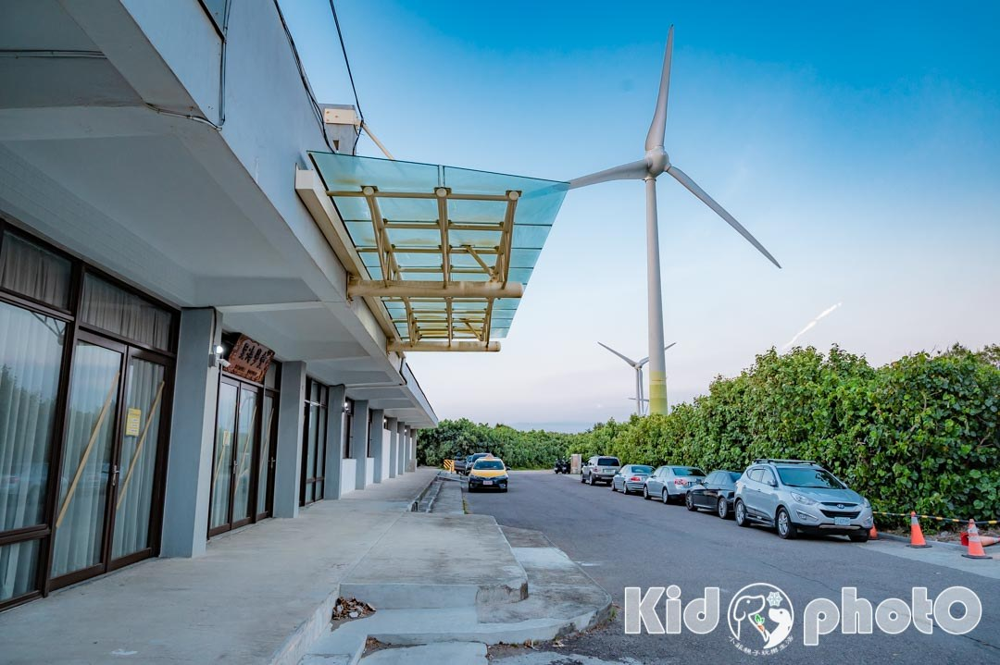

*圖：guanyin-sea_006｜來源：https://natsuphil.com/wp-content/uploads/2021/08/guanyin-sea_006.jpg*

- 【 停車場】 停車場為 免費停車場，滿位了沒關係，路邊白線也可以停。

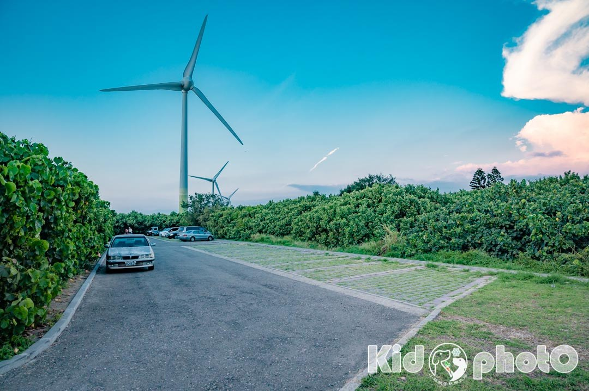

*圖：guanyin-sea_007｜來源：https://natsuphil.com/wp-content/uploads/2021/08/guanyin-sea_007.jpg*

- 入口有前後兩處，前段為有招牌的正門，後段則是視聽教室旁的入口。背對停車場往最右邊走，可以看到 「觀音濱海遊憩區」 的招牌，那裡就是正門入口。

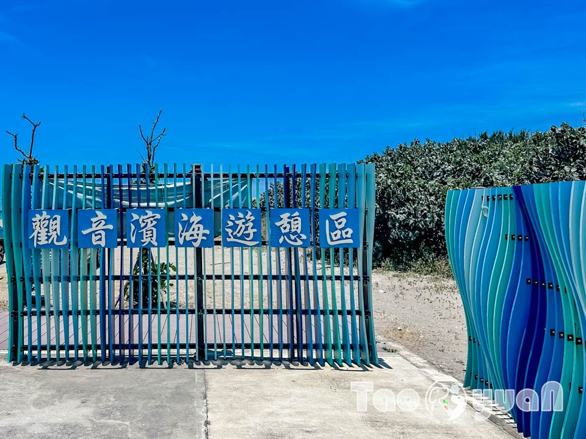

*圖：IMG_9870｜來源：https://natsuphil.com/wp-content/uploads/2023/06/IMG_9870.jpg*

- 由後段入口進入，有木棧步道可以走，途中會經過 草漯沙丘展示館，是一所簡易的室內展館，一樓為展示館與互動體驗區，二樓則是休憩空間，提供一些書籍與簡易餐點與飲品，可以坐在此處休息賞景。二樓戶外亦有一處觀景台可眺望無敵海景，可以走出去站在不同的角度欣賞沙丘與海景。(二樓開放時間不一定，某幾次去就沒開放)

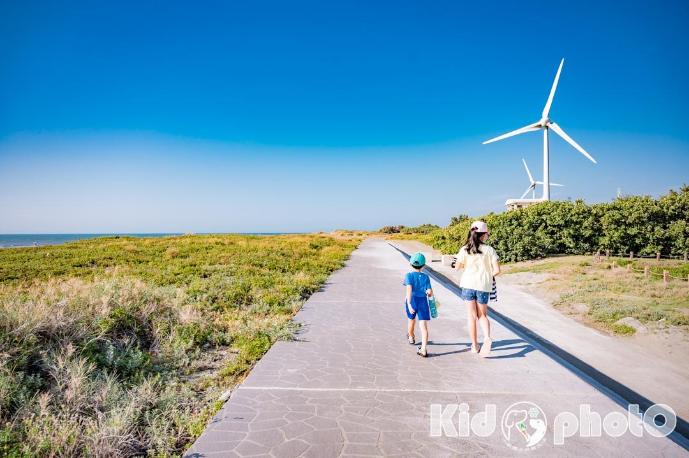

*圖：guanyin-sea_002｜來源：https://natsuphil.com/wp-content/uploads/2021/08/guanyin-sea_002.jpg*

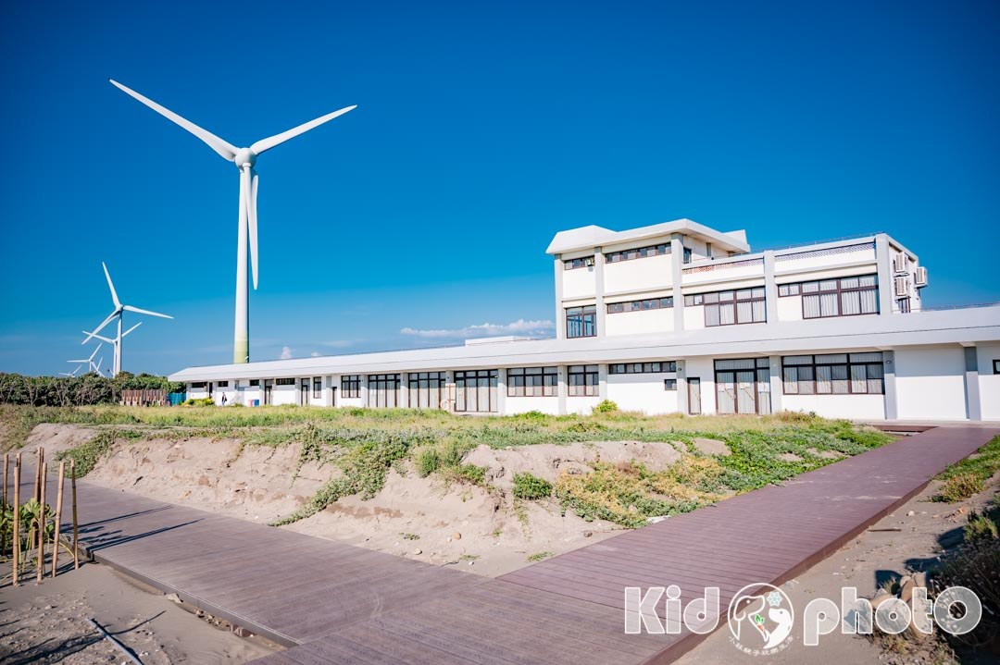

*圖：guanyin-sea_004｜來源：https://natsuphil.com/wp-content/uploads/2021/08/guanyin-sea_004.jpg*

- 草漯沙丘觀音展示館 草漯砂丘展示館雖然小小間的不大，不過有趣的互動體驗還是吸引寶寶玩了好一會兒。【 詳細介紹請點此:草漯砂丘展示館 】

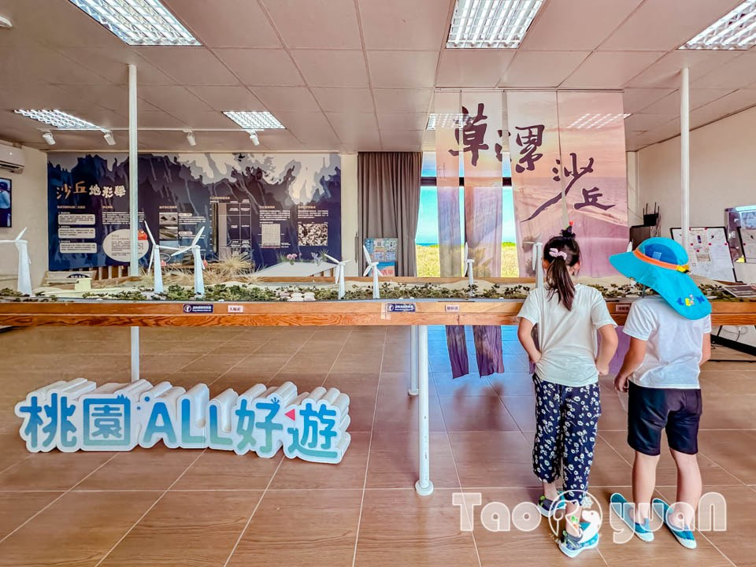

*圖：IMG_9807｜來源：https://natsuphil.com/wp-content/uploads/2023/06/IMG_9807.jpg*

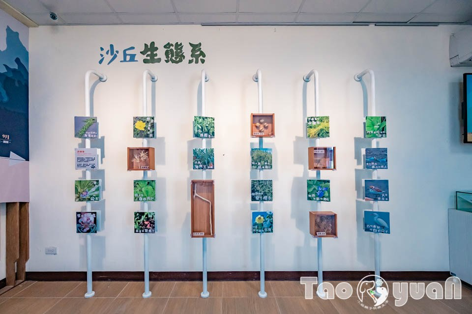

*圖：caota-dune-indoor-009｜來源：https://natsuphil.com/wp-content/uploads/2022/08/caota-dune-indoor-009.jpg*

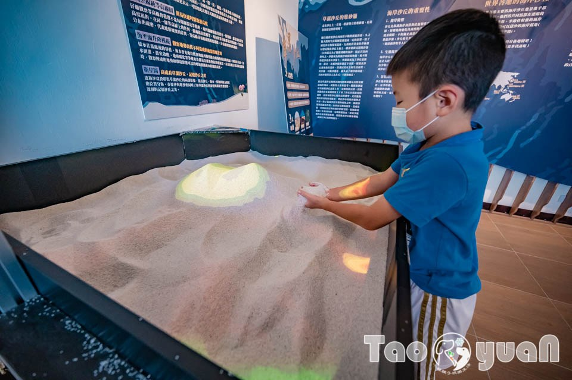

*圖：caota-dune-indoor-015｜來源：https://natsuphil.com/wp-content/uploads/2022/08/caota-dune-indoor-015.jpg*

### 桃園觀音天空之鏡

- 沙丘圍籬大風車 桃園觀音海岸的特產就是「沙丘圍籬」和「白色大風車」

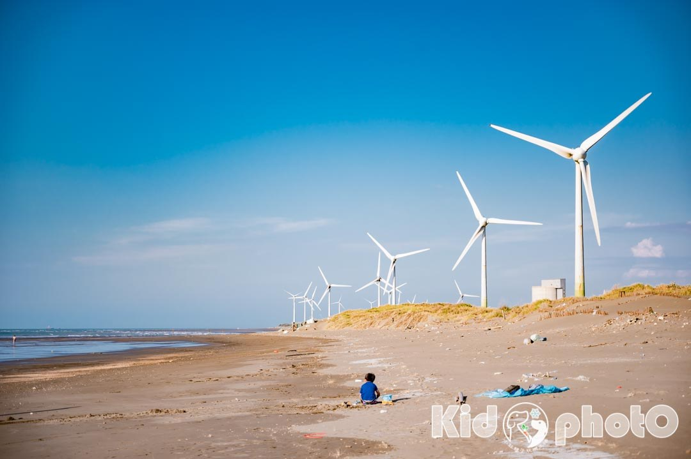

*圖：guanyin-sea_010｜來源：https://natsuphil.com/wp-content/uploads/2021/08/guanyin-sea_010.jpg*

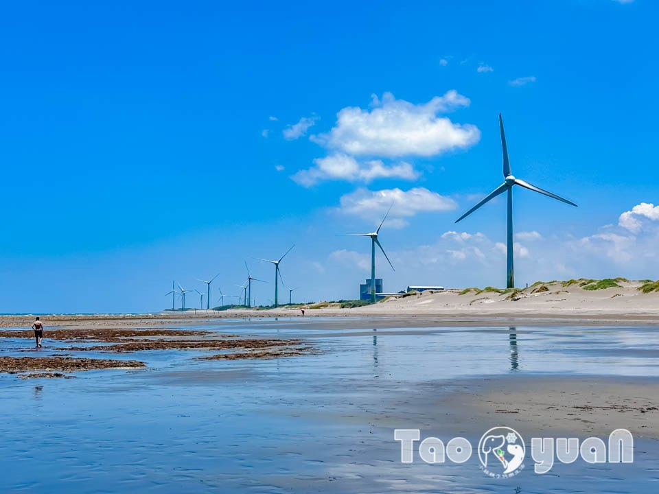

*圖：IMG_9848｜來源：https://natsuphil.com/wp-content/uploads/2023/06/IMG_9848.jpg*

- 走過沙灘時，常會看到螃蟹製造出來的 沙球，感覺牠們好像在玩沙，不過這可是螃蟹特有的習性稱為「 擬糞 」。雄招潮蟹的大螯威嚇、求偶或防禦用，小螯取食用。

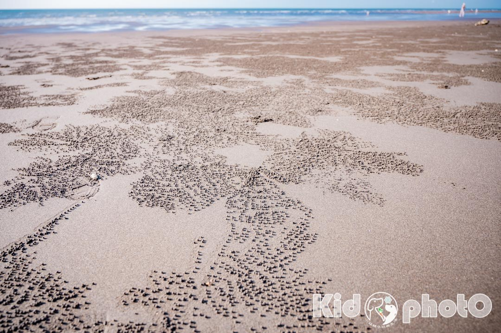

*圖：guanyin-sea_014｜來源：https://natsuphil.com/wp-content/uploads/2021/08/guanyin-sea_014.jpg*

- 站在沙灘往後看，還可以看到遠方的「 白沙岬燈塔 」喔！也是一處相當值得造訪的燈塔景點。

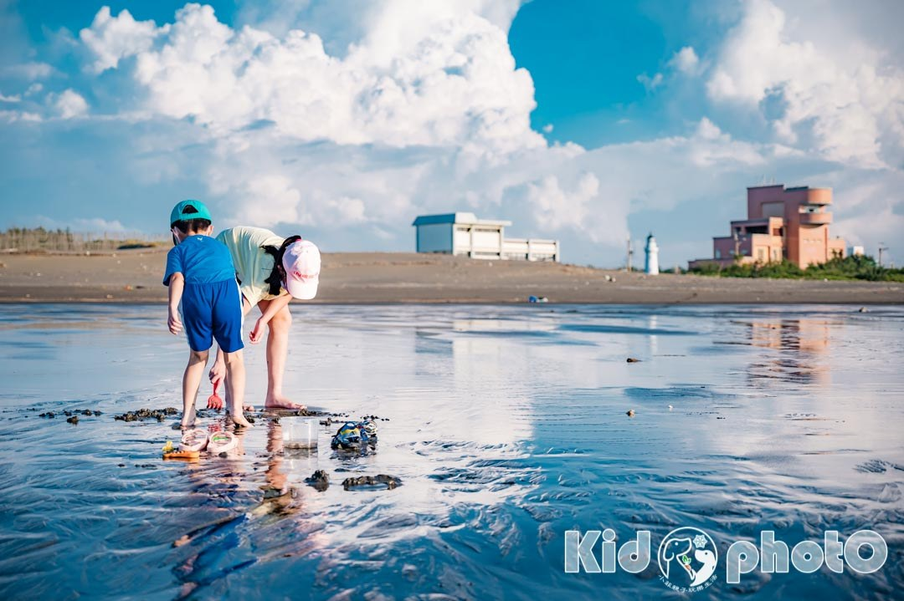

*圖：guanyin-sea_015｜來源：https://natsuphil.com/wp-content/uploads/2021/08/guanyin-sea_015.jpg*

- 下午時段來，光線柔和、陽光斜射，讓沙灘也成為鏡面，站在上頭拍照有大自然的特效，很美耶！

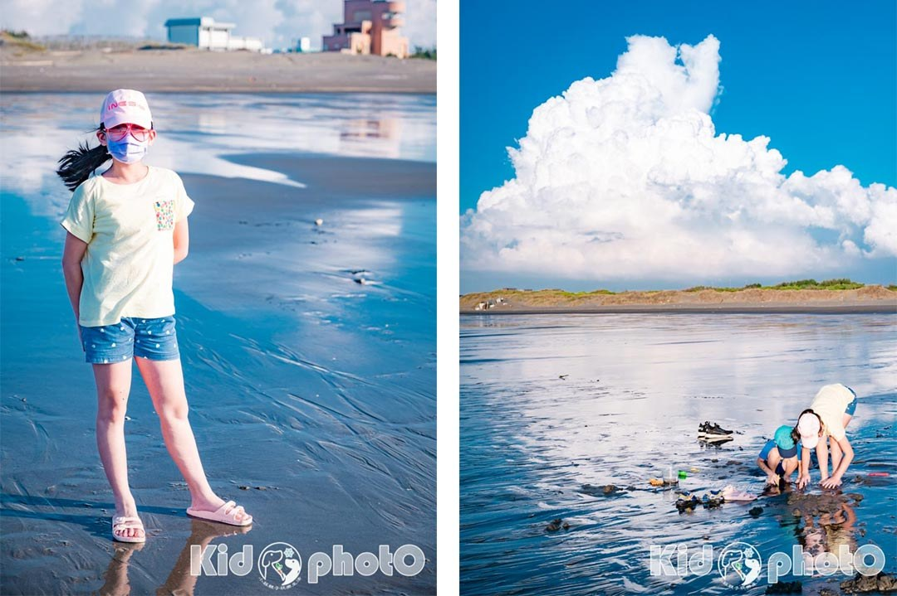

*圖：guanyin-sea_016｜來源：https://natsuphil.com/wp-content/uploads/2021/08/guanyin-sea_016.jpg*

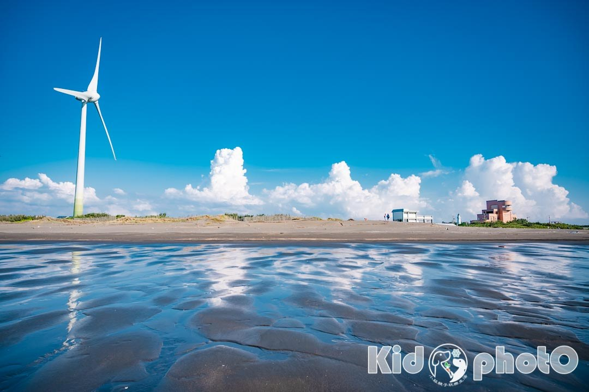

*圖：guanyin-sea_017｜來源：https://natsuphil.com/wp-content/uploads/2021/08/guanyin-sea_017.jpg*

- 連風車也可以拍出唯美的倒影~玩沙、踏水、找寄居蟹~~開心！

### 呼朋引伴一起來玩

- 好玩的景點就是要呼朋引伴同樂！今年暑假帶表妹們一起來玩，寶寶自己則不知已是第幾訪了。我們又來了~~~

- 可能因為暑假的關係，這次來，沙灘上出現了帳篷和陽傘，人潮也比之前多了好幾倍，而且還有帶戲水遊具和泳圈來玩水的遊客。(提醒：此沙灘水域無救生員，於淺灘戲水的朋友請注意自身安全，尤其有帶小朋友的家長，務必全程陪伴左右)

- 這次來還有發現一塊新的堪版：原來這裡有 「風箏衝浪熱區」，不過因為此水上活動範圍大，遊客務必離活動水域遠一點，以策安全。 觀音海濱因地形與風況佳，適合風箏衝浪水上活動，不過因為風箏衝浪活動範圍大、速度快，風箏線容易纏繞傷人，請遊客保持安全距離。 水域無救生員，下水從事水域遊憩活動者，請穿著救生衣、浮具或適當裝備，並隨時注意天候、氣象，注意安全。

### 平坦的沙灘〡小水漥踏踏水

- 去過 馬崗潮間帶 [ 文章連結：馬崗潮間帶〡東北角極東秘境海岸 ] 的黃小菲，覺得 觀音濱海遊憩區 的沙灘更適合小朋友觀察，可以在比較安全的環境下近距離觀察潮間帶生物，雖然潮間帶生物沒有馬崗來的富豐，不過這裡也多了可以玩沙和堆沙堡的樂趣。愜意的在岸邊找螃蟹和寄居蟹不只小朋友喜歡，大人也非常熱愛!!

- 大退潮後，整片的礁岩裸露出來，走在礁岩石上還是要小心注意，腳步輕、慢慢走才安全，建議穿上沙灘鞋，若有防滑鞋或溯溪鞋就更讚了。(青苔很滑，盡量避開)

- 大退潮後，一顆一顆的石頭裸露在沙灘上，成了一大片的石地，仔細一看，每個石頭上還會附滿螺類生物。小孩們觀察生物與尋找寄居蟹、大人們則瘋狂捕捉美照。

- 這裡的水漥都不算深，以小朋友高度算，差不多都只到腳裸（退潮時），且離海面也有一段距離，所以相對較安全，不過出門在外，大人還是要隨時陪伴在孩子們身邊才安全喔！

- 可以與小朋友一同觀察生態和研究，又能享受海邊放鬆的舒壓感，雙享受！(提醒：觀察完畢記得溫柔回放唷~)

### 潮間帶生物~觀察起來

- 姊弟倆在找螃蟹和寄居蟹前，一定要先把沙子玩一輪才干心，這時帶來的玩沙工具就能派上用場囉！

- 有位爸爸好厲害，帶大鏟子來直接開挖，幫孩子們DIY一座小水池，看得大家羨慕極了！爸爸也不吝嗇的借工具給需要的遊客，大家一起同樂的概念，值得鼓勵。

- 觀音的寄居蟹比較小隻，不像 馬崗潮間帶 都是巨無霸等級的，這裡的寄居蟹鉗子小小的好可愛。

- 螃蟹的鉗子可就要小心了，建議用網子撈進水箱或桶子裡觀察比較安全。

- 想找螃蟹的話，可以仔細觀察礁岩上的小洞洞，牠們經常在裡面跟大家玩躲貓貓呢~

### 滿滿收穫/建議近日落時間來觀音沙灘

- 這裡的寄居蟹真的不少，而且各種顏色的都有，全部放在一起很漂亮喔！不過後來幾次再訪，數量變得很少。再次提醒大家，潮間帶的生物觀察就好，不可以帶離海邊喔~

- 觀察時間 寶寶說很喜歡抓寄居蟹是因為可以觀察牠們的一舉一動，覺得好玩又有趣。這也是黃小菲喜歡帶一家四口到戶外親近大自然的原因，除了親子間多了更多話題，還有免費的自然生態教室，讚啦！

- 每回出遊、每個景點都是我們共同的回憶，享受當下的愉快心情，釋放無形的身心靈壓力，回頭在看這些照片時，心中有滿滿的幸福感。

- 夕陽來囉 觀音濱海遊憩區 也是觀夕陽的好所在，微黃的天空色調一出現，又是家長們美拍的關鍵時刻了。夕陽下的人景，有種說不出的特別感覺，彷彿時間暫停了。

- 好玩的 觀音濱海遊憩區 來了好幾回都不膩，大家一起同樂更好玩，酷熱的暑假，快帶家人朋友一起來玩沙、踏水、觀察生態吧~

### 洗腳區〡盥洗室

- 洗手腳區兩排四面都有水龍頭，這種雙面空間利用的設計概念也減少排隊的時間，黃小菲覺得很讚！

- 水龍頭也設計孩子們能自行使用的高度，這個小細節很不錯，讓小朋友們可以學習能做的事情自行完成，好棒！

- 洗手間

- 【 盥洗室 】 觀音濱海遊憩區 這裡的盥洗室太威了！竟然 有熱水 可以洗，而且還 免費 ！只要帶齊沐浴用品和一套乾淨的衣服，沐浴完畢馬上可以接下一個景點，這不大推一下說不過去啊！而且有提供吹風機喔~若想自己帶吹風機也可以，有插座可以使用。( 備註 ： 熱水只有假日與例假日提供 “若有變動依現場公告資訊為主 “)

### 楊柳淨瓶廣場〡觀景平台

- 到 觀音濱海遊憩區 玩耍好幾回的我們，一心只想著玩沙踏水找寄居蟹，早將周邊的景給遺忘了。要不是姪女的一句：姨丈~那個樓梯是要去哪裡的？黃小菲恐怕都不會走到廣場這裡。

- 原來 觀音濱海遊憩區 旁還有經典的廣場，以在地觀音信仰文化為發想，用觀音佛祖所持法器(楊柳淨瓶)為造型，波浪狀鋼橋則象徵楊柳枝條，很有特色。

- 廣場的右邊是跨橋的出入口，可走上觀景台欣賞觀音溪與擁有百年歷史的 白沙岬燈塔，另有自行車道，所以自行車也可以通過，不過需下車牽引。

- 自行車道，需下車牽引。

- 站在觀景平台上可以看見幸福風車與 白沙岬燈塔， 不過這裡沒有遮陽設備，若夏季前來，烈日下不宜久待。

### 2026桃園地景藝術節〡「歸海」&「大珠小珠落玉盤」

- 雖然 2026桃園地景藝術節 已落幕，但約有40件藝術作品會繼續留下來陪伴大家，觀音濱海遊憩區的「 歸海 」就是其中之一，約五公尺高的作品讓人印象深刻，此藝術創作來自韓國藝術家金昌煥之手。

### 景觀廣場〡石觀音

- 緊鄰楊柳淨瓶廣場的是觀龍步道，細看步道舖面是由漸層磁磚打造的龍鱗花紋，一旁還有大大的蓮花圖案磚道，還有 「石觀音」 雕塑品佇立其中。

- 蓮花池中造了一條小橋，蓮花盛開之時可在此欣賞。

- 觀音濱海遊憩區來了好幾回，每次都有不同的感受或新發現，就像這朵美麗又立體的雲，隨著時間的流逝，下一秒又會變換成不同的樣貌了。

### 小菲玩樂心得

桃園還有哪裡好玩

桃園市景點 桃園觀音區懶人包 白沙岬燈塔 觀新藻礁生態區 蓮荷園休閒農場 草漯沙丘觀音展示館 羊稠森林步道 大有梯田生態公園 竹圍漁港 水之丘主題公園 桃園立市兒童美術館 大溪老街 溪海休閒農業園區 大嵙崁親水園區 威天宮 許厝港濕地 永安海螺文化館 永安漁港 林步道 龍潭運動公園 華興池公園 光明公園 平鎮運動公園 四維兒童公園 陽明運動公園 利百代彩筆文創館 雄獅文具想像力製造所 風禾公園 巧虎夢想新樂園 大古山登山步道公園 乙未保台紀念公園 向陽農場 台茂公園

全台懶人包系列

全台灣燈塔懶人包 全台灣漁港懶人包 台61線濱海懶人包 北部室內樂園懶人包 北部海邊戲水懶人包

關於〡黃小菲

愛拍照的黃小菲，喜歡用照片說故事，最愛帶著一家四口到處走走拍拍

用質感最高的畫面，細膩生動的文字，帶領你進入黃小菲的親子玩樂生活

喜歡黃小菲用心拍攝的照片或是逗趣文章內容的朋友們，記得來FB粉絲團點個讚喔

聯絡信箱： [email protected]

> 小菲兒童親子隨拍

### 店家/景點資訊

- 店家名稱： 觀音海水浴場
- 所在地址：328臺灣桃園市觀音區中興路469號
- 營業時間：日 一 二 三 四 五 六 00:00-24:00
- 店家電話：
- 備註資訊： 1.建議白天前往 2.可多帶一套乾淨衣服 3.有熱水的淋浴間 4.有廁所

### 交通資訊

### 評論
