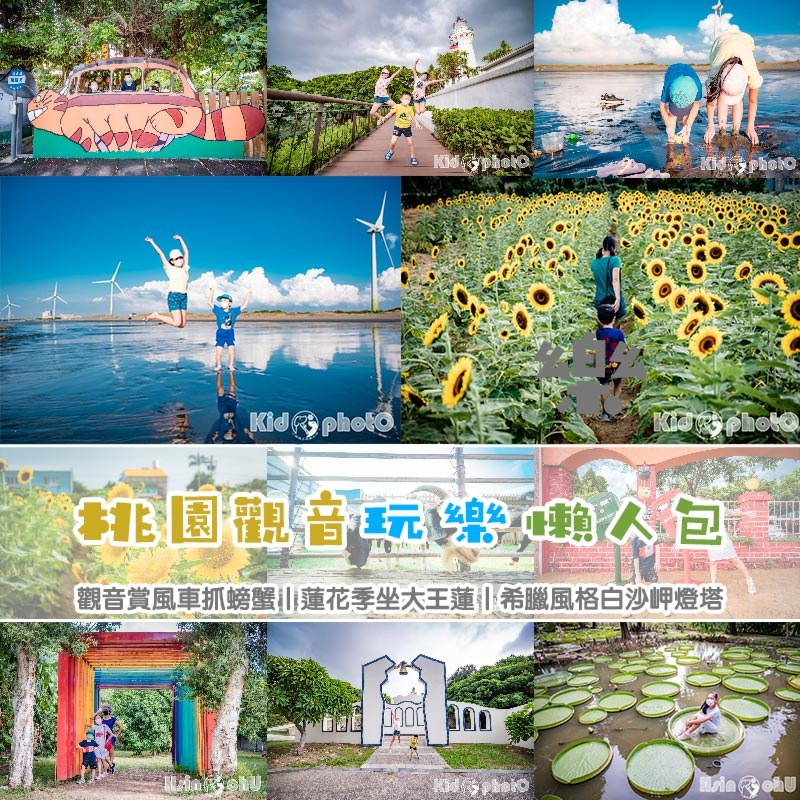
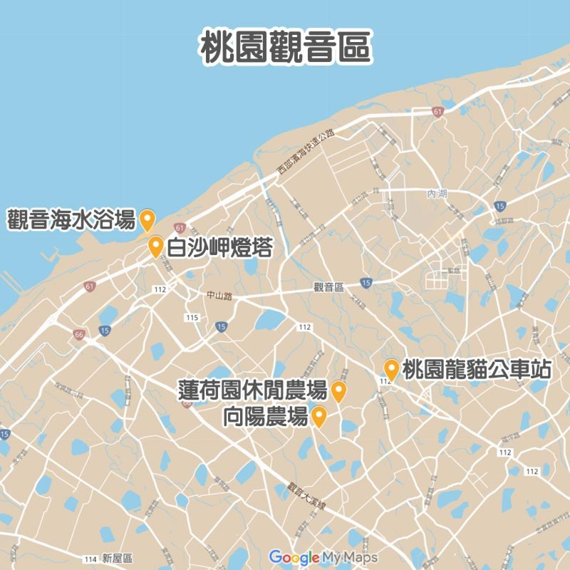
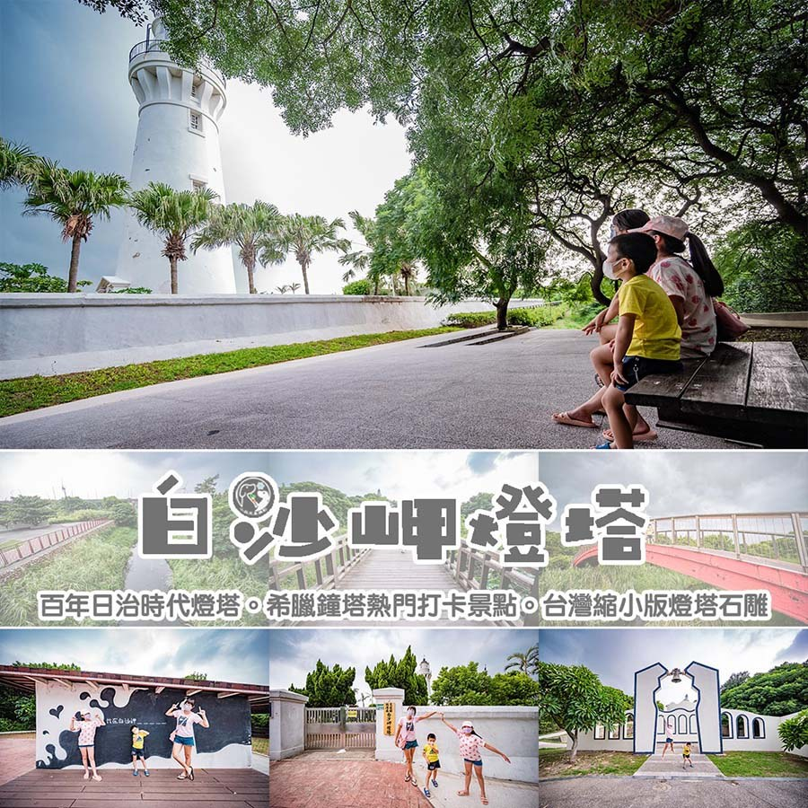
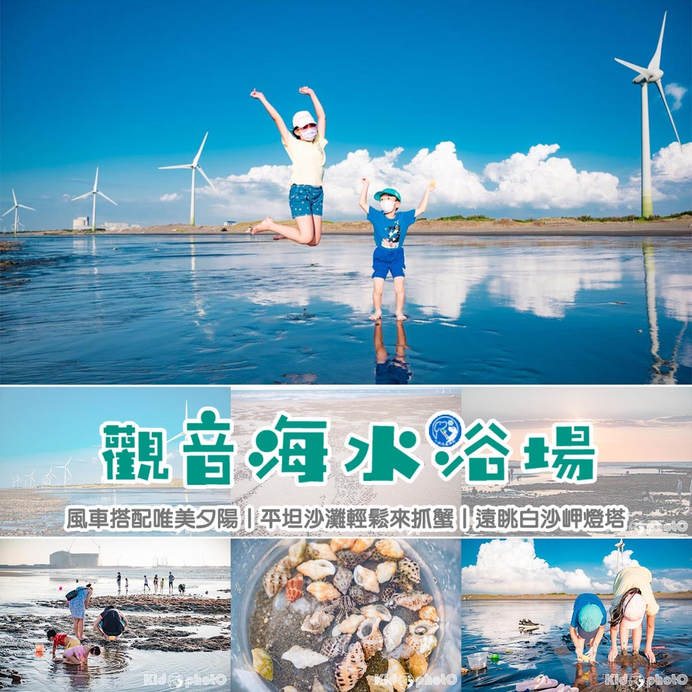
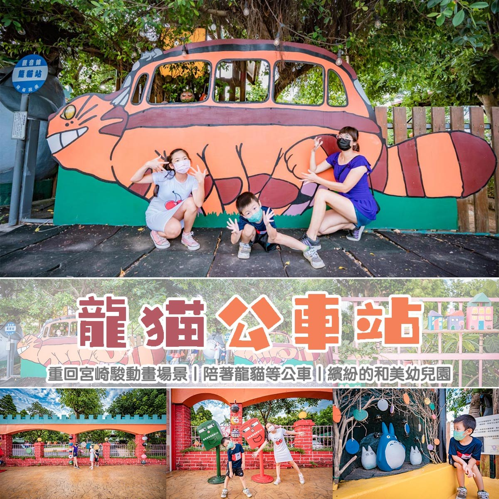
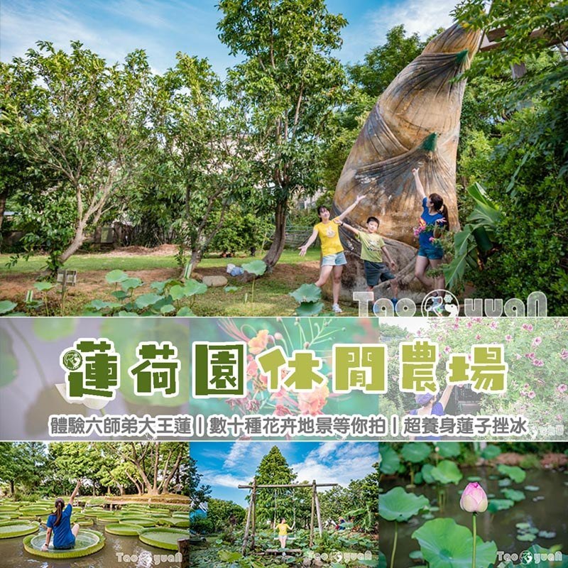
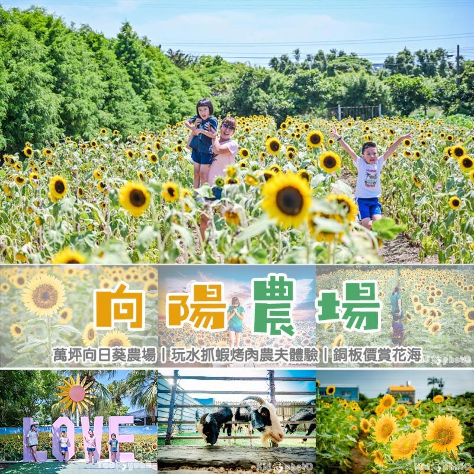
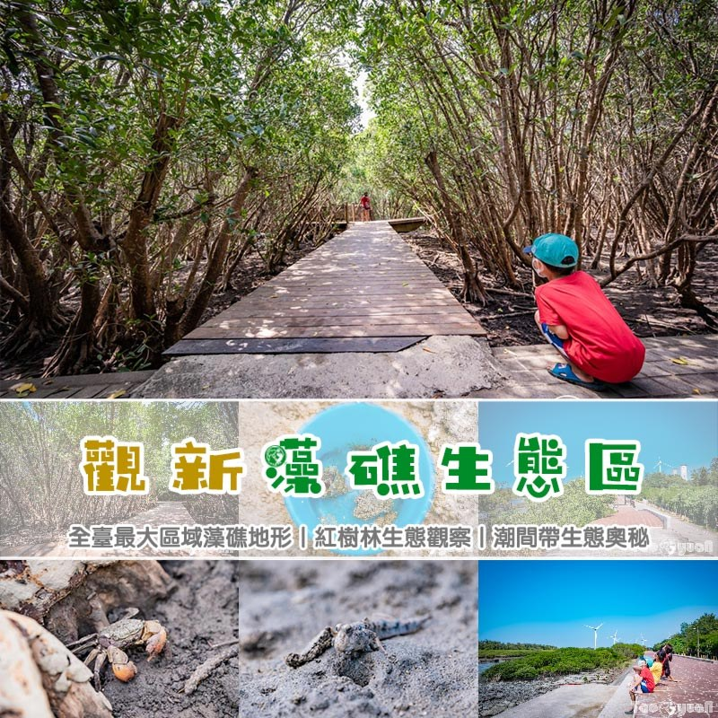
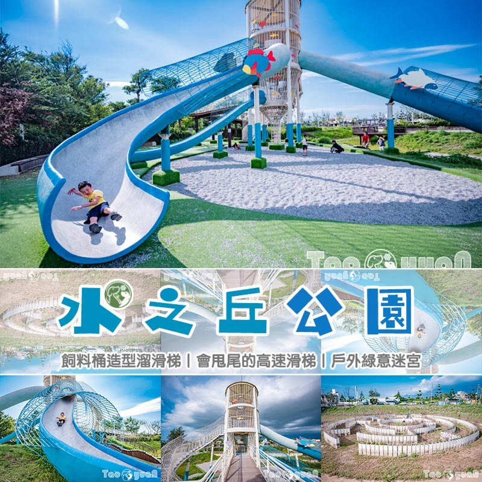
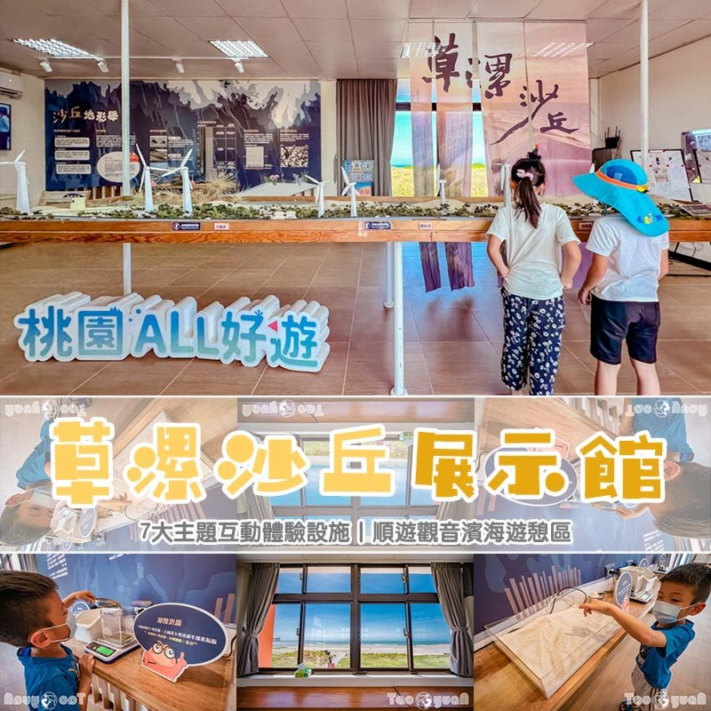

# 桃園觀音玩樂懶人包〡觀音賞風車抓螃蟹, 蓮花季坐大王蓮, 希臘風格白沙岬燈塔, 觀音旅遊地圖 @小菲親子玩樂生活

- 原始網址：https://natsuphil.com/fun-taiwan/guanyin/
- 網站名稱：小菲親子玩樂生活
- 作者：natsuphil0222@gmail.com
- 發表日期：2025-09-26T16:39:52+08:00
- 爬取時間：2026-11-05T16:41:43+08:00　取得方式：requests　正文定位：通用規則 .post-content
- 圖片：10 張

---

*圖：guanyin_F1｜來源：https://natsuphil.com/wp-content/uploads/2021/10/guanyin_F1.jpg*

平常很少來桃園觀音的黃小菲，最近玩了幾個景點之後，發現觀音原來也可以這麼好玩，有海邊、有燈塔、還有超大的農場，所有的景點都非常適合親子一起來玩。想來桃園玩找不到景點的人，不如來安排個觀音一日遊吧。

- 桃園觀音〡地圖導覽

- 白沙岬燈塔〡百年日治時代燈塔
- 觀音濱海遊憩區〡風車搭配唯美夕陽
- 龍貓公車站〡重回宮崎駿動畫場景
- 蓮荷園休閒農場〡體驗六師弟大王蓮輕功水上漂
- 向陽農場〡萬坪向日葵主場農場
- 觀新藻礁〡探索潮間帶生態奧秘
- 水之丘公園〡會甩尾的溜滑梯
- 草漯沙丘展示館〡互動體驗設施

*圖：LoFi-Land_F1｜來源：https://natsuphil.com/wp-content/uploads/2021/10/LoFi-Land_F1.jpg*

### 桃園市觀音區景點

- 白沙岬燈塔〡百年日治時代燈塔

日治時代就已經是熱門景點的「白沙岬燈塔」，它位於「觀音海岸」是台灣國定古蹟，也是目前保存最完整的日治燈塔。其燈塔高度僅次於墾丁「鵝鑾鼻燈塔」約37公尺高。燈塔周圍有環行步道、觀景台、休憩涼亭等…，讓遊客除了一覽燈塔全貌之外，還可以散步、賞景，附近還有「觀音海水浴場」，可以玩水、也可以帶小朋友一起觀察大自然的潮間帶生態。假日來西部海岸時，別忘了這個親子同遊的好去處。

- 詳細文章： https://natsuphil.com/taoyuan/baisha-cape/
- 景點位置：桃園市觀音區光明路216號。 [Google導航地圖]

*圖：（原文無圖片說明）｜來源：https://natsuphil.com/wp-content/uploads/2021/07/baisha-cape_F1-1.jpg*

- 觀音濱海遊憩區〡風車搭配唯美夕陽

位在桃園觀音的「觀音濱海遊憩區」，是由原先的「觀音海水浴場」轉型而成。這裡一望無際的大海、寬廣遼闊的沙灘，加上一排排白色的風車，配搭起來形成一幅美麗的畫。日落時分陽光斜照時，形成一面鏡面沙灘，宛如天空之鏡，將風車、白雲、藍天的倒影，印照在上面，真的超美。平坦的沙灘、超長的海岸線，也讓小朋友們可以安全、方便的觀察小蟹、小魚。是一個超適合親子同遊戲水、觀察潮間帶的好地方。

- 詳細文章： https://natsuphil.com/hualian/beibin-park/
- 景點位置：桃園市觀音區台61線周邊。 [Google導航地圖]

*圖：（原文無圖片說明）｜來源：https://natsuphil.com/wp-content/uploads/2021/08/WP封面-1200p.jpg*

- 龍貓公車站〡重回宮崎駿動畫場景

相信宮崎駿動畫「龍貓」大家一定都有看過，其中有一幕經典中的經典就是「大龍貓拿著雨傘在公車站牌等龍貓公車」，而這樣的畫面就出現在桃園觀音的一座幼兒園的牆面，也吸引了許多遊客前來拍照，除了逼真的龍貓公車站之外，幼兒園的外圍都是可愛的招牌和裝飾，就連上課的地方也繽紛到讓人驚艷，黃小菲心想「還真想讓孩子們在這裡念書呢」。

- 詳細文章： https://natsuphil.com/hualian/lichuan-fish/
- 景點位置：桃園市觀音區中山路二段239號。 [Google導航地圖]

*圖：（原文無圖片說明）｜來源：https://natsuphil.com/wp-content/uploads/2021/09/totoro-bus_F1.jpg*

- 蓮荷園休閒農場〡體驗六師弟大王蓮輕功水上漂

桃園觀音鄉是蓮花的故鄉，而蓮荷園以「你坐蓮，我渡人」的宗旨，打造一座占地2公頃的休閒農場，裡面有大片的蓮花池、稻草博物館、五行八卦迷宮等… 景點，還有些戶外造景提供你拍照。最熱門的就是大王蓮水上漂，只要付銅板價就能像「少林足球」裡的六師弟一樣，平穩的坐在上面、躺在上面、就算金雞獨立也沒問題。其中焢窯、稻草手作也是熱門的親子活動，還有還有，特別是夏季來臨時，來碗特有的健康養身的南瓜蓮子冰，讓人更加的清涼無比。

- 詳細文章： https://natsuphil.com/hualian/lichuan-fish/
- 景點位置：桃園市觀音區金華路690號。 [Google導航地圖]

*圖：（原文無圖片說明）｜來源：https://natsuphil.com/wp-content/uploads/2025/08/lotus-farm_F1.jpg*

- 向陽農場〡萬坪向日葵主場農場

每年五月到十月正是向日葵的花季（依天氣狀況，花況不盡相同），說到賞向日葵的景點，大多數北部人第一個聯想到的都是桃園觀音「向陽農場」，它也是目前北台灣最大的向日葵主題農場，雖沒有到花海等級，但品種很多，可以一次收集起來。除了可以欣賞到不同種類的向日葵之外，也可以在千坪向日葵花海中美拍，園內也提供相當多的活動、設施，像是餵山羊、射箭場、漆彈場、大型烤肉、採集蔬果等…，還有小朋友最愛的小火車塔乘。這麼多項的活動、體驗，讓向陽農場就像是座戶外的大型遊樂園，趕緊跟著黃小菲一同進入這夏末必賞的向日葵花海吧。

- 詳細文章： https://natsuphil.com/hualian/lichuan-fish/
- 農場位置：桃園市觀音區藍埔里11鄰52號。 [Google導航地圖]

*圖：（原文無圖片說明）｜來源：https://natsuphil.com/wp-content/uploads/2024/07/sun-green_F13.jpg*

- 觀新藻礁生態區〡探索潮間帶生態奧秘

全臺灣最大區域的藻礁區，就在桃園 觀音 和 新屋 沿岸，除了大自然賦予的天然地景，豐富、多元的生物也是觀新藻礁特別的地方，據說在這裡的生物密度是高美濕地的5倍、香山濕地的8倍喔！

- 詳細文章： https://natsuphil.com/taoyuan/guanxin-sea/
- 景點位置： 觀新藻礁生態區：涵蓋桃園市觀音區保生村、桃園市新屋區永興村及永安村，並分為核心區、緩衝區與永續利用區。 [Google導航地圖] 藻礁生態環境教室：桃園市新屋區東興路二段1800巷160號。〔 Google導航地圖 〕

*圖：（原文無圖片說明）｜來源：https://natsuphil.com/wp-content/uploads/2021/10/guanxin-sea_F2.jpg*

- 水之丘公園〡會甩尾的溜滑梯

外觀不是很討喜的飼料桶溜滑梯沒想到這麼好玩，而且連大人都可以溜！「水之丘公園」裡也有洗手間，大小朋友都可以玩更久了，若夏季前往，也要記得適時補充水分和做好防曬喔~(2025公園旁出現麥當勞，更方便了。)

- 詳細文章： https://natsuphil.com/taoyuan/water-mound-park/
- 景點位置：桃園市觀音區台15線402號。 [Google導航地圖] 或 Google map 搜尋 [水之丘公園]

*圖：（原文無圖片說明）｜來源：https://natsuphil.com/wp-content/uploads/2023/09/water-mound_F1.jpg*

- 草漯沙丘展示館〡玩中學學中玩

草漯沙丘觀音展示館就在桃園觀音濱海遊憩區的旁邊而已，有剛好來抓蟹踏水或賞夕陽的朋友們也可以進去參觀看看喔~除了一小區的互動體驗，另外還有一間視聽室，教室裡有開冷氣非常涼，座位也不少，在此區休息一下也蠻不錯的。

- 詳細文章： https://natsuphil.com/taoyuan/caota-dune-indoor/
- 景點位置：桃園市觀音區中興路469號。 [Google導航地圖] 或 Google map 搜尋 [草漯沙丘地景展示館]

*圖：（原文無圖片說明）｜來源：https://natsuphil.com/wp-content/uploads/2024/07/caota-dune-indoor_F11.jpg*

### 關於〡黃小菲

愛拍照的黃小菲，喜歡用照片說故事，最愛帶著一家四口到處走走拍拍

用質感最高的畫面，細膩生動的文字，帶領你進入黃小菲的親子玩樂生活

喜歡黃小菲用心拍攝的照片或是逗趣文章內容的朋友們，記得來FB粉絲團點個讚喔

聯絡信箱： [email protected]

> 小菲兒童親子隨拍

### 評論
