# 桃園觀音景點〡蓮荷園休閒農場〡體驗六師弟大王蓮輕功水上漂, 數十種花卉造景美拍加分, 特色美味南瓜蓮子冰 @小菲親子玩樂生活

- 原始網址：https://natsuphil.com/taoyuan/lotus-farm/
- 網站名稱：小菲親子玩樂生活
- 作者：natsuphil0222@gmail.com
- 發表日期：2026-10-31T17:20:29+08:00
- 爬取時間：2026-11-05T16:41:54+08:00　取得方式：requests　正文定位：通用規則 .post-content
- 圖片：16 張

---
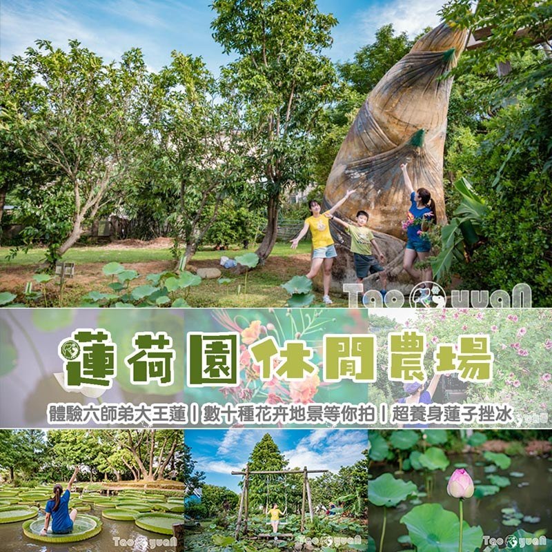

*圖：lotus-farm_F1｜來源：https://natsuphil.com/wp-content/uploads/2025/08/lotus-farm_F1.jpg*

桃園觀音鄉是蓮花的故鄉， 蓮荷園 不僅有大片的蓮花池，還有戶外造景提供大家拍照。而最熱門的就是大王蓮水上漂，只要付銅板價就能像「少林足球」裡的六師弟一樣，平穩的坐在上面、躺在上面、就算金雞獨立也沒問題，創意pose擺出來就對了！夏季來臨時，來碗園內特有的健康養身南瓜蓮子冰，透心涼~ 【 提醒 ： 蓮荷園休閒農場 每年開園期約落在5~10月，大王蓮花乘坐體驗約6月初開放(每年正式開園日會公布在蓮荷園休閒農場粉專”FB”)，鎖定粉專得知更多資訊】

### 蓮荷園休閒農場〡相關資訊

- 景點位置：桃園市觀音區金華路690號。 [Google導航地圖]
- 停車資訊：蓮荷園休閒農場正對面停車場。 [Google導航地圖]
- 營業時間： 星期一 、三、四、五、六、日， 09：00 ~ 17：00 星期二 公休 每年 開園期約落在5~10月， 大王蓮花乘坐體驗約6月初開放 每年正式開園日會公布在蓮荷園休閒農場粉專”FB”，鎖定粉專得知更多資訊 冬季休園公告 ： 自2026年11月1日起進入冬季休園與整理期，不對外開放散客；期間僅接受30人以上團體預約，預計於2027年5月1日重新開園。 若有變動依園方公告資訊為主
- 連絡電話：（03）477-6972
- 門票資訊： 全票 100元（園內消費無折抵） 半票50元 (120公分以下) 團體票80元 (20人以上) 乘坐「大王蓮」另外付費 50元（限重100公斤） 若有變動依園內公告資訊為主

### 桃園還有哪裡好玩

桃園市景點 桃園觀音區懶人包 白沙岬燈塔 觀新藻礁生態區 蓮荷園休閒農場 草漯沙丘觀音展示館 羊稠森林步道 大有梯田生態公園 竹圍漁港 水之丘主題公園 許厝港濕地 永安漁港 利百代彩筆文創館 雄獅文具想像力製造所 風禾公園 巧虎夢想新樂園 大古山登山步道公園 乙未保台紀念公園 向陽農場 永安海螺文化館

> 小菲兒童親子隨拍

### 蓮荷園休閒農場

- 看到黑白色的大乳牛代表到達目的地囉~ 蓮荷園休閒農場 的入口就在旁邊

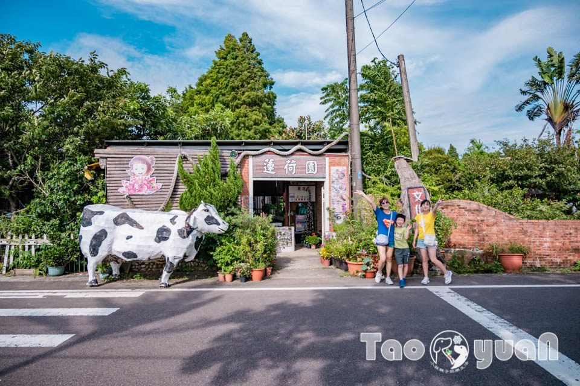

*圖：DSC_5731｜來源：https://natsuphil.com/wp-content/uploads/2025/06/DSC_5731.jpg*

- 收費標準 黃小菲首訪時全票是80元，再訪價位有調整喔！票價如下： 全票：100元 半票：50元 (120公分以下) 團體票：80元 (20人以上) 不可折抵園內消費 若有變動依現場公告資訊為主 乘坐大王蓮 要 另外付費 50元 喔~

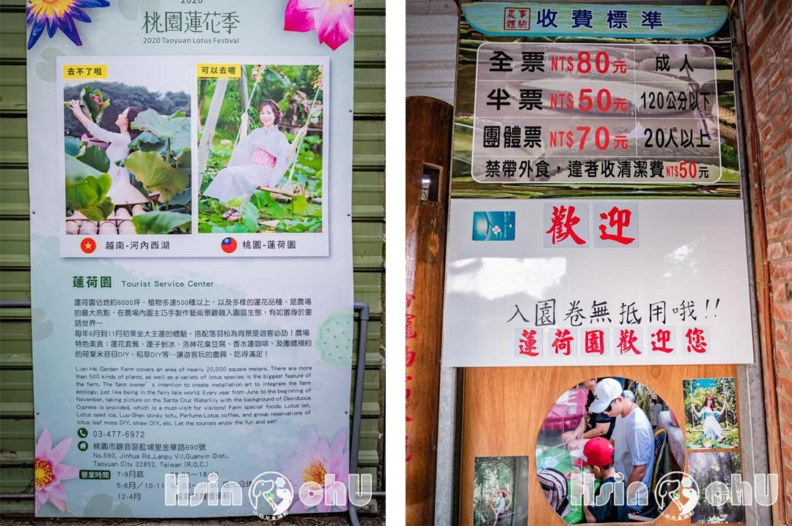

*圖：lotus-farm_003｜來源：https://natsuphil.com/wp-content/uploads/2021/09/lotus-farm_003.jpg*

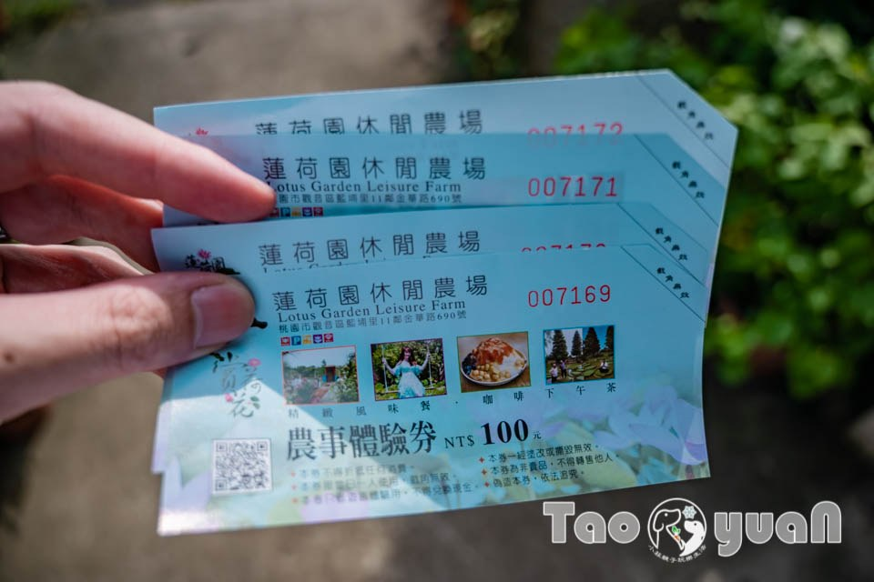

*圖：DSC_5736｜來源：https://natsuphil.com/wp-content/uploads/2025/06/DSC_5736.jpg*

- 蓮荷園 的環境很天然，沒有繽紛華麗的造景，取而代之的是一花一草和樹木群們，以及木製或草編的地景。自然景就是耐看，在園內拍的照片，看起來都別有一番風味。

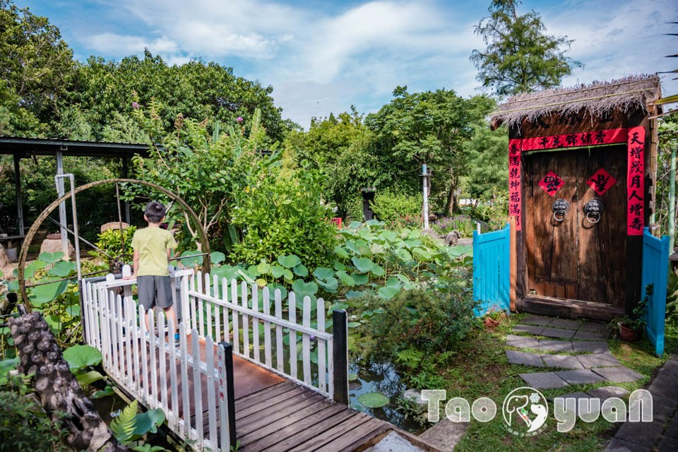

*圖：DSC_5740｜來源：https://natsuphil.com/wp-content/uploads/2025/06/DSC_5740.jpg*

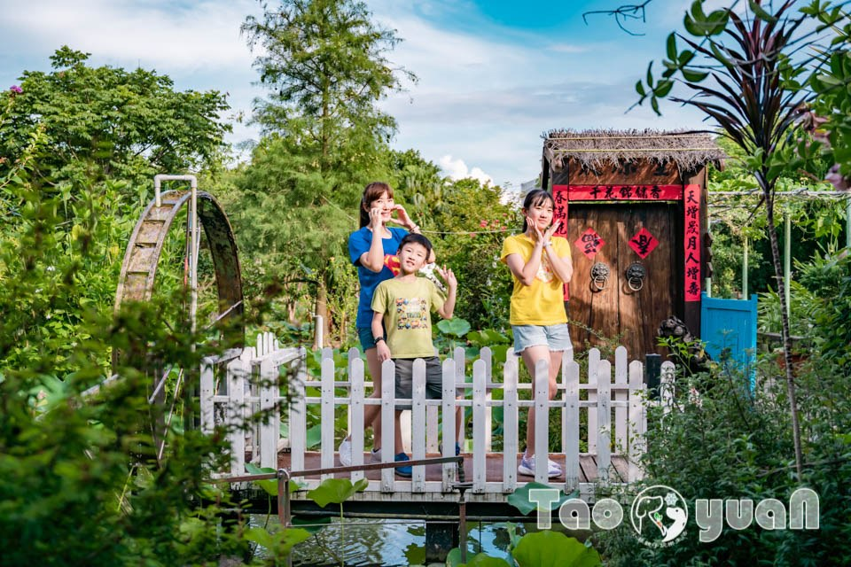

*圖：DSC_5884｜來源：https://natsuphil.com/wp-content/uploads/2025/06/DSC_5884.jpg*

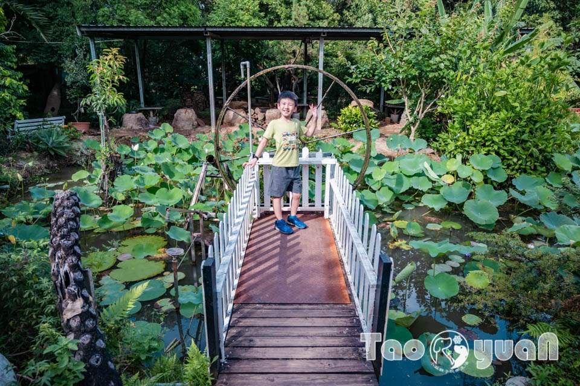

*圖：DSC_5738｜來源：https://natsuphil.com/wp-content/uploads/2025/06/DSC_5738.jpg*

- 竟然還有水濂洞

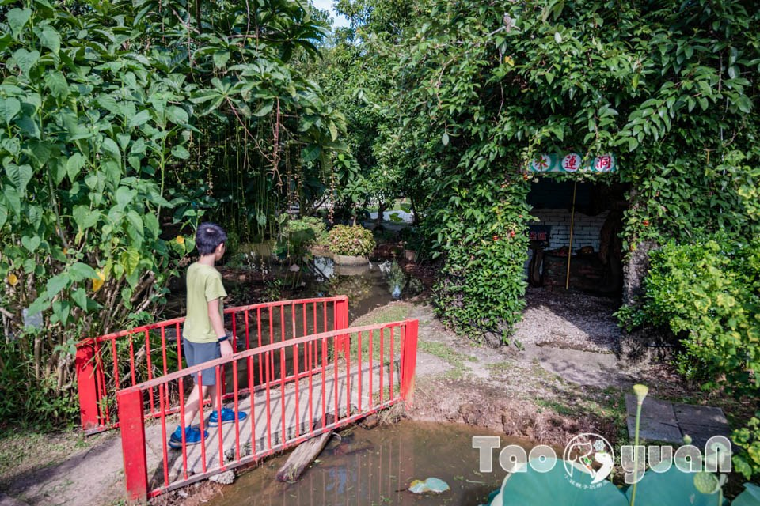

*圖：DSC_5745｜來源：https://natsuphil.com/wp-content/uploads/2025/06/DSC_5745.jpg*

- 2025 暑假再訪，多了一區 「獨角仙的家」。雖然已經過了七月的爆發期，不過園內少少的光蠟樹上還是可以看得到零星幾隻，寶寶觀察員啟動觀察模式~

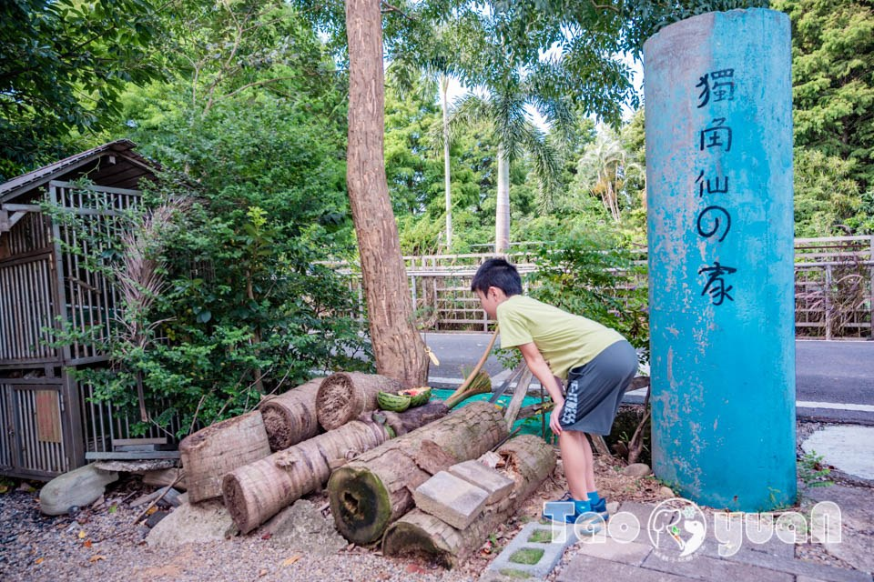

*圖：DSC_5777｜來源：https://natsuphil.com/wp-content/uploads/2025/06/DSC_5777.jpg*

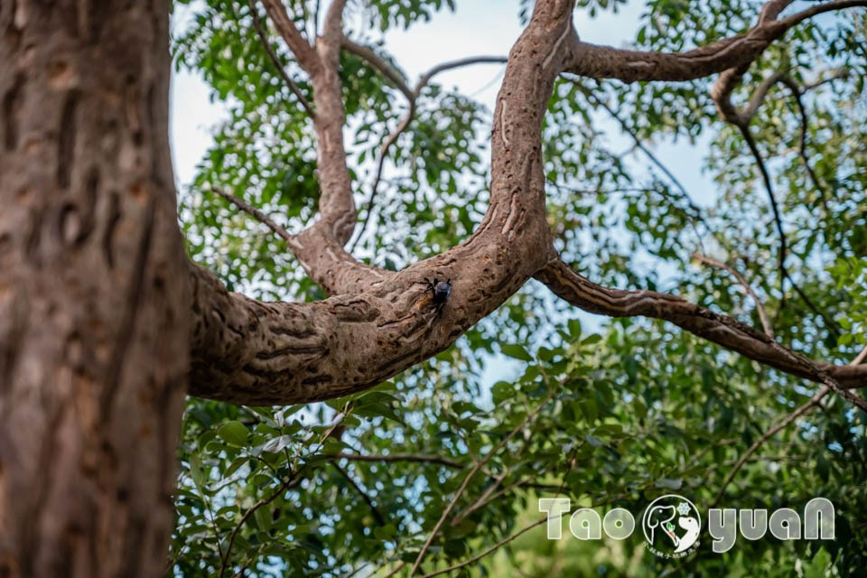

*圖：DSC_5778｜來源：https://natsuphil.com/wp-content/uploads/2025/06/DSC_5778.jpg*

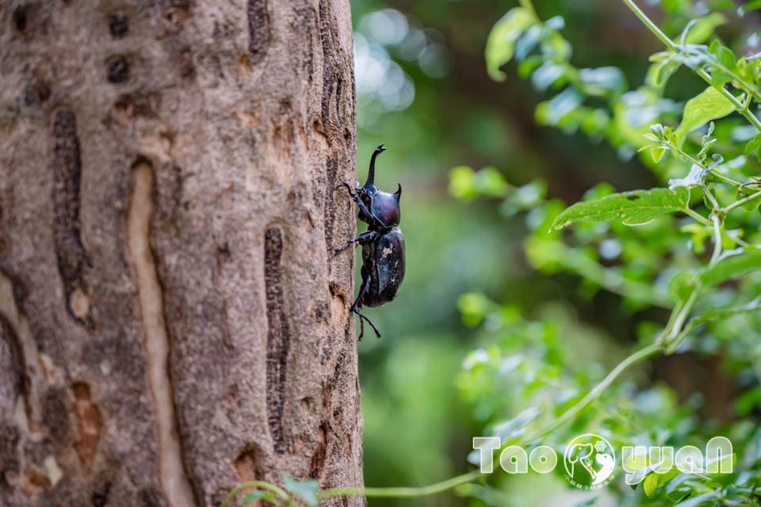

*圖：DSC_5779｜來源：https://natsuphil.com/wp-content/uploads/2025/06/DSC_5779.jpg*

### 小船美拍區 ｜ 稻草造景區

- 蓮花1號 蓮花1號可載重100公斤，雙人也可以搭乘喔~只要體重總和沒有超過都OK。不過如果遇到人潮較多，務必排隊輪流拍照，切勿佔位太久。

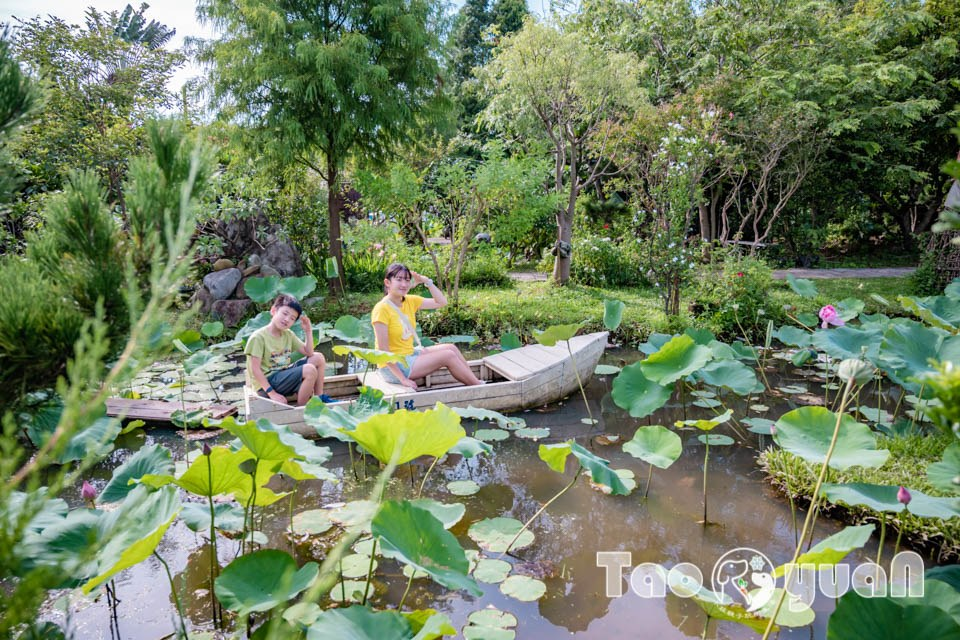

*圖：DSC_5753｜來源：https://natsuphil.com/wp-content/uploads/2025/06/DSC_5753.jpg*

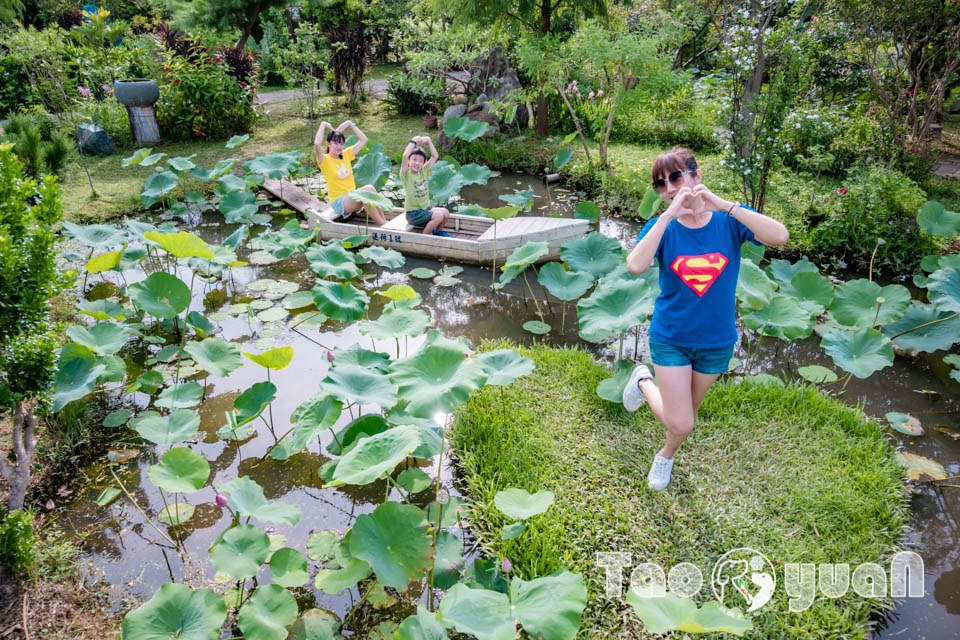

*圖：DSC_5763｜來源：https://natsuphil.com/wp-content/uploads/2025/06/DSC_5763.jpg*

- 首訪是疫情解封前期，還戴著口罩呢！

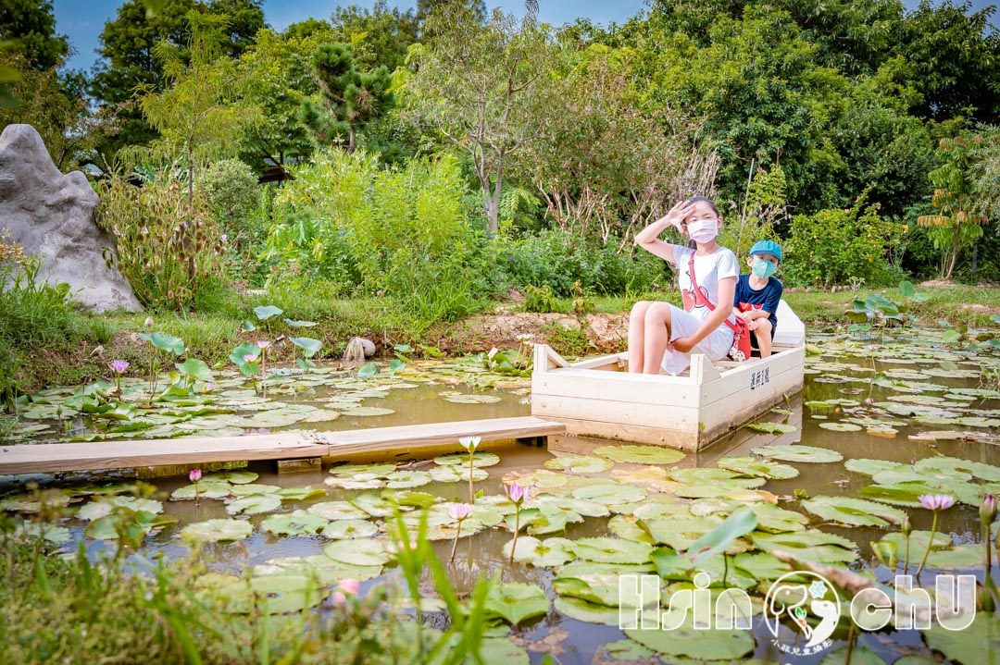

*圖：lotus-farm_008｜來源：https://natsuphil.com/wp-content/uploads/2021/09/lotus-farm_008.jpg*

- 稻草造景區 利用稻草編制各式各樣的動物或昆蟲，提供大家美拍 (造景不定期更換)。再訪象車已退休，只留下飛天稻草人。

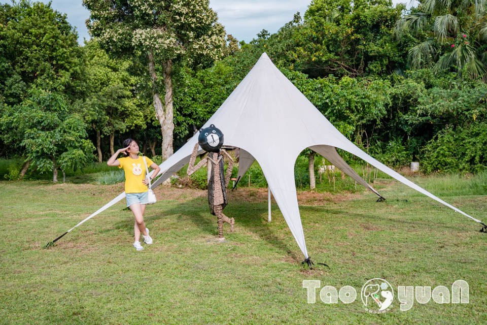

*圖：DSC_5855｜來源：https://natsuphil.com/wp-content/uploads/2025/06/DSC_5855.jpg*

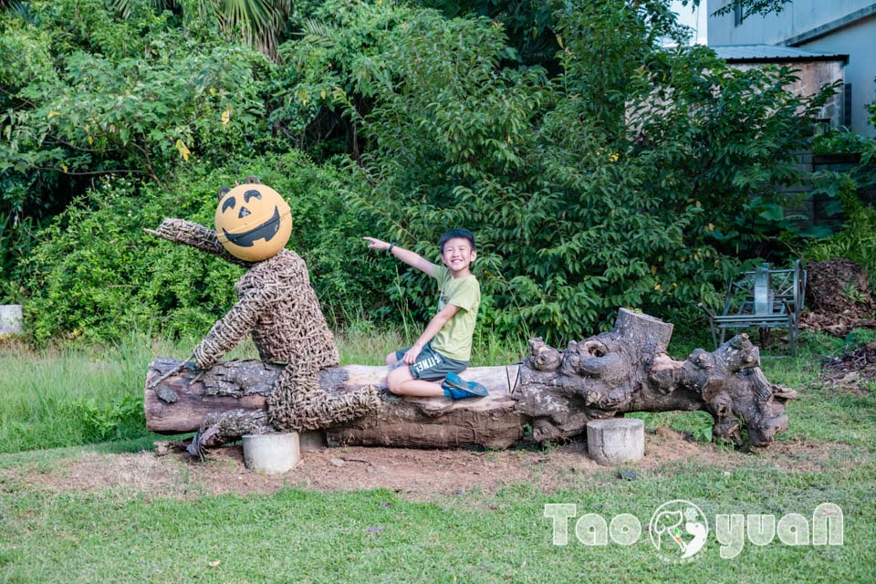

*圖：DSC_5860｜來源：https://natsuphil.com/wp-content/uploads/2025/06/DSC_5860.jpg*

- 方圓之間 雖然彩虹拱門和部分稻草造景已退休，不過也有新的拍照點出現，例如照片裡的(方圓之間)美拍點。綠意盎然~生機勃勃，正能量滿滿！

### 蓮花靜淨地〡大王蓮在這邊

- 想乘坐大王蓮的朋友，從稻草區直直走到底，經過一條小馬路，就能看到貼著三張門聯的小門，走進來後，就可以開始找大王蓮囉！

- 大王蓮區有古色古香的造景，遊走在園內很有拍古裝劇的感覺。

- 各式蓮花 在大王蓮這區，可以欣賞到蓮花池裡各式各樣的蓮花，有睡蓮、牡丹蓮、泰國蓮、大賀蓮等…，對蓮花沒有研究的黃小菲，還真的完全分不出來，只覺得通通都漂亮，朵朵都是出淤泥而不染。

- 含苞待放的蓮花、或者是準備收成蓮子來吃的蓮花，都各自擁有不同的美。

### 美拍聖地大王蓮池

- 看到滿滿的大王蓮，好想直接衝上去坐下來體驗！不過想乘坐的朋友要留意，可不是朵朵都能坐，蓮花上有透明的圓盤，才是提供給遊客坐的唷~而且會有服務人員在旁收費與指導，每乘坐一次50元(若有變動依現場規定為主)。

- 因為有時間限制，所以在乘坐之前建議先想好幾個拍照姿勢，想不到的朋友也可以參考勘版上的動作喔~(備註：大王蓮花乘坐體驗限重100公斤)

- 每人限拍六張，建議想好拍照pose再上去，注意事項如下： 每人50元 (拍六張照片) 限重100公斤 站著拍、坐著拍或躺著拍都可以 不管移動或定點，都盡量在圓盤的中間位置 不要觸摸葉子避免刺到 若拍照規定內容有變動依園方公告資訊為主

- 黃小菲一直覺得大王蓮是種非常特別的植物，忍不住幫它來張特寫。

- 像寶寶一樣不敢站在荷葉上的朋友，可以到靠近大王蓮花田入口區的這朵偽大王蓮花處擺拍喔！

### 數十種花卉、巨大竹筍造景

- 在稻草區靠近入口那端，有支巨無霸竹筍，而且非常逼真， 2025暑假 再訪，大竹筍依舊存在喔！

- 大竹筍旁邊也有盪鞦韆可以美拍

- 小池子裡的魚，還滿大尾的，寶寶超喜歡的。

- 在 蓮荷園 裡還能賞花喔~五顏六色真美！

### 南瓜蓮子挫冰〡販賣處

- 用餐區與販賣部就在入口處，不少蓮子相關的小餐點，像是南瓜蓮子挫冰、蓮子豆花、蓮花冰棒和蓮子竹筒飯等等。喜歡蓮子的黃小菲，真想通通嚐過一輪！

- 【 菜單 】 不定期更動內容物和價位，首訪蓮子剉冰一碗120元，再訪已調為140元。

- 南瓜蓮子挫冰 冰的最上層是南瓜醬，底下除了招牌的蓮子外，還有仙草、鳳梨等配料，有特色的蓮子剉冰，好吃！

- 舊地重遊還是很喜歡， 蓮荷園 不花俏的自然環境與氛圍，很適合喜歡慢步調、輕鬆行的朋友。

### 黃小菲玩樂筆記

### 桃園還有哪裡好玩

- 桃園觀音〡龍貓公車站
- 桃園觀音〡白沙岬燈塔〡百年日治燈塔
- 桃園觀音〡觀音濱海遊憩區
- 桃園中壢〡巧虎夢想新樂園
- 桃園桃園〡利百代彩筆文創館
- 桃園龍潭〡雄獅文具想像力製造所
- 桃園桃園〡大有梯田生態公園

### 關於〡黃小菲

愛拍照的黃小菲，喜歡用照片說故事，最喜歡帶著一家四口到處走走拍拍

呈現最真實的畫面，用細膩生動的文字，帶領你進入黃小菲的親子玩樂生活

喜歡黃小菲用心拍攝的照片或是逗趣文章內容的朋友們，記得來FB粉絲團點個讚喔

聯絡信箱： [email protected]

> 小菲兒童親子隨拍

### 店家/景點資訊

- 店家名稱： 蓮荷園休閒農場
- 所在地址：臺灣桃園市觀音區金華路690號
- 營業時間：日 一 二 三 四 五 六 08:30-17:00
- 店家電話：
- 備註資訊： 1.營業時間：09:00 – 17:00（每週二公休，實際開園期主要為每年5月至10月) 2.冬季休園公告：自2026年11月1日起進入冬季休園與整理期，不對外開放散客；期間僅接受30人以上團體預約，預計於2027年5月1日重新開園。

### 交通資訊

### 評論
