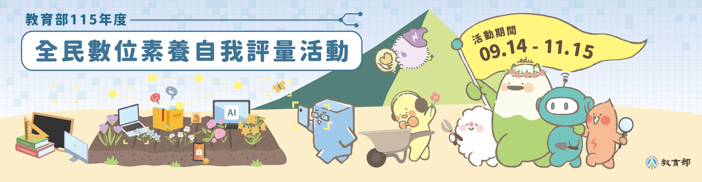

# 經濟部觀音產業園區服務中心 Guanyin Industrial Park Service Center

- 原始網址：https://www.bip.gov.tw/iphw/kuangin/
- 網站名稱：www.bip.gov.tw
- 作者：（未標示）
- 發表日期：（未標示）
- 爬取時間：2026-11-05T16:42:12+08:00　取得方式：requests　正文定位：文字密度評分
- 圖片：2 張

---
### 入區相關規定

- 2026-08-01 【觀音產業園區】容許入區產業別及入區相關規定

### 最新消息

- 2026-11-05 【轉知】本局經辦「出口拓銷說明會」，敬邀本園區廠商參與
- 2026-11-05 轉知-檢送外送員「每筆訂單基本報酬之保障金額」公告影本1份

### 最新活動

- 2026-08-27 ~ 2026-12-31 因應勞動部職業安全衛生署政策，「職業安全衛生管理人員及一般勞工」，在職教育訓練證...
- 2026-01-01 ~ 2026-12-31 115年度觀音產業園區在職教育訓練活動行事曆

### 政令宣導

- 目前無資料

本產業園區編訂係遵奉行政院前孫院長為解決桃園市濱海四區所面臨難題，於民國六十八年十一月二十四日專程蒞臨實地考察所作之裁示，並為配合政府改善投資環境，因應台灣北部地區工業引進帶動沿海地區之繁榮，而開發之政策性產業園區為配合工業引進用地需求量及開發資金籌措需要，於民國七十一年二月起在桃園市觀音區分三期開發，至民國七十九年十二月完成。開發總面積632.12公頃，係一綜合性產業園區，此項開發對當地的繁榮與發展有極大的貢獻。

*圖：矯正機關自營商品展售商城｜來源：https://www.bip.gov.tw/iphw/_commons/images/adv/ATTCH3.jpg*

*圖：全民數位素養自我評量 logo｜來源：https://www.bip.gov.tw/iphw/_commons/images/adv/260916.jpg*
