# 桃園大園景點〡華興池公園〡華興池生態埤塘公園, 多功能特色公園震撼登場, 遊戲區放電數飛機, 還有夏日戲水區,  喬寓咖啡The QiAO絕美視角, 假日開放水上活動 @小菲親子玩樂生活

- 原始網址：https://natsuphil.com/taoyuan/hauxingchi-park/
- 網站名稱：小菲親子玩樂生活
- 作者：natsuphil0222@gmail.com
- 發表日期：2026-09-20T10:09:20+08:00
- 爬取時間：2026-10-29T16:12:02+08:00　取得方式：requests　正文定位：通用規則 .post-content
- 圖片：15 張

---

*圖：WP-封面-800p｜來源：https://natsuphil.com/wp-content/uploads/2024/10/WP-封面-800p-6.jpg*

桃園的公園越來越厲害！有點年紀但有全台最長滾輪滑梯的 「風禾公園」 、連大人也能溜，且速度感十足的 「水之丘公園」，還有大家反應難停車但公園相當有挑戰性的 「大有梯田生態公園」，以及2024暑假全新啟用的 「南崁溪第一河濱公園」，至今都還很熱門！只是人外有人天外有天，桃園又有一座超級公園震撼登場！ 「華興池生態埤塘公園」 讓黃小菲心中前三喜愛的公園名單一直在變動！

華興池生態埤塘公園〡相關資訊

- 景點位置：桃園市大園區華興路205號 [Google導航地圖]
- 停車資訊：公園周圍的停車格或路邊白線，若滿位附近停車場有~ 城市車旅停車場 全聯大園華興站 [ Google導航地圖 ] 大園區老街溪停車場 [ Google導航地圖 ] 以上兩處停車場皆須再步行10~15分鐘到華興池生態埤塘公園
- 公園 全天開放 喬寓咖啡 The QiAO營業時間~ 週一至週五 10:00~18:00 週六、週日：10:00~21:00 週二公休 若有變動依店家公告時間為主
- 公共設施：[有] 公共廁所〡[有] 洗腳區〡[有] 淋浴間〡[有] 休憩區〡[有] 戲水區〡[有] 遊戲區〡[有] 觀景台〡[有] 咖啡廳

桃園還有哪裡好玩

桃園市景點 桃園觀音區懶人包 白沙岬燈塔 觀新藻礁生態區 蓮荷園休閒農場 草漯沙丘觀音展示館 羊稠森林步道 大有梯田生態公園 竹圍漁港 水之丘主題公園 桃園立市兒童美術館 大溪老街 溪海休閒農業園區 大嵙崁親水園區 威天宮 許厝港濕地 永安海螺文化館 永安漁港 龍潭運動公園 華興池公園 光明公園 平鎮運動公園 四維兒童公園 陽明運動公園 楓樹腳公園

全台灣瀨人包系列

全台灣燈塔懶人包 台61線濱海懶人包 北部室內樂園懶人包 北部海邊戲水懶人包

> 小菲兒童親子隨拍

### 華興池生態埤塘公園〡秋日廣場&城市通廊

▼ 華興池生態埤塘公園 不僅有遊憩與休憩功能，還導入生態環境保護及都市美學的應用，最後再結合與公園融為一體的湖畔咖啡廳，男女老幼通通兼顧到。在占地大的 華興池公園 同時還享有飛機看到飽的驚喜，讓大小朋友都開心極了。

*圖：hauxingchi-park-2｜來源：https://natsuphil.com/wp-content/uploads/2024/10/hauxingchi-park-2.jpg*

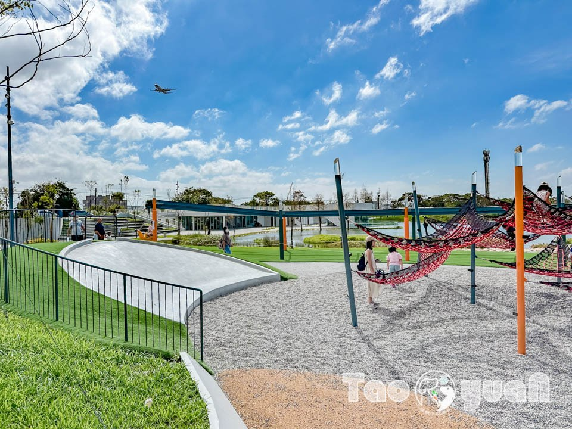

*圖：hauxingchi-park-24｜來源：https://natsuphil.com/wp-content/uploads/2024/10/hauxingchi-park-24.jpg*

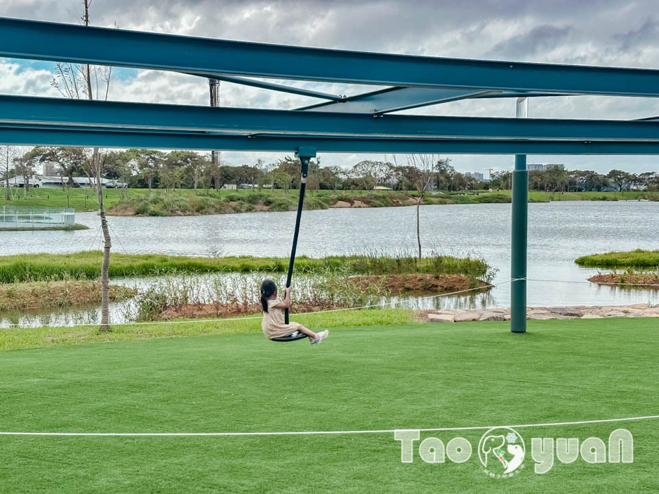

*圖：hauxingchi-park-61｜來源：https://natsuphil.com/wp-content/uploads/2024/10/hauxingchi-park-61.jpg*

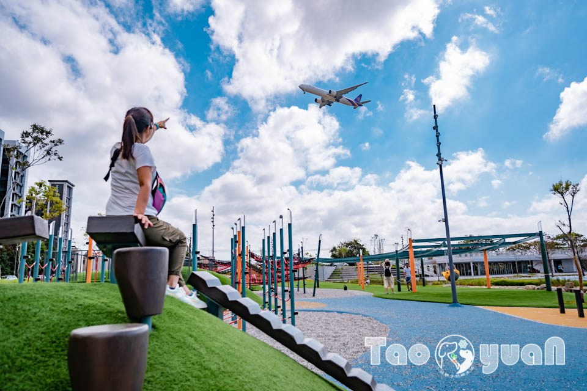

*圖：hauxingchi-park-16｜來源：https://natsuphil.com/wp-content/uploads/2024/10/hauxingchi-park-16.jpg*

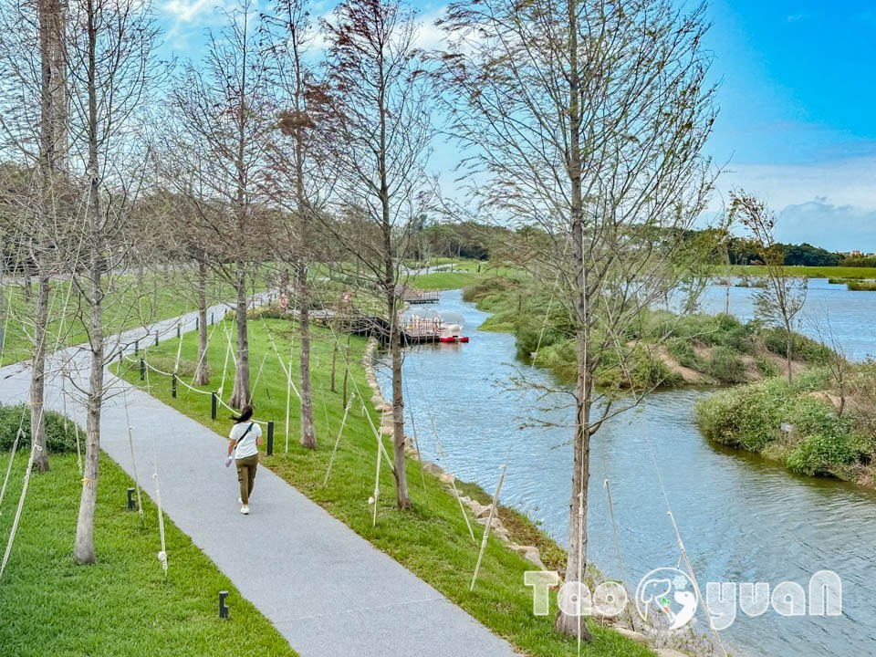

*圖：hauxingchi-park-32｜來源：https://natsuphil.com/wp-content/uploads/2024/10/hauxingchi-park-32.jpg*

▼ 到 華興池生態埤塘公園 除了搭乘交通工具，附近的民眾也能多多騎乘U-bike前往，解能減碳又環保。開車族的朋友可以將車子停在公園周圍的停車格或路邊白線，不過若假日滿位，就要停到( 城市車旅停車場 全聯大園華興站 )或是( 大園區老街溪停車場 )，但要再步行約10~15分鐘路程才能到公園，所以若能早到的朋友建議早點出門。

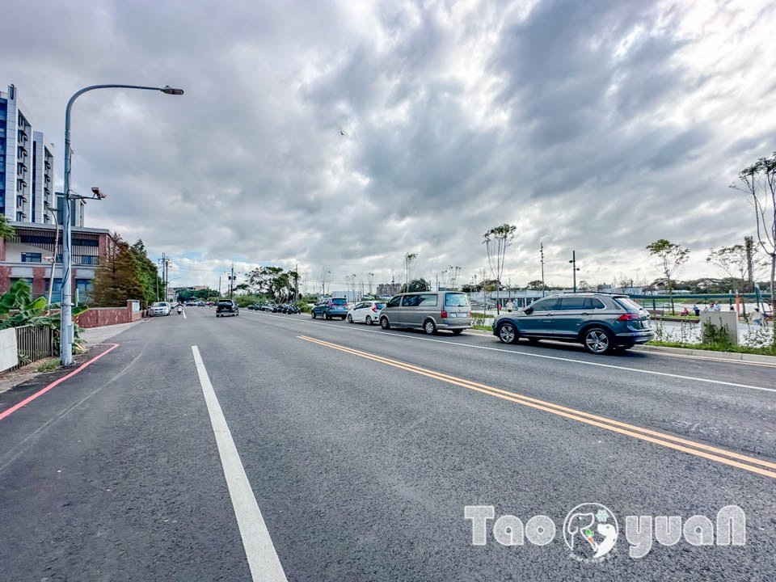

*圖：hauxingchi-park-65｜來源：https://natsuphil.com/wp-content/uploads/2024/10/hauxingchi-park-65.jpg*

▼ 黃小菲從城市通廊進入，另外還有兩處入口(春日廣場)與(秋日廣場)。

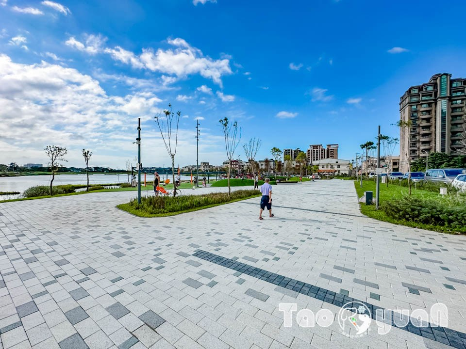

*圖：hauxingchi-park-64｜來源：https://natsuphil.com/wp-content/uploads/2024/10/hauxingchi-park-64.jpg*

▼公園招牌 靠近 秋日廣場，這裡有一小區美美的落羽松，還規劃一條彎彎的步道將落羽松包圍，設計者一定是懂拍的網美。期待天氣越來越冷，落雨松綻放風采的時刻，屆時這區絕對會成為 華興池生態埤塘公園 最夯的打卡點。

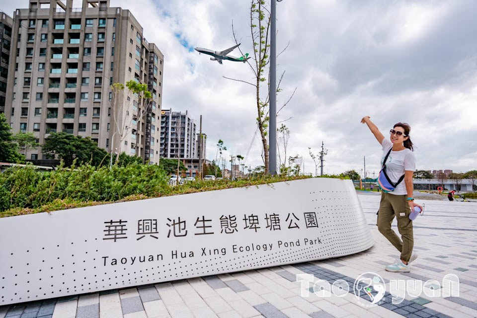

*圖：hauxingchi-park-57｜來源：https://natsuphil.com/wp-content/uploads/2024/10/hauxingchi-park-57.jpg*

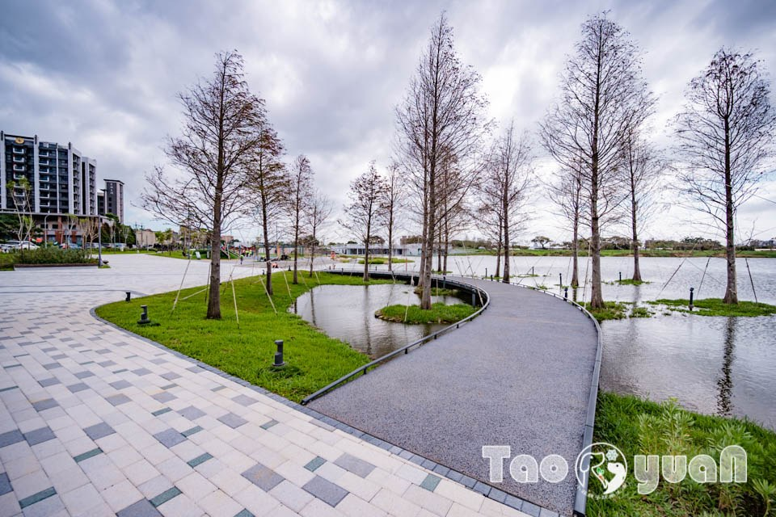

*圖：hauxingchi-park-56｜來源：https://natsuphil.com/wp-content/uploads/2024/10/hauxingchi-park-56.jpg*

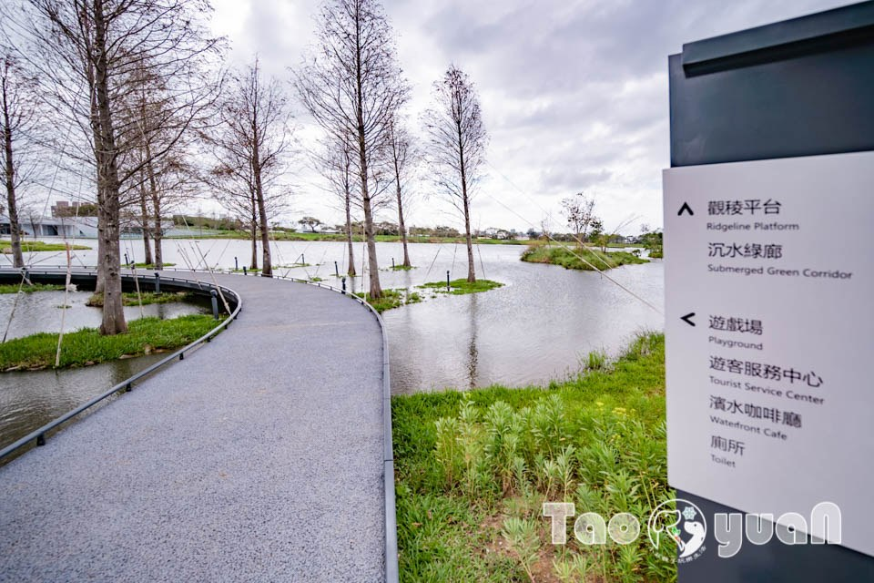

*圖：hauxingchi-park-55｜來源：https://natsuphil.com/wp-content/uploads/2024/10/hauxingchi-park-55.jpg*

### 冒險森林遊戲場〡夏日戲水區

▼冒險森林遊戲區 的遊具主要以 攀爬類 為主，但最受歡迎的是大人也能玩的追風滑索！(脈衝滑軌)

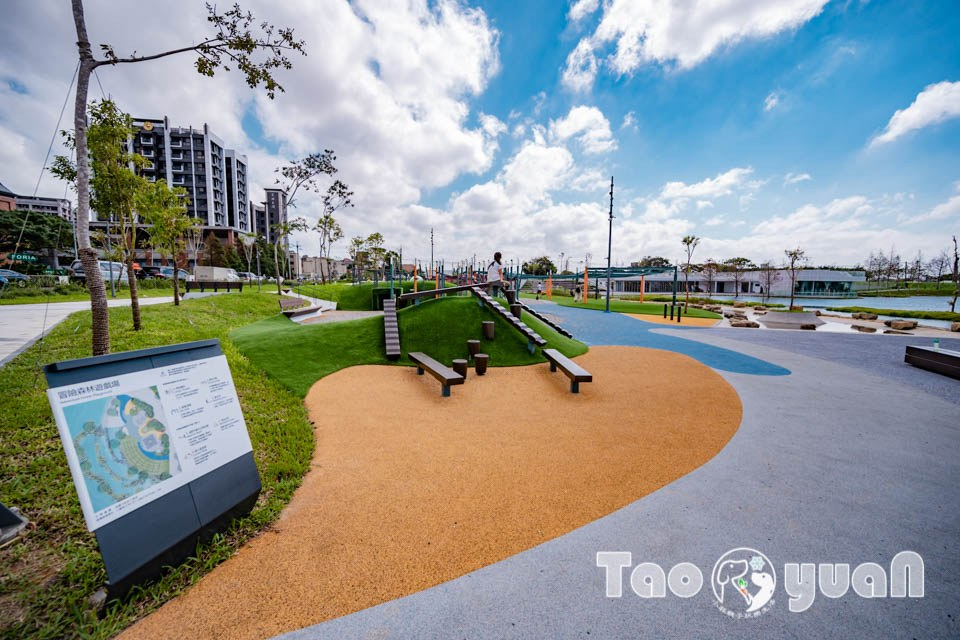

*圖：hauxingchi-park-18｜來源：https://natsuphil.com/wp-content/uploads/2024/10/hauxingchi-park-18.jpg*

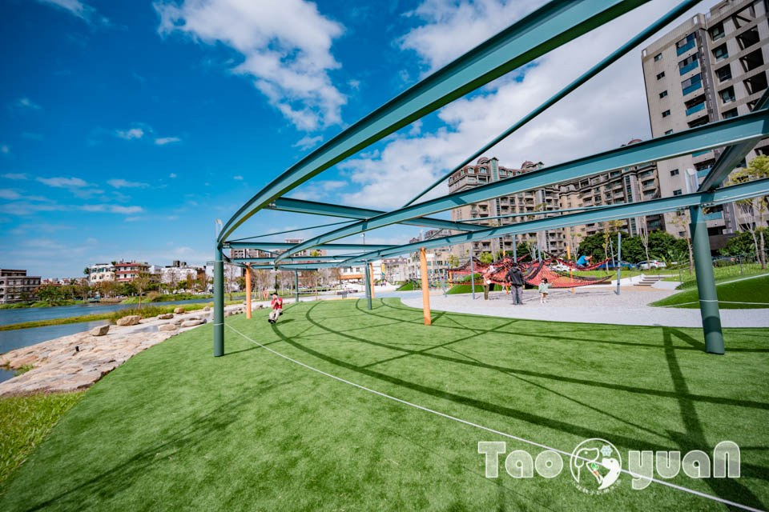

*圖：hauxingchi-park-4｜來源：https://natsuphil.com/wp-content/uploads/2024/10/hauxingchi-park-4.jpg*

▼【 脈衝滑軌】 滑索下方有假草皮做安全鋪面，大小朋友們務必遵守使用規定，並且排隊輪流玩，才能玩得安全又安心。

- 限100公斤以內
- 限六歲以上
- 限單人使用
- 請勿大人抱小孩一起乘坐
- 開放時間：09：00~18：00
- 若有變動依現場公告時間與資訊為主

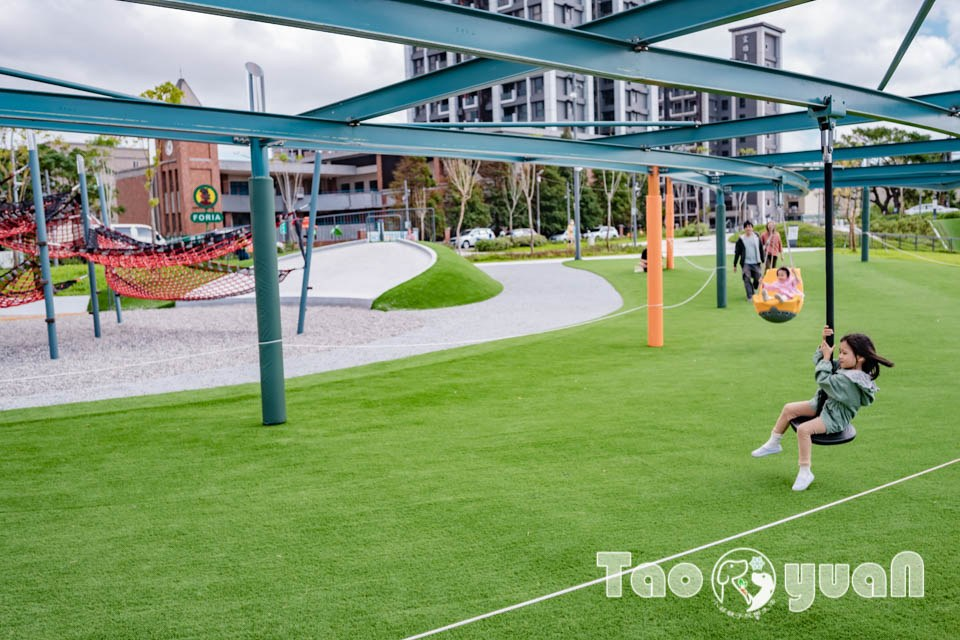

*圖：hauxingchi-park-5｜來源：https://natsuphil.com/wp-content/uploads/2024/10/hauxingchi-park-5.jpg*

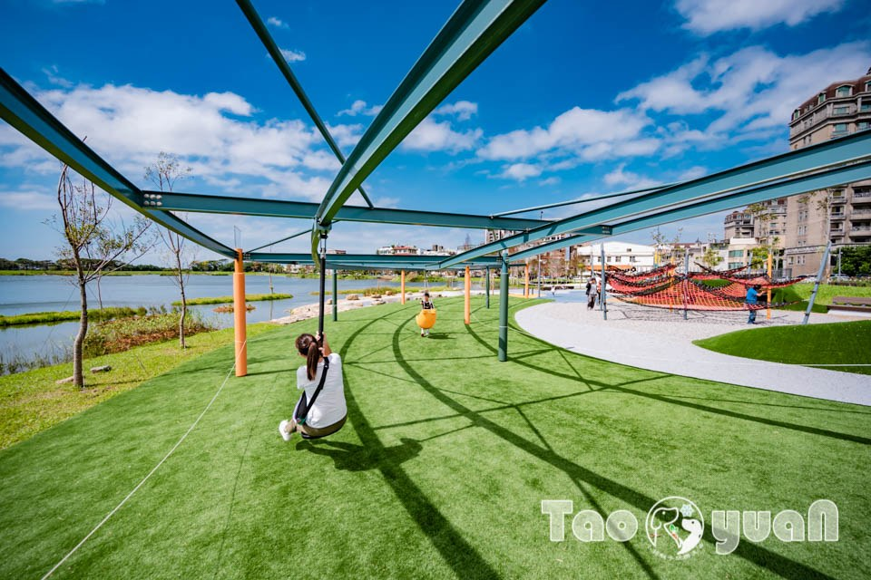

*圖：hauxingchi-park-1-2｜來源：https://natsuphil.com/wp-content/uploads/2024/10/hauxingchi-park-1-2.jpg*

▼ 滑索靠近湖畔邊，有一區 夏日戲水池，淺淺的水窪在炎炎夏日裡也是可以達到微消暑氣的效果。(提醒：戲水區旁與湖水間有石子鋪面緩衝，但沒有護欄，有帶小朋友的家長要特別留意，別讓孩子們太靠近湖邊，安全第一。) 戲水區開放期間與噴水時段：

- 7/1~8/31
- 10:00~18:00
- 週一和週五為清潔日不開放
- 若有變動依現場公告時間為主

▼ 有戲水池或玩沙池，附近通常都會有洗手、腳設備， 華興池生態埤塘公園 的戲水區也不例外。

▼ 介紹攀爬區之前先來溜這道小碗公，碗公溜滑梯比單道的磨石子更有延展性，是許多小朋友喜歡的滑梯類型。

### 冒險森林遊戲場〡變身小小蜘蛛人

▼兩組 攀爬遊具坐落在遊戲場中間，兩邊各有一座綠色山丘遊戲塔。不過其中一座造景性質比較高，只有涵洞可以玩躲貓貓。綠色山丘是不可以爬上去的喔~有貼一張 白色告示牌 寫著： 非遊戲動線，禁止攀爬。家長們要適時提醒小朋友，因為有些孩子們玩得入迷，這類的告示牌沒有注意到，容易不小心誤闖了。

▼網狀天際 似乎也很吸引小朋友，看看這座攀爬網上的孩子們，一人一個小窩的畫面，有點可愛呢！

▼穿梭叢林 的遊具難度會再高一點，小朋友們要量力而為喔~而且務必遵守使用規定。

▼越野梅花樁平衡木 適用年齡寫13歲以上，蘿蔔媽馬上說要試試，難得有大人也可以玩的遊具當然得把握！不過看這東倒西歪的走法，平衡感不太行唷~小朋友們可能都比這位阿姨厲害。

### 極限山丘遊戲場〡階梯廣場

▼ 公園的遊戲區主要有兩座遊戲場，第一座是前面介紹的 「冒險森林遊戲場」，另外一座就是靠近階梯廣場的 「極限山丘遊戲場」。

▼ 由一面大攀岩牆、綠草地攀爬坡與磨石子滑梯組成的 「極限山丘遊戲場」 顏色很天然。沒有花俏的黃、綠、紅等色調，也沒有過多的設計，簡單也可以很好玩。

▼ 「極限山丘遊戲場」旁是 階梯廣場，可以欣賞淨水草澤裡的植物，也能悠閒地坐在階梯上數飛機。天氣漸涼，坐在階梯吹著徐徐的風還有點冷呢！不少阿姨們自帶水果或小點心，邊吃邊賞飛機，果然薑是老的辣！

▼ 一架、兩架越蒐集越多，還出現酷企鵝彩繪機呢！喜歡看飛機的朋友會喜歡這座多功能的 華興池公園。

▼ 沿著 階梯廣場 走，可以到一處觀景平台，算是 喬寓咖啡The QiAO 的頂樓。這裡的視野很不錯，能看見生態池全貌，雖然沒有大海療癒，但也蠻舒心的，黃小菲建議大家可以上來走走唷~

### 喬寓咖啡The QiAO〡湖畔美景盡收眼底

▼喬寓咖啡The QiAO 開在這裡實在太讚了！直接坐擁美輪美奐的自然景，難怪平日來也座無虛席。窗邊的位置超搶手，看看這窗外景，坐在這裡用餐，感覺食物都變美味了。雖然這次來訪沒有位置，還是在店內走了一圈，發現連甜點櫃的蛋糕都快沒貨了，讓黃小菲下定決心一定要找時間再訪！

- 營業時間：週一至週五 10:00~18:00、週六、週日：10:00~21:00
- 週二公休

▼ 雖然沒有坐到位置，熱情的老闆還是告訴我們打卡有送手工餅乾，免費的當然要把握！拿到手工小餅乾，吧檯剛好有一個空位，拍了一張有生態池背景的照片，桌上多肉植物也挺加分的，吧台區也不錯耶！不過只有一個位置，所以我們轉往隔壁看起來也是咖啡廳一部份的店裡。

▼ 原來這區也是 喬寓咖啡The QiAO，看得出來有特別規劃，店內濃濃的親子風元素，連水杯都換成是塑膠材質，高腳塑膠杯有點可愛耶~

▼喬寓咖啡The QiAO 有許多視角都好美，下面這張照片也是在咖啡廳前拍的唷~

### 行舟秘境〡生態浮島

▼ 終於要開始走秘境步道了，或許是天氣正要轉涼，吹著微涼的風走在步道上非常舒服，如果有躺椅一定可以馬上睡著。

▼ 寬廣的 華興池公園 將水域區分成兩邊，其中一邊是踩天鵝船或划獨木舟等水上活動專用，另一邊則是供鳥類棲息與生態浮島的生態水域，這區是不能進入的保護區。

▼ 要說 華興池生態埤塘公園 什麼最多，大概就是飛機吧！幾分鐘就來一架的頻率，想要吃一百隻飛機許願的朋友來這裡就妥當了！

▼提醒： 大家在走步道時，別被眼前美景吸引而靠湖太近喔！有帶小朋友的家長在走環湖步道更要留意，戲水區那塊也要注意。

### 沉水綠廊〡觀稜平台

▼ 走到這裡算是盡頭，可以原路折返或繼續順走繞一圈回去，黃小菲建議大家選擇後者，因為繼續往前走就會看到有特殊造景的 沉水綠廊。

▼ 利用地勢高低變化，讓遊客走進與湖面幾乎等高的神秘步道，遠看視覺效果超足的！步道裡還有溢流孔的療癒畫面可以觀賞，不過不要靠太近，避免發生危險，尤其有帶小朋友的家長要特別留意。

▼ 走過沉水綠廊再繼續往前走，會繞一圈回到秋日廣場，回程繼續看飛機，幸運地出現皮卡丘彩繪機，算是為這次 華興池生態埤塘公園 之行畫下超完美句點！

### 小菲玩樂心得

桃園還有哪裡好玩

桃園市景點 桃園觀音區懶人包 白沙岬燈塔 觀新藻礁生態區 蓮荷園休閒農場 草漯沙丘觀音展示館 羊稠森林步道 大有梯田生態公園 竹圍漁港 水之丘主題公園 桃園立市兒童美術館 大溪老街 溪海休閒農業園區 大嵙崁親水園區 威天宮 許厝港濕地 永安海螺文化館 永安漁港 龍潭運動公園 華興池公園 光明公園 平鎮運動公園

全台灣瀨人包系列

全台灣燈塔懶人包 台61線濱海懶人包 北部室內樂園懶人包 北部海邊戲水懶人包

關於〡黃小菲

愛拍照的黃小菲，喜歡用照片說故事，更喜歡帶著一家四口到處走走拍拍

用真實的畫面加上細膩生動的文字，帶著大家進入黃小菲的親子玩樂生活

喜歡黃小菲拍攝的照片和逗趣的文章，歡迎點讚追蹤喔

聯絡信箱： [email protected]

> 小菲兒童親子隨拍

### 店家/景點資訊

- 店家名稱： 華興池生態埤塘公園
- 所在地址：臺灣桃園市大園區華興路205號
- 營業時間：日 一 二 三 四 五 六 00:00-24:00
- 店家電話：
- 備註資訊： 1.公園遮蔽物少，夏日前往須慎選時段 2.公園旁的喬寓咖啡廳營業時間 *週一至週五 10:00~18:00 *週六、週日：10:00~21:00 *週二公休 *若有變動依店家公告時間為主

### 交通資訊

### 評論
