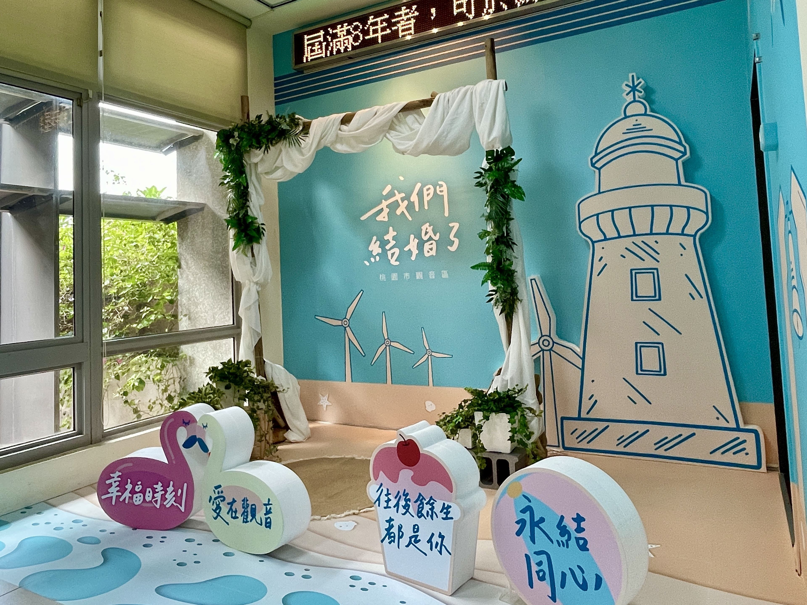
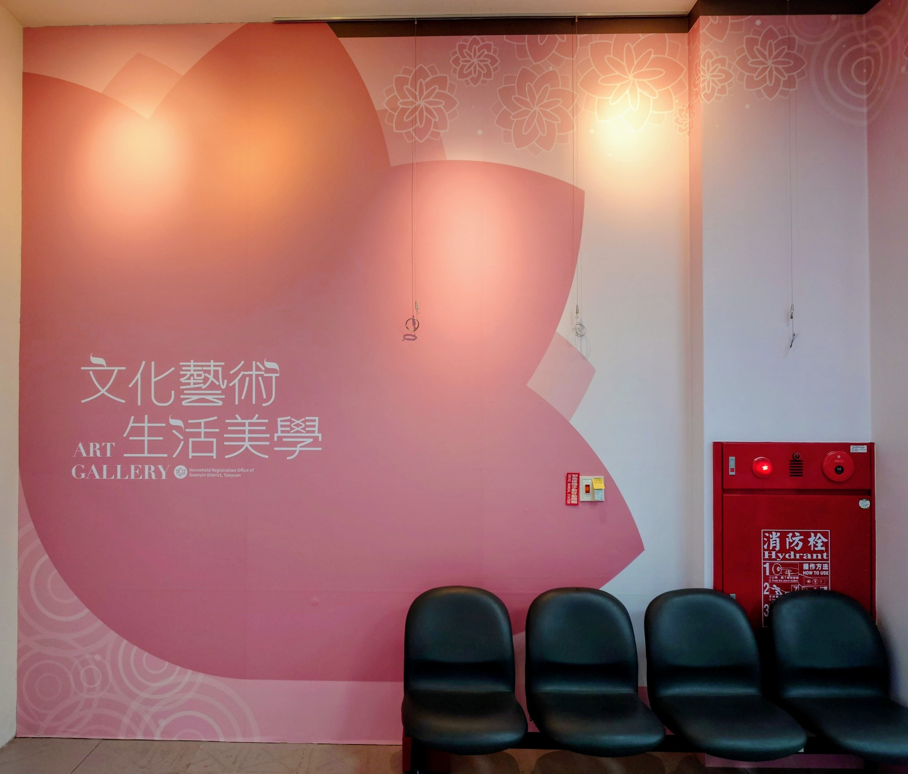

# 環境介紹

- 原始網址：https://www.guanyin-hro.tycg.gov.tw/cp.aspx?n=13768
- 網站名稱：桃園市觀音區戶政事務所
- 作者：（未標示）
- 發表日期：（未標示）
- 爬取時間：2026-11-05T16:42:27+08:00　取得方式：requests　正文定位：通用規則 main
- 圖片：4 張

---
### 環境介紹

- 列印內容

- 結婚拍照專區(民眾等候區)
- 藝文廊區

- 日期：113-05-17

觀音區是濱海之鄉，擁有國定古蹟白沙岬燈塔及獨特風車景觀，結婚專區巧妙融入觀音特有風情，以湛藍為主色系，融合「燈塔、風車、海岸」等特色，打造出海島婚禮的浪漫氛圍。

此外，本所還提供逗趣手拿板，讓新人留下美好回憶！

*圖：/001/Upload/166/relpic/15791/5413/dbf288a3-f477-496e-b4b1-acb3706f7dcd.jpg｜來源：https://ws.tycg.gov.tw/001/Upload/166/relpic/15791/5413/dbf288a3-f477-496e-b4b1-acb3706f7dcd.jpg*

*圖：/001/Upload/166/relpic/15791/5413/81559ad0-aff2-4aa1-b19c-ab3725ac14df.jpg｜來源：https://ws.tycg.gov.tw/001/Upload/166/relpic/15791/5413/81559ad0-aff2-4aa1-b19c-ab3725ac14df.jpg*

*圖：/001/Upload/166/relpic/15791/5413/0bcff6f9-8fa6-47be-b334-d2706d9a50f0.jpg｜來源：https://ws.tycg.gov.tw/001/Upload/166/relpic/15791/5413/0bcff6f9-8fa6-47be-b334-d2706d9a50f0.jpg*

#### 結婚登記申辦須知

申請人97年5月23日起結婚者：結婚雙方當事人。

97年5月22日以前(含97年5月22日當日)結婚或其結婚已生效者：結婚當事人之一方。

受委託人：

有正當理由並經戶政事務所核准者，得以書面委託他人辦理。應備證件結婚書約：依民法第982條規定：自民國97年5月23日起，結婚應以書面為之，並應由雙方當事人向戶政機關為結婚之登記，方為有效。書約應載有結婚雙方當事人之姓名、出生日期、國民身分證統一編號（護照號碼或居留證號碼）、戶籍住址（國外居住地址）等相關資料，及2人以上證人簽名或蓋章等相關資料。

未成年人結婚者，另提法定代理人之同意書。

在國內結婚者，應附繳結婚當事人雙方之國民身分證、印章（或簽名）、戶口名簿、最近2年所攝正面符合規定之半身彩色照片各1張或數位相片及規費各50元，得免繳交相片或數位相片之情形，請參照國民身分證及戶口名簿製發相片影像檔建置管理辦法 第14條規定，（國民身分證相片規格可至「內政部戶政司全球資訊網」-主題資訊- 國民身分證專區-國民身分證相片規格 查詢，繳交數位相片者請至內政部戶政司全球資訊網-網路申辦服務- 國民身分證-國民身分證影像上傳 上傳數位相片）。

##### 其他身分證明文件：

國外結婚已生效後授權委託他人辦理者，應檢附經駐外館處或行政院於香港、澳門設立或指定之機構或委託之民間團體驗證之授權委託書、受委託人（即授權書上所載之被授權人）之國民身分證、印章（或簽名）。

結婚當事人為國內曾有或未曾設戶籍者，應檢附其護照或內政部移民署依法核發之居留證明文件。

##### 其他結婚證明文件：

在國外結婚已生效者，應檢附經駐外館處或行政院於香港、澳門設立或指定之機構或委託之民間團體驗證之結婚證明或已向當地政府辦妥結婚登記（或結婚註冊）之證明文件及中文譯本，加註「符合行為地法」字樣者，並得免附婚姻狀況證明文件。

結婚當事人一方為外國籍者，另應檢附外籍配偶取用中文姓名聲明書，經駐外館處驗證之婚姻狀況證明文件及中文譯本。婚姻狀況證明文件於原核發機關核發之日起六個月內有效。經外交部公告之特定國家人士，已取得內政部移民署依法核發之永久居留證者，亦同。

經外交部公告之特定國家，國人與特定國家人士結婚)須先於外籍配偶之原屬國完成結婚登記後，備齊結婚證明文件向駐外館處申請面談，再持憑經駐外館處驗證之結婚證明文件，向國內戶政機關辦理結婚登記。

在國外作成之結婚證明文件及其中文譯本，應由駐外館處驗證或國內公證人認證之。

與大陸地區人民辦理結婚登記者，應檢附結婚證明文件及經內政部移民署發給加蓋「通過面談，請憑辦理結婚登記」章戳之臺灣地區入出國許可證。在大陸地區或香港、澳門作成之文書，應經行政院設立或指定之機構或委託之民間團體驗證。注意事項遷入(含住址變更)同時結婚登記而單獨立戶，應參照遷入有關規定辦理。

受理戶政事務所全國任一戶政事務所

雙方或一方在國內現有或曾設戶籍者，在國內結婚，得向任一戶政事務所辦理結婚登記。

雙方或一方在國內現有或曾設戶籍者，在國外結婚，得檢具相關文件，向我國駐外使領館、代表處、辦事處（以下簡稱駐外館處）或行政院於香港、澳門設立或指定之機構或委託之民間團體申請驗證後，經驗證後函轉戶籍地或最後遷出戶籍地戶政事務所，或親自向任一戶政事務所辦理結婚登記。

雙方在國內未曾設戶籍者，在國內結婚，得向任一戶政事務所為之。但在國外結婚，得檢具相關文件，向駐外館處或行政院於香港、澳門設立或指定之機構或委託之民間團體申請，經驗證後函轉中央主管機關指定之中央政府所在地戶政事務所或親自向任一戶政事務所辦理結婚登記。

- 日期：111-12-14

為打破傳統公務機關冷冰冰的刻板印象， 本所 特別打造了以「文化藝術．生活美學」為主題的藝文走廊。

🌸 設計理念與意象

藝文走廊視覺設計中特別融入了蓮花綻放的線條與漣漪水紋——這不僅象徵著觀音著名的在地特色「蓮花之鄉」，更代表著生命水波般層層擴散的美好與祝福。

🎨 空間與生活連結

*圖：藝文廊區｜來源：https://ws.tycg.gov.tw/001/Upload/166/relpic/15791/5412/dfc3e0e1-67bd-4dcb-9c7c-cad008a4952c.jpg*

藝文走廊將藝術帶入日常洽公空間，讓民眾在等待或辦理戶政業務之餘，能放慢腳步，沉浸於藝術氛圍中。這裡不僅是展示在地文化與藝術創作的舞台，更是一個傳遞生活美學、提升人文涵養的溫馨角角。
