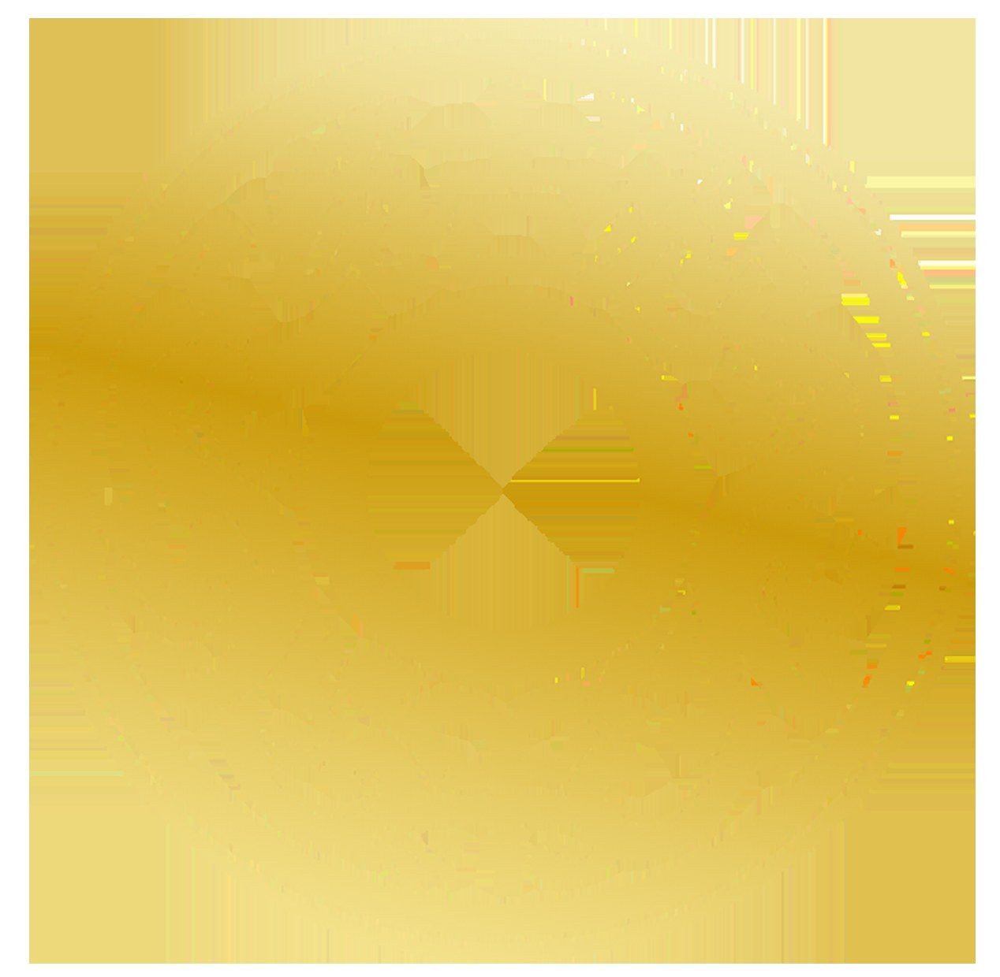
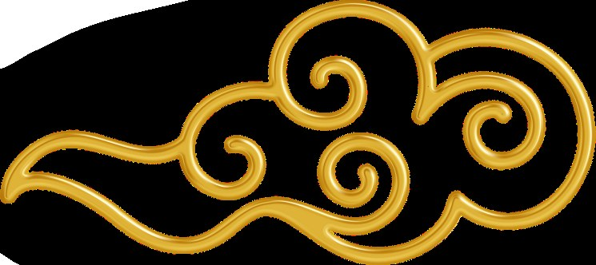

# 觀音甘泉寺

- 原始網址：https://www.ganquan-temple.org.tw/aboutus
- 網站名稱：www.ganquan-temple.org.tw
- 作者：（未標示）
- 發表日期：（未標示）
- 爬取時間：2026-10-29T16:13:12+08:00　取得方式：requests　正文定位：通用規則 main
- 圖片：4 張

---

*圖：（原文無圖片說明）｜來源：https://www.ganquan-temple.org.tw/images/theme-c67/history-pto.png*

*圖：（原文無圖片說明）｜來源：https://www.ganquan-temple.org.tw/images/theme-c67/history-cloud-1.png*

*圖：（原文無圖片說明）｜來源：https://www.ganquan-temple.org.tw/images/theme-c67/history-cloud-2.png*

*圖：（原文無圖片說明）｜來源：https://www.ganquan-temple.org.tw/images/theme-c67/history-cloud-3.png*

- 1887年（清光緒13年） 創建開始 神示「甘泉」治疾神蹟，信眾感念神恩擴建，正式定名為**「甘泉寺」
- 1955年（民國44年） 戰後首度改建 因廟宇老舊，由黃景祥先生召集信徒大會，廖團景先生擔任修建主委。
- 1958年（民國47年） 改建完工 工程完竣。廟宇初具富麗堂皇之規模，地方繁榮，香客日增。
- 1986年（民國75年） 現代宏偉規模奠定 因後方路基填高導致廟宇顯得矮小，且空間不敷使用。信徒大會推選曾献奉先生為主任委員，決議重建。
- 1989年（民國78年） 正式動工 農曆4月23日正式動工。
- 1997年（民國86年） 二次改建完工 歷時八年，正式完成今日「五山三山、三層三進」之宮殿式建築格局。
- 2022年（民國111年） 全寺光明燈數位化 轉型亮點：引進現代化點燈系統，實現「即點即上」之高效率服務，將傳統信仰與數位科技結合，方便信眾祈福。

- 首頁
- 關於甘泉寺
- 歷史沿革
