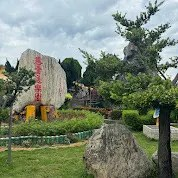
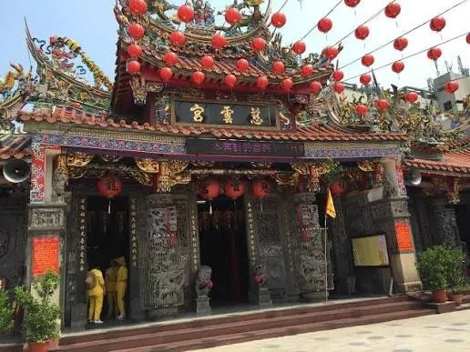
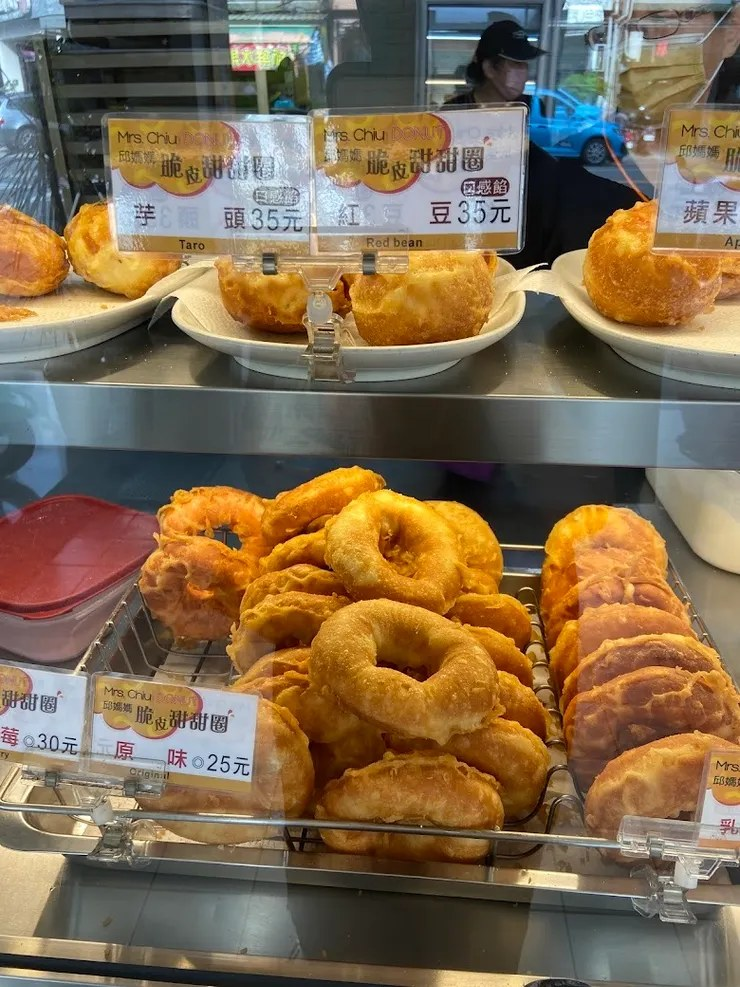
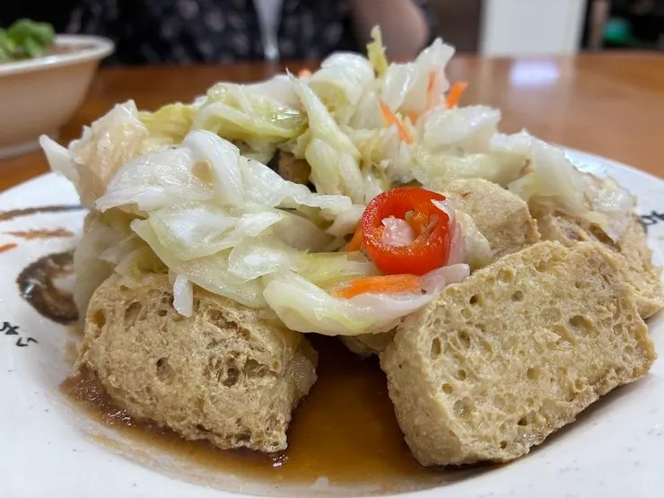

# 通霄鎮慈雲寺一日遊｜媽祖海線必訪觀音古剎｜歷史沿革、參拜流程、交通美食全攻略

- 原始網址：https://vocus.cc/article/69382030fd89780001707e86
- 網站名稱：vocus
- 作者：峰
- 發表日期：2026-01-31T00:30:36.064Z
- 爬取時間：2026-11-05T16:42:37+08:00　取得方式：requests　正文定位：站點規則 article
- 圖片：9 張

---
苗栗通霄有許多信仰據點，其中位於五里牌的 通霄鎮慈雲寺（舊稱五里牌觀音亭）更是香火鼎盛、歷史悠久的觀音寺廟。主祀觀音佛祖，長年守護海線居民與旅人，被視為「海線慈悲地標」。

#### 一、慈雲寺歷史沿革、由來與典故

*圖：慈雲寺（圖片截圖於網路）｜來源：https://img.vocus.cc/02NJLiW0kRkzo9D7ETl_obFK5zZOwqVgj-5nOEu3ENE/w:447/f:webp/plain/https://images.vocus.cc/3d628dcf-ce14-4360-9a26-6f598f0d2e97.jpg*

慈雲寺（圖片截圖於網路）

- 古稱「五里牌觀音亭」，為早期通霄地區重要信仰中心。
- 建寺歷史可追溯清代，因地方居民迎請觀音佛祖供奉於五里牌，以慈悲濟世、護佑漁農而聞名。
- 後因信眾日增，擴建為今日宏偉的「慈雲寺」。
- 傳說觀音佛祖顯靈救渡海上漁民，使本地人更虔誠敬奉。
- 現今已是通霄地區 宗教文化地標 與旅遊熱門景點。

#### 二、主祀神明與陪祀

觀音佛祖（圖片截圖於網路）

& 主祀

- 觀音佛祖（南海觀世音菩薩）

陪祀神明（依各殿略述）

- 地藏王菩薩
- 韋馱菩薩
- 伽藍菩薩
- 諸佛與護法尊神（依寺內實際架構調整）

#### 三、主要保佑事項

- 求平安順遂
- 家庭和合、增福添慧
- 求子求孕
- 保佑考試事業
- 消災解厄、轉運開運
- 出入平安、行車平安
- 健康祈福

#### 四、參拜流程（依樓層＆動線清楚條列）

慈雲寺牌樓（圖片截圖於網路）

（以下為標準寺廟參拜動線，可依你後續提供的殿別再微調）

① 山門／寺外

- 於入口淨手、調心
- 向觀音佛祖方向合掌致意

② 主殿（觀音佛祖）

*圖：主殿 觀音佛祖（圖片截圖於網路）｜來源：https://img.vocus.cc/zipvNwe44aP9OfkyIw5j0B3C2KO0Msoe0tcJ_WUVP6Q/w:387/f:webp/plain/https://images.vocus.cc/94060117-ac12-4a4c-8b3f-d9ad4098723b.jpg*

主殿 觀音佛祖（圖片截圖於網路）

- 先向正殿主祀 觀音佛祖 上香
- 誠心祈求：健康、家庭、事業、平安

③ 地藏王殿

- 祈求消災解厄
- 祈福祖先、冤親債主化解

④ 護法殿（韋馱、伽藍）

- 祈求事業與人緣
- 保佑學業與智慧

⑤ 後殿／佛祖殿（若有）

- 按順序繞行，依寺內殿別參拜
- 完成後出殿向主殿合掌感謝

#### 五、周邊造景與園區亮點

*圖：十八羅漢雕像（圖片截圖於網路）｜來源：https://img.vocus.cc/ocjxCwngIgUJ_9jnxSHdkeXJpiIuYOnQ-rbl1RJe1Ww/w:178/f:webp/plain/https://images.vocus.cc/2597919d-8101-458f-ac1b-2e98fe39ae7d.jpg*

十八羅漢雕像（圖片截圖於網路）

*圖：觀音菩薩、福德正神（圖片截圖於網路）｜來源：https://img.vocus.cc/DSOysOxrAMCxHy5MyNN0xJXSHJ5EX3601lJNGmMUFBg/w:740/f:webp/plain/https://images.vocus.cc/f339b082-2ee4-4b03-b407-3d321fd49a4f.jpg*

觀音菩薩、福德正神（圖片截圖於網路）

園區造景-觀音佛祖（圖片截圖於網路）

園區大型雕像及無敵湖（圖片截圖於網路）

*圖：園區內造景（圖片截圖於網路）｜來源：https://img.vocus.cc/BS89lB7srXoFvVrOb2Q_Y5U0w8HuIy8AIeWoMqVsPSc/w:178/f:webp/plain/https://images.vocus.cc/71af8e38-885c-40d2-ac77-44aac61874db.jpg*

園區內造景（圖片截圖於網路）

唐三藏師徒取經去（圖片截圖於網路）

- 備有廣大廟埕、整潔庭園
- 環境靜謐，適合沉澱心靈
- 香客休憩區、停車場完善
- 周邊山海景觀開闊，視野極佳
- 部分位置可俯瞰通霄地區，是拍照熱點

#### 六、建築風格特色

*圖：屋脊上交趾陶、剪黏工藝精湛（圖片截圖於網路）｜來源：https://img.vocus.cc/N_WItJq00D4CqeHOFTVOCohqrDzbxsLW8jseQfL11RU/w:516/f:webp/plain/https://images.vocus.cc/62fc7786-520f-4711-9f3e-ce3b61dcf892.jpg*

屋脊上交趾陶、剪黏工藝精湛（圖片截圖於網路）

*圖：慈雲寺 美侖美奐的公園（圖片截圖於網路）｜來源：https://img.vocus.cc/KbDW7iRlo5YQdolEZOAnntUdX4WGExK3rcjLoslZk_s/w:178/f:webp/plain/https://images.vocus.cc/c0522aa9-d75a-4eea-bb32-f4a4a6888dda.jpg*

慈雲寺 美侖美奐的公園（圖片截圖於網路）

莊嚴隆重的牌樓與佛字相對應（圖片截圖於網路）

園區-書香亭（圖片截圖於網路）

- 典型 台灣傳統寺廟建築：剪黏、燕尾屋脊、龍虎雕飾
- 主殿莊嚴宏偉，彩繪精緻
- 木雕佛像、諸佛金身保存良好
- 廟埕寬廣，適合大型慶典舉行

#### 七、重大慶典

- 觀音佛祖聖誕（農曆 2 月 19）
- 觀音成道日（農曆 6 月 19）
- 觀音出家紀念日（農曆 9 月 19）
- 農曆新年新春祈福
- 中元普渡與施食法會
- 祈安法會、光明燈開燈典禮

#### 八、注意要項

- 寺廟為佛教場域，需保持安靜
- 服裝儀容整潔得體
- 上香動線依寺方指示
- 勿隨意觸碰佛像與法器
- 參加法會需依志工指導
- 請尊重寺廟與其他善信

#### 九、交通指南

^ 自行開車

- 國道三號 → 通霄交流道 → 往通霄市區 → 直達慈雲寺
- 寺廟備有停車空間，假日建議提早到場

^ 大眾交通

- 台鐵通霄站下車
- 轉搭計程車約 5–8 分鐘即可抵達
- 或步行約 20–25 分鐘

#### 十、在地美食推薦（通霄海線必吃）

- 通霄肉包／水煎包
- 黑輪伯關東煮
- 通霄牛奶甜甜圈

*圖：牛奶甜甜圈（圖片截圖於網路）｜來源：https://img.vocus.cc/XqE1O-9RemWXuLXni2aIDGCgxOWYPoest8PeETQ7h3M/w:740/f:webp/plain/https://images.vocus.cc/4832189e-56e5-4635-b425-f520b85604a4.jpg*

牛奶甜甜圈（圖片截圖於網路）

- 福樂臭豆腐

*圖：美味的臭豆腐（圖片截圖於網路）｜來源：https://img.vocus.cc/4Cuu-Knu-FM9acomZ7wcSwiSU5MJrczQBuNdh2c7d68/w:740/f:webp/plain/https://images.vocus.cc/d39ac64c-966e-46d2-9b65-807f91fd7068.jpg*

美味的臭豆腐（圖片截圖於網路）

- 通霄火車站前小吃街
- 海線海鮮料理（竹圍漁港）

#### 十一、周邊景點推薦（順遊最適合）

- 通霄神社（文青拍照必訪）
- 通霄海水浴場
- 台鹽通霄觀光園區
- 通霄精鹽場天空之鏡
- 白沙屯拱天宮（可串連海線媽祖信仰）
- 苑裡藺草文化館

#### 十二、FAQ 常見問題

Q1：慈雲寺可以求什麼最靈？

A：最著名的是求 平安、健康、家庭、考試事業，觀音佛祖慈悲護念、感應特別快。

Q2：需要帶香嗎？寺內可以點香？

A：可依寺廟規範，通常會有統一香枝供善信使用。

Q3：是否提供平安符或點燈？

A：多半提供平安燈、光明燈、太歲燈等服務，建議依現場公告為主。

Q4：適合親子嗎？

A：環境寬敞乾淨，非常適合家庭一起參拜休憩。

Q5：附近好停車嗎？

A：有寺廟專屬停車位，假日建議早點抵達。

#### 「 一日遊行程建議 」

09:00 抵達慈雲寺 → 寺前拍照 → 參拜觀音佛祖

10:00 參拜地藏王殿、護法殿 → 遊園區拍照

11:00 前往通霄市區享用 brunch

12:30 通霄神社巡禮

14:00 台鹽通霄觀光園區（天空之鏡）

16:00 前往竹圍漁港吃海鮮

18:00 返程或至白沙屯拱天宮祈福

作者｜悠遊時光

走訪慈雲寺，總能感受到觀音佛祖溫柔而堅定的力量。寺廟不僅是信仰中心，也是讓心靈沉澱的好地方。每一次踏進殿內，都像是重新整理自己，在慈悲與寧靜中獲得力量。希望這篇攻略能陪你走一趟放鬆又有收穫的通霄小旅行，也讓慈雲寺的祝福伴你一路平安。
