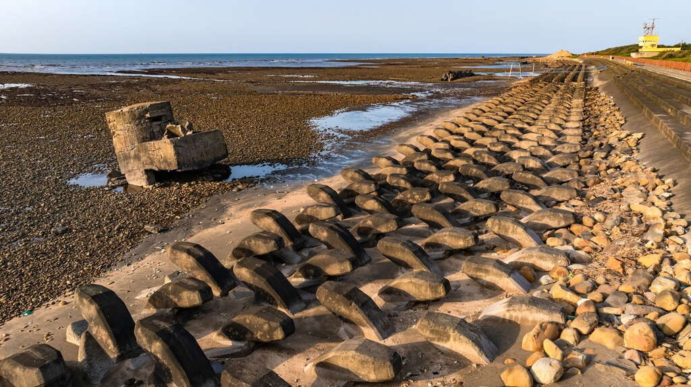
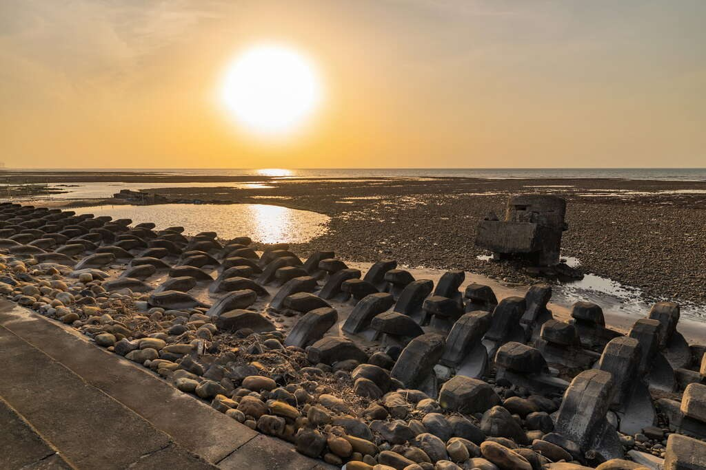
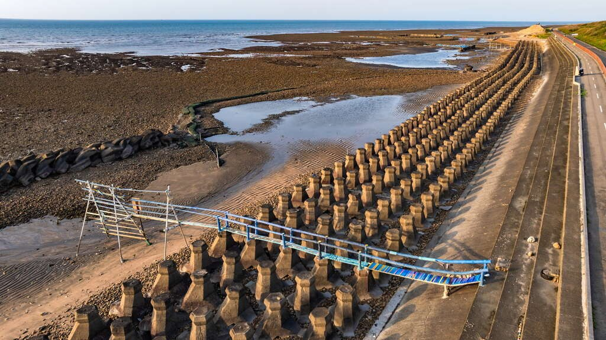
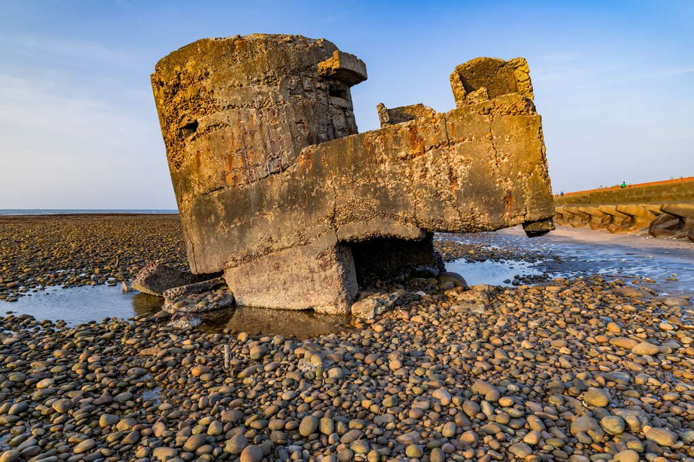
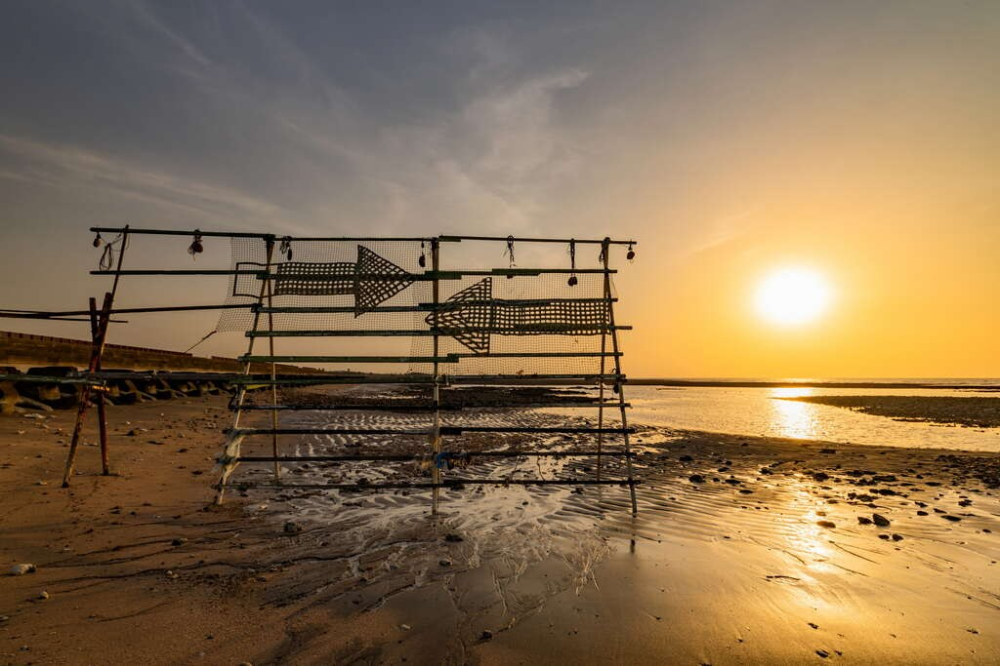
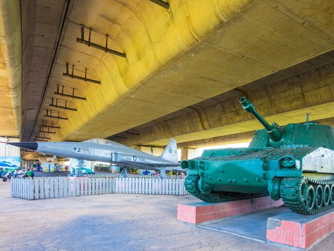
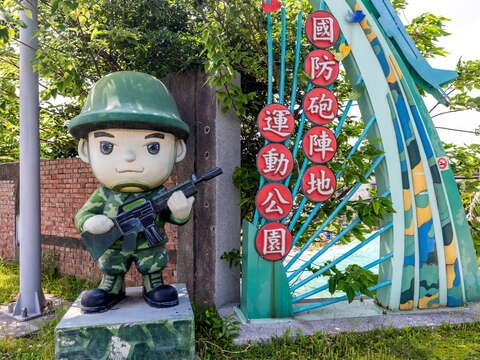
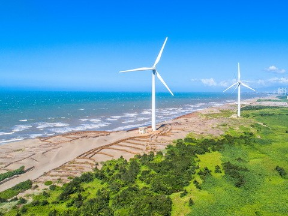

# 大園古亭海岸碉堡

- 原始網址：https://travel.tycg.gov.tw/ja/travel/attraction/2239
- 網站名稱：桃園観光旅行
- 作者：（未標示）
- 發表日期：（未標示）
- 爬取時間：2026-11-05T16:43:12+08:00　取得方式：playwright　正文定位：站點規則 main
- 圖片：12 張

---
### 大園古亭海岸碉堡

- 海浜地区

神秘感あふれる海上碉堡（トーチカ＝軍用の小型防御施設）、心癒される夕日の絶景、そして砂浜では小さなカニがちょこちょこと歩く姿。ここはゆったり散歩を楽しみ、美しい写真を撮影しながら、心からリラックスできるスポットです。海風を浴びながら、大海と出会うひとときをぜひお楽しみください！

- 碉堡、砂浜、夕日の絶景―異国情緒あふれる風景を一度に楽しめます。、
- 潮間帯の生態を観察し、カニやトビハゼと間近に触れ合いましょう。、
- ロマンチックな夕日を眺め、夕陽に紅く染まる美しいひとときに浸りましょう。、
- 海上碉堡を探訪し、時の流れと自然が織りなす独特の風景を感じてみましょう。、

都市の喧騒から離れ、静かな海岸を探しているなら、「大園古亭海岸」こそがあなたの秘密基地です！ここには観光客の人混みが少なく、その代わりに、驚きを与える歴史と自然景観が広がり、足を運ぶたびにまるで時空を旅しているかのように感じられます。

海岸に立ち、黄金色の砂浜の先に目を向けると、海上にそびえ立つ碉堡（トーチカ）がいくつも見え、時代の移り変わりを物語っています。これらの碉堡は冷戦期に建てられ、敵軍の上陸を防ぐために設置されたものです。現在では防衛の任務を終えましたが、旅行者が写真を撮り、歴史に思いを馳せる独特の観光スポットとなっています。潮の満ち引きに伴い、碉堡は時に静かに海中にそびえ立ち、時に波間に隠れ、その姿は大自然と文化が織り成す光景に感嘆を覚えさせます。

*圖：天空與海面交織出絕美的金橘色光影｜來源：https://travel.tycg.gov.tw/Image/111385/?r=1753776048189*

夕暮れ時、夕陽がゆっくりと水平線に沈み、空と海が織り成す金橙色の光景は、息をのむほどの美しさです。海岸を散策すると、潮間帯では元気に動き回る小さなカニや自由に泳ぐ魚の群れ、さらに時折トビハゼが跳ねる可愛らしい姿に出会えます。ぜひご家族と一緒に、この静かな海辺でゆったりとした時間を過ごし、心身を大自然の懐の中に委ねてみてください。

海岸の階段に静かに腰を下ろして物思いにふけるのも、砂浜をゆっくり歩きながら海風が頬をなでるのを感じるのも「大園古亭海岸」なら、あなたの思い描くリラックスをすべて満たしてくれます。ここには商業的な喧騒はなく、純粋な自然の美しさだけが広がっています。煩わしさを忘れ、海と一体となるようなひとときを楽しめます。

*圖：大園古亭海岸碉堡｜來源：https://travel.tycg.gov.tw/content/images/attractions/111379/1024x768_attractions-image-pc3ryb2vy0mvpmxyq21tpw.jpg*

*圖：大園古亭海岸碉堡｜來源：https://travel.tycg.gov.tw/content/images/attractions/111380/1024x768_attractions-image-oxrd5yzv-u6pmd5vcnka3g.jpg*

*圖：大園古亭海岸碉堡｜來源：https://travel.tycg.gov.tw/content/images/attractions/111381/1024x768_attractions-image-qrpbm7ka4eeqwb0hbyc7fw.jpg*

*圖：大園古亭海岸碉堡｜來源：https://travel.tycg.gov.tw/content/images/attractions/111382/1024x768_attractions-image-vyaoi-hbwuek9afrjpytmg.jpg*

*圖：大園古亭海岸碉堡｜來源：https://travel.tycg.gov.tw/content/images/attractions/111383/1024x768_attractions-image-jdrps-4rse-9pkifjoi9mw.jpg*

*圖：大園古亭海岸碉堡｜來源：https://travel.tycg.gov.tw/content/images/attractions/111384/1024x768_attractions-image-6rmwdivge0chd8x5o9sjga.jpg*

*圖：大園古亭海岸碉堡｜來源：https://travel.tycg.gov.tw/content/images/attractions/111385/1024x768_attractions-image-57a2ticat0esyqyy4tys7w.jpg*

- 日曜日：00:00 - 23:59
- 月曜日：00:00 - 23:59
- 火曜日：00:00 - 23:59
- 水曜日：00:00 - 23:59
- 木曜日：00:00 - 23:59
- 金曜日：00:00 - 23:59
- 土曜日：00:00 - 23:59

-潮汐時刻を必ずご確認のうえ、満潮時には危険区域に近づかないようご注意ください。

-砂浜や潮間帯は地形が変化に富んでいるため、歩行の際は滑りやすい石やくぼみにご注意ください。

### 周辺の観光スポット

*圖：（原文無圖片說明）｜來源：https://travel.tycg.gov.tw/content/images/attractions/46780/480x360_attractions-image-bjocbhis3u2ens8q8wprmq.jpg*

*圖：（原文無圖片說明）｜來源：https://travel.tycg.gov.tw/content/images/attractions/17668/480x360_files636172436359479488.jpg*

*圖：（原文無圖片說明）｜來源：https://travel.tycg.gov.tw/content/images/attractions/111779/480x360_attractions-image-gd8_guqcue62jbu88mwh4a.jpg*

*圖：（原文無圖片說明）｜來源：https://travel.tycg.gov.tw/content/images/attractions/47460/480x360_attractions-image-tg997k9x5emlwrypkpt_cg.jpg*

- 3.8 圳頭里軍史公園 木曜日：00:00 – 23:59 人氣 3230
- 4.3 許厝港湿地 (許厝港濕地) 木曜日：00:00 - 23:59 人氣 4830
- 国防砲陣地運動公園 (國防砲陣地運動公園) 24時間 人氣 616
- 4.2 観音草漯砂丘 (觀音草漯沙丘) 木曜日：00:00 - 23:59 人氣 6448
