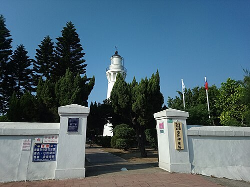
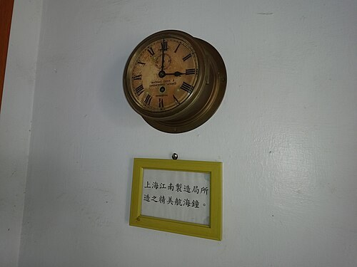

# 白沙岬燈塔

- 原始網址：https://zh.wikipedia.org/wiki/%E7%99%BD%E6%B2%99%E5%B2%AC%E7%87%88%E5%A1%94
- 網站名稱：zh.wikipedia.org
- 作者：維基媒體專案貢獻者
- 發表日期：2009-02-23T15:30:18Z
- 爬取時間：2026-10-29T16:14:21+08:00　取得方式：requests　正文定位：站點規則 #mw-content-text .mw-parser-output
- 圖片：3 張

---

*圖：白沙岬燈塔｜來源：https://thumb.wikimedia.org/wikipedia/commons/thumb/4/41/%E7%99%BD%E6%B2%99%E5%B2%AC%E7%87%88%E5%A1%94%E5%85%A5%E5%8F%A3.jpg/960px-%E7%99%BD%E6%B2%99%E5%B2%AC%E7%87%88%E5%A1%94%E5%85%A5%E5%8F%A3.jpg?utm_source=zh.wikipedia.org&utm_campaign=parser&utm_content=thumbnail*

| 白沙岬燈塔 Baishajia Lighthouse |  |
|---|---|
| 白沙岬燈塔 |  |
| 位置 | 中華民國 （ 台灣 ） 桃園市 觀音區 觀音里新坡下 |
| 座標 | 25°02′28.8″N 121°04′34.4″E  /  25.041333°N 121.076222°E |
| 初建年份 | 1898年 |
| 啟用年份 | 1901年 |
| 構造 | 雙層磚石造耐震塔 |
| 塔形 | 圓柱形，帶有燈室與修護平臺 |
| 標識 | 白色 |
| 塔高 | 27.7公尺（91英尺） [ 1 ] : 52 |
| 焦距 | 36.6公尺（120英尺） [ 1 ] : 52 |
| 初始燈器 | 三等旋轉鏡三重蕊 煤油燈 |
| 目前燈器 | 三等旋轉透鏡 電燈 |
| 光源 | 市電 |
| 光度 | 白光：1,000,000支 燭光 紅光：310,000支燭光 |
| 光程 | 白光：25.7海里（47.6公里；29.6英里） 紅光：22.6海里（41.9公里；26.0英里） |
| 燈號頻率 | 每20秒白光紅光各一閃（白紅換色閃光） |
| 英國水文局 編號 | P4662 |
| NGA 編號 | 13952 |
| ARLHS 編號 | TAI-019 |
| 材料 | 紅磚 、 砂岩 、 石灰 |
| 公眾參觀 | 開放時間：星期二~星期日9:00-18:00（4月1日至10月31日），9:00-17:00（11月1日至3月31日）（星期一內部整理不開放） 參觀費用：免費 |
| 使用者 | 交通部航港局 |
| 所有者 | 財政部國有財產署 |
| 網站 | 白沙岬燈塔-交通部航港局燈塔專區 |
| 中華民國文化資產 |  |
| 官方名稱 | 觀音白沙岬燈塔 |
| 類型 | 登錄等級：國定古蹟 登錄種類：燈塔 |
| 評定時間 | 2002年9月2日（ 直轄市定古蹟 ） 2021年5月10日（國定古蹟） |
| 詳細登錄資料 |  |

白沙岬燈塔 （英語： Baishajia Lighthouse ）是一座位於 臺灣 桃園市 觀音區 觀音里 新坡下的 燈塔。於 明治 三十一年（1898年）開始興建，歷時三年完工 [ 2 ] : 137，三十四年（1901年）1月啟用發光 [ 3 ] : 57。塔身為雙層磚造圓塔 [ 3 ] : 56， 太平洋戰爭 時曾遭 同盟國 所屬的 戰鬥機 撞毀，戰後修復後塔高減至27.7公尺 [ 2 ] : 137。2002年由桃園縣政府文化局（今 桃園市政府文化局 ）指定為縣定古蹟，2014年12月改為市定古蹟。2013年9月起開放一般大眾參觀 [ 3 ] : 59。2021年5月指定為國定古蹟。 [ 4 ]

### 地理條件

桃園市 沿海包括 蘆竹 、 大園 、 觀音 與 新屋 等4個 區，其 海岸 沙灘 狹長，除具開發有許多 海水浴場 外，更與 新竹縣 、 市 的 紅毛港 、 崁頭 與 南寮 等地，共同組成 北臺灣 漁業 的重鎮。此地 漁港 皆具有不易淤積、港內水面平穩，與港內外屏障良好等條件 [ 5 ] : 89。觀音區海岸平原狹窄，但處於扼守 海岸線 的要地，兼具 軍事 與 經濟 價值，成為在此地建造 燈塔 的條件。 [ 6 ] : 50

### 沿革

#### 日治時期

明治 二十八年（1895年）6月24日設立 臨時臺灣燈標建設部，歸 陸軍省 管轄。二十九年（1896年）3月31日設 臺灣總督府燈臺所，管理 臺灣地區 燈塔 業務 [ 6 ] : 16。同年設計興建白沙岬燈塔，8月遇 颱風 侵襲， 豪雨 成災，沖毀建塔基地，預定地附近地形全然改變 [ 5 ] : 89。後於 石觀音庄 另選新址，但當地盜匪橫行，妨礙工事進行 [ 5 ] : 90。至三十一年（1898年）7月11日開始動工，工程歷時三年，採 士林 所產 石材，以 船舶 由 淡水 運至工地 [ 6 ] : 51。三十四年（1901年）1月15日完工 [ 5 ] : 90，採三等旋轉鏡三重蕊 煤油燈 [ 6 ] : 51， 燈器 、 稜鏡 與 重鎚 均由 法國 進口。 [ 3 ] : 57

明治 三十五年（1902年）11月17日廢除 臺灣總督府燈臺所， 燈塔 改隸 臺灣總督府民政部通信局 [ 6 ] : 16。四十五年（1912年）5月4日改用石油 白熱燈 [ 6 ] : 51，光力69,000 燭光。 大正 十三年（1924年）12月24日改為 臺灣總督府交通局遞信部 管理 [ 6 ] : 16。 太平洋戰爭 期間，一架由 高射炮 擊落的 同盟國 飛機，掉落在燈塔附近，撞毀上半截 燈具。 [ 5 ] : 90

#### 戰後

1945年 臺灣光復， 燈塔 由 臺灣省行政長官公署 交通處航務管理局接收。1946年5月，鑑於 大陸地區 燈塔皆由 海關 管理，於 臺北關稅務司公署 下設海務副巡工司駐關辦事處，負責 臺灣地區 燈塔的管理與補給。另設燈塔工程辦事處，辦理燈塔的興建與修繕事宜 [ 6 ] : 18。同時進行白沙岬燈塔的修復，塔高減為27.7公尺，形成目前的外貌。 [ 5 ] : 90

1956年 燈器 改為三等旋轉透鏡電燈。1969年7月1日 臺北關稅務司公署 拆分為 財政部關務署基隆關 與 財政部關務署臺北關，撤銷海務副巡工司駐關辦事處與燈塔工程辦事處，將業務移交海關總稅務司署（今 財政部關務署 ）海務科 [ 6 ] : 18。2001年 行政院文化建設委員會 舉辦 臺灣歷史建築百景 票選，白沙岬燈塔名列47名 [ 6 ] : 53。2002年9月2日白沙岬燈塔被指定為桃園縣定古蹟 [ 1 ] : 53，範圍包括主塔建築、 日晷 及週邊 圍牆。2013年1月1日 燈塔 移交由 交通部航港局 管轄。9月1日起開放一般民眾參觀。 [ 1 ] : 53

### 建築結構

*圖：財政部臺北關 白沙岬燈塔名牌。｜來源：https://thumb.wikimedia.org/wikipedia/commons/thumb/f/fb/%E8%B2%A1%E6%94%BF%E9%83%A8%E8%87%BA%E5%8C%97%E9%97%9C%E7%99%BD%E6%B2%99%E5%B2%AC%E7%87%88%E5%A1%94%E5%90%8D%E7%89%8C.jpg/500px-%E8%B2%A1%E6%94%BF%E9%83%A8%E8%87%BA%E5%8C%97%E9%97%9C%E7%99%BD%E6%B2%99%E5%B2%AC%E7%87%88%E5%A1%94%E5%90%8D%E7%89%8C.jpg?utm_source=zh.wikipedia.org&utm_campaign=parser&utm_content=thumbnail*

*圖：上海江南製造局 所造 航海鐘。｜來源：https://thumb.wikimedia.org/wikipedia/commons/thumb/2/2f/%E4%B8%8A%E6%B5%B7%E6%B1%9F%E5%8D%97%E5%88%B6%E9%80%A0%E5%B1%80%E6%89%80%E9%80%A0%E8%88%AA%E6%B5%B7%E9%90%98.jpg/500px-%E4%B8%8A%E6%B5%B7%E6%B1%9F%E5%8D%97%E5%88%B6%E9%80%A0%E5%B1%80%E6%89%80%E9%80%A0%E8%88%AA%E6%B5%B7%E9%90%98.jpg?utm_source=zh.wikipedia.org&utm_campaign=parser&utm_content=thumbnail*

#### 塔身

白沙岬燈塔為磚造圓塔，塔高27.7公尺 [ 5 ] : 90。塔身採雙層磚石耐震構造 [ 2 ] : 137，石磚間以 糯米 拌 黑糖 與 石灰 黏合 [ 3 ] : 59，上段以石材組砌成托架，以承托 鑄鐵 造塔頂 [ 2 ] : 137。外牆敷以25比1的石灰與 鹽，並加糯米和勻，呈現白色外觀 [ 6 ] : 34。入口上具三角形 門楣，兩側為方形柱， 柱頭 加滾邊裝飾。 [ 3 ] : 59

白沙岬燈塔另藏有舊時的日晷與 上海江南製造局 所造的銅製 航海鐘。 [ 3 ] : 169

#### 燈器

白沙岬燈塔的 燈器 為三等旋轉透鏡 電燈 [ 註 1 ] [ 5 ] : 90，透鏡在 臺灣島 的 燈塔 中為最大 [ 6 ] : 53，透鏡迴轉機使用水銀槽以齒輪轉動 [ 5 ] : 42。 光力 白光1,000,000支 燭光，紅光310,000支燭光。每20 秒 白光紅光各一閃（各亮0.23秒與暗9.77秒） [ 5 ] : 90。公稱 光程 白光25.7 浬 [ 註 2 ]，紅光22.6浬 [ 6 ] : 53。 明弧 55度～235度，75度至78度為建物遮蔽。

日治時期剛完工時使用的燈器是法國製的三等迴轉透鏡三重芯煤油燈，現仍保有此燈器「Babbier & Benard Constructeurs, Paris, 1897」的銅牌 [ 7 ]。

### 附註

- ^ 三等燈指透鏡直徑為1,000 公釐 的燈器。 [ 6 ] : 38
- ^ 公稱光程指在均勻 大氣層 中，大氣能見度為10浬時的燈光射程。 [ 6 ] : 53

### 參考

- ^ 1.0 1.1 1.2 1.3 交通部航港局 . 《臺灣燈塔專輯》. 交通部航港局 . 2014. ISBN 9789860431056 .
- ^ 2.0 2.1 2.2 2.3 李泰昌 、 李敏子 、 何良正 、 吳瑞益 、 金梅玲 、 陳輝陽 、 崔靜萍 、 蔡學忠 . 《台灣的古蹟：北台灣》. 遠足文化 . 2004. ISBN 9867630521 .
- ^ 3.0 3.1 3.2 3.3 3.4 3.5 3.6 交通部航港局 . 《臺灣燈塔風情》. 交通部航港局 . 2016. ISBN 9789860510300 .
- ^ 文化部文化資產局--國家文化資產網 . [ 2021-05-30 ] . （ 原始內容 存檔於2021-08-19） （中文（臺灣）） .
- ^ 5.00 5.01 5.02 5.03 5.04 5.05 5.06 5.07 5.08 5.09 沈文台 . 《台灣燈塔圖鑑》. 貓頭鷹出版 . 2014. ISBN 9789862622001 .
- ^ 6.00 6.01 6.02 6.03 6.04 6.05 6.06 6.07 6.08 6.09 6.10 6.11 6.12 6.13 6.14 李素芳 . 《台灣的燈塔》. 遠足文化 . 2002. ISBN 9572803123 .
- ^ 莊秀美（主編） (編). 〈觀音白沙岬燈塔〉. 《桃園市文化資產 導覽手冊》. 桃園市政府文化局. 2017-08: 180. ISBN 978-986-05-2793-3 .

### 外部連結

- 白沙岬燈塔 （ 頁面存檔備份，存於 網際網路檔案館 ）
- 交通部航港局-白沙岬燈塔 （ 頁面存檔備份，存於 網際網路檔案館 ）
