# 観音海浜レジャーエリア (觀音濱海遊憩區)

- 原始網址：https://travel.tycg.gov.tw/ja/travel/attraction/778
- 網站名稱：桃園観光旅行
- 作者：（未標示）
- 發表日期：（未標示）
- 爬取時間：2026-11-05T16:43:34+08:00　取得方式：playwright　正文定位：站點規則 main
- 圖片：16 張

---
### 観音海浜レジャーエリア (觀音濱海遊憩區)

- 海浜地区

- 探してみよう！観景遊歩道に隠れた観音パスワード
- 海浜系オレンジPantone ~夏はテンニンギクがお目見え
- MVのロケ地~夕陽と風車を背景に告白タイム

夕陽とベニバナを眺め、百年の灯台を見学！もとは「観音海水浴場」だった「観音海浜レジャーエリア」には、海岸に風を受けて悠々と回る大風車、青と白で塗られた地中海風の観海亭があり、SNS映えスポットとして人気で、ドラマのロケ地としても何度も登場しています。最近、観音溪のそばに環状遊歩道と景観広場が新しく整備され、インスタ映え度も急上昇。旅の楽しみも倍増です。 台61線を観音区中興路まで進むと、「浜海遊憩公園」に到着です。地元の人に崇められてきた観音聖像は、2015年の台風で被災した後、再興されていませんが、公園内の「楊柳浄瓶広場」、「観龍遊歩道」は地元文化を体験できる新たな選択肢です。広場は観音様が手にする法器｢楊柳浄瓶｣の形状で、伸び出す波型の鋼橋は楊柳の枝を象徴しており、地元の観音信仰文化のシンボルです。公園は観音溪のほとりに設けられ、シンプルな柵がレジャーの雰囲気を盛り上げます。広場右側は跨橋出入口で、上に立つと、観音溪、武威溝水岸風景、旧跡「白沙岬灯台」が眺められます。 「楊柳浄瓶広場」に隣接する「観龍遊歩道」では、流線型の金属素材に竹で編んだ透かし模様を組み合わせ、龍頭の生き生きした様子を表現し、遊歩道の路面では、彩色タイルが龍の鱗模様を描き、龍に乗る観音さまのイメージを表しています。広場正面向い側には蓮池があり、橋を渡ればハスの花の海へ分け入って行くことができ、周辺に広がる煉瓦造りの古民家とおだやかな田園風景を形成しています。巨大な風車が並ぶ海岸へと進めば、夏はオレンジ色のテンニンギクが迎えてくれます。可憐な花が潮風に揺れるさまは、旅の思い出に一際鮮やかな彩りを添えてくれるでしょう。

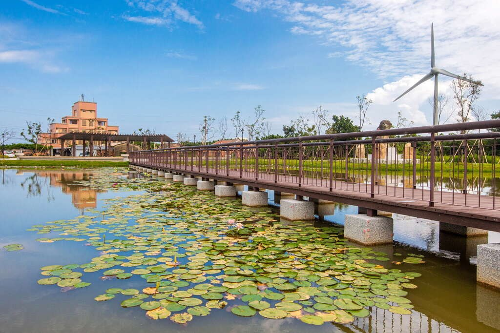

*圖：夕陽とベニバナを眺め｜來源：https://travel.tycg.gov.tw/content/images/attractions/59742/1024x768_attractions-image-a2zbkqjt90g9kf-ixbp5yg.jpg*

*圖：観音浜海遊憩区｜來源：https://travel.tycg.gov.tw/content/images/attractions/59743/1024x768_attractions-image-gazxezswtuqwymd7fhjkbg.jpg*

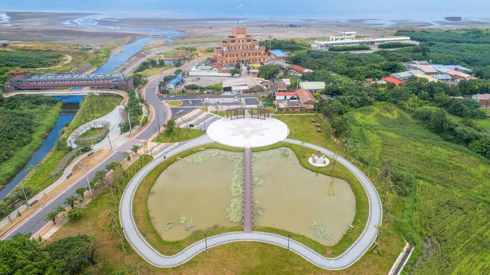

*圖：旅の楽しみも倍増です。｜來源：https://travel.tycg.gov.tw/content/images/attractions/59744/1024x768_attractions-image-mpsckks7gu-i99uuolde9q.jpg*

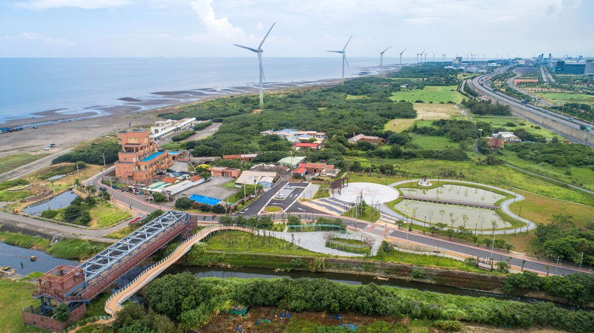

*圖：SNS映えスポットとして人気で｜來源：https://travel.tycg.gov.tw/content/images/attractions/59745/1024x768_attractions-image-ydlpgzn3deiab3sxrl2-0w.jpg*

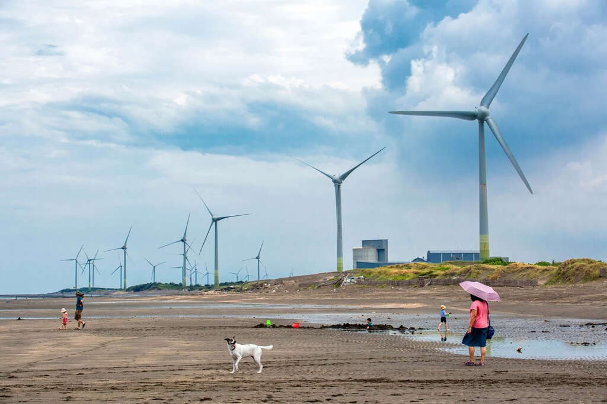

*圖：夕陽と風車を背景に告白タイム｜來源：https://travel.tycg.gov.tw/content/images/attractions/59746/1024x768_attractions-image-ohjnmv26zuajhowmsw5ujg.jpg*

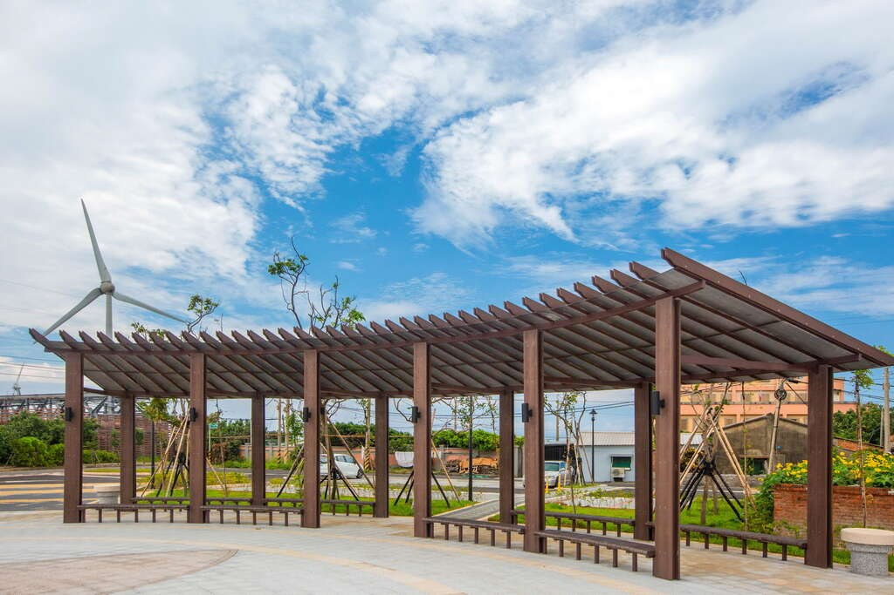

*圖：ドラマのロケ地としても何度も登場しています。｜來源：https://travel.tycg.gov.tw/content/images/attractions/59748/1024x768_attractions-image-oeqqg9qt3eaj77ffd-zcyw.jpg*

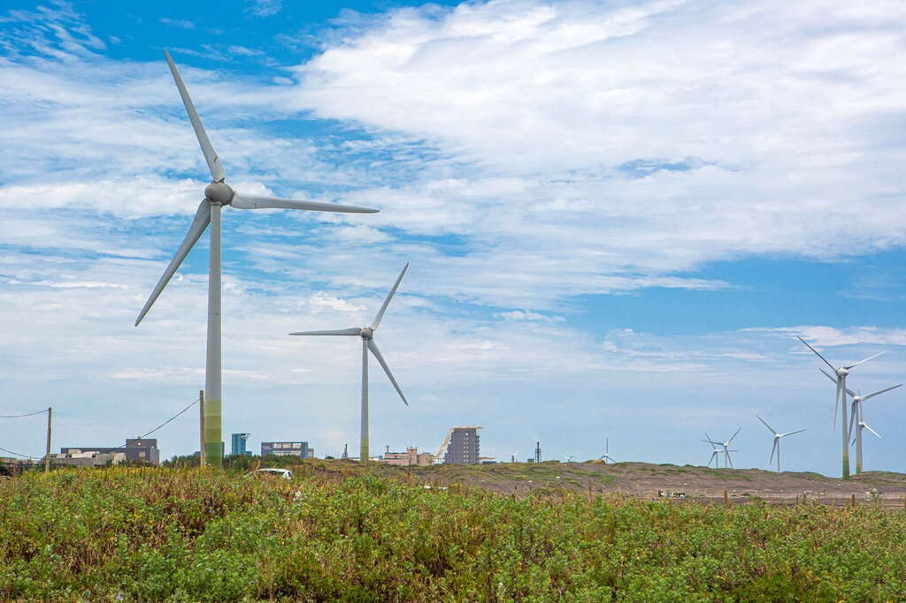

*圖：海岸に風を受けて悠々と回る大風車｜來源：https://travel.tycg.gov.tw/content/images/attractions/59749/1024x768_attractions-image-mwnmbnjb3uug0li76hdk2q.jpg*

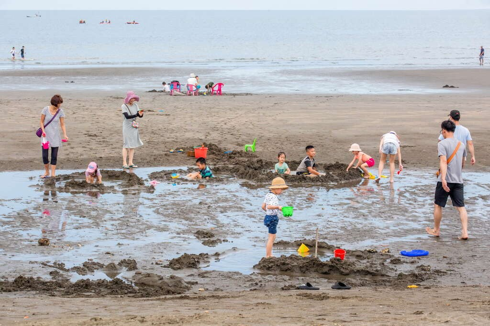

*圖：観音海水浴場｜來源：https://travel.tycg.gov.tw/content/images/attractions/59750/1024x768_attractions-image-9jxfkodrdkmg5xiqql7amw.jpg*

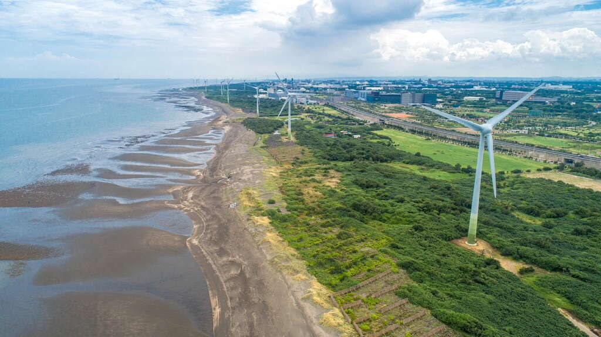

*圖：観音溪のそばに環状遊歩道｜來源：https://travel.tycg.gov.tw/content/images/attractions/59751/1024x768_attractions-image-aznocxs4z0a8ghzystz9oq.jpg*

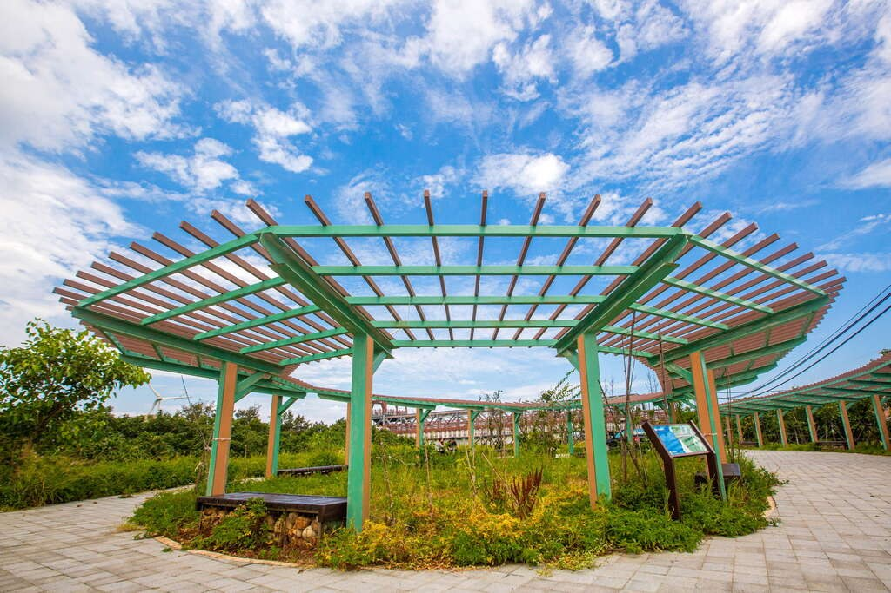

*圖：景観広場が新しく整備され｜來源：https://travel.tycg.gov.tw/content/images/attractions/59752/1024x768_attractions-image-ymokw0kkn0cphupe3toysa.jpg*

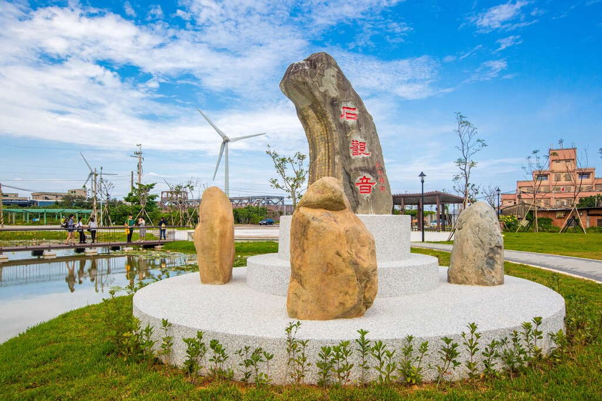

*圖：地元文化を体験できる新たな選択肢です。｜來源：https://travel.tycg.gov.tw/content/images/attractions/59753/1024x768_attractions-image-vn_mldj5tkyl06cvd1d12w.jpg*

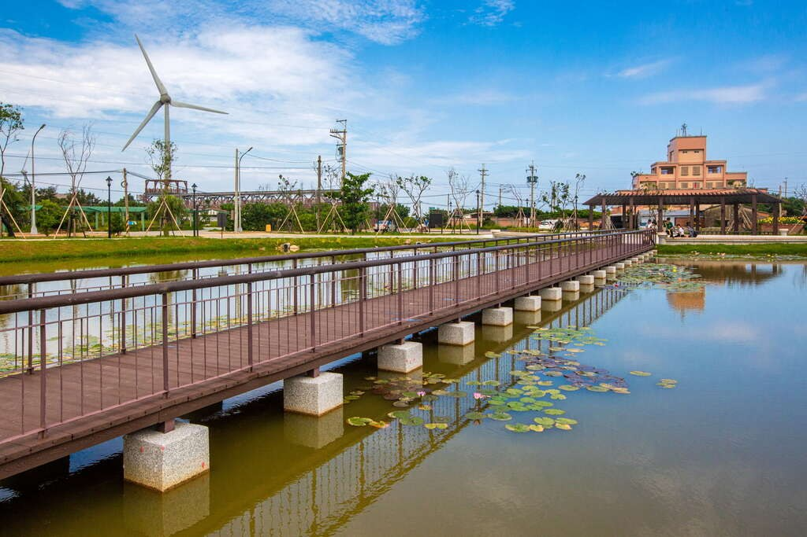

*圖：シンプルな柵がレジャーの雰囲気を盛り上げます。｜來源：https://travel.tycg.gov.tw/content/images/attractions/59754/1024x768_attractions-image-urgftvitb0-0ei-g8z-8na.jpg*

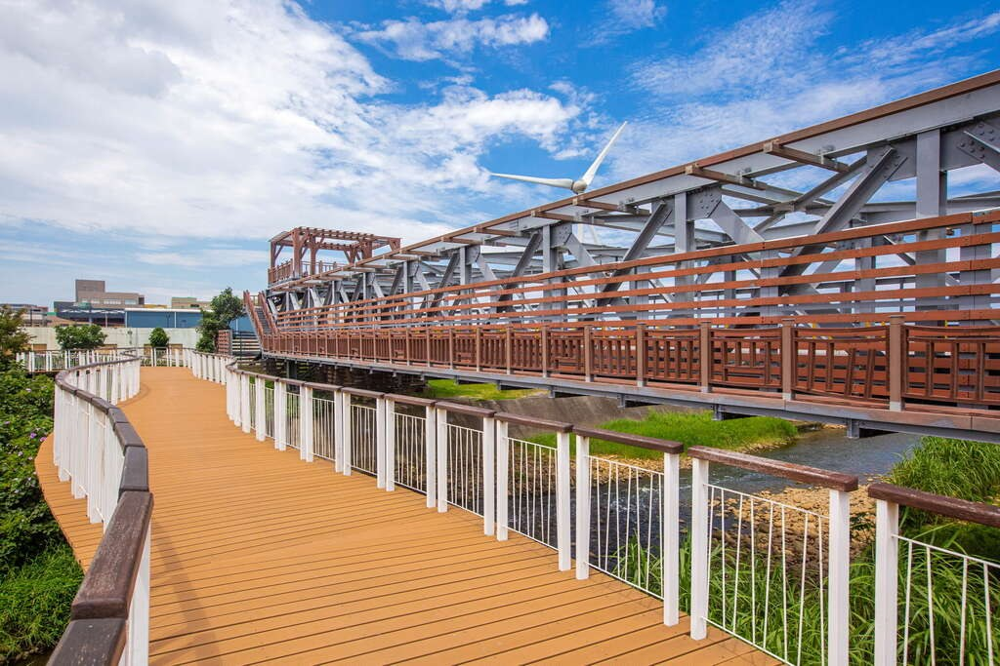

*圖：広場右側は跨橋出入口で｜來源：https://travel.tycg.gov.tw/content/images/attractions/59757/1024x768_attractions-image-_avvewsjd0amoxz6zr_nrq.jpg*

*圖：大風車｜來源：https://travel.tycg.gov.tw/content/images/attractions/59758/1024x768_attractions-image-eo3t2rmg20mdt5fhkczwpq.jpg*

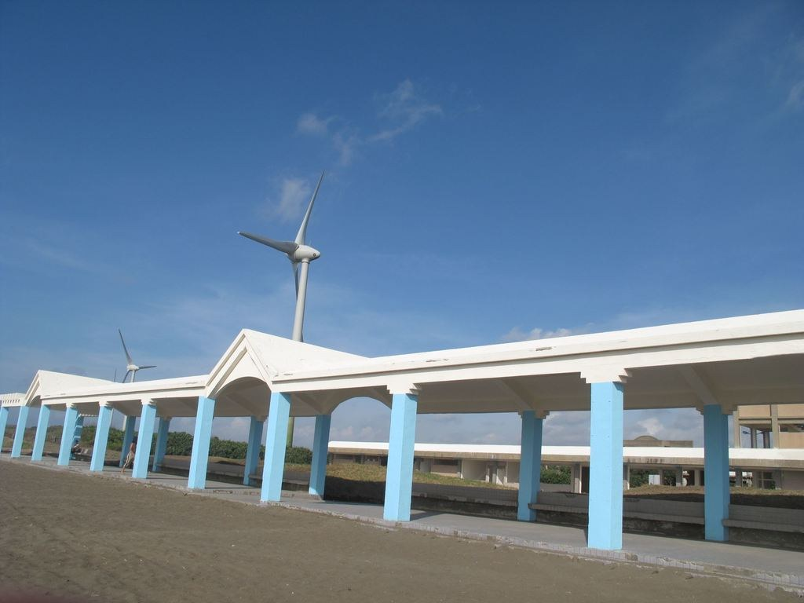

*圖：観景遊歩道に隠れた観音パスワード｜來源：https://travel.tycg.gov.tw/content/images/attractions/138/1024x768_N20118916452.jpg*

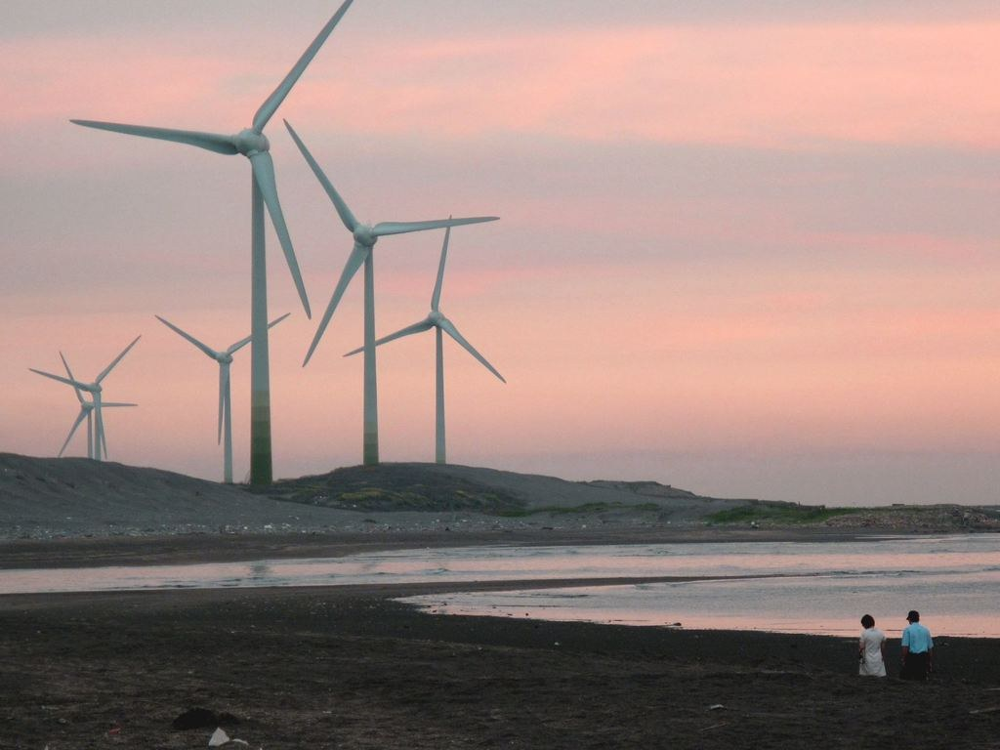

*圖：大型風車｜來源：https://travel.tycg.gov.tw/content/images/attractions/139/1024x768_IMG_0268.JPG*

- 日曜日：24時間昼夜営業
- 月曜日：24時間昼夜営業
- 火曜日：24時間昼夜営業
- 水曜日：24時間昼夜営業
- 木曜日：24時間昼夜営業
- 金曜日：24時間昼夜営業
- 土曜日：24時間昼夜営業

- 展望台
- 停車場
- 遊歩道

■「桃園観音ハスの花祭り」と合わせてテーマ旅行もできます。

■当該区域は危険水域ですので水遊びは厳禁です。

### 周辺の観光スポット

- 白沙岬灯塔(灯台)(白沙岬燈塔) 立入可能範囲は灯台内部と庭園施設。主灯台室は見学できません。 人氣 7776
- 4.6 甘泉寺 木曜日：06:00 - 21:00 人氣 592
- 2.6 中台環境資源教育センター(中台環境資源教育中心) 木曜日：09:00 - 12:00、13:30 - 17:00 人氣 5217
- 4.1 観音区「白玉海岸」(觀音白玉海岸) 木曜日：00:00 - 23:59 人氣 408
