# 甘泉寺

- 原始網址：https://travel.tycg.gov.tw/ja/travel/attraction/2247
- 網站名稱：桃園観光旅行
- 作者：（未標示）
- 發表日期：（未標示）
- 爬取時間：2026-11-05T16:44:01+08:00　取得方式：playwright　正文定位：站點規則 main
- 圖片：14 張

---
### 甘泉寺

- 海浜地区
- 歷史と人文

観音という地名の由来を知るには、百年の歴史を持つ古廟「甘泉寺」を訪れる必要があります。堂内には「石観音佛祖」が祀られており、名高い「観音聖水」を求め、長年にわたり数多くの信徒が参拝に訪れています。

- 台湾唯一の三層の高さを誇る銅彫刻の観世音菩薩像を鑑賞でき、その姿は荘厳で圧巻です。、
- 「観世音佛誕」や「石観音文化節」に参加し、地域に息づく濃厚な伝統文化を体感しましょう。、
- 三層の宮殿式廟宇を鑑賞し、精緻で華やかな建築の細部を探訪しましょう。、
- 「甘泉井」を訪ね、伝説に語られる清らかで甘美な神秘の泉水を実際に味わってみましょう。、

桃園市観音区に位置する「甘泉寺」は、地域で最も伝説的な色彩を帯びた信仰の中心の一つであり、儒教・仏教・道教の三教を融合した宗教建築の奇跡として知られています。百年以上にわたる修繕を経て完成したこの壮麗な廟宇は、その華麗な建築様式と豊かな文化的意義によって、参拝者や旅行者を惹きつけています。

「甘泉寺」の前身は「福龍寺」で、その起源は清朝乾隆年間（1780年）にさかのぼります。一人の農夫が観音菩薩に似た石を拾い、地元で「石観音」として祀ったのが始まりです。その後、泉が湧き出し、あらゆる万病を癒すという神秘的な霊験が伝わったため、寺は「甘泉寺」と改名されました。隣接する「甘泉井」は今日に至るまで清らかに湧き続け、信徒の巡礼の地となっています。

「甘泉寺」は階層ごとに異なる神々が祀られており、「石観音佛祖」「玉皇大帝」「瑤池金母」など、計18尊の神像が安置されています。廟宇の建築は伝統的な宮殿式の構造を採用し、屋根棟の剪黏装飾には神獣や人物の精緻で生き生きとした彫刻が施されています。12本の龍が巻き付いた龍柱は壮大で迫力があり、背後にそびえる銅彫刻の観世音菩薩像は、台湾でも稀少な三層建てに及ぶ巨大作品です。

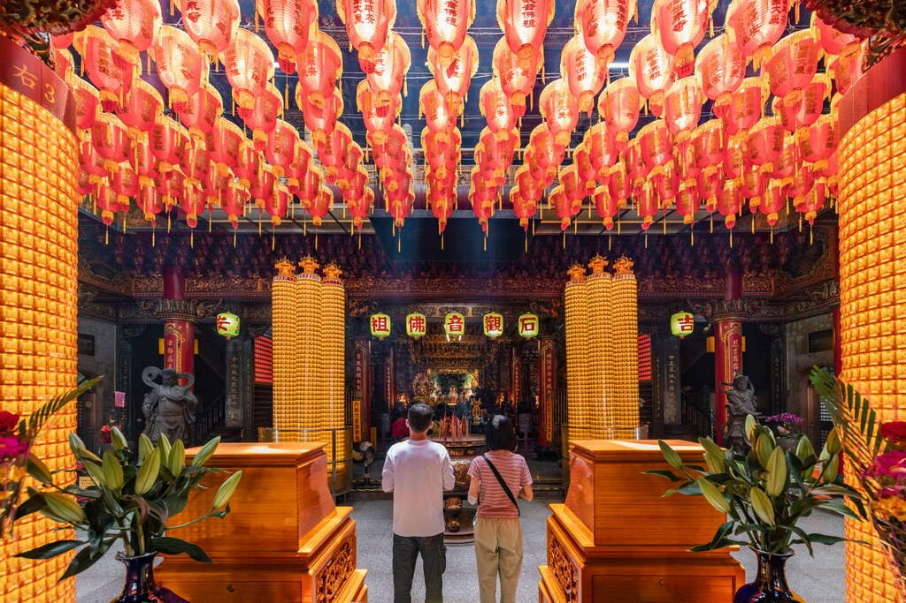

*圖：參拜香客｜來源：https://travel.tycg.gov.tw/Image/111540/?r=1753948157355*

「甘泉寺」では毎年三大祭典が行われ、「観世音佛誕日」、「石観音浮出記念日」、「中元普渡慶讚活動」がその代表です。これらは信仰と地域文化の深いつながりを体現しています。祭典は伝統と現代を融合させ、千人による海岸清掃や客家地域での芸術文化公演などを取り入れ、古くからの宗教行事に新たな息吹を与えています。

廟宇の内外には装飾芸術が至るところに見られます。石玉を口に含む石獅子、五穀豊穣と安泰を願う（風調雨順を意味する）四大天王の石像、さらに歴史的価値を持つ百年の扁額や彩色壁画までが、「甘泉寺」と地域信仰の深い結びつきを物語っています。

「甘泉寺」を訪れることは、伝統文化を探訪するだけでなく、心を洗い清める旅でもあります。ここでは歴史・建築・信仰が見事に融合し、訪れる人々の探訪を待ち受けています。

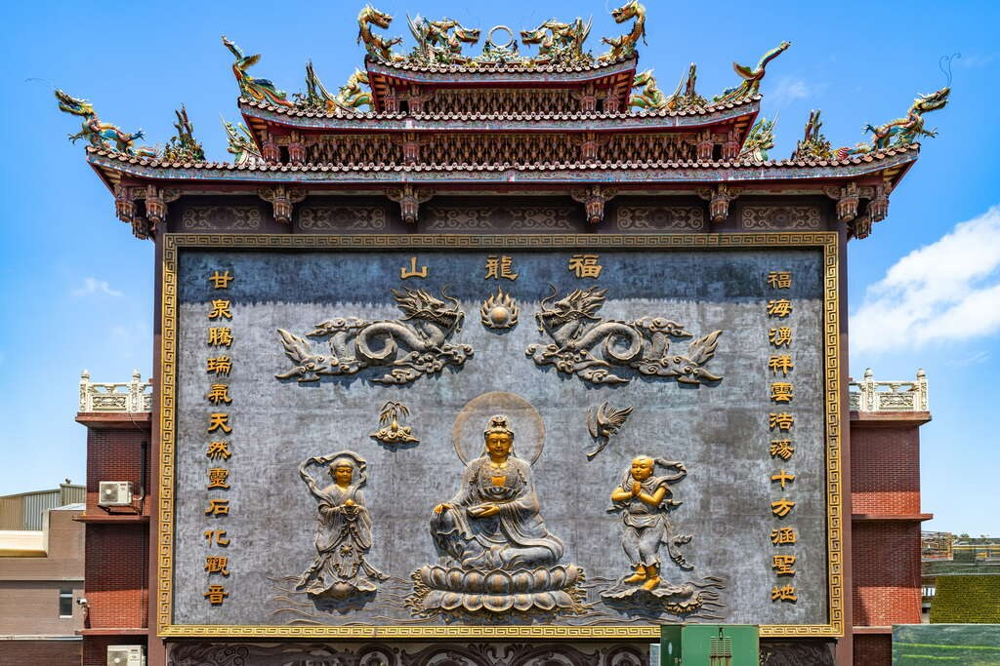

*圖：甘泉寺｜來源：https://travel.tycg.gov.tw/content/images/attractions/111538/1024x768_attractions-image-vycy4rfaieymidkotojfpq.jpg*

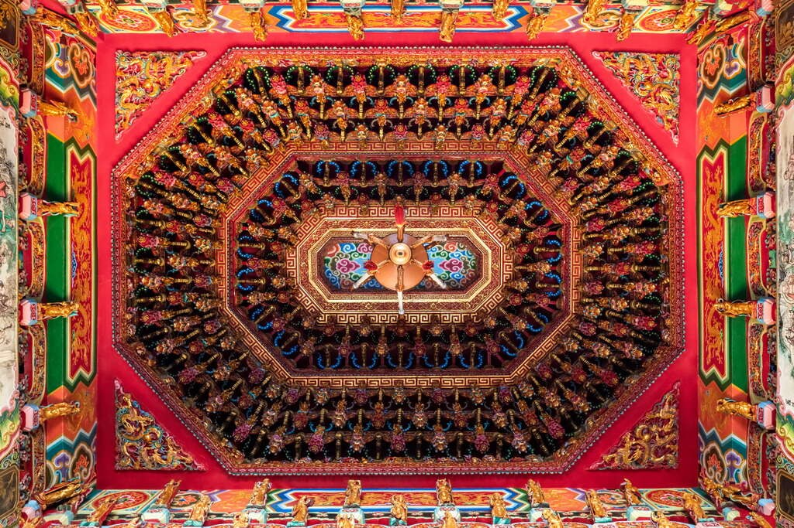

*圖：甘泉寺｜來源：https://travel.tycg.gov.tw/content/images/attractions/111539/1024x768_attractions-image-tmh0cb7blukvim4vsxeyrg.jpg*

*圖：甘泉寺｜來源：https://travel.tycg.gov.tw/content/images/attractions/111540/1024x768_attractions-image-nfhrrirhweahse47cnawfa.jpg*

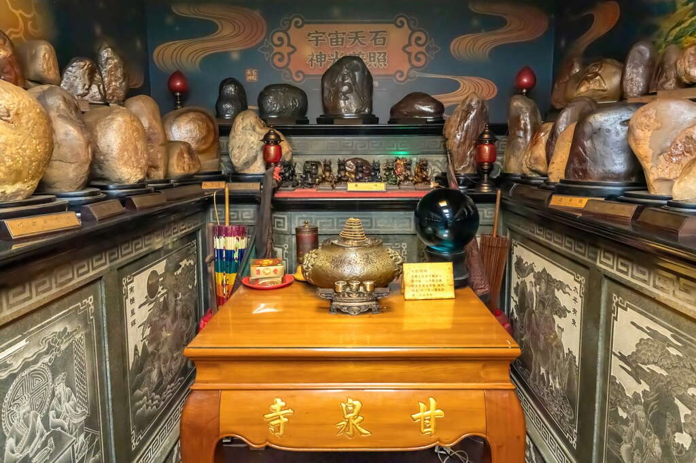

*圖：甘泉寺｜來源：https://travel.tycg.gov.tw/content/images/attractions/111541/1024x768_attractions-image-v89n4lvdskck-mjmqujdxq.jpg*

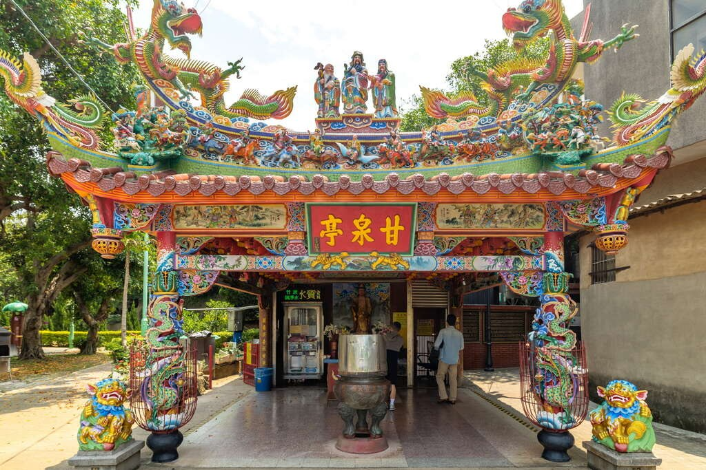

*圖：甘泉寺｜來源：https://travel.tycg.gov.tw/content/images/attractions/111542/1024x768_attractions-image-3bfzhybyneo1oltnllcgea.jpg*

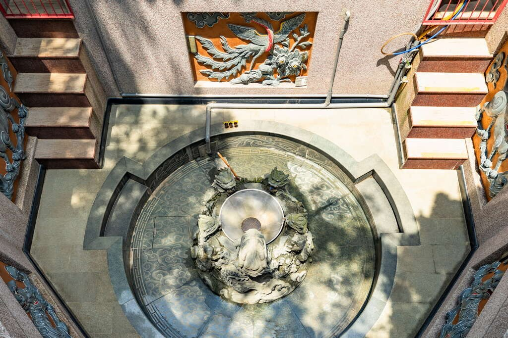

*圖：甘泉寺｜來源：https://travel.tycg.gov.tw/content/images/attractions/111543/1024x768_attractions-image-lutkqhsaiu6olsjj9dcapg.jpg*

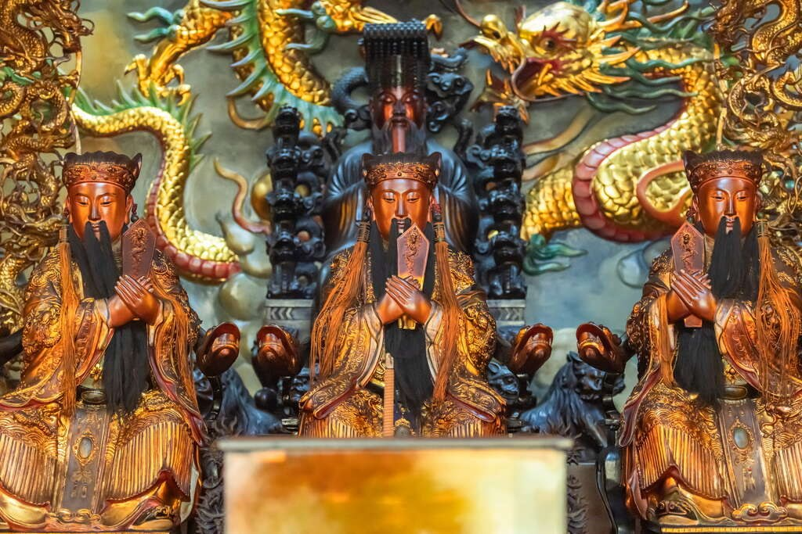

*圖：甘泉寺｜來源：https://travel.tycg.gov.tw/content/images/attractions/111544/1024x768_attractions-image-3gv1rgji_ukipr5s-loala.jpg*

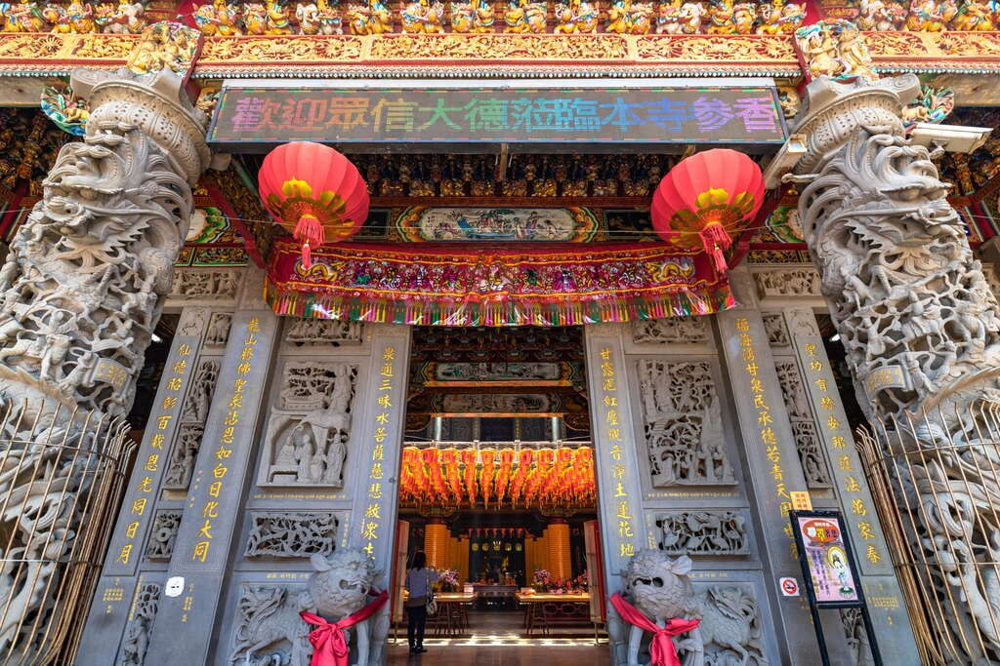

*圖：甘泉寺｜來源：https://travel.tycg.gov.tw/content/images/attractions/111545/1024x768_attractions-image-3n41qxsgbue5rw1zflgkdg.jpg*

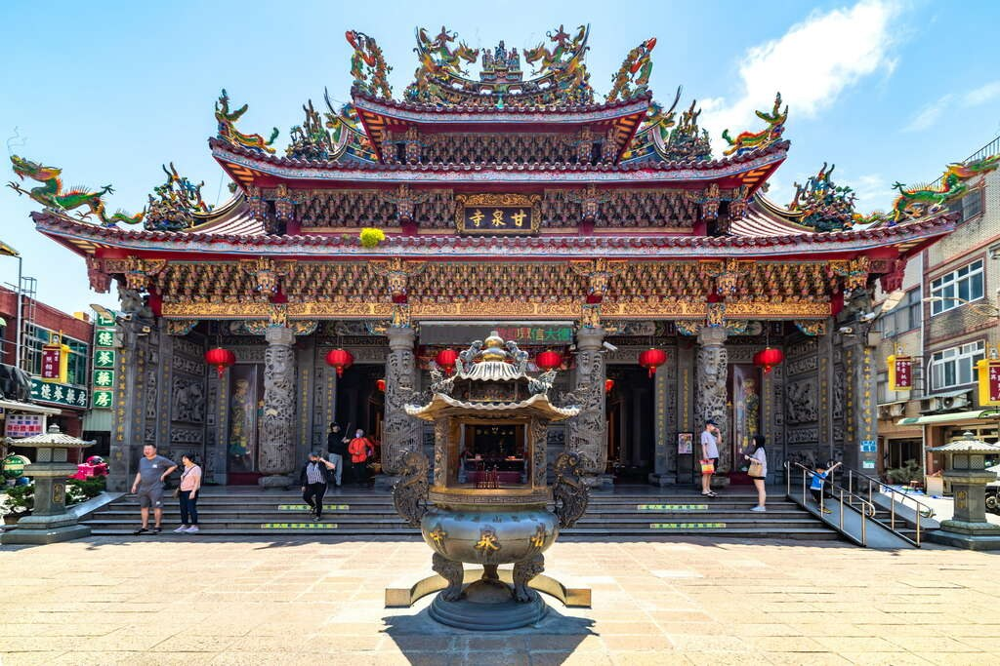

*圖：甘泉寺｜來源：https://travel.tycg.gov.tw/content/images/attractions/111537/1024x768_attractions-image-sjvkrmgfauw7v2sqvbapsg.jpg*

- 日曜日：06:00 - 21:00
- 月曜日：06:00 - 21:00
- 火曜日：06:00 - 21:00
- 水曜日：06:00 - 21:00
- 木曜日：06:00 - 21:00
- 金曜日：06:00 - 21:00
- 土曜日：06:00 - 21:00

- バス停
- トイレ

### 周辺の観光スポット

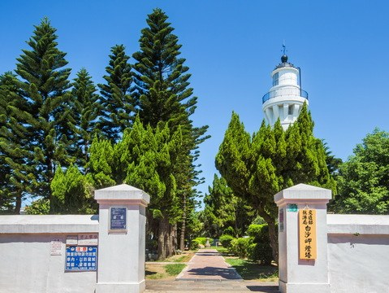

*圖：（原文無圖片說明）｜來源：https://travel.tycg.gov.tw/content/images/attractions/48707/480x360_attractions-image-uoane3hfy0ginrdhrd8nqq.jpg*

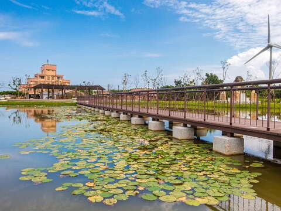

*圖：（原文無圖片說明）｜來源：https://travel.tycg.gov.tw/content/images/attractions/59742/480x360_attractions-image-a2zbkqjt90g9kf-ixbp5yg.jpg*

*圖：（原文無圖片說明）｜來源：https://travel.tycg.gov.tw/content/images/attractions/16080/480x360_files636168780503453175.jpg*

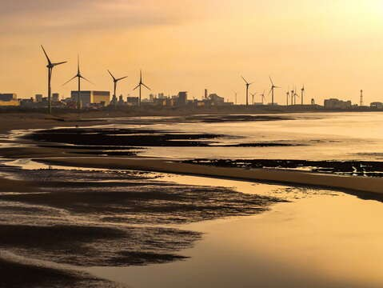

*圖：（原文無圖片說明）｜來源：https://travel.tycg.gov.tw/content/images/attractions/111440/480x360_attractions-image-snvwwmeqbuuelp-9fzzfia.jpg*

- 白沙岬灯塔(灯台)(白沙岬燈塔) 立入可能範囲は灯台内部と庭園施設。主灯台室は見学できません。 人氣 7776
- 4.4 観音海浜レジャーエリア (觀音濱海遊憩區) 木曜日：24時間昼夜営業 人氣 11108
- 2.6 中台環境資源教育センター(中台環境資源教育中心) 木曜日：09:00 - 12:00、13:30 - 17:00 人氣 5217
- 4.1 観音区「白玉海岸」(觀音白玉海岸) 木曜日：00:00 - 23:59 人氣 408
