# 觀音山 (新北市)

- 原始網址：https://zh.wikipedia.org/wiki/%E8%A7%80%E9%9F%B3%E5%B1%B1_(%E6%96%B0%E5%8C%97%E5%B8%82)
- 網站名稱：zh.wikipedia.org
- 作者：維基媒體專案貢獻者
- 發表日期：2005-07-02T10:53:50Z
- 爬取時間：2026-11-05T16:44:27+08:00　取得方式：requests　正文定位：站點規則 #mw-content-text .mw-parser-output
- 圖片：15 張

---

*圖：觀音山在臺灣的位置｜來源：https://thumb.wikimedia.org/wikipedia/commons/thumb/b/b0/Taiwan_relief_location_map.jpg/960px-Taiwan_relief_location_map.jpg?utm_source=zh.wikipedia.org&utm_campaign=parser&utm_content=thumbnail*

| 觀音山 |  |
|---|---|
| 由 烘爐塞山 所見的觀音山（圖中最高者），左側較矮的渾圓山頭為 牛港稜山。 |  |
| 最高點 |  |
| 海拔 | 616公尺（2,021英尺） |
| 座標 | 25°08′10.99″N 121°25′39.11″E  /  25.1363861°N 121.4275306°E |
| 地理 |  |
| 觀音山 觀音山在臺灣的位置 |  |
| 位置 | 新北市 五股區 、 八里區 |

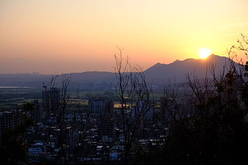

*圖：於弘法大師岩遠眺觀音山｜來源：https://thumb.wikimedia.org/wikipedia/commons/thumb/9/9a/%E6%96%BC%E5%BC%98%E6%B3%95%E5%A4%A7%E5%B8%AB%E5%B2%A9%E9%81%A0%E7%9C%BA%E8%A7%80%E9%9F%B3%E5%B1%B1FUJI2329.jpg/500px-%E6%96%BC%E5%BC%98%E6%B3%95%E5%A4%A7%E5%B8%AB%E5%B2%A9%E9%81%A0%E7%9C%BA%E8%A7%80%E9%9F%B3%E5%B1%B1FUJI2329.jpg?utm_source=zh.wikipedia.org&utm_campaign=parser&utm_content=thumbnail*

*圖：在北投公園遠望觀音山｜來源：https://thumb.wikimedia.org/wikipedia/commons/thumb/a/a0/2010_07_23590_3649_Beitou_District%2C_Taipei%2C_Streets_in_Taipei%2C_Mountains%2C_Taiwan.JPG/500px-2010_07_23590_3649_Beitou_District%2C_Taipei%2C_Streets_in_Taipei%2C_Mountains%2C_Taiwan.JPG?utm_source=zh.wikipedia.org&utm_campaign=parser&utm_content=thumbnail*

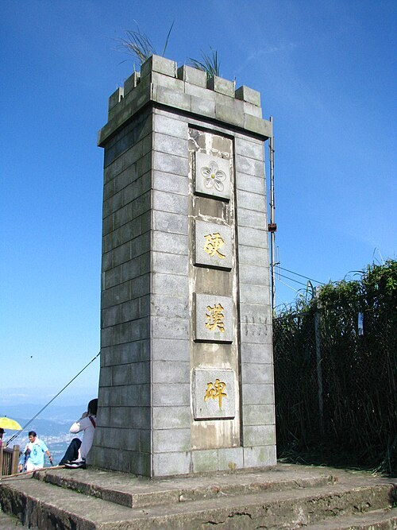

*圖：觀音山山頂的硬漢碑｜來源：https://thumb.wikimedia.org/wikipedia/commons/thumb/9/97/Yinhanbei.JPG/500px-Yinhanbei.JPG?utm_source=zh.wikipedia.org&utm_campaign=parser&utm_content=thumbnail*

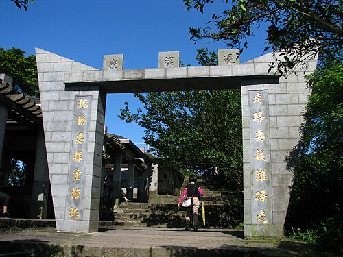

*圖：硬漢嶺登頂前的牌樓。｜來源：https://thumb.wikimedia.org/wikipedia/commons/thumb/c/c4/Yinhanling.JPG/500px-Yinhanling.JPG?utm_source=zh.wikipedia.org&utm_campaign=parser&utm_content=thumbnail*

觀音山，位於 台灣 新北市 五股區 、 八里區 交界， 海拔 標高616公尺，由 淡水河 北岸向南遙望，遠遠眺望似觀音躺像而得名，全區有十八連峰，山頂稱「硬漢嶺」，是唯一超過600公尺之地，區內有 西雲寺 、 凌雲禪寺 等多座古剎，更增添觀音山的靈性，其中還有數間供奉 觀世音菩薩 的觀音寺。亦有不少 納骨塔 及墓園錯落其間，該山西臨 台灣海峽，東北隔淡水河遠望 關渡，昔日的「坌嶺吐霧」為淡水八大景之一，全山屬 北海岸及觀音山國家風景區，是登山、健行的好去處。

### 地名變遷

在 荷蘭 人統治時代，觀音山叫淡水山（出現在1654年荷蘭人『淡水與其附近村社暨雞籠島略圖』中編號37的Tamswijse berch），但漢人習稱八里分（坌）山，係因山邊的原住民部落 八里坌社 而得名。 [ 1 ]

康熙 年間，乃延用八里坌山的地名（康熙二十四年 蔣毓英 「 臺灣府志 」）。

清朝 雍正 年間（西元1710年代）也曾因 興直堡 改為「興直山」，但在各地方史籍中仍以「八里坌山」稱之。 [ 2 ]

後來改為觀音山的說法有二：一說是乾隆17年（西元1752年） 客家 籍 貢生 胡焯猷 （ 福建 汀州 永定 人）在山路西雲岩籌建大士觀（今五股區 西雲岩寺 ）而得名，一說是由於山稜起伏變化，從 關渡 一帶眺望時，山型起伏貌似 觀音菩薩 的面容仰天的側面而得名。 [ 3 ]

據台灣著名的地名學者——國立台灣師範大學地理學系陳國章教授所著的台灣地名辭典，認為該地的地名是因「形似觀音菩薩的山」而得名。 [ 4 ]

### 坌嶺吐霧

由於季風吹來台灣海峽的水氣，遇到觀音山嶺的阻擋，便降下化為雲霧，有如飄綿滾絮、變幻無常，蔚為奇觀．被文人雅士命名為「坌嶺吐霧」，名列清代 淡北八景 之一。同治年間 大龍峒 舉人 陳維英 曾題詩讚曰：「坌嶺微茫八里間，連朝吐霧罩鴉鬟，此中定有深藏貌，未許分明見一斑」。 [ 5 ]

### 地質地形

觀音山為單一中心噴發的火山碎屑、凝灰岩與熔岩交替組成之 複式火山，其火山口位於觀音山硬漢嶺和其西的牛港稜之間，略呈圓形，南北有缺口，直徑約800公尺。 [ 6 ] 觀音山最早於60萬年前噴發，目前為止共噴發三次。 [ 7 ] 觀音山是 大屯火山彙 最西的一部分，但火山的主體因岩漿庫噴發耗竭而萎縮形成塌陷 破火山口，是為全臺灣屬一屬二之大 火山口。 [ 8 ] 其北側以火山熔岩為主，南側以火山碎屑流為主，火成岩以 安山岩 為主，另外含有一些早期噴發的 玄武岩，越晚期的噴發則形成含 角閃石 的安山岩。 淡水河 沿著觀音山麓流入 台灣海峽，因兩側的火山熔岩與碎屑物漫流入海，而形成火山海岸。

因錐狀火山體的地形特性，觀音山周圍形成放射狀水系及稜線，稜線間形成許多谷地 [ 7 ]，其地名通常帶有「坑」字，其中以山體南側的中坑規模最大，為穹丘地形，受岩脈侵入而拱起成為穹窿狀傾斜 [ 6 ]，使中坑內部的 觀音坑溪 形成環狀水系。其他例子如中坑東北部的觀音坑、位於 五股坑溪 流域的五股坑、牛港稜西南的荖阡坑、中直坑溪（觀音坑溪支流）流域的直坑等。 [ 7 ]

觀音山地區地層基盤為觀音山層（ 更新世 砂岩 、 泥岩 互層），屬於陸相或濱海相知早期更新世沉積，現今於觀音山東側的石壁腳及南側的中坑地區有出露。而山體中心、北側的大堀湖、牛寮埔、羊花崙，以及西側的牛港稜、荖阡坑等地均為更新是凝灰角礫岩、安山岩等火成岩類，其中安山岩地層依噴發時間順序有些許差異，下層為普通輝石安山岩，中層為兩輝安山岩，也是觀音山地區分布最廣的岩層，成為 觀音山石 的石材 [ 9 ]，上層則為紫蘇輝石安山岩及角閃石紫蘇安山岩。 [ 10 ] 而受區域性地殼隆升及海平面變化等影響，觀音山體北側及東側有海階分布，共有七階，最高階約285至350公尺。 [ 11 ]

### 硬漢嶺

硬漢嶺為觀音山最高峰，海拔609公尺，山頂擁有360度視野，可眺望台北港、淡水河、大屯山區、台北盆地、林口臺地等地區，能見度極佳時可望見 聖稜線 、南湖群峰等。 [ 12 ] 硬漢嶺山頂設有展望台及硬漢碑，主要登頂路線為硬漢嶺步道，為1961年 憲兵學校 的受訓成員在此地做體能訓練而設立，當時稱為硬漢路，並於登頂前的階梯設立牌樓，於上坡面刻有「走路要找難路走，挑擔要揀重擔挑」，下坡面刻有「為學硬漢而來，為作硬漢而去」之對聯。 [ 13 ] [ 14 ]

*圖：觀音山頂遠眺台北101｜來源：https://thumb.wikimedia.org/wikipedia/commons/thumb/8/85/%E8%A7%80%E9%9F%B3%E5%B1%B1%E9%A0%82%E9%81%A0%E7%9C%BA%E5%8F%B0%E5%8C%97101DSC_7238B.jpg/250px-%E8%A7%80%E9%9F%B3%E5%B1%B1%E9%A0%82%E9%81%A0%E7%9C%BA%E5%8F%B0%E5%8C%97101DSC_7238B.jpg?utm_source=zh.wikipedia.org&utm_campaign=parser&utm_content=thumbnail*

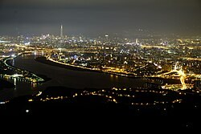

*圖：觀音山頂遠眺台北市｜來源：https://thumb.wikimedia.org/wikipedia/commons/thumb/1/1d/%E8%A7%80%E9%9F%B3%E5%B1%B1%E9%81%A0%E7%9C%BA%E5%8F%B0%E5%8C%97%E5%B8%82FUJI2501.jpg/250px-%E8%A7%80%E9%9F%B3%E5%B1%B1%E9%81%A0%E7%9C%BA%E5%8F%B0%E5%8C%97%E5%B8%82FUJI2501.jpg?utm_source=zh.wikipedia.org&utm_campaign=parser&utm_content=thumbnail*

*圖：觀音山遠眺漁人碼頭｜來源：https://thumb.wikimedia.org/wikipedia/commons/thumb/d/d4/%E8%A7%80%E9%9F%B3%E5%B1%B1%E9%81%A0%E7%9C%BA%E6%BC%81%E4%BA%BA%E7%A2%BC%E9%A0%ADDSC_9183.jpg/250px-%E8%A7%80%E9%9F%B3%E5%B1%B1%E9%81%A0%E7%9C%BA%E6%BC%81%E4%BA%BA%E7%A2%BC%E9%A0%ADDSC_9183.jpg?utm_source=zh.wikipedia.org&utm_campaign=parser&utm_content=thumbnail*

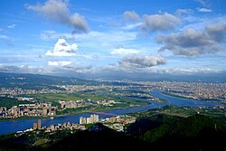

*圖：觀音山眺望社子島關渡｜來源：https://thumb.wikimedia.org/wikipedia/commons/thumb/4/46/%E8%A7%80%E9%9F%B3%E5%B1%B1%E7%9C%BA%E6%9C%9B%E7%A4%BE%E5%AD%90%E5%B3%B6%E9%97%9C%E6%B8%A1FUJI4450.jpg/250px-%E8%A7%80%E9%9F%B3%E5%B1%B1%E7%9C%BA%E6%9C%9B%E7%A4%BE%E5%AD%90%E5%B3%B6%E9%97%9C%E6%B8%A1FUJI4450.jpg?utm_source=zh.wikipedia.org&utm_campaign=parser&utm_content=thumbnail*

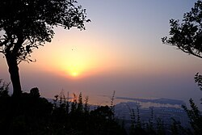

*圖：觀音山遠眺漁台北港落日｜來源：https://thumb.wikimedia.org/wikipedia/commons/thumb/0/0b/%E8%A7%80%E9%9F%B3%E5%B1%B1%E9%81%A0%E7%9C%BA%E6%BC%81%E5%8F%B0%E5%8C%97%E6%B8%AF%E8%90%BD%E6%97%A5FUJI2835.jpg/250px-%E8%A7%80%E9%9F%B3%E5%B1%B1%E9%81%A0%E7%9C%BA%E6%BC%81%E5%8F%B0%E5%8C%97%E6%B8%AF%E8%90%BD%E6%97%A5FUJI2835.jpg?utm_source=zh.wikipedia.org&utm_campaign=parser&utm_content=thumbnail*

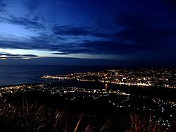

*圖：觀音山遠眺漁人碼頭夜景｜來源：https://thumb.wikimedia.org/wikipedia/commons/thumb/d/d0/%E8%A7%80%E9%9F%B3%E5%B1%B1%E9%81%A0%E7%9C%BA%E6%BC%81%E4%BA%BA%E7%A2%BC%E9%A0%AD%E5%A4%9C%E6%99%AF075.jpg/250px-%E8%A7%80%E9%9F%B3%E5%B1%B1%E9%81%A0%E7%9C%BA%E6%BC%81%E4%BA%BA%E7%A2%BC%E9%A0%AD%E5%A4%9C%E6%99%AF075.jpg?utm_source=zh.wikipedia.org&utm_campaign=parser&utm_content=thumbnail*

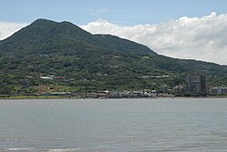

*圖：觀音山與淡水河｜來源：https://thumb.wikimedia.org/wikipedia/commons/thumb/b/b7/Danshui_0321_-_Summer_2007.jpg/250px-Danshui_0321_-_Summer_2007.jpg?utm_source=zh.wikipedia.org&utm_campaign=parser&utm_content=thumbnail*

- 觀音山頂遠眺台北101
- 觀音山頂遠眺台北市
- 觀音山遠眺漁人碼頭
- 觀音山眺望社子島關渡
- 觀音山遠眺漁台北港落日
- 觀音山遠眺漁人碼頭夜景
- 觀音山與 淡水河

### 北海岸及觀音山國家風景區

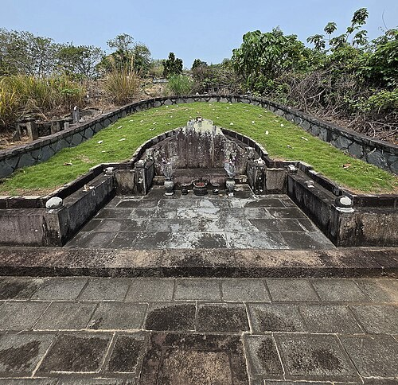

*圖：觀音山天乙路孝義路間的 墳墓群｜來源：https://thumb.wikimedia.org/wikipedia/commons/thumb/d/d4/%E4%BA%94%E8%82%A1%E5%AD%9D%E7%BE%A9%E8%B7%AF%E5%85%AC%E5%A2%93%E5%8D%80_%E6%B8%85%E5%90%8C%E6%B2%BB%E5%B9%B4%E9%96%93%E5%8F%A4%E5%A2%93_20260411.jpg/500px-%E4%BA%94%E8%82%A1%E5%AD%9D%E7%BE%A9%E8%B7%AF%E5%85%AC%E5%A2%93%E5%8D%80_%E6%B8%85%E5%90%8C%E6%B2%BB%E5%B9%B4%E9%96%93%E5%8F%A4%E5%A2%93_20260411.jpg?utm_source=zh.wikipedia.org&utm_campaign=parser&utm_content=thumbnail*

1937年12月27日成立 大屯國立公園，觀音山亦在其中。但戰後成立的 陽明山國家公園 剔除觀音山（2002年方另成立 北海岸及觀音山國家風景區 管理），以及民間認為此山為 風水 寶地，埋下日後濫墾濫葬及水土保持的問題。據估計目前山上非法 墓 計4萬處 [ 15 ]，成為發展阻礙。

### 步道系統

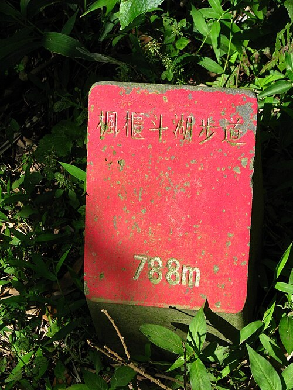

*圖：觀音山步道系統之里程標示，此為風櫃斗湖步道終點之里程標示。｜來源：https://thumb.wikimedia.org/wikipedia/commons/thumb/1/1f/Fongguidouhubudao.JPG/500px-Fongguidouhubudao.JPG?utm_source=zh.wikipedia.org&utm_campaign=parser&utm_content=thumbnail*

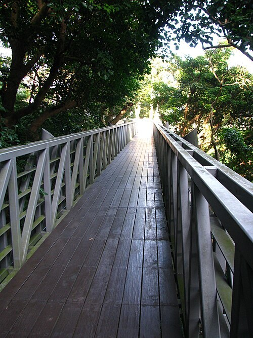

*圖：於2012年啟用的觀音山林梢步道。｜來源：https://thumb.wikimedia.org/wikipedia/commons/thumb/2/2e/Linshaobudao.JPG/500px-Linshaobudao.JPG?utm_source=zh.wikipedia.org&utm_campaign=parser&utm_content=thumbnail*

北海岸及觀音山國家風景區將觀音山周邊編有六條步道，包含牛港稜登山步道、福隆山登山步道 、硬漢嶺登山步道、楓櫃斗湖登山步道、尖山步道、牛寮埔登山步道等。另有林梢步道這條景觀步道，以及非步道系統之傳統古道，包含北橫古道、龍形古道，以及占山連稜等。

#### 牛港稜登山步道

牛港稜位於硬漢嶺稜線西方，步道由觀音山遊客中心至賞鷹台，全長753公尺。 [ 16 ] 其步道入口位在遊客中心石雕公園的後方，峰頂設有眺望平台，也是不錯的賞鳥場所。 [ 17 ]

#### 福隆山登山步道

福隆山步道大致與北53-1鄉道平行，大致由凌雲禪寺沿著溪谷至觀音坑，全長1315公尺。 [ 16 ] 其步道入口位在凌雲路三段41號旁，為昔稱觀音古道之前段，昔日為 台北西國三十三所靈場，至今沿線尚有二十幾尊觀音佛像。 [ 17 ]

#### 硬漢嶺登山步道

硬漢嶺登山步道為登觀音山硬漢嶺的主要步道，登山口位於凌雲禪寺附近，於俗稱弱者俱樂部的雙亭上稜線，經奉水茶站、牛寮埔登山步道叉路的觀景平台後至硬漢嶺，全長1563公尺。 [ 16 ] 昔稱觀音古道。 [ 18 ]

#### 楓櫃斗湖登山步道

風櫃斗湖步道為硬漢嶺攻頂路程最短之路線，由觀音山遊客中心旁腰繞後陡上，於稜線接上硬漢嶺步道里程約950公尺處，全長788公尺。 [ 16 ] 雖然行程較短，但坡度陡峭，沿途有濃密的竹林。 [ 17 ]

#### 尖山步道

尖山，又稱占山，位於硬漢嶺東南方的小丘，登山口位於凌雲禪寺旁，大致沿著稜線至尖山，另有一條通往鷹仔尖的支線，全長1620公尺。 [ 16 ]

#### 牛寮埔登山步道

牛寮埔登山步道自硬漢嶺步道登頂前的展望台下坡，終點在無極宮，全長907公尺。 [ 16 ] 由硬漢嶺下至牛寮埔後，可沿北52鄉道至八里區米倉接 台15線 4K+145處。 [ 19 ] 沿途有許多的觀光果園。 [ 17 ]

#### 林梢步道

林梢步道位於觀音山遊客中心與凌雲禪寺之間的道路旁，由觀音山生態園區至開山園，全長800公尺，共分兩段。 [ 16 ] 於2012年4月21日啟用。 [ 20 ] [ 21 ] 大多為高架木棧道，並設有觀景台及涼亭。 [ 22 ]

#### 北橫古道

北橫古道是一條腰繞觀音山山體東側及北側的山腰小路，昔日為八里山區牛寮埔、石壁寮聚落居民前往凌雲寺及凌雲禪寺的路線，也是當地農民上山種墾的農路。為非官方步道系統，全線無正規指標，南端位於尖山步道途中，與尖山連稜的叉路旁，北端位於牛寮埔附近，並於牛寮埔附近有打石遺跡。 [ 23 ]

#### 占山連稜

占山連稜指占山與硬漢嶺之間的連稜，稜上有數個山頭，須面臨數個陡上與陡下。登山口位於北56鄉道觀音社區涼亭旁，前半段為尖山步道的一部份，主要為石階步道，後半段則為非官方步道系統，多為拉繩山徑及岩稜，並有一處峭壁，最後接上硬漢嶺步道，可續行至硬漢嶺。 [ 16 ] [ 13 ]

### 產業、文化與節慶

#### 賞鷹

觀音山因其地理位置位於台灣西部海岸北端，因此成為春季時鳥類向北遷徙的過境地，主要遷移期為每年三月初至五月底。其中以鷹、隼等猛禽類居多，包括 紅隼 、 遊隼 等 隼科，以及 東方蜂鷹 、 赤腹鷹 、 灰面鷲 等 鷹科。主要遷移方向為西南往東北走向，以及東往西走向。 [ 24 ] 因此，交通部北海岸及觀音山國家風景區管理處於每年四月至五月的主要遷移期，皆會在觀音山地區舉行「觀音．觀鷹」的活動，以落實環境教育。觀天觀地賞肚娟 [ 25 ] [ 26 ]

#### 綠竹筍

觀音山西南麓於清代即開始運用當地的 火山灰土 以及濕潤的氣候來種植 綠竹，使此地成為台灣主要的綠竹筍產地之一。目前種植面積約750公頃，產季從每年五月開始長達半年，主要盛產期為六、七月間。 [ 27 ] 近年五股區農會會在產季時舉行綠竹筍相關的節慶活動。 [ 28 ]

#### 揹水隊

揹水隊為觀音山的特色之一，其起源為創始人蘇進雄於1990年攀登硬漢嶺時缺乏水源，接受了陌生山友的水後啟發其揹水隊的想法，至今發展為「亞洲形上觀音山揹水隊」，目前固定成員約八十人，於硬漢嶺步道里程約1200公尺處及步道終點處設立奉茶水站，服務山友。 [ 29 ] [ 30 ] [ 31 ]

#### 觀音石

觀音山因其過去的火山活動所形成的安山岩，青灰色， 硬度 4至5度，為良好的石材，將此地所開採的石材稱為觀音石，可供廟宇建築雕刻，故自清代開始，在米倉、大崁、埤頭、荖阡坑等地區開始以人力打石，送至挖子尾渡船口，至大稻埕、艋舺進行雕刻。1980年代，於牛寮埔地區以機械進行新一波的開採，於1990年代禁採。 [ 9 ]

### 相關條目

- 觀音山派
- 凌雲禪寺
- 台北西國三十三所靈場
- 小觀音山
- 觀音山旗竿湖
- 大屯火山彙
- 占山
- 台15線
- 台64線

### 參考資料

- ^ Tony. 觀音山．西雲寺．凌雲寺．開山院．西國三十三所觀音靈場 . Tony. 2004年10月 [2010年1月15日] . （原始內容 存檔 於2021年1月24日） （中文） .
- ^ 觀音吐霧 . （ 原始內容 存檔於2009-12-22） （中文） .
- ^ 蘇秋金. 觀音山石在八里 . （ 原始內容 存檔於2009-12-15） （中文） .
- ^ 陳國章. 台灣地名辭典 . [2010年1月15日] . （ 原始內容 存檔於2007年5月22日）.
- ^ 觀音山：台灣最年輕的火山 . （原始內容 存檔 於2021-01-24） （中文） .
- ^ 6.0 6.1 楊貴三; 沈淑敏. 台灣全志，卷二，土地誌，地形篇。. 南投市: 國史館台灣文獻館. 2010. ISBN 9789860250329 .
- ^ 7.0 7.1 7.2 八里鄉志，地理篇，第二章：地形與地質，第一節：地勢與地形 (PDF) . 八里區公所. 2005年 [2013年11月22日] . （ 原始內容 (PDF) 存檔於2013年12月2日）.
- ^ 莊文星. 觀音山火山地質地形自然景觀 . [2010年1月15日] . （原始內容 存檔 於2021年4月28日）.
- ^ 9.0 9.1 八里打石業 . 奇巖打石歌. [2013年11月22日] . （ 原始內容 存檔於2013年12月2日）.
- ^ 八里鄉志，地理篇，第二章：地形與地質，第二節：地質構造與土壤 (PDF) . 八里區公所. 2005年 [2013年11月22日] . （ 原始內容 (PDF) 存檔於2013年12月3日）.
- ^ 董德輝、鄧國雄、劉佳怡（2008）淡水河口海岸階地之對比。亞熱帶資源與環境學報，3(4):8-15。
- ^ 2010 夏 觀音山無敵展望 . 在水一方 碧連天. [2013年11月21日] . （原始內容 存檔 於2015年6月10日）.
- ^ 13.0 13.1 [台北五股]．占山．觀音山．鷹仔尖 . Tony的自然人文旅記. [2013年11月21日] . （原始內容 存檔 於2021年1月25日）.
- ^ 吳文良. 新北市／征服1900階硬漢嶺 上觀音山攬勝 . 聯合新聞網. 2011年9月16日 [2013年11月21日] . （ 原始內容 存檔於2014年9月10日）.
- ^ 《觀音山濫葬 墳變塔可三贏》，聯合報，2008年2月15日
- ^ 16.0 16.1 16.2 16.3 16.4 16.5 16.6 16.7 觀音山遊客中心步道圖
- ^ 17.0 17.1 17.2 17.3 觀音山6條登山步道系統 . 北海岸及觀音山國家風景區. [2013年11月19日] . （原始內容 存檔 於2019年11月15日）.
- ^ 觀音山硬漢嶺步道 . Hikingbook Inc. [ 2024-03-13 ] . （原始內容 存檔 於2024-03-13）.
- ^ 沒有起點的斷頭路--北52鄉道 . anddy北縣鄉道之旅. 2009年10月3日 [2013年11月19日] .
- ^ 觀音觀鷹暨林梢步道啟動開幕式 . 北海岸及觀音山國家風景區. [2013年11月21日] . （原始內容 存檔 於2015年6月10日）.
- ^ 2012觀音‧觀鷹-呼朋遊林梢．鬥陣來賞鷹 . 交通部觀光局-國家風景區觀光活動. [2013年11月21日] . （ 原始內容 存檔於2013年6月26日）.
- ^ [新北市五股] ．觀音山林梢步道 . Tony的自然人文旅記. [2013年11月21日] . （原始內容 存檔 於2021年1月24日）.
- ^ [新北市八里] ．觀音山北橫古道 . Tony的自然人文旅記. [2013年11月21日] . （原始內容 存檔 於2021年1月24日）.
- ^ 林柏壽、林文宏、陳世中（2011）台灣北端觀音山春季遷徙性猛禽調查1991~2010。台灣猛禽研究，11:1-23。
- ^ 灰面鵟鷹北返 觀音山賞鷹良機 . 大紀元. 2012年4月14日 [2013年11月22日] . （原始內容 存檔 於2021年1月24日）.
- ^ 2013觀音觀鷹 5月4日正式登場！ . 北海岸及觀音山國家風景區. [2013年11月22日] . （原始內容 存檔 於2016年3月5日）.
- ^ 種竹採筍山腰間 . 北海岸及觀音山國家風景區. [2013年11月22日] . （原始內容 存檔 於2021年1月24日）.
- ^ 2013觀音山綠竹筍節 7/7登場囉 . 觀音山休閒旅遊網. [2013年11月22日] . （ 原始內容 存檔於2015年4月5日）.
- ^ 觀音山80好漢 揹水奉茶20年 . 聯合新聞網. 2010年5月10日 [2013年11月22日] . （原始內容 存檔 於2010年7月14日）.
- ^ 觀音山揹水 記者腿軟累趴 . 蘋果日報. 2013年1月2日 [2013年11月22日] . （原始內容 存檔 於2017年3月31日）.
- ^ Home Run Taiwan . homeruntaiwan.com. [ 2024-07-26 ] . （原始內容 存檔 於2024-07-26）.

### 外部連結

- 台灣地貌-多面向台灣火山地質地形自然景觀數位典藏資料庫拓展 （ 頁面存檔備份，存於 網際網路檔案館 ）： 觀音山火山地質地形自然景觀 （ 頁面存檔備份，存於 網際網路檔案館 ）
