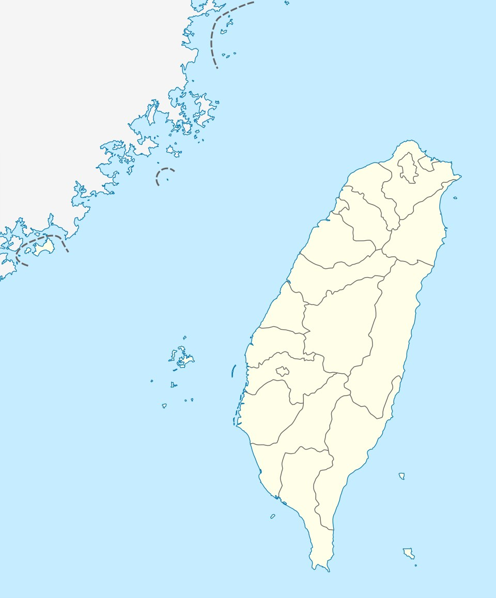

# Guanyinkeng Xi (suba sa Republika sa Tsina, Taipei) - Wikipedia

- 原始網址：https://ceb.wikipedia.org/wiki/Guanyinkeng_Xi_(suba_sa_Republika_sa_Tsina,_Taipei)
- 網站名稱：ceb.wikipedia.org
- 作者：Contributors to Wikimedia projects
- 發表日期：2017-05-30T23:20:33Z
- 爬取時間：2026-11-05T16:44:43+08:00　取得方式：requests　正文定位：站點規則 #mw-content-text .mw-parser-output
- 圖片：2 張

---
Alang sa ubang mga dapit sa mao gihapon nga ngalan, tan-awa ang Guanyinkeng Xi .

*圖：Nahimutangan sa Guanyinkeng Xi sa Republika sa Tsina.｜來源：https://thumb.wikimedia.org/wikipedia/commons/thumb/1/10/2021_Guanyinkeng_River_ii.jpg/500px-2021_Guanyinkeng_River_ii.jpg?utm_source=ceb.wikipedia.org&utm_campaign=parser&utm_content=thumbnail*

| Guanyinkeng Xi ( 觀音坑溪 ) |  |
|---|---|
| Guanyinkeng Si, Kuan-yin-k’eng Hsi |  |
| Suba |  |
| Nasod | Republika sa Tsina |
| Lalawigan | Taipei |
| Lalawigan | Taipei |
| Gitas-on | 4 m (13 ft) |
| Tiganos | 25°06′23″N 121°27′20″E  /  25.10638°N 121.45554°E |
| Timezone | CT ( UTC+8 ) |
| GeoNames | 6748994 |

Suba ang Guanyinkeng Xi ( Chinese : 觀音坑溪 , Kuan-yin-k’eng Hsi ) sa Republika sa Tsina . [ 1 ] Ang Guanyinkeng Xi nahimutang sa lalawigan sa Taipei ug lalawigan sa Taipei , sa amihanang bahin sa nasod. Guanyinkeng Xi nidagayday paingon ngadto sa Kadagatang Pasipiko .

*圖：Guanyinkeng Xi is located in Taiwan｜來源：https://thumb.wikimedia.org/wikipedia/commons/thumb/7/72/Taiwan_location_map.svg/960px-Taiwan_location_map.svg.png?utm_source=ceb.wikipedia.org&utm_campaign=parser&utm_content=thumbnail*

Nahimutangan sa Guanyinkeng Xi sa Republika sa Tsina.

### Ang mga gi basihan niini

- ↑ Guanyinkeng Xi sa Geonames.org (cc-by) ; post updated 2012-01-20; database download sa 2017-01-30
