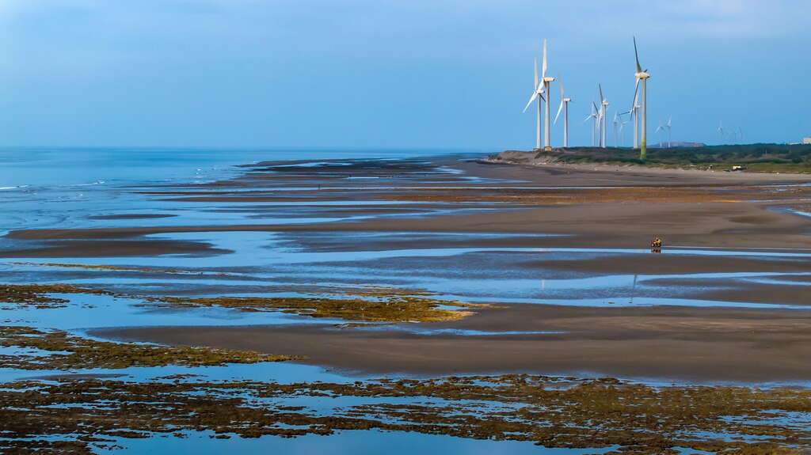
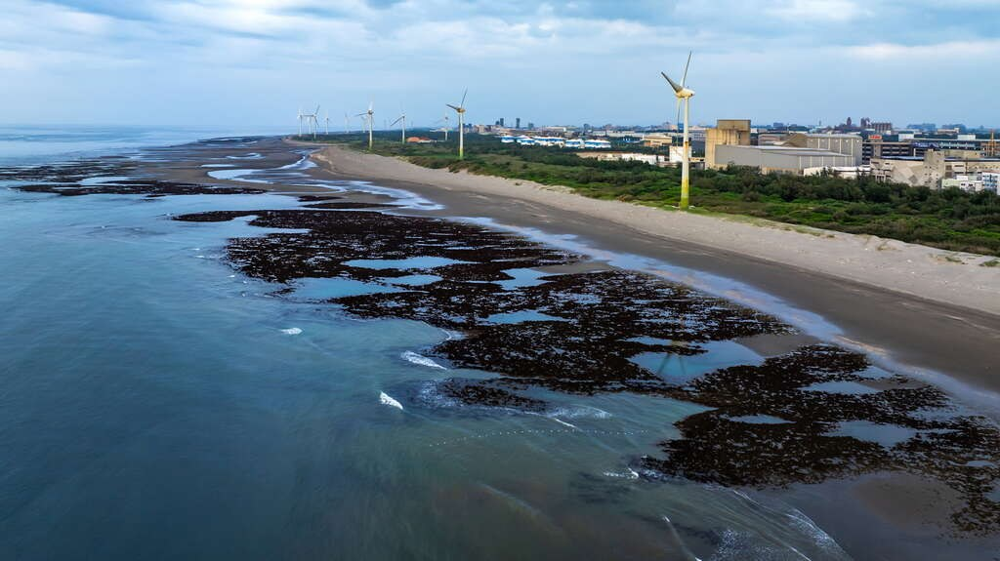
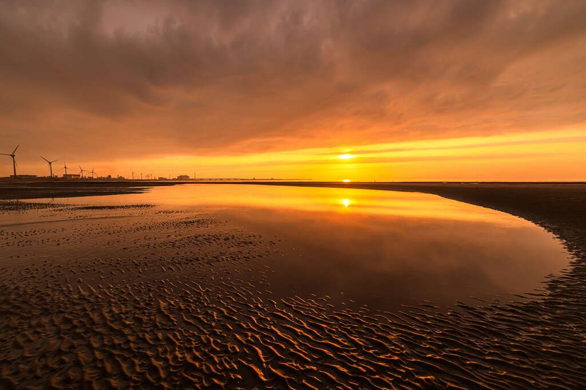
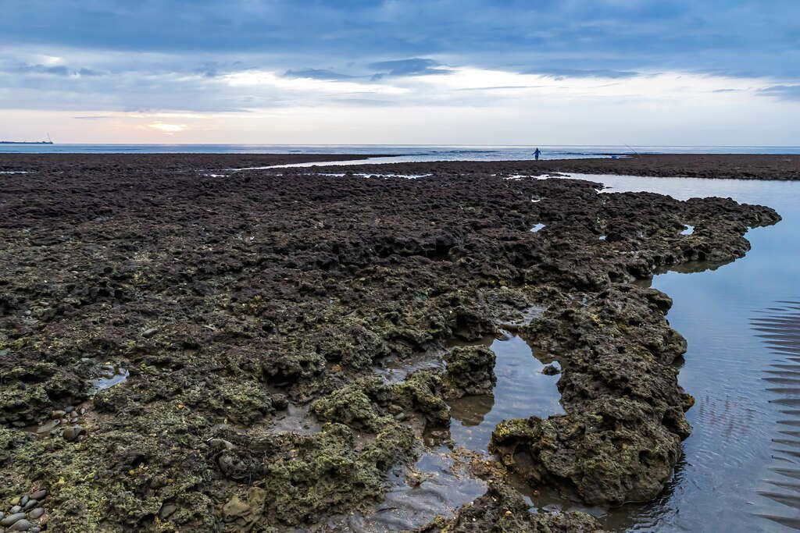
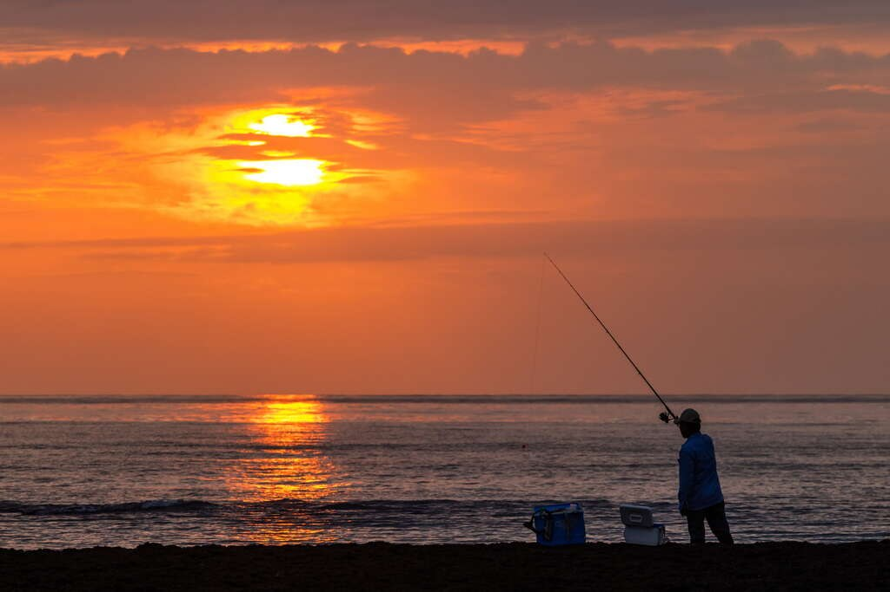
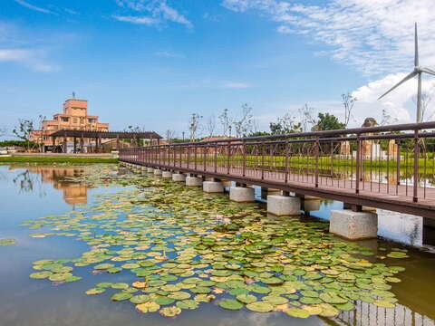
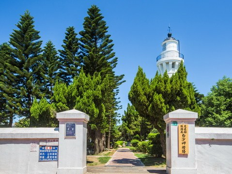
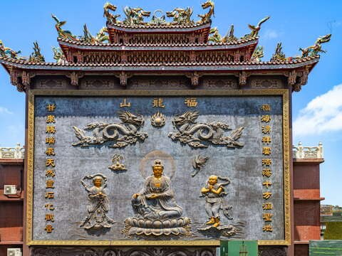

# 観音区「白玉海岸」(觀音白玉海岸)

- 原始網址：https://travel.tycg.gov.tw/ja/travel/attraction/2250
- 網站名稱：桃園観光旅行
- 作者：（未標示）
- 發表日期：（未標示）
- 爬取時間：2026-10-29T16:15:16+08:00　取得方式：playwright　正文定位：站點規則 main
- 圖片：12 張

---
### 観音区「白玉海岸」(觀音白玉海岸)

- 海浜地区

「白玉海岸」では、回転する風車、「豆腐岩」の模様と空を舞うコアジサシの姿が重なり合い、夕暮れの空と雲の影が織りなす光景が広がります。静かに散策し、そっと思い出に残したくなる、隠れた海辺の散策スポットです。

- コアジサシに出会い、自然の生態が織りなす不思議な日常を観察してみましょう。、
- 「領海基点」で記念撮影をし、海辺の秘境を訪れた証を残しましょう。、
- 「豆腐岩」の秘境をゆったり散策し、干潮時にのみ現れる鏡のような絶景を堪能しましょう。、
- 夕暮れ時の美しい夕陽を眺め、巨大な風車と一緒に写真を撮りましょう。、

桃園の海辺といえば「永安漁港」と「草漯砂丘」だけだと思っているなら、この絶景の秘境を見逃してしまうでしょう！観音区の「大堀渓」河口に位置する「白玉海岸」は、控えめながらも大きな魅力を放ち、地元の人々に愛される夏の散歩スポットです。約2.5キロメートルにわたる海岸線をゆっくり歩くと、遠くには高くそびえる風車が海風を受けてゆったりと回転しているのが見えます。地面には規則正しく並んだ排水路が干潮時に「小豆腐岩」のような模様を現し、夕暮れ時の空と海の色合いと相まって、加工なしでも映画のような雰囲気あふれる写真が撮れます。

干潮のたびに、「白玉海岸」は最も魅力的な姿を映し出します。海水は鏡のように静かに地面を覆い、空の色と雲の影を映し出し、岸辺の枯木と重なり合い、静けさと寂寥が織りなす光景を描き出します。ここには人混みの喧騒はなく、寄り添うのは波の音とそよ風だけです。まるで静かな風景画の中に迷い込んだように、海岸ならではの穏やかな空気を味わえます。

*圖：不需濾鏡也能拍出電影感滿滿｜來源：https://travel.tycg.gov.tw/Image/111442/?r=1753853274829*

風車や「豆腐岩」に加え、ここには重要なランドマーク「中華民国領海基点」を示す標識もあります。台湾の領海基点は、この「大堀渓」河口を起点としており、地理愛好家には見逃せない撮影スポットです。海と空が水平線で一体となる景色のもと、この小さくも重要な標識が、旅に歴史と地理を掘り下げるもうひとつの楽しみを添えてくれます。

「白玉海岸」は、二級保育類鳥類であるコアジサシの重要な生息地でもあります。コアジサシは台湾のカモメ科で最小の種で、体は小さく、動きは俊敏です。繁殖期には「黒面具（黒いマスク模様）」をつけたような姿となり、ユーモラスで愛嬌のある姿が人々を惹きつけます。こうしたコアジサシを守るため、近年地元では囲いを設け、安全な繁殖環境を整えています。運が良ければ、コアジサシが優雅に海面をかすめる姿を目にでき、旅の思いがけないハイライトとなるでしょう！

*圖：観音区「白玉海岸」(觀音白玉海岸)｜來源：https://travel.tycg.gov.tw/content/images/attractions/111440/1024x768_attractions-image-snvwwmeqbuuelp-9fzzfia.jpg*

*圖：観音区「白玉海岸」(觀音白玉海岸)｜來源：https://travel.tycg.gov.tw/content/images/attractions/111441/1024x768_attractions-image-bz0okw1skes4ips1aqr_xq.jpg*

*圖：観音区「白玉海岸」(觀音白玉海岸)｜來源：https://travel.tycg.gov.tw/content/images/attractions/111442/1024x768_attractions-image-cpc8oh_7kukn2hxb9j2u0a.jpg*

*圖：観音区「白玉海岸」(觀音白玉海岸)｜來源：https://travel.tycg.gov.tw/content/images/attractions/111443/1024x768_attractions-image-zjqciu8zoei9x92epuue6g.jpg*

*圖：観音区「白玉海岸」(觀音白玉海岸)｜來源：https://travel.tycg.gov.tw/content/images/attractions/111444/1024x768_attractions-image-f42k8u3u4k-ys7qcli2tyq.jpg*

*圖：観音区「白玉海岸」(觀音白玉海岸)｜來源：https://travel.tycg.gov.tw/content/images/attractions/111445/1024x768_attractions-image-o8gd136sokgg4fxts70k_q.jpg*

*圖：観音区「白玉海岸」(觀音白玉海岸)｜來源：https://travel.tycg.gov.tw/content/images/attractions/111446/1024x768_attractions-image-s10zwa--fe-4o54sb6j_rq.jpg*

台湾桃園市観音区「白玉里」大崛渓の河口

- 日曜日：00:00 - 23:59
- 月曜日：00:00 - 23:59
- 火曜日：00:00 - 23:59
- 水曜日：00:00 - 23:59
- 木曜日：00:00 - 23:59
- 金曜日：00:00 - 23:59
- 土曜日：00:00 - 23:59

-堤防には高さがありますので、歩行の際は十分ご注意ください。

-「豆腐岩」は干潮時にのみ姿を現します。

### 周辺の観光スポット

*圖：（原文無圖片說明）｜來源：https://travel.tycg.gov.tw/content/images/attractions/82616/480x360_attractions-image-xgllamine0ayqkpvuhprpg.jpg*

*圖：（原文無圖片說明）｜來源：https://travel.tycg.gov.tw/content/images/attractions/59742/480x360_attractions-image-a2zbkqjt90g9kf-ixbp5yg.jpg*

*圖：（原文無圖片說明）｜來源：https://travel.tycg.gov.tw/content/images/attractions/48707/480x360_attractions-image-uoane3hfy0ginrdhrd8nqq.jpg*

*圖：（原文無圖片說明）｜來源：https://travel.tycg.gov.tw/content/images/attractions/111538/480x360_attractions-image-vycy4rfaieymidkotojfpq.jpg*

- 4.7 GFun機能生活館 木曜日：10:00 - 17:00 人氣 5190
- 4.4 観音海浜レジャーエリア (觀音濱海遊憩區) 木曜日：24時間昼夜営業 人氣 11060
- 白沙岬灯塔(灯台)(白沙岬燈塔) 立入可能範囲は灯台内部と庭園施設。主灯台室は見学できません。 人氣 7511
- 4.6 甘泉寺 木曜日：06:00 - 21:00 人氣 538
