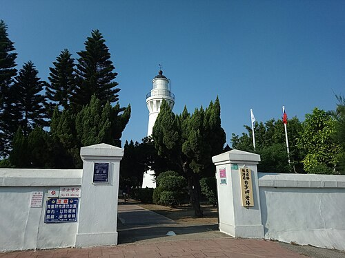
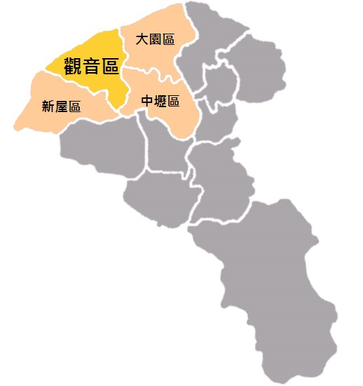
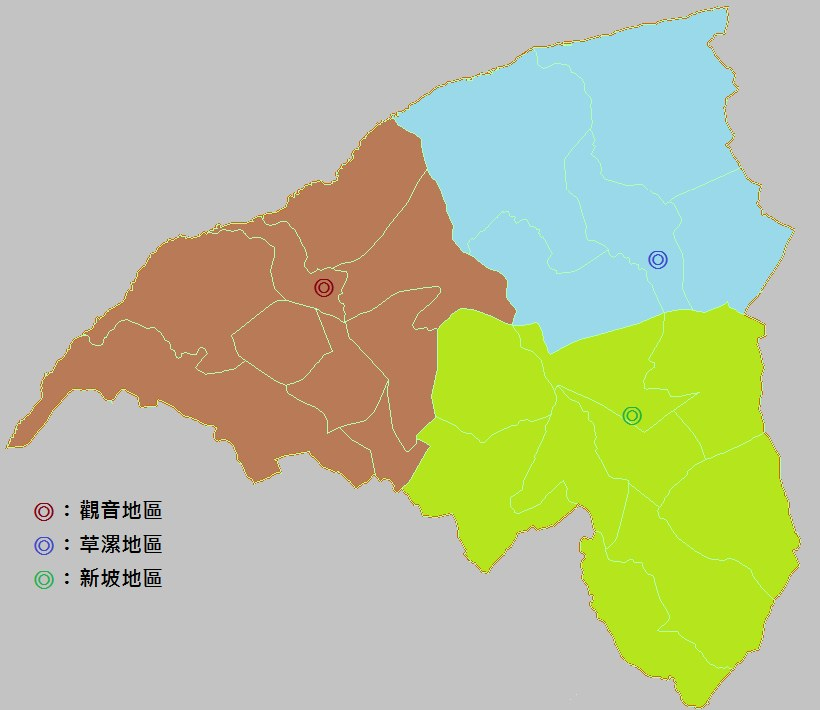
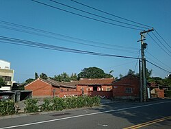
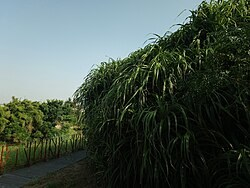

# 觀音區

- 原始網址：https://zh.wikipedia.org/zh-tw/%E8%A7%80%E9%9F%B3%E5%8D%80
- 網站名稱：zh.wikipedia.org
- 作者：維基媒體專案貢獻者
- 發表日期：2005-02-06T08:00:19Z
- 爬取時間：2026-11-05T16:32:31+08:00　取得方式：requests　正文定位：站點規則 #mw-content-text .mw-parser-output
- 圖片：5 張

---
25°2′10.70″N 121°4′54.10″E  /  25.0363056°N 121.0816944°E

*圖：白沙岬燈塔｜來源：https://thumb.wikimedia.org/wikipedia/commons/thumb/4/41/%E7%99%BD%E6%B2%99%E5%B2%AC%E7%87%88%E5%A1%94%E5%85%A5%E5%8F%A3.jpg/500px-%E7%99%BD%E6%B2%99%E5%B2%AC%E7%87%88%E5%A1%94%E5%85%A5%E5%8F%A3.jpg?utm_source=zh.wikipedia.org&utm_campaign=parser&utm_content=thumbnail*

*圖：觀音區位置圖｜來源：https://upload.wikimedia.org/wikipedia/commons/3/33/Guanyin_district.png?utm_source=zh.wikipedia.org&utm_campaign=parser&utm_content=thumbnail_unscaled*

| 觀音區 Guanyin District 舊稱：石觀音 |  |
|---|---|
| 區 |  |
| 白沙岬燈塔 |  |
| 觀音區位置圖 |  |
| 坐標： 25°02′N 121°06′E  /  25.03°N 121.1°E |  |
| 國家 | 中華民國 |
| 上級區劃 | 桃園市 |
| 下級區劃 | 24 里 402 鄰 |
| • 區長 | 劉草典 |
| 面積 |  |
| • 總計 | 87.9807平方公里（33.9695平方英里） |
| 海拔 | 44公尺（144英尺） |
| 人口 （2026年7月）（32,515戶） |  |
| • 總計 | 78,137人（桃園市的第11位） |
| • 密度 | 888人/平方公里（2,300人/平方英里） |
| 時區 | 國家標準時間 （ UTC+08:00 ） |
| 郵遞區號 | 328 |
| 戶政資料代碼 | 68000120 |
| 毗鄰 | 大園區 、 新屋區 、 中壢區 |
| 網站 | www .guanyin .tycg .gov .tw |

| 觀音區－ 台灣語言 寫法及拼音 |  |
|---|---|
| 注音 | ㄍㄨㄢ- ㄧㄣ- ㄑㄩ- |
| 漢語拼音 | Guān yīn qū |
| 通用拼音 | Guan yin cyu |
| 威妥瑪拼音 | Kuan yin ch'ü |
| 台語白話字 | Koan-im Khu |
| 台語羅馬字 | Kuan-im Khu |
| 客語白話字 | Kôn-yîm Khî |
| 客羅 | 海陸腔 ：gonˋ rhimˋ kiˋ 四縣腔 ：gonˊ imˊ ki^ 饒平腔 ：guanˇ rhimˇ kiˇ |

觀音區，舊稱「石觀音」 [ 1 ]，前身「觀音鄉」，位於 臺灣 桃園市 西部沿海。東臨 大園區 、 中壢區，南邊與 新屋區 相臨，西濱 臺灣海峽。區內人口約7.8萬人 [ 2 ]，人口主要分布於觀音市區、草漯及新坡三大聚落中，居民大多屬 客家族群。當地原為農業鄉鎮，1970年代以後隨著臺灣工業的蓬勃發展而設立工業區，境內有 觀音工業區 和新創的 桃園科技工業園區。觀音區也盛產 蓮花，每年夏天會舉辦蓮花季。

### 歷史

觀音區舊稱「石觀音」 [ 1 ]，係於1860年一名 竹北二堡 石牌嶺庄 （今屬新屋區）的農民往返耕作途中，在當地的小溪中撿到一顆酷似 觀音佛 的天然石，供奉瞻拜，故名。直至1920年設庄時，石觀音改稱「觀音」 [ 3 ] : 51。

日治時期，1895年，觀音屬 臺北縣 新竹支廳，一部份隸屬 桃澗堡，一部份則隸屬竹北二堡。1896年3月，全臺設3縣1廳，觀音隸屬臺北縣 [ 4 ] : 308。1901年11月改為20廳，屬 桃園廳 [ 4 ] : 309。1920年改訂地方制度，廢廳置州，全臺灣設5州2廳3市， 觀音庄 隸屬 新竹州 中壢郡 [ 4 ] : 310。

二戰後 1946年，隸屬 新竹縣 中壢區觀音鄉 [ 4 ] : 312。1950年，桃園立縣，與新竹縣分治，觀音鄉改隸 桃園縣 [ 4 ] : 313。之後境內村數歷經兩次變更 [ 註 1 ] [ 4 ] : 314，至2014年1月1起，觀音鄉共轄24個村；12月25日因應桃園縣改制為直轄市，觀音鄉改制為「觀音區」 [ 1 ]。

### 地理

#### 地形

觀音區屬於 桃園沖積扇 的一部分。

#### 水文

- 河川：富林溪、大堀溪、觀音溪、新屋溪。
- 灌溉系統： 桃園大圳 （ 大漢溪 ）。

#### 人口

| 年份 | 人口 | ±% |
|---|---|---|
| 1946 | 27,040 | — |
| 1951 | 29,951 | +10.8% |
| 1956 | 33,454 | +11.7% |
| 1961 | 38,317 | +14.5% |
| 1966 | 44,283 | +15.6% |
| 1971 | 47,698 | +7.7% |
| 1976 | 47,408 | −0.6% |
| 1981 | 45,758 | −3.5% |
| 1986 | 44,069 | −3.7% |
| 1991 | 43,911 | −0.4% |
| 1996 | 49,808 | +13.4% |
| 2001 | 54,227 | +8.9% |
| 2006 | 58,901 | +8.6% |
| 2011 | 61,676 | +4.7% |
| 2016 | 65,555 | +6.3% |
| 2021 | 69,995 | +6.8% |
| 來源： 謝公倉 1986，第128頁 內政部統計月報-各鄉鎮市區人口數 . 內政部 . [ 2019-12-19 ] . （ 原始內容 存檔於2020-11-10）. |  |  |

根據桃園市政府觀音區戶政事務所統計，2025年底觀音區戶數約3.2萬戶，人口約7.8萬人，區內人口最多與最少的里分別是草新里與新興里，2025年底兩里人口分別為8,599人與909人 [ 2 ]。2025年底，觀音區人口中0至14歲人口佔比約有12.54%，15至64歲人口佔比約有72.01%，65歲以上人口則佔比約有15.45%，是桃園市青壯年人口佔比最高的行政區 [ 5 ]。

### 政治

#### 歷任首長

##### 鄉長

| 任次 | 姓名 | 備註 |
|---|---|---|
| 1 | 古萬桂 |  |
| 2 | 黃阿壁 |  |
| 3 | 廖德景 |  |
| 4 |  |  |
| 5 | 許金燦 |  |
| 6 |  |  |
| 7 | 廖運清 |  |
| 8 | 黃金春 | 民主進步黨 |
| 9 |  |  |
| 10 | 李文貴 |  |
| 11 |  |  |
| 12 | 郭榮宗 | 民主進步黨 |
| 13 | 當選立委 |  |
| 13 | 張永輝 | 民主進步黨 |
| 14 | 解職 |  |
| 14 | 黃茂實 | 補選 |
| 15 |  |  |
| 16 | 歐炳辰 | 民主進步黨 |

##### 區長（指派）

| 任次 | 姓名 | 備註 |
|---|---|---|
| 1 | 洪清淵 |  |
| 2 | 林國甯 |  |
| 3 | 劉草典 | 現任 |

#### 區政組織

觀音區公所是 桃園市政府 在觀音區的派出機關，在中華民國政府架構中為市政府綜理區政的執行機關，上級業務監督機關為桃園市政府。 區長 由 市長 任命，其任期為無任期保障。在區長及主任秘書之下，設有5課4室等9個內部單位 [ 6 ]。觀音區為 桃園市議會 第十二選區，在市議會的63席市議員中，觀音區共選出2席區域市議員（不含平地原住民與山地原住民議員） [ 7 ]。

#### 行政區

##### 沿革

現今觀音區行政範圍的確立，來自於1920年，日本將臺灣十二廳改為五州二廳，設觀音庄屬新竹州中壢郡。觀音庄轄茄苳坑、大潭、觀音、三座屋、坑尾、坡寮、白沙屯、樹林仔、新坡、上大堀、下青埔、草漯、塔子腳、崙坪、下大堀、苦苓腳等16個大字。1945年，改為「觀音鄉」，屬新竹縣中壢區。1950年，調整行政區域並裁撤區署，觀音鄉改隸新成立的桃園縣 [ 8 ] : 84。2014年12月25日，桃園縣改制為直轄市，觀音鄉改制為市轄區「觀音區」，隸屬桃園市 [ 1 ]。

觀音區共轄24里，其行政區域分布情形為 [ 9 ] [ 10 ] ：

| 次分區 | 里名 |  |  |  |  |  |  |  |  |
|---|---|---|---|---|---|---|---|---|---|
| 觀音區 | 觀音里 | 廣興里 | 白玉里 | 武威里 | 保生里 | 坑尾里 | 三和里 | 新興里 | 大潭里 |
| 草漯區 | 草漯里 | 富林里 | 樹林里 | 保障里 | 塔腳里 | 草新里 |  |  |  |
| 新坡區 | 新坡里 | 大同里 | 崙坪里 | 廣福里 | 上大里 | 藍埔里 | 富源里 | 金湖里 | 大堀里 |

##### 次分區

*圖：觀音區的次分區｜來源：https://upload.wikimedia.org/wikipedia/commons/f/fc/GuanyinMap.png?utm_source=zh.wikipedia.org&utm_campaign=parser&utm_content=thumbnail_unscaled*

- 觀音次分區 指大堀溪以南，坑尾以西地帶，包括觀音、白沙屯、大潭、茄苳坑、三座屋、坑尾地段及坡寮一部分。早年移墾較其他二區有成就故莊役場設於觀音次分區。但日治時代後，交通改道，發展變緩 [ 11 ] : 48。
- 草漯次分區 位於觀音區東北角，指大堀溪以東地帶；範圍最小，是觀音區開發最早的地區。草漯素來與大園區有深厚感情，因其居民大多同為 台灣閩南人，而觀音區則以 台灣客家人 為主，位於草漯村內，供奉主神為 媽祖 的 草漯保障宮 更是香火鼎盛，已有兩百多年的歷史，是當地居民信仰中心，而且廟內建築格局奇特，參拜時不需爬高爬低，僅需要一炷香就能拜眾神，因此， 草漯保障宮 有「通天香」的美名。而現今草漯里由於農地重劃，釋出150公頃的建地，成為 桃園航空城 被徵收戶的標的，房價已大幅攀升 [ 12 ]。
- 新坡次分區 包括新坡、上下大堀、苦練腳、下青埔、崙坪及坡寮一部分。發展迅速是在日治時代以後，尤其大正十三年（1924年） 桃園大圳 完成後，農村的繁榮，使其與觀音次分區立於分庭抗禮之地位；觀音次分區雖為行政中心，但全區的農會和郵局卻在新坡。公路交通發達後，新坡以接近中壢，地當中壢往觀音中途，且為南北往新屋、大園道路交會點，市況繁榮超過觀音。此次分區因毗鄰中壢，富源里部份區域被劃入 中壢都會區都市計畫區。

### 文化

#### 藝文活動

- 桃園蓮花季

#### 宗教信仰

- 觀音甘泉寺，供奉 觀世音菩薩，香火鼎盛，十分靈驗。
- 草漯保障宮，位於草漯里，主神供奉 媽姐，香火十分鼎盛。
- 觀音復興宮 ：位於臺灣桃園市觀音區觀音工業區的 開漳聖王 廟，前身為大溪區的 阿姆坪復興宮。
- 石橋應天宮，主神供奉 關聖帝君。
- 協天宮，主神供奉 關聖帝君，在地的居民稱關平爺公廟。
- 理教石橋復興宮，主神供奉 開漳聖王。
- 觀音永興宮，主神供奉 天上聖母。
- 正大宮，主神供奉 五年千歲十二王爺。
- 溥濟宮，主神供奉 保生大帝，俗稱保生廟。
- 慈母宮，主神供奉 驪山老母 、 王母娘娘 、 地母娘娘 、 觀音菩薩 、 九天玄女。

#### 語言

觀音的本土語言以 臺灣客家語 海陸腔 及 臺灣閩南語 偏漳腔 為主。

- 富源， 臺灣閩南語 、 臺灣客家語。
- 白玉， 臺灣閩南語 、 臺灣客家語。
- 大潭， 臺灣閩南語 、 臺灣客家語。
- 草漯， 臺灣閩南語。
- 崙坪， 臺灣閩南語。
- 上大， 臺灣閩南語。
- 新坡， 臺灣閩南語。

### 教育

大潭發電廠 坐落於觀音區，桃園市政府以發電廠回饋金實施國中、國小學生免費營養午餐 [ 13 ]。

#### 大專院校

觀音區現有為 國立臺灣海洋大學 （桃園觀音校區）一校，於2018年11月1日揭牌 [ 14 ]。

#### 公立高級中學

- 桃園市立觀音高級中等學校 一校，並附設國中部。

#### 國民中學

- 桃園市立觀音國民中學
- 桃園市立草漯國民中學

#### 國民小學

- 桃園市觀音區觀音國民小學
- 桃園市觀音區上大國民小學
- 桃園市觀音區大潭國民小學
- 桃園市觀音區育仁國民小學
- 桃園市觀音區保生國民小學
- 桃園市觀音區草漯國民小學
- 桃園市觀音區崙坪國民小學
- 桃園市觀音區新坡國民小學
- 桃園市觀音區富林國民小學
- 桃園市觀音區樹林國民小學

### 交通

#### 省道

- 台15線 ：西濱公路
- 台61線 ：西濱快速公路 33 草漯 草漯交流道 38 桃科 桃科交流道 42 觀音 觀音交流道
- 台66線 ：東西向快速公路（觀音－大溪線） 0 觀音 觀音交流道 5 觀音一 觀音一交流道

#### 市道

- 市道112號
- 市道115號

#### 公車

- 桃園客運 觀音站 L512愛心福利專車長庚B線（觀音、高鐵桃園站到長庚） L513愛心福利專車長庚C線（白玉、藍埔到高鐵桃園站） L515愛心福利專車長庚D線

（埔頂、觀音工業區、草漯到高鐵桃園站）

- L516免費公車草漯線 L516A免費公車草漯線延駛高鐵桃園站 L516B免費公車草漯線延駛觀音高中 L517免費公車新坡線 L517免費公車新坡線延駛蘭亭集序社區 5032中壢-新屋-石橋-觀音 5033中壢-新屋-保生-觀音 5039中壢-觀崁（先進觀音、永安） 5039中壢-崁觀（先進新屋、永安） 5040桃園-大園-草漯-觀音 5040A桃園-大園-草漯-觀音（繞駛大園國中） 5040B桃園-大園-草漯-觀音（繞駛開南大學） 5041中壢-觀音工業區-白玉-觀音 5042中壢-新坡-觀音 5043中壢-草漯-樹林新村-觀音工業區 5043A中壢-草漯-樹林新村-觀音工業區（延駛回觀音）

#### 輕便軌道

觀音區曾有輕便軌道的舖設，目前均已拆除，而當年的輕便軌道是由中壢軌道公司經營，共有二條路線分別如下 [ 11 ] : 224 ：

- 中壢－觀音：1918年營運，1953年廢除
- 新坡－草漯：1918年營運，1935年廢除

#### 自行車租賃系統

桃園市公共自行車租賃系統 至2020年7月，在觀音區設有4站：

- 觀音高中
- 觀音國小
- 觀音中興停車場
- 觀音區棒壘球場

### 旅遊

觀音區每年夏天會舉辦 蓮花 季，2017年經行政院農業委員會公告劃定「觀音蓮花園休閒農業區」，配合觀音區蓮花產業、蓮花農場、休閒農場及古厝等農村景點進行整體規劃及行銷 [ 15 ]。

#### 景點

- 草漯沙丘地質公園
- 觀音海水浴場
- 觀音藻礁
- 白沙岬燈塔 ：1901年啟用（全臺第二高的燈塔）
- 觀音鉤漕陂生態園區（桃園大圳第8-2號池）：位於崙坪里
- 觀音蓮花池 ：位於市中心東側，是清領時期農民為灌溉而開挖的埤塘
- 觀音蓮花園休閒農業區 林家古厝休閒農場 吳厝楊家莊 蓮荷園農場 青林農場 向陽農場
- 漢聲廣播電台 光華之聲觀音分台：光華之聲在觀音區設有一分台
- 7-Eleven 千塘門市

*圖：白玉里的三合院｜來源：https://thumb.wikimedia.org/wikipedia/commons/thumb/9/93/%E6%A1%83%E5%9C%92%E5%B8%82%E8%A7%80%E9%9F%B3%E5%8D%80%E7%99%BD%E7%8E%89%E9%87%8C%E7%9A%84%E4%B8%89%E5%90%88%E9%99%A2.jpg/250px-%E6%A1%83%E5%9C%92%E5%B8%82%E8%A7%80%E9%9F%B3%E5%8D%80%E7%99%BD%E7%8E%89%E9%87%8C%E7%9A%84%E4%B8%89%E5%90%88%E9%99%A2.jpg?utm_source=zh.wikipedia.org&utm_campaign=parser&utm_content=thumbnail*

*圖：觀音里的林投｜來源：https://thumb.wikimedia.org/wikipedia/commons/thumb/8/8b/%E6%A1%83%E5%9C%92%E5%B8%82%E8%A7%80%E9%9F%B3%E5%8D%80%E8%A7%80%E9%9F%B3%E9%87%8C%E7%9A%84%E6%9E%97%E6%8A%95.jpg/250px-%E6%A1%83%E5%9C%92%E5%B8%82%E8%A7%80%E9%9F%B3%E5%8D%80%E8%A7%80%E9%9F%B3%E9%87%8C%E7%9A%84%E6%9E%97%E6%8A%95.jpg?utm_source=zh.wikipedia.org&utm_campaign=parser&utm_content=thumbnail*

- 白玉里 的 三合院
- 觀音里 的 林投

### 相關條目

- 觀音庄
- 桃園市立法委員第二選舉區

### 注釋

- ^ 1952年，三和村分出「新興村」，大堀村分出「大同村」。2014年，草漯村分出「草新村」。

### 參考資料

引用來源

- ^ 1.0 1.1 1.2 1.3 觀音區介紹-本所沿革 . 桃園市政府-觀音區公所. [ 2023-01-22 ] . （原始內容 存檔 於2023-05-31） （中文（臺灣）） .
- ^ 2.0 2.1 人口統計資料 . 桃園市觀音區戶政事務所. [ 2020-05-12 ] . （原始內容 存檔 於2020-10-20）.
- ^ 謝公倉等編纂. 第一篇·土地. 《觀音鄉志》. 桃園縣: 觀音鄉公所. 1986 （中文（臺灣）） .
- ^ 4.0 4.1 4.2 4.3 4.4 4.5 謝公倉等編纂. 第九篇·大事記. 《觀音鄉志》. 桃園縣: 觀音鄉公所. 1986 （中文（臺灣）） .
- ^ 內政部戶政司. 人口統計資料 . 中華民國 內政部戶政司 全球資訊網. [ 2025-01-15 ] . （原始內容 存檔 於2021-03-19） （中文（臺灣）） .
- ^ 觀音區介紹-本所組織介紹-組織架構圖 . 桃園市政府觀音區公所. [ 2021-09-26 ] . （ 原始內容 存檔於2022-07-09） （中文（臺灣）） .
- ^ 議員介紹-本屆議員-第十二選區 觀音區 . 桃園市議會. [ 2021-09-26 ] . （ 原始內容 存檔於2022-06-29） （中文（臺灣）） .
- ^ 謝公倉等編纂. 第三篇·政事. 《觀音鄉志》. 桃園縣: 觀音鄉公所. 1986 （中文（臺灣）） .
- ^ 城鄉發展局-認識城鄉-都市計畫科-都市計畫相關資訊-桃園縣13鄉鎮都市計畫行政區域明細表 . 桃園縣政府城鄉發展局. [ 2011-10-17 ] . （原始內容 存檔 於2014-01-03） （中文（臺灣）） .
- ^ 各派出所簡介 . 桃園縣政府警察局大園分局. [ 2011-10-17 ] . （原始內容 存檔 於2010-02-26） （中文（臺灣）） .
- ^ 11.0 11.1 謝公倉等編纂. 《觀音鄉志》. 桃園縣: 桃園縣觀音鄉公所. 1986-02 （中文（臺灣）） .
- ^ 桃園炒房新樂土 草漯將成為青埔第二？ . [ 2015-01-26 ] . （原始內容 存檔 於2017-12-01）.
- ^ 一區一高中！新屋國中改制高中 學生就學方便 . [ 2017-04-13 ] . （原始內容 存檔 於2017-04-13）.
- ^ 海大觀音校區揭牌帶動地方發展 . [ 2018-11-02 ] . （原始內容 存檔 於2020-08-09）.
- ^ （桃園）591頃觀音蓮花園 劃定休閒農業區 . [ 2017-01-05 ] . （原始內容 存檔 於2020-08-09）.

書籍

- 謝公倉等編纂. 《觀音鄉志》. 桃園縣: 觀音鄉公所. 1986 （中文（臺灣）） .
- 施添福等編纂. 第三章·觀音鄉. 《臺灣地名辭書》. 卷十五·桃園縣（上）. 南投縣: 國史館臺灣文獻館. 2009. ISBN 978-986-01-8864-6 （中文（臺灣）） .

### 外部連結

- 觀音區公所 （ 頁面存檔備份，存於 網際網路檔案館 ）
- YouTube上的 觀音小編 頻道
