# 分區介紹

- 原始網址：https://travel.tycg.gov.tw/zh-tw/travel/district/50
- 網站名稱：桃園觀光導覽網
- 作者：（未標示）
- 發表日期：（未標示）
- 爬取時間：2026-10-29T16:01:38+08:00　取得方式：playwright　正文定位：站點規則 main
- 圖片：15 張

---
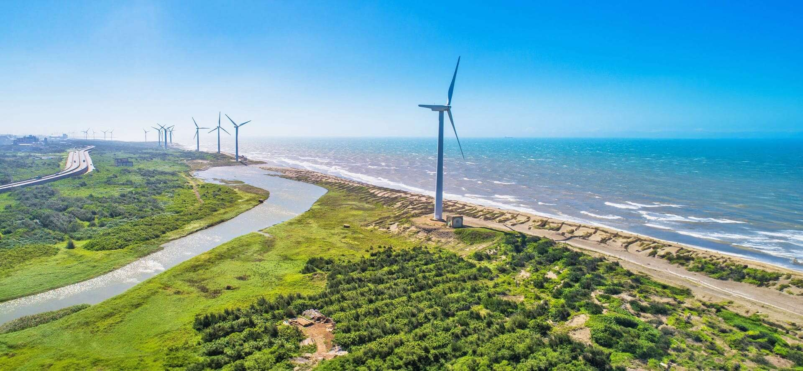

*圖：（原文無圖片說明）｜來源：https://travel.tycg.gov.tw/content/images/travelpurpose/93802/1920x1080_travelpurpose-image--qwqkvbbek-v79xrxl5s6a.jpg*

### 觀音

探索千年藻礁生態寶庫，徜徉蓮花盛開田園美景

觀音區位於桃園市西北方的海岸區域，距離市中心約30分鐘至1小時的車程。觀音區有北台灣最大的蓮花種植面積，每到夏季，區域內蓮花田紛紛盛開，遊客在賞花的同時，也可品嘗蓮花全餐。除了農家體驗，觀音區的海岸風景及自然生態也非常值得一遊，累積千年的觀新藻礁是生態觀察的天然教室，濱海遊憩區的遼闊沙灘也非常適合戲水消暑。

- 探訪千年藻礁，了解潮間帶生態奧秘。
- 在遼闊海水浴場玩沙戲水，夏季超消暑。
- 穿梭在埤塘、白千層、蓮池之間的自行車道，平坦好騎，適合親子共遊。
- 夏季時蓮花盛開，可享用蓮花大餐及預約DIY體驗。

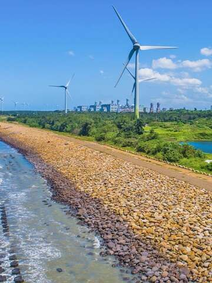

*圖：（原文無圖片說明）｜來源：https://travel.tycg.gov.tw/content/images/TravelPurpose/93825/640x480_travelpurpose-image-x8kdgfligeind-j5nmq_ya.jpg*

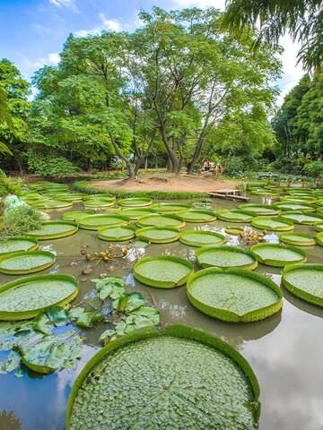

*圖：（原文無圖片說明）｜來源：https://travel.tycg.gov.tw/content/images/TravelPurpose/93826/640x480_travelpurpose-image-csag2ynddemyccflkcszsq.jpg*

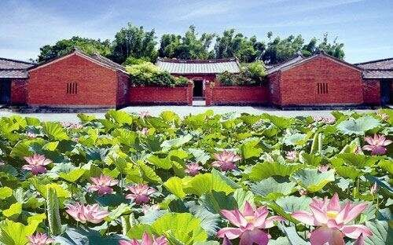

*圖：（原文無圖片說明）｜來源：https://travel.tycg.gov.tw/content/images/TravelPurpose/104316/640x480_travelpurpose-image-rppnodohtkgrijycbb_exw.jpg*

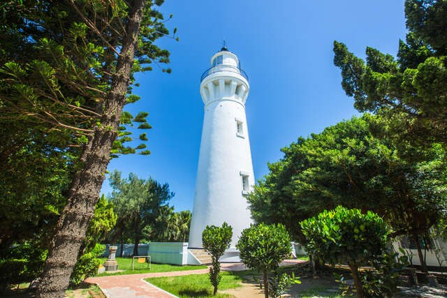

*圖：（原文無圖片說明）｜來源：https://travel.tycg.gov.tw/content/images/TravelPurpose/104317/640x480_travelpurpose-image-cltkjdd3fkmnzx2rljdxxw.jpg*

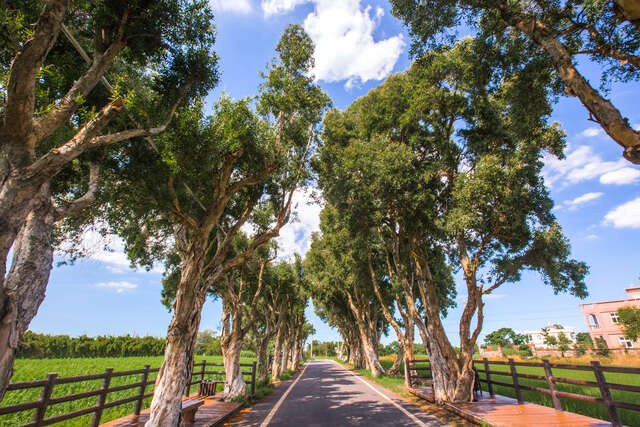

*圖：（原文無圖片說明）｜來源：https://travel.tycg.gov.tw/content/images/TravelPurpose/104318/640x480_travelpurpose-image-vzpqmky_zeqn2j1kbcneuw.jpg*

- 坐擁千年藻礁生態寶庫 觀音區海岸線坐擁全臺面積最大的植物藻礁，但因沿海工業區的開發，這花費4000年累積的海洋珍寶僅存最後的5公里，為保育難得的自然資產而設立「觀新藻礁生態系野生動物保護區」，退潮時，您可以在此看見露出海面的礁體，以及棲息於其中的魚蟹螺貝等無數海岸生物。在生態觀察之餘，若您想下水解暑，不妨前往觀音濱海遊憩區，有遼闊的沙灘海岸可以盡情散步奔跑，玩沙戲水。
- 農遊觀音蓮花田 每年6月起，觀音區內數十間休閒農場及蓮園的蓮花田紛紛盛開，超過百種蓮花吸引眾多遊客前來賞玩。您可以乘坐大王蓮，體驗漂浮在水上的新鮮趣味，也可以品嘗蓮子冰、蓮花茶、荷葉湯包、炒彩蓮等蓮花全餐，還有蓮葉粽、採蓮蓬、睡蓮盆栽等DIY活動，適合一家大小一同出遊，賞花兼體驗農家生活樂趣。
- 一磚一瓦，訴說百年歲月 林家古厝是棟紅磚堆砌的三合院建築，至今已有一百二十餘年的歷史。屋內保存著完好的木桌板凳、木製婚床與紅磚大灶，各式農具訴說著世代務農的生活，換上現場租借的古裝，那一刻就是穿越了百年。農場內還有焢土窯區，可以體驗古老的烹飪方式。步道旁的白玉湘蓮，白荷映月，純潔如霜，美的不可言喻。古厝不遠處便是一大片蓮田，一朵朵的荷花，就綻放了整個夏季。蓮花田中有幫鴨群打造「水上鴨家」，隨處可見的小黃鴨，可愛動人。在這裡可以品嘗獨家的香水蓮與香草混搭的「蓮花茶」，也可以體驗挖藕的趣味。
- 守護台海的船隻，年復一年 台灣唯一使用紅磚和石頭建造而成的白沙岬燈塔，曾是本島最西側的燈塔，從1901起至今都守護著濱海安全。展覽室的互動體驗，除了介紹燈塔百年歷史，也設計多樣拍照效果供遊客選擇。園中保存著日治時期的日晷，以及由上海機器製造局製作的時鐘。防空洞變成散步乘涼的地方，以前卻是戰機掃射的地方，落差感頓時撲面而來。燈塔旁設有環形步道，一路沿著觀音溪畔修築，展示了許多縮小版的燈塔，也能眺望遠處的風車，人形拱橋則成了拍攝婚紗的選擇。
- 穿梭秘境，遇見鐵炮百合 白千層綠色隧道全長約2.8公里，約矗立700棵白千層樹。白千層隨著莖部內裡不斷孕育新生，會將外層老皮推出，導致脫落，一層一層包覆著樹幹，正因如此這種獨特的生長方式也成為它的名字。騎著單車或漫步其中，綿延的白千層樹加上高低坡度，似乎沒有盡頭，有種即將通往神秘之境的錯覺。步行到底，與一棟古厝撞個滿懷，古厝前種植整排的鐵炮百合花，就像驚喜般讓人錯不及防，其花瓣潔白如雪，香氣清雅綿長，令人心曠神怡。

★ 蓮花季約於每年6月開始，花季結束後，也有採蓮蓬、剝蓮子等體驗。各休閒農場及蓮園提供服務以各農家官方公告為準，建議提前聯絡、預約。

★ 造訪觀新藻礁生態系野生動物保護區時，敬請遊客協助保護自然生態，勿破壞自然環境，或捕捉、採集動植物。

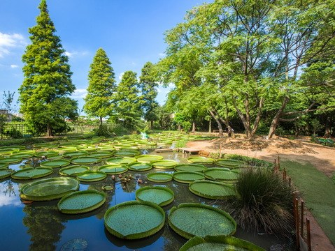

*圖：（原文無圖片說明）｜來源：https://travel.tycg.gov.tw/content/images/attractions/47065/480x360_attractions-image--s7nhlifs0qnlqsaqzpskg.jpg*

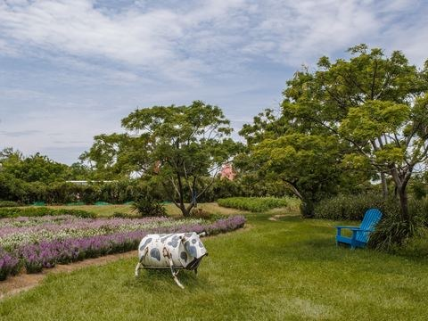

*圖：（原文無圖片說明）｜來源：https://travel.tycg.gov.tw/content/images/attractions/18440/480x360_files636173196485166579.jpg*

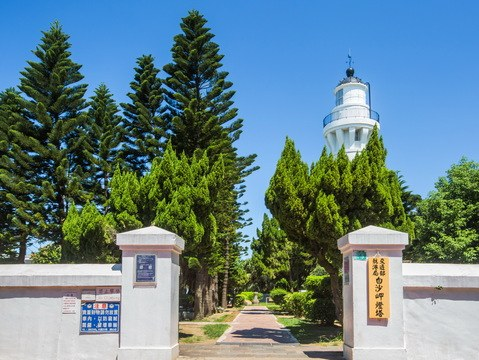

*圖：（原文無圖片說明）｜來源：https://travel.tycg.gov.tw/content/images/attractions/48707/480x360_attractions-image-uoane3hfy0ginrdhrd8nqq.jpg*

- 3.9 蓮荷園休閒農場 星期四：09:00 - 17:00 人氣 250281
- 4.0 青林農場 星期四：09:30 – 17:00 人氣 183996
- 白沙岬燈塔 夏令時間(4月~10月)：09:00~18:00、冬令時間(11月~隔年3月)：09:00~17:00 週一公休，遇國定假日或連續假期則調整為收假次日不開放 人氣 173889

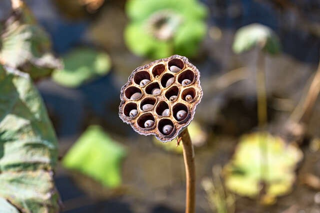

*圖：（原文無圖片說明）｜來源：https://travel.tycg.gov.tw/content/images/TravelPurpose/104319/640x480_travelpurpose-image-buff1crz7emmx2pgypvmsa.jpg*

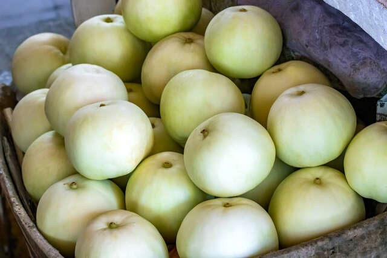

*圖：（原文無圖片說明）｜來源：https://travel.tycg.gov.tw/content/images/TravelPurpose/104320/640x480_travelpurpose-image-euujq8pm4uiq5iar9dhxwq.jpg*

- 乾燥蓮蓬 觀音區有許多蓮花田，老農鮮摘蓮蓬，日曬成乾，乾燥蓮蓬也成為特色之一，既然來了，不妨試試看吧。
- 香瓜 觀音區在地美濃瓜甜度可達到13-15度，飽滿多汁、爽脆香甜，不妨帶一盒回家品嘗或是送禮都是不錯的選擇。

*圖：（原文無圖片說明）｜來源：https://travel.tycg.gov.tw/content/images/tours/5662/480x360_image635530561651118435.jpg*

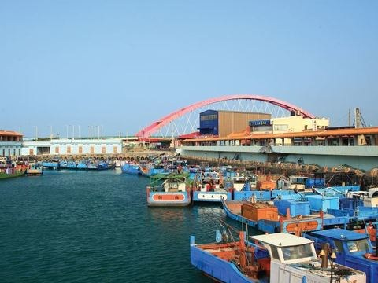

*圖：（原文無圖片說明）｜來源：https://travel.tycg.gov.tw/content/images/tours/12314/480x360_image635897434033801031.jpg*

*圖：（原文無圖片說明）｜來源：https://travel.tycg.gov.tw/content/images/tours/19433/480x360_image636178373221180186.jpg*

*圖：（原文無圖片說明）｜來源：https://travel.tycg.gov.tw/content/images/tours/38923/480x360_tours-image-axvsnwywwe-fju_rqfifuq.jpg*

- 漁港風光一日遊 旅遊天數：一日遊 旅遊季節：四季皆宜 行程類型：生態環境、歷史巡禮、背包客 發佈人：觀光旅遊局 人氣 7488
- 穿越濱海線 竹圍嚐鱻鐵馬樂 旅遊天數：一日遊 旅遊季節：四季皆宜 行程類型：達人帶路 發佈人：觀光旅遊局 人氣 7564
- 暢遊海線․濱海公車自由行 旅遊天數：一日遊 旅遊季節：四季皆宜 行程類型：其他 發佈人：觀光旅遊局 人氣 9492
- 蔚藍海岸線的浪漫之旅 旅遊天數：一日遊 旅遊季節：四季皆宜 行程類型：生態環境、歷史巡禮、背包客 人氣 3432

- 大園 大園區位於桃園市北側的海岸，桃園國際機場便位於此處，且有機場捷運行經，交通便捷。您可往海岸區域，漫步沙丘與許厝港溼地，近距離接觸地質奇景與紅樹林生態。此外，在桃園國際機場旁的景觀餐廳看飛機起降，也是許多遊客放鬆心情的選擇。若對藝文活動情有獨鍾，橫山書法藝術館的精緻環境與書法收藏，讓您在不知不覺中就度過整個午後。
- 楊梅 楊梅區位於桃園市西側，緊鄰中壢區，距離中壢市中心約30分鐘車程。區域內丘陵與埤塘遍布，遊客可在視野極佳的步道健行，欣賞層層疊疊的茶園梯田，品嘗茶味濃厚的「秀才茶」，再品嘗全臺知名的鳳梨酥。若您喜歡寧靜的小鎮，富岡老街不僅保留百年洋樓，更有濃厚生活感，推薦與附近的三連陂一同造訪，漫步設有精緻藝術裝置的湖岸步道。
- 大溪 大溪區保有桃園郊區的自然美景及人文歷史，但距離市中心不遠，且設有公車總站，遊客可以輕易地由各交通樞紐搭乘公車，抵達此處。遊客不妨先造訪此區最知名的大溪老街，盡情品嘗超熱門的古早味小吃，造訪留存百年的日式宿舍，鑑賞精湛的木雕藝品。也可以轉往山區，綠意盎然的慈湖周圍設有多條自然步道，藉此呼吸新鮮的空氣，欣賞寧靜的湖光景致。
