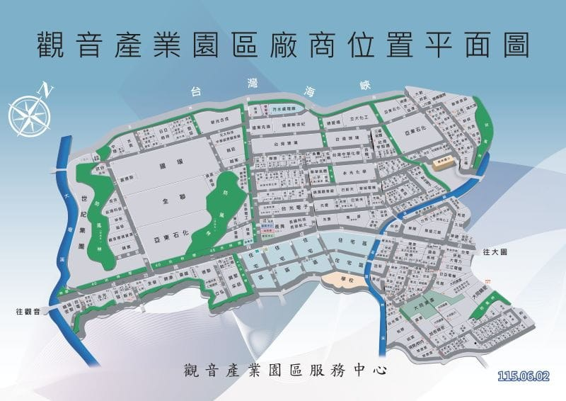
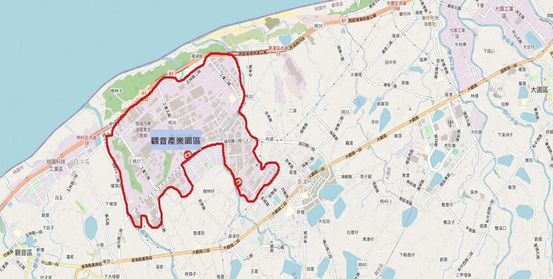
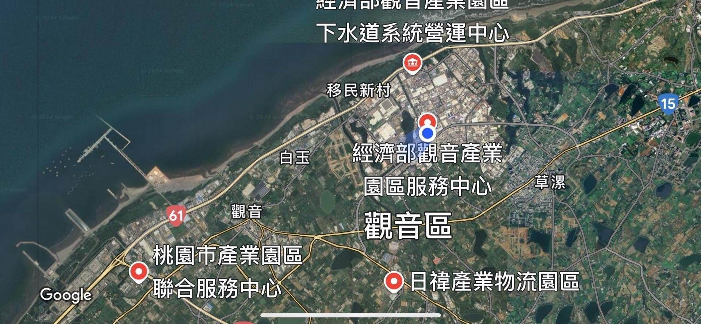

# 經濟部觀音產業園區服務中心 Guanyin Industrial Park Service Center

- 原始網址：https://www.bip.gov.tw/iphw/kuangin/index.do?id=10
- 網站名稱：www.bip.gov.tw
- 作者：（未標示）
- 發表日期：（未標示）
- 爬取時間：2026-10-29T16:02:54+08:00　取得方式：playwright　正文定位：文字密度評分
- 圖片：3 張

---
### 園區簡介

設立緣起與開發經過

本產業園區編訂係遵奉行政院前孫院長為解決桃園市濱海四區所面臨難題，於民國六十八年十一月二十四日專程蒞臨實地考察所作之裁示，並為配合政府改善投資環境，因應台灣北部地區工業引進帶動沿海地區之繁榮，而開發之政策性產業園區為配合工業引進用地需求量及開發資金籌措需要，於民國七十一年二月起在桃園市觀音區分三期開發，至民國七十九年十二月完成。開發總面積632.12公頃，係一綜合性產業園區，此項開發對當地的繁榮與發展有極大的貢獻。

公共設施

本產業園區公共設施完善，主要為：

- 道路：區內道路總長26659.79公尺。
- 排水系統：U型溝總長33108公尺，箱涵4014公尺，涵管3423.94公尺。
- 污水下水道系統：污水管線總長40910公尺。
- 自來水給水系統：每日最大供水量5萬5仟公噸，尚足以供給區內廠商需水量。
- 電力工程：產業園區內有變電所四座，可供應電力達31萬7仟 千瓦。
- 電信系統：產業園區全區可供應電話14000門，並佈放光纖電纜高速傳輸通訊系統，提高區內廠商通信品質。
- 綠帶：除保留原有防風林三座計35.634 公頃外，另在產業園區周邊及道路旁種植林帶25.1392公頃，區內人行道並栽植水黃皮，海芒果等行道樹，有效加強綠色環境，淨化空氣，消除污染，兼具防風、防塵、隱蔽、美觀之功能。
- 北區檢驗中心：提供北區產業界各項空污，水污，噪音等數據之檢驗認定，並可作為培訓學員場所。
- 消防大樓：提供草漯消防隊進駐，有效減低火災意外之損失。

土地配置與廠商情形

本產業園區總開發面積為632公頃，建廠工業用地451公頃。

廠商行業別統計

- 行業別 家數 比例
- 化學工業 121 31%
- 金屬工業 66 17%
- 電子工業 49 13%
- 紡染工業 34 9%
- 機械工業 26 7%
- 塑膠.橡膠 25 6%
- 其他 15 4%
- 汽車 14 4%
- 食品.飲料 12 3%
- 非金屬 10 3%
- 紙業 6 2%
- 藥品 3 1%
- 其他運輸 3 1%
- 倉儲.批發業 3 1%

廠商分布位置圖

觀音產業園區分布大崛溪右側及富林溪左右兩側，周圍有林帶、防風林。服務中心位於成功路二段與工業五路交界處。

*圖：廠商位置平面圖｜來源：https://www.bip.gov.tw/iphw/kuangin/images/content/廠商位置平面圖_800.jpg*

點選上圖另開新視窗顯示原始大小廠商位置平面圖

地理位置與交通狀況

觀音產業園區位於桃園縣觀音區西北部，近鄰台灣海峽，介於大堀溪與富林溪之間，繫鄰觀音區草漯地區都市計劃北界，距基隆港七十公里，台北市四十五公里，桃園市二十四公里，中壢市一十五公里，桃園機場七公里，適位於台北都會區之外緣地帶，對外交通以台十五線為主

地理位置圖

*圖：觀音產業園區地理位置圖｜來源：https://www.bip.gov.tw/iphw/kuangin/images/content/p00010.gif*

觀音產業園區地理位置圖

觀音產業園區交通路線圖

*圖：觀音產業園區交通路線圖｜來源：https://www.bip.gov.tw/iphw/kuangin/images/content/map01.jpg*

自行開車

- 南下：從中山高速公路(國道1號)轉機場系統(國道2號)，於大園交流道下，遇民生路右轉，遇大觀路左轉(往觀音方向)，遇成功路右轉即可抵達觀音產業園區
- 北上：由66號快速道路接61號快速道路於草漯交流道下直行接成功路右轉即可抵達觀音產業園區

搭火車或公車

- 於中壢火車站下車後，搭乘桃園客運，5043中壢往樹林新村路線即可抵達。

搭乘高鐵

- 於桃園站下車，搭乘計程車可抵達，路程約35分鐘
