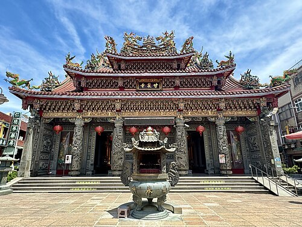
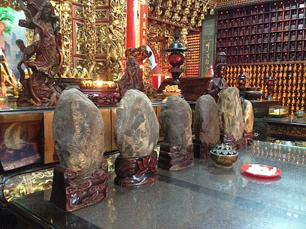
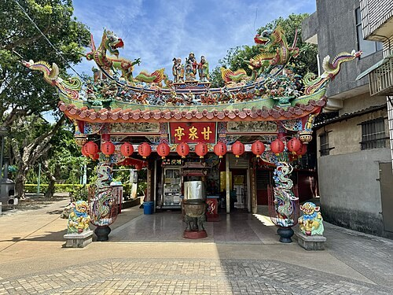
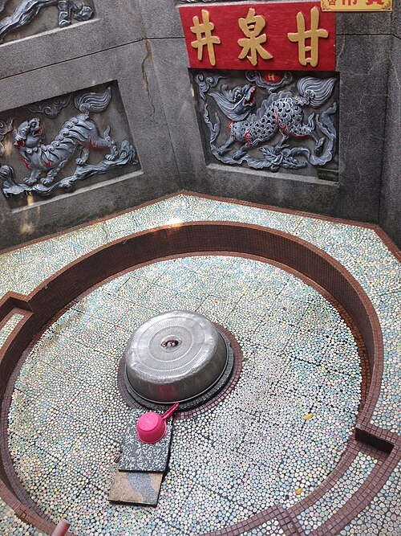

# 甘泉寺 (桃園市)

- 原始網址：https://zh.wikipedia.org/wiki/%E7%94%98%E6%B3%89%E5%AF%BA_(%E6%A1%83%E5%9C%92%E5%B8%82)
- 網站名稱：zh.wikipedia.org
- 作者：維基媒體專案貢獻者
- 發表日期：2011-11-12T10:53:48Z
- 爬取時間：2026-11-05T16:34:03+08:00　取得方式：requests　正文定位：站點規則 #mw-content-text .mw-parser-output
- 圖片：4 張

---
25°02′13″N 121°04′54″E  /  25.037070°N 121.081593°E

*圖：（原文無圖片說明）｜來源：https://thumb.wikimedia.org/wikipedia/commons/thumb/0/03/%E8%A7%80%E9%9F%B3%E7%94%98%E6%B3%89%E5%AF%BA.jpg/500px-%E8%A7%80%E9%9F%B3%E7%94%98%E6%B3%89%E5%AF%BA.jpg?utm_source=zh.wikipedia.org&utm_campaign=parser&utm_content=thumbnail*

| 甘泉寺 |  |
|---|---|
| 基本資訊 |  |
| 位置 | 桃園市 觀音區 觀音里甘泉街一號 |
| 宗教 | 佛教 |
| 本尊 | 觀世音菩薩 |
| 例祭 | 農曆九月十九 |
| 開山時間 | 咸豐十年（1860年） |
| 地圖 |  |

甘泉寺，舊稱 福龍寺 、 福龍山寺，是位於 臺灣 桃園市 觀音區 觀音里的 觀音寺，為觀音區地名的由來。

### 沿革

在 咸豐 十年（1860年），相傳 竹北二堡 石牌嶺 庄一名叫黃等的人在河流中撿到近似觀音的石像，並將此像建置於路傍，成為眾人崇拜的對象。半年後， 白沙墩庄 黃雲中 [ a ] 等發起募捐，於咸豐十年十一月，建築寺宇奉祀之，稱「福龍山寺」、「福龍寺」。 [ 2 ] [ 3 ] [ 4 ] [ 5 ]

同治 十一年（1872年），徐水曾獻殿聯，上書：「法雨化甘泉蒼海波中聞貝葉，慈雲流淡水白沙堆土顯曇花。」 [ 6 ]

光緒 十二年（1886年）由於廟宇破損嚴重， 埔頂庄 曾坤房、石觀音庄劉文進等鄉紳發起修建募款，六個月完工，並改名為「甘泉寺」 [ 2 ] [ 3 ] [ 4 ] [ 5 ]。光緒二十年（1894年），曾阿房等重新改造 [ 2 ]。 明治 三十八年（1905年）建立的南崁公學校石觀音分校（今觀音國小）過去尚無校舍時，借用廟堂上課 [ 7 ]。

1991年，廟前廣場被徵地為 桃園客運 汽車停車場和調度站，引起信眾不滿 [ 8 ] [ 9 ]。1993年整修，1997年完成 [ 10 ]。1997年委由聖光公司在廟宇後牆施作長17.6、高10.5公尺的銅製浮雕，圖案兩旁有金童玉女，另外兩隻神龍騰雲駕霧 [ 11 ]。

2002年報導時，地址在觀音鄉觀音村甘泉街一號，緊鄰觀音鄉公所 [ 3 ]。

### 祭祀

*圖：石觀音｜來源：https://thumb.wikimedia.org/wikipedia/commons/thumb/e/e6/%E7%94%98%E6%B3%89%E5%AF%BA%E7%9F%B3%E8%A7%80%E9%9F%B3.jpg/500px-%E7%94%98%E6%B3%89%E5%AF%BA%E7%9F%B3%E8%A7%80%E9%9F%B3.jpg?utm_source=zh.wikipedia.org&utm_campaign=parser&utm_content=thumbnail*

農曆正月二十 天穿日，當地 客家人 會來此廟膜拜。除頂禮還願外，因客家習俗在天穿日工作會招來不幸，因此來廟祭拜也有消災解厄效果。日治時期，觀音庄長還選在這日開放 白沙岬燈塔，讓上完香的客家人至燈塔遊玩，藉此攏絡人心。觀音文化工作陣，曾在這天舉辦燈塔節活動，讓觀音的客人耆老重溫當年。 [ 12 ]

農曆九月十九，觀世音菩薩成道日，會舉行 神豬 比賽。在2011年報導時，臺灣動物社會研究院主任陳玉敏說，全臺灣839間 觀音寺 中，只有 竹林山觀音寺 、 石觀音甘泉寺 和 竹北蓮華寺 這三間會舉辦此比賽。 [ 13 ]

昔日，此地的客家人會讓小孩拜此石觀音為 契母 [ 14 ]。廟方管委會總幹事曾獻斌曾表示，石觀音曾託夢指示共有16尊石觀音像流落各地，希望信眾代為協尋，於是廟方依據神明指點，依序在 雲林 古坑 、 臺中 太平 及 苗栗 獅頭 等地找到8尊聖石，其中5尊以 分香 形式作為其他廟宇供奉主神，自留3尊奉祀，在石觀音文化節活動也以會邀請各地的石觀音回家掃街繞境 [ 15 ]。

### 地名

因此寺皈依者增加，當地形成聚落，地方名「石觀音街」，後來發展成 石觀音庄。1920年， 總督府 施行州廳制度，刪除「石」字，定名「 觀音庄 」，戰後改名「觀音鄉」。 [ 2 ] [ 3 ]

### 名井

*圖：甘泉亭｜來源：https://thumb.wikimedia.org/wikipedia/commons/thumb/5/5e/%E8%A7%80%E9%9F%B3%E7%94%98%E6%B3%89%E5%AF%BA%E7%94%98%E6%B3%89%E4%BA%AD.jpg/500px-%E8%A7%80%E9%9F%B3%E7%94%98%E6%B3%89%E5%AF%BA%E7%94%98%E6%B3%89%E4%BA%AD.jpg?utm_source=zh.wikipedia.org&utm_campaign=parser&utm_content=thumbnail*

此廟的甘泉井傳說以能治病聞名。該井處於低窪處，南方及東南方地勢較高且均為受壓地下水層，在加上泉井旁約一百公尺處為 觀音溪，因此為自流井。 [ 5 ]

逢農曆二月十九日觀音誕辰時，多有信徒會來此泉水取水 [ 4 ]。香客會攜帶水桶，沿甘井亭的階梯走到泉眼處取水；若取用量並不大可直接到正殿的觀音像前裝取水 [ 5 ]。《桃園廳志》就記載 明治 二十八年（1895年）七月，當時有患眼疾者用此廟挖出的泉水洗眼，洗之即癒，人們皆感到驚訝，數十里外之百姓亦來參謁，聲名遠播，便改寺名為「甘泉寺」 [ 2 ]。另說發生在光緒十二年，在修廟時發生 [ 4 ]。還有一說是傳聞撿到石觀音的黃等發現湧出泉水，患者痊癒 [ 5 ]。清治時期的《新竹縣志初稿》則記錄相傳石觀音也是從泉水出現 [ 2 ]。

*圖：甘泉井｜來源：https://thumb.wikimedia.org/wikipedia/commons/thumb/8/83/%E7%94%98%E6%B3%89%E5%AF%BA%E7%94%98%E6%B3%89%E4%BA%95.jpg/500px-%E7%94%98%E6%B3%89%E5%AF%BA%E7%94%98%E6%B3%89%E4%BA%95.jpg?utm_source=zh.wikipedia.org&utm_campaign=parser&utm_content=thumbnail*

丁善璽 在拍《 八百壯士 》被爆傷，在醫院躺了一個月。這時丁妻蕭蓉夢到 南極仙翁 要她去中壢找觀音治療她先生的病，輾轉到觀音鄉找到甘泉寺。丁善璽喝了該寺的井水後傷痛減輕，後來又在一場高速公路的車禍中幸運生還。因此，夫妻從 天主教 改宗 佛教，太太還 皈依 華嚴蓮社的南亭法師。丁導演為了還願遂拍攝佛教主題電影的故事《陰陽有情天》，由妻子親自飾演觀音，男女主角分別是 秦漢 、 徐楓。在電影上映時，丁善璽本想把妻子夢中景況寫一篇文字大肆宣傳一番，但唯恐被人說成導人 迷信，招致影片禁映，之後才在佛教會對居士說。 李翰祥 在1981年投稿在《民生報》的連載文章，以多篇文章詳述此事。 [ 16 ] [ 17 ] [ 18 ] [ 19 ] [ 20 ] [ 21 ] [ 22 ] [ 23 ] [ 24 ] [ 25 ] [ 26 ]

在拍《 旗正飄飄 》時，丁善璽及妻子蕭蓉、 林青霞 、 楊麗菁 等人參加此寺的一百零一年周年慶典與抗戰殉難軍民追悼會 [ 27 ]。

### 註釋

- ^ 黃雲中，字文偉，祖籍 廣東 惠州 陸豐， 台灣客家人，1822年生， 貢生。在咸豐年間，他與當地 閩人 首領郭火金和談，平息該地的 閩客械鬥。1894年去世。曾孫黃貽徐曾任職觀音鄉戶籍課長。 [ 1 ]

### 參考文獻

- ^ 楊海宴. 義勇千秋 百年往事說從頭 黃雲中刀弭械鬥. 《聯合報》. 1958-09-12 （中文（臺灣）） .
- ^ 2.0 2.1 2.2 2.3 2.4 2.5 陳佳穗. 桃園縣「觀音鄉」地名沿革及傳說研究 (PDF) . 《南亞學報》 (南亞技術學院). 2009, 第29期 [ 2017-03-21 ] （中文（臺灣）） .
- ^ 3.0 3.1 3.2 3.3 謝進盛. 甘泉寺 流傳石觀音傳奇 百年傳奇發展成地方信仰中心 平日香火鼎盛 與海水浴場等地連成一氣. 《聯合報》. 2002-08-30 （中文（臺灣）） .
- ^ 4.0 4.1 4.2 4.3 吳文良. 一鄉鎮一特色 觀音鄉 沾神明的光. 《聯合報》. 1995-03-11 （中文（臺灣）） .
- ^ 5.0 5.1 5.2 5.3 5.4 陳建霖. 白沙岬燈塔 古厝風情悠閒遊 桃園觀音 「海線」休閒觀光之旅 百年甘泉寺井水甘甜沁涼 . 《大紀元時報》. 2015-06-22 [ 2017-03-21 ] . （原始內容 存檔 於2019-06-06） （中文（臺灣）） .
- ^ 陳天嵐. 田野砂丘老厝巨宅─走訪大園觀音（下）. 《民生報》. 1980-11-04 （中文（臺灣）） .
- ^ 莊明仁. 百年校慶 觀音國小講古 老樹祈福揭序幕 熱鬧到七日. 《中國時報》. 2004-03-02 （中文（臺灣）） .
- ^ 吳文良. 甘泉寺前公車站 '擋了佛祖視線'觀音鄉所'順民意'徵收車站土地 客運公司拒絕 雙方僵持. 《聯合晚報》. 1991-01-07 （中文（臺灣）） .
- ^ 吳文良. 姚客可在甘泉寺前設車站 觀音鄉民不服 據理以爭. 《聯合晚報》. 1991-02-20 （中文（臺灣）） .
- ^ 黃文杰. 觀音甘泉寺有座石觀音 傳因雨沖開龍淵巖現出石像 曾顯靈救信眾至今仍流傳. 《中國時報》. 1997-12-25 （中文（臺灣）） .
- ^ 黃文杰. 觀音甘泉寺全台最大銅製浮雕開始黏貼. 《中國時報》. 1997-11-23 （中文（臺灣）） .
- ^ 羅平、楊宗灝. 議員鞭春牛 籲清水庫淤泥. 《中國時報》. 2004-02-11 （中文（臺灣）） .
- ^ 侯俐安. 觀世音成道日 竹山觀音寺殺神豬. 《中國時報》. 2011-10-15 （中文（臺灣）） .
- ^ 楊宗灝. 石觀音 契兒契女多. 《中國時報》. 2005-05-22 （中文（臺灣）） .
- ^ 楊宗灝. 神奇 觀音石栩栩如生. 《中國時報》. 2005-05-25 （中文（臺灣）） .
- ^ 李翰祥. 三十年細說從頭 丁善璽太太的怪夢. 《民生報》. 1981-06-01 （中文（臺灣）） .
- ^ 李翰祥. 三十年細說從頭 要到中壢找觀音. 《民生報》. 1981-06-02 （中文（臺灣）） .
- ^ 李翰祥. 三十年細說從頭 一切災殃化為塵. 《民生報》. 1981-06-03 （中文（臺灣）） .
- ^ 李翰祥. 三十年細說從頭 甘泉寺的一段故事. 《民生報》. 1981-06-04 （中文（臺灣）） .
- ^ 李翰祥. 三十年細說從頭 什麼事都要做兩次. 《民生報》. 1981-06-05 （中文（臺灣）） .
- ^ 李翰祥. 三十年細說從頭 汽車撞成夾心餅. 《民生報》. 1981-06-06 （中文（臺灣）） .
- ^ 李翰祥. 三十年細說從頭 觀音像撞成粉碎. 《民生報》. 1981-06-07 （中文（臺灣）） .
- ^ 李翰祥. 三十年細說從頭 小丁夫婦齊唸大悲咒. 《民生報》. 1981-06-08 （中文（臺灣）） .
- ^ 李翰祥. 三十年細說從頭 丁善璽高抬貴腳. 《民生報》. 1981-06-09 （中文（臺灣）） .
- ^ 李翰祥. 三十年細說從頭 死心塌地要做觀音兵. 《民生報》. 1981-06-10 （中文（臺灣）） .
- ^ 李翰祥. 三十年細說從頭 已經做了七世夫妻. 《民生報》. 1981-06-11 （中文（臺灣）） .
- ^ 「旗正飄飄」工作人員 甘泉寺追悼抗戰亡魂. 《民生報》. 1987-05-20 （中文（臺灣）） .
