# 白沙岬灯塔(灯台)(白沙岬燈塔)

- 原始網址：https://travel.tycg.gov.tw/ja/travel/attraction/1045
- 網站名稱：桃園観光旅行
- 作者：（未標示）
- 發表日期：（未標示）
- 爬取時間：2026-10-29T16:03:40+08:00　取得方式：playwright　正文定位：站點規則 main
- 圖片：16 張

---
### 白沙岬灯塔(灯台)(白沙岬燈塔)

- 海浜地区
- 歷史と人文

- 台湾歴史建築百景！最も完全な形で保存されている日本統治時代の灯台
- 灯台の中の様子！ベールを脱ぐ百年灯台
- SNSで人気の時計台広場！来れば瞬時に地中海
- ロマンチックな三月、紫の美しいセンダンの花

*圖：白沙岬燈塔｜來源：https://travel.tycg.gov.tw/Image/48745/?r=1696575854342*

白沙岬灯台は観音海岸にあります。台南の国聖灯台が建設されるまでは、台湾本島で最西端の灯台でした。週辺には環状遊歩道が設けられ、観音浜海レクリエーションエリアまで足を延ばすこともできます。白沙岬灯台の雪のように白い姿は、青い海と空を背景に目が覚めるような鮮やかさ。1901年の点灯後、日本統治時代にはすでに台湾の著名な景勝地となっていました。百年を超える歲月を経て、2001年には文建会「台湾歷史建築百景」に列せられ、灯台の建物、周囲の塀、日本統治時代の日時計は翌年、桃園で初めての県定史跡に指定されました。そしてさらに、2021年5月には桃園で二つめの国定史跡となりました。保存状態が極めて良好な日本統治時代初期の灯台です。

「白沙岬灯台」は墾丁の「鵝鑾鼻灯台」に次ぐ高さ約37m。台湾の他の灯台がセメントで作られているのとは異なり、この灯台は台湾で唯一、赤レンガと石材で作られています。清代末期、灯台の機器の多くはイギリス、フランスからの輸入でした。製造会社は塔身、灯具等のパーツの鋳造を完成させてから、船舶で設置地点に運び組み立てましたが、三年を費やして完成された「白沙岬灯台」は、鋳鉄組み立て式ではなく、日本語で「レンガ石造り」と呼ばれる二層式の耐震構造で作られた珍しいものです。円形の塔身は、伝統工法を採用し、レンガの接着にもち米、黒糖、石灰の混合物を用いています。灯台の上段は大きな石材を積んで、鋳鉄造りの塔頂を支えています。第二次世界大戦では戦闘機の掃射を受け、また地震や台風に何度も見舞われましたが深刻な損傷もなく、今も頼もしい姿を見せてくれています。

内部には案内室があり、灯台内の各設備について解説しています。灯台周囲には環状遊歩道、公園、東屋、広場、子供用遊具があります。遊歩道は観音溪に沿って設けられており、風車が並ぶ観音海浜の有名な風景を眺めることもできます。鐘塔広場、観音溪人形アーチ橋は結婚写真撮影の人気スポットです。

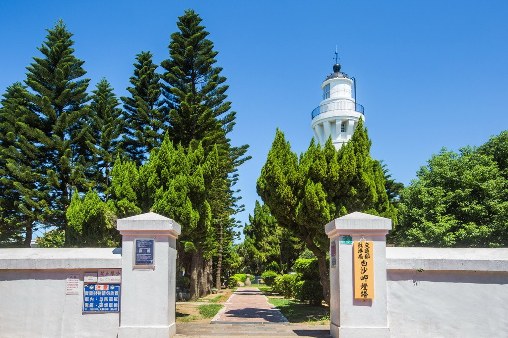

*圖：白沙岬燈塔｜來源：https://travel.tycg.gov.tw/content/images/attractions/48707/1024x768_attractions-image-uoane3hfy0ginrdhrd8nqq.jpg*

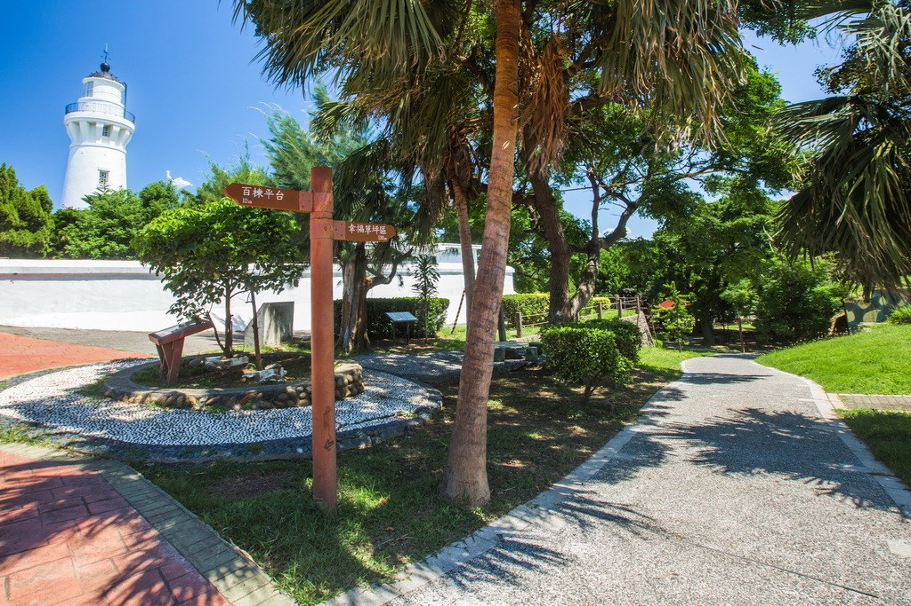

*圖：白沙岬燈塔｜來源：https://travel.tycg.gov.tw/content/images/attractions/48708/1024x768_attractions-image-eighv2vjykezetd7dj-wbw.jpg*

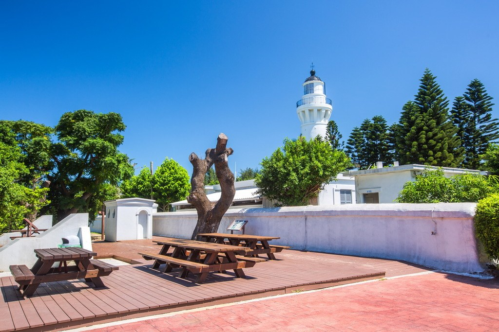

*圖：白沙岬燈塔｜來源：https://travel.tycg.gov.tw/content/images/attractions/48709/1024x768_attractions-image-apxwwfrok0cof1w1tr9zna.jpg*

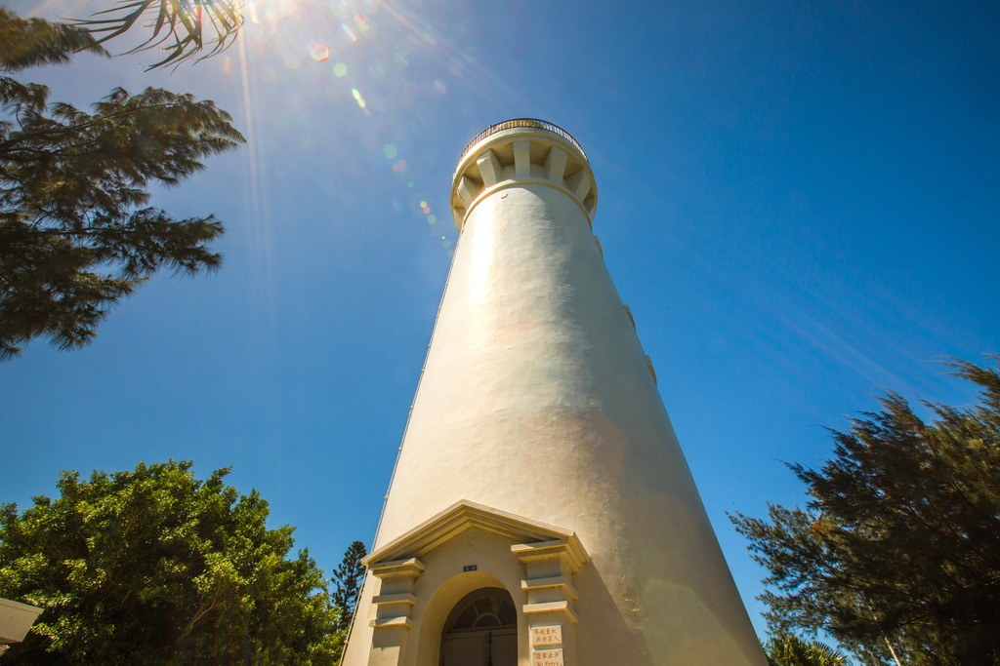

*圖：白沙岬燈塔｜來源：https://travel.tycg.gov.tw/content/images/attractions/48694/1024x768_attractions-image-nfnuld2glu2ko2rkdgo5vq.jpg*

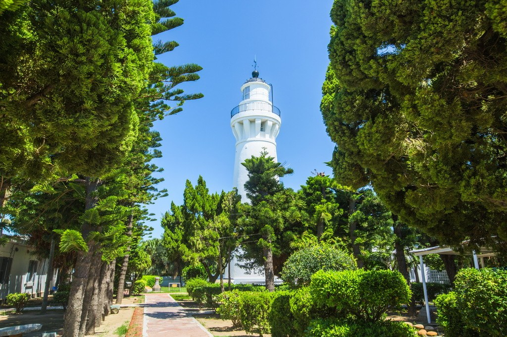

*圖：白沙岬燈塔｜來源：https://travel.tycg.gov.tw/content/images/attractions/48695/1024x768_attractions-image-hvlaxlcm4ukpausx0tt0ag.jpg*

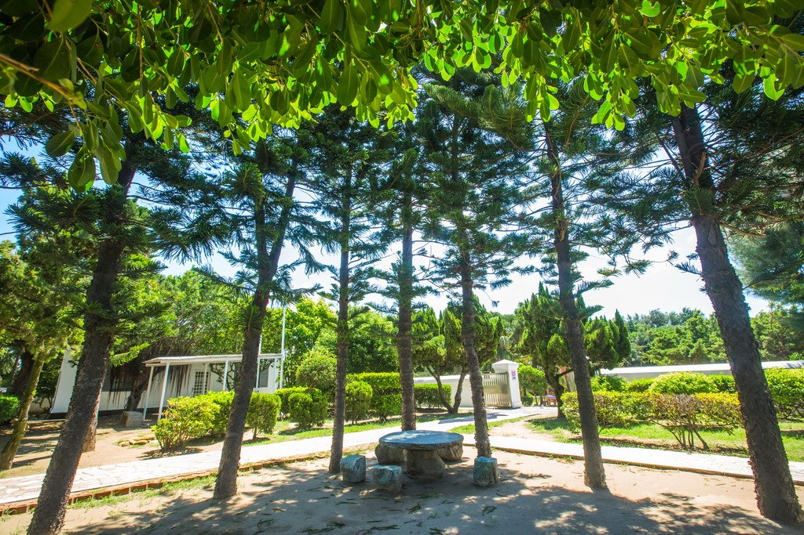

*圖：白沙岬燈塔｜來源：https://travel.tycg.gov.tw/content/images/attractions/48697/1024x768_attractions-image-a5yczrgttew_qqxjt4rekw.jpg*

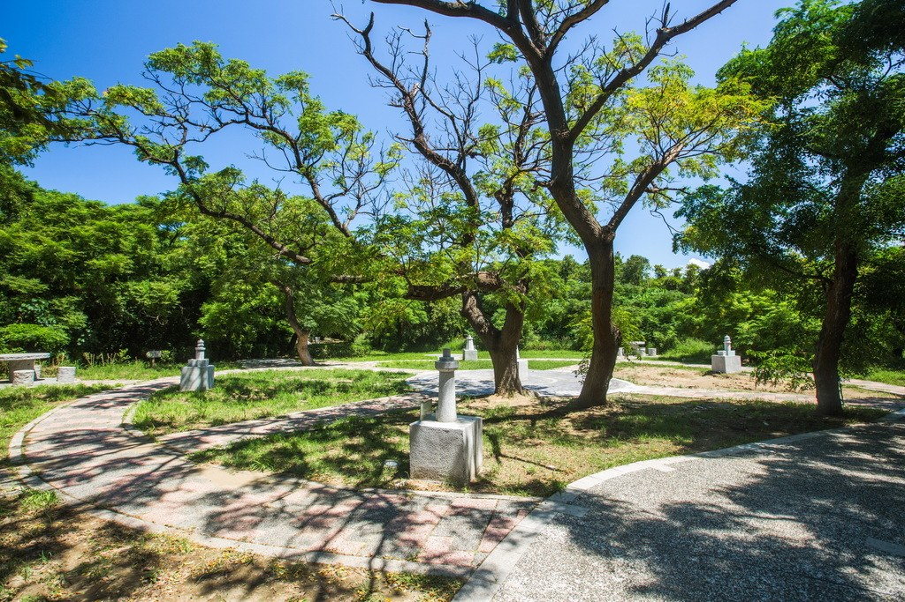

*圖：白沙岬燈塔｜來源：https://travel.tycg.gov.tw/content/images/attractions/48698/1024x768_attractions-image-wzjd3huc10qyny90-gurcq.jpg*

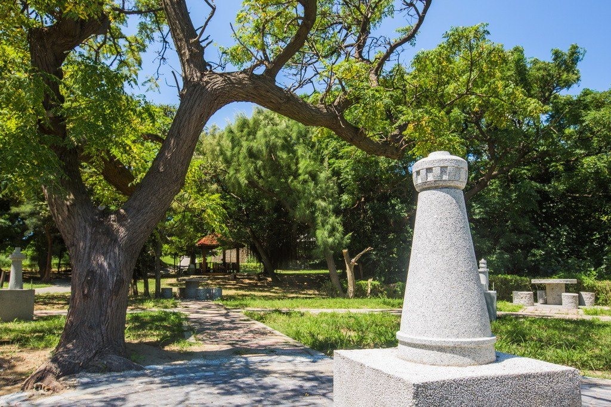

*圖：白沙岬燈塔｜來源：https://travel.tycg.gov.tw/content/images/attractions/48703/1024x768_attractions-image-3_ntwqp3cusodqmbsje4lq.jpg*

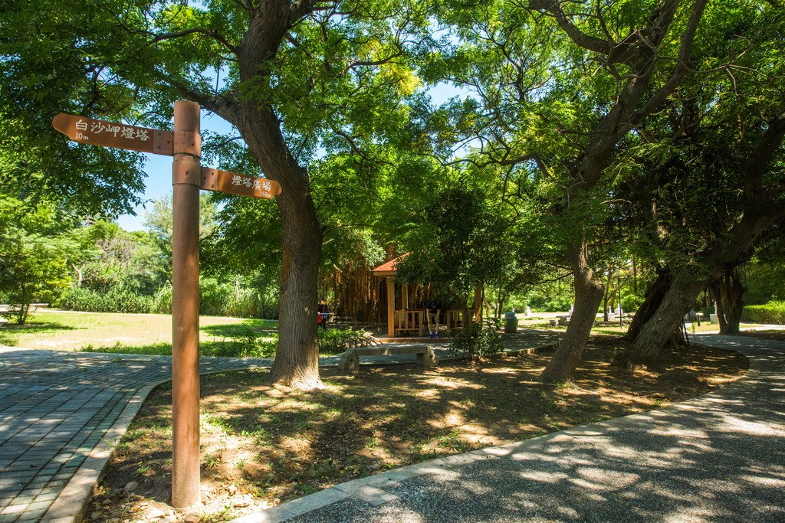

*圖：白沙岬燈塔｜來源：https://travel.tycg.gov.tw/content/images/attractions/48704/1024x768_attractions-image-dvd_1zsnjembx-wl9zwurq.jpg*

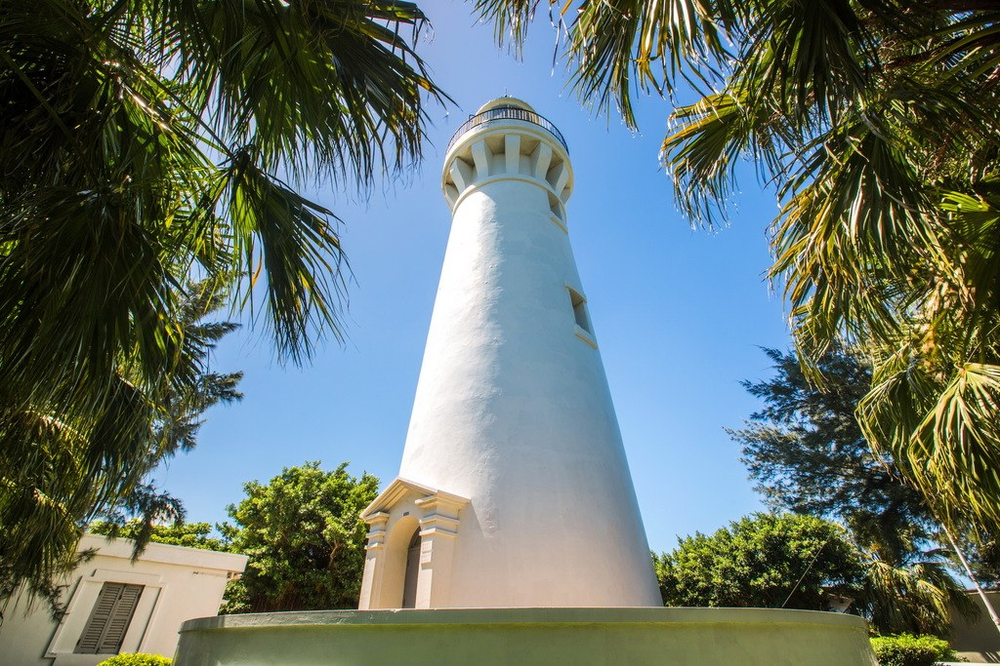

*圖：白沙岬燈塔｜來源：https://travel.tycg.gov.tw/content/images/attractions/48705/1024x768_attractions-image-e-ldxtddsksexlh6unczjg.jpg*

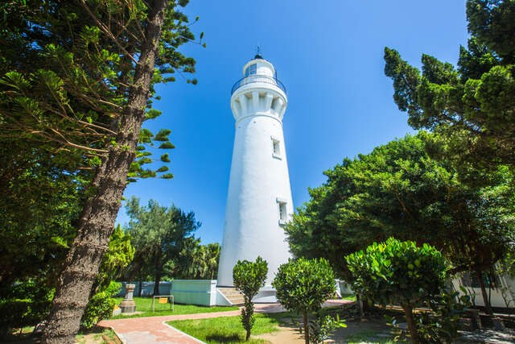

*圖：白沙岬燈塔｜來源：https://travel.tycg.gov.tw/content/images/attractions/48706/1024x768_attractions-image-xvozh_nsruy9cgmgbo8-na.jpg*

立入可能範囲は灯台内部と庭園施設。主灯台室は見学できません。

- バス停
- トイレ
- 遊歩道

### 周辺の観光スポット

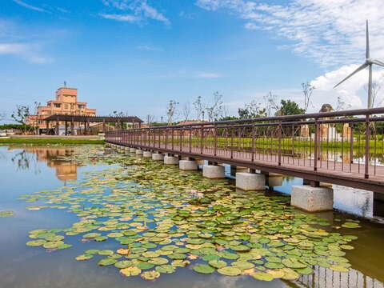

*圖：（原文無圖片說明）｜來源：https://travel.tycg.gov.tw/content/images/attractions/59742/480x360_attractions-image-a2zbkqjt90g9kf-ixbp5yg.jpg*

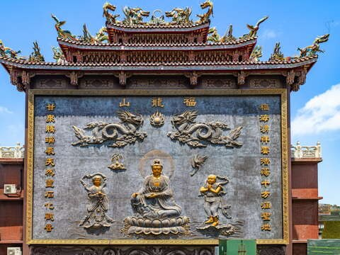

*圖：（原文無圖片說明）｜來源：https://travel.tycg.gov.tw/content/images/attractions/111538/480x360_attractions-image-vycy4rfaieymidkotojfpq.jpg*

*圖：（原文無圖片說明）｜來源：https://travel.tycg.gov.tw/content/images/attractions/16080/480x360_files636168780503453175.jpg*

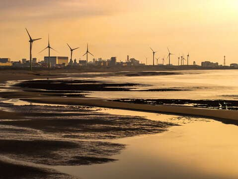

*圖：（原文無圖片說明）｜來源：https://travel.tycg.gov.tw/content/images/attractions/111440/480x360_attractions-image-snvwwmeqbuuelp-9fzzfia.jpg*

- 4.4 観音海浜レジャーエリア (觀音濱海遊憩區) 木曜日：24時間昼夜営業 人氣 11060
- 4.6 甘泉寺 木曜日：06:00 - 21:00 人氣 538
- 2.6 中台環境資源教育センター(中台環境資源教育中心) 木曜日：09:00 - 12:00、13:30 - 17:00 人氣 5202
- 4.1 観音区「白玉海岸」(觀音白玉海岸) 木曜日：00:00 - 23:59 人氣 365
