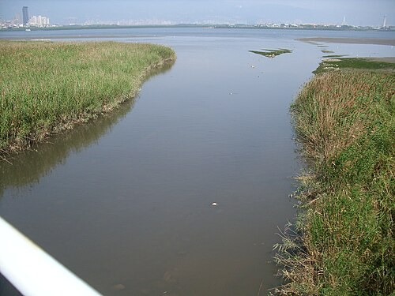
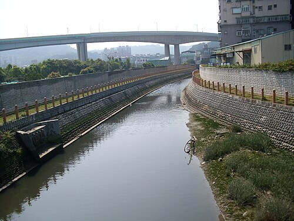

# 觀音坑溪

- 原始網址：https://zh.wikipedia.org/wiki/%E8%A7%80%E9%9F%B3%E5%9D%91%E6%BA%AA
- 網站名稱：zh.wikipedia.org
- 作者：維基媒體專案貢獻者
- 發表日期：2008-01-25T17:32:47Z
- 爬取時間：2026-10-29T16:05:26+08:00　取得方式：requests　正文定位：站點規則 #mw-content-text .mw-parser-output
- 圖片：2 張

---

*圖：過觀音坑溪橋入淡水河，對岸右邊是社子，左邊是關渡｜來源：https://thumb.wikimedia.org/wikipedia/commons/thumb/2/23/%E8%A7%80%E9%9F%B3%E5%9D%91%E6%BA%AA%E5%85%A5%E6%B7%A1%E6%B0%B4%E6%B2%B3.JPG/500px-%E8%A7%80%E9%9F%B3%E5%9D%91%E6%BA%AA%E5%85%A5%E6%B7%A1%E6%B0%B4%E6%B2%B3.JPG?utm_source=zh.wikipedia.org&utm_campaign=parser&utm_content=thumbnail*

| 觀音坑溪 |  |
|---|---|
| 過觀音坑溪橋入淡水河，對岸右邊是社子，左邊是關渡 |  |
| 流域 |  |
| 水系 | 淡水河 |
| 源頭 |  |
| • 位置 | 觀音山 南側（凌雲禪寺附近） |
| • 海拔 | 372公尺（1,220英尺） |
| 河口 | 獅子頭 |
| 流域面積 | 9.2平方公里（3.6平方英里） |
| 位置 | 新北市 五股區 |
| 本貌 |  |
| 長度 | 6.2公里（3.9英里） |

*圖：觀音坑溪橋上看上游，遠方為 台64線 高架。｜來源：https://thumb.wikimedia.org/wikipedia/commons/thumb/8/8c/%E8%A7%80%E9%9F%B3%E5%9D%91%E6%BA%AA.JPG/500px-%E8%A7%80%E9%9F%B3%E5%9D%91%E6%BA%AA.JPG?utm_source=zh.wikipedia.org&utm_campaign=parser&utm_content=thumbnail*

觀音坑溪 (或以中下游地名另稱北勢坑溪)，位於 台灣 北部，是 淡水河 的一條支流，河長6.2公里，流域面積9.2平方公里，分佈於 新北市 五股區。其源頭位於 觀音山 南側的凌雲禪寺附近，標高372公尺 [ 1 ]，向東南流入 台北盆地 後，轉向東注入淡水河。

觀音坑溪原本注入淡水河的另一支流 塭子川 [ 2 ]，後因拓寬淡水河道工程而炸毀 獅子頭 隘口，即變成現況之各自注入淡水河。

導演 齊柏林 在所執導的《 看見台灣 》紀綠片中，拍攝到觀音坑溪遭上游染整廠排放的廢水汙染，河面呈暗紅色。

### 橋梁

觀音坑溪橋: 八里左岸自行車道 跨過觀音坑溪。

### 相關條目

- 淡水河
- 塭子川

### 參考資料

- ^ 李錫堤等， 林口台地及其鄰接海岸地形變遷與地貌復原可行性探討 （ 頁面存檔備份，存於 網際網路檔案館 ）
- ^ 楊萬全，臺北盆地零公尺地區的問題，台灣水文論文集，2000年5月，第114頁
