# 觀新藻礁生態系野生動物保護區

- 原始網址：https://travel.tycg.gov.tw/zh-tw/travel/attraction/1454
- 網站名稱：桃園觀光導覽網
- 作者：（未標示）
- 發表日期：（未標示）
- 爬取時間：2026-11-05T16:36:07+08:00　取得方式：playwright　正文定位：站點規則 main
- 圖片：15 張

---
### 觀新藻礁生態系野生動物保護區

- 濱海追風
- 自然生態

號稱全台面積最大的千年植物藻礁，因其生長速度緩慢，每一方寸都是彌足珍貴，每逢春夏更是吸引不少旅人來一探潮間帶的生態奧秘。

- 全台面積最大！370公頃完整藻礁地形
- 歲月的結晶，千年成型的曠世巨作
- 豐富物種~北台灣的海洋生態博物館

歲月是什麼模樣?站在台灣本島面積最大的藻礁地形﹣觀新藻礁前，千年流轉時光化成的生態巨作令人大為震撼，也深覺人類的渺小。占地約370公頃的觀新藻礁，不同於動物所形成的珊瑚礁，藻礁是由無節珊瑚藻類死亡鈣化後，沉積於礫石灘上所形成石灰岩礁體的｢植物礁｣，平均10年才可生成1公分。桃園的藻礁群曾經自大園、觀音綿延到新屋，然而隨著沿海工業區的開發，現已從27公里僅存約5公里。為保育這4000年的海洋珍寶，2014年劃設｢桃園觀新藻礁生態系野生動物保護區｣，成為認識藻礁環境的無牆教室。而每年舉辦的｢珍愛桃園藻礁千人健行｣活動，也讓民眾身體力行愛護這片海岸。

觀新藻礁位於觀音區小飯壢溪以南到新屋區後湖溪口以北的沿海，除了驚艷於這珍貴的千年地景，豐富的生物多樣性也是觀新藻礁的亮點之一﹔目前共發現有10種藻類、129種動物，動物密度是高美濕地的5倍，香山濕地的8倍，宛如是北台灣的海洋生態博物館。觀新藻礁共劃分為核心區、緩衝區及永續利用區。每當退潮，礁體露出於海面時，可在潮間帶發現藻類魚蝦、螺貝類、綠藻等多種海岸生物，而踏上木棧道可前往紅樹林教育園區，近距離觀察彈塗魚、招潮蟹。順遊推薦新屋百年石滬、觀音草漯沙丘、許厝港濕地，一覽桃園濱海四大亮點。

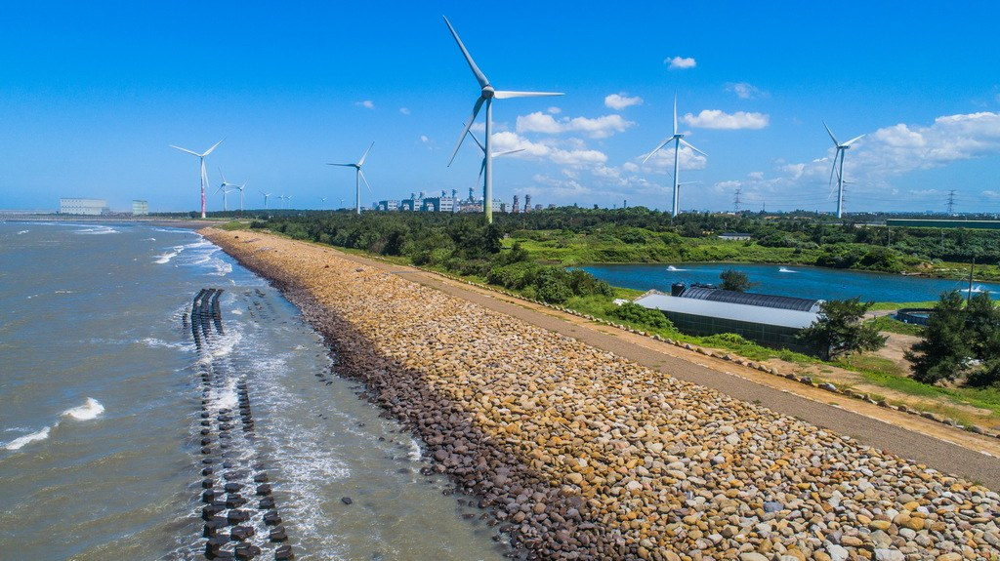

*圖：觀新藻礁生態系野生動物保護區｜來源：https://travel.tycg.gov.tw/content/images/attractions/47725/1024x768_attractions-image-8qm7thgebkyd8k-6fo_xcq.jpg*

*圖：觀新藻礁生態系野生動物保護區｜來源：https://travel.tycg.gov.tw/content/images/attractions/47726/1024x768_attractions-image-0s1zw-bifk-ntnrcfzhkbw.jpg*

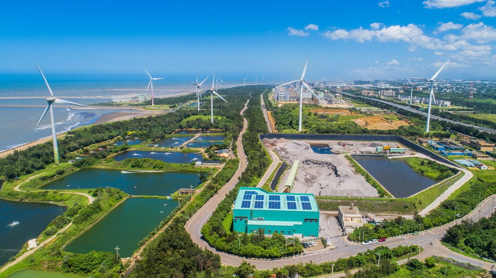

*圖：觀新藻礁生態系野生動物保護區｜來源：https://travel.tycg.gov.tw/content/images/attractions/47727/1024x768_attractions-image-m8rvkeogtkqvzytvc-7ekw.jpg*

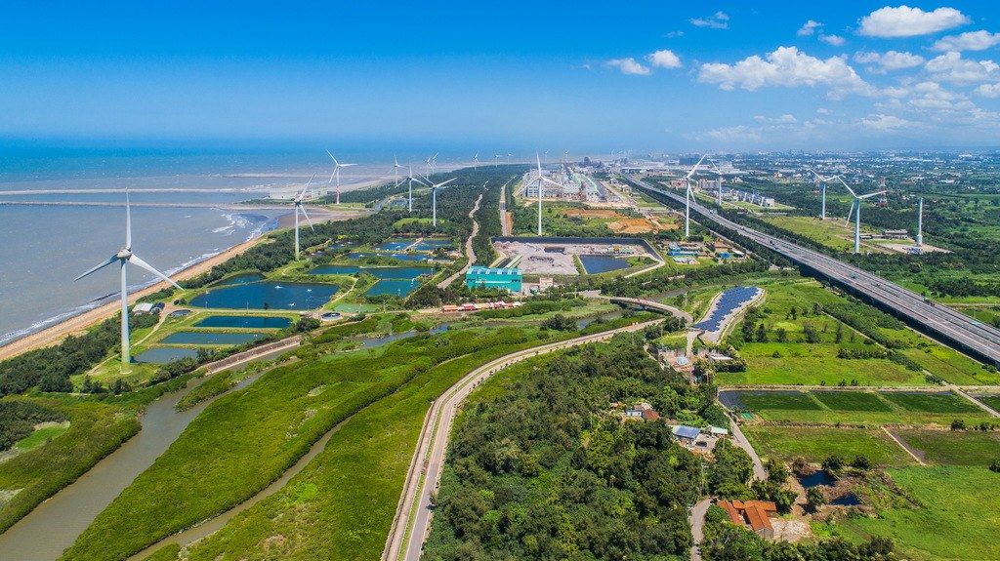

*圖：觀新藻礁生態系野生動物保護區｜來源：https://travel.tycg.gov.tw/content/images/attractions/47730/1024x768_attractions-image-r7op87tbb0ydr_4gng0r9q.jpg*

*圖：觀新藻礁生態系野生動物保護區｜來源：https://travel.tycg.gov.tw/content/images/attractions/47734/1024x768_attractions-image-40osvcbzg0q0dotmxged7w.jpg*

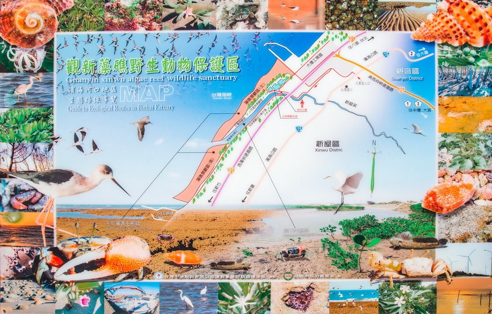

*圖：觀新藻礁生態系野生動物保護區｜來源：https://travel.tycg.gov.tw/content/images/attractions/47739/1024x768_attractions-image-xrztz_ulu0yclwk9pm5hkg.jpg*

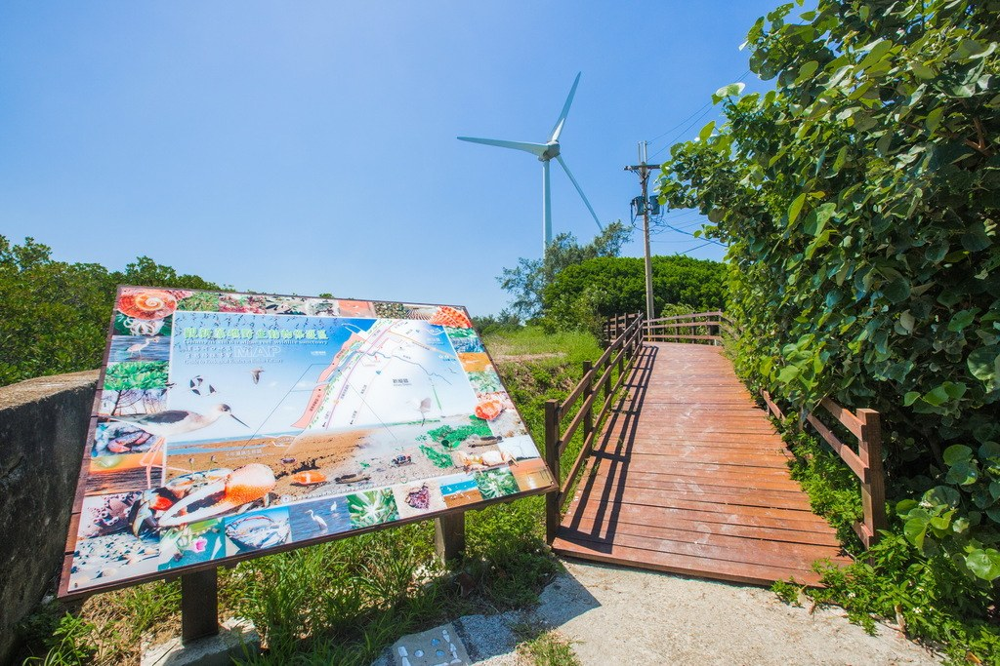

*圖：觀新藻礁生態系野生動物保護區｜來源：https://travel.tycg.gov.tw/content/images/attractions/47741/1024x768_attractions-image-ackpupdwzuyu8vspwmx-dq.jpg*

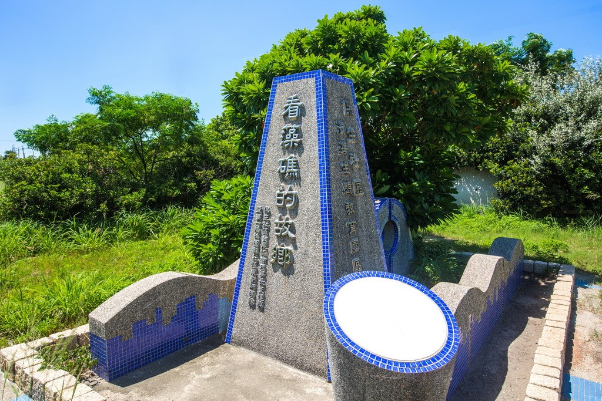

*圖：觀新藻礁生態系野生動物保護區｜來源：https://travel.tycg.gov.tw/content/images/attractions/47742/1024x768_attractions-image-ds7yzhj5vk6nnbsnc86jow.jpg*

*圖：觀新藻礁生態系野生動物保護區｜來源：https://travel.tycg.gov.tw/content/images/attractions/47743/1024x768_attractions-image-ztsgzobtckuherxfcyqw9g.jpg*

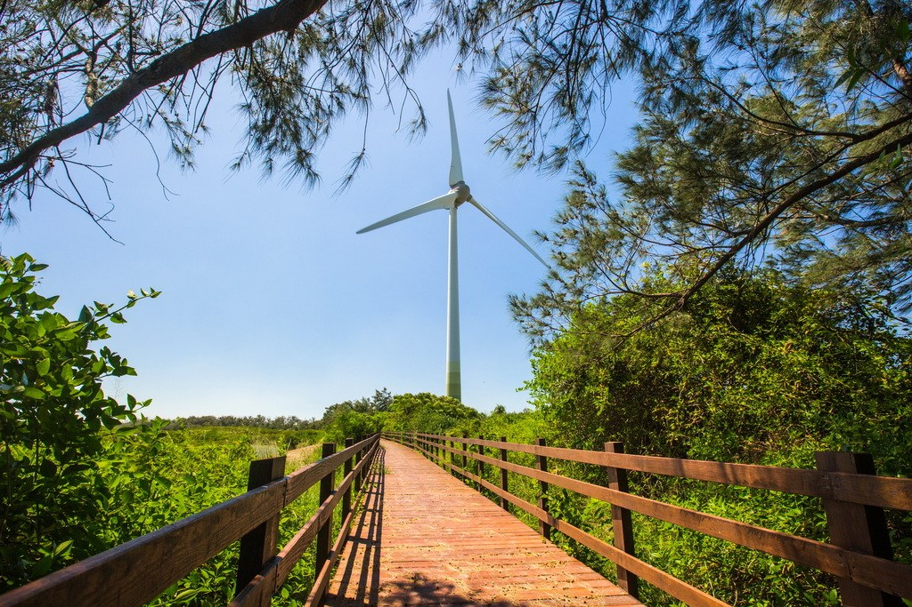

*圖：觀新藻礁生態系野生動物保護區｜來源：https://travel.tycg.gov.tw/content/images/attractions/47744/1024x768_attractions-image-eri6h-ssc0-yfj_xoaghzw.jpg*

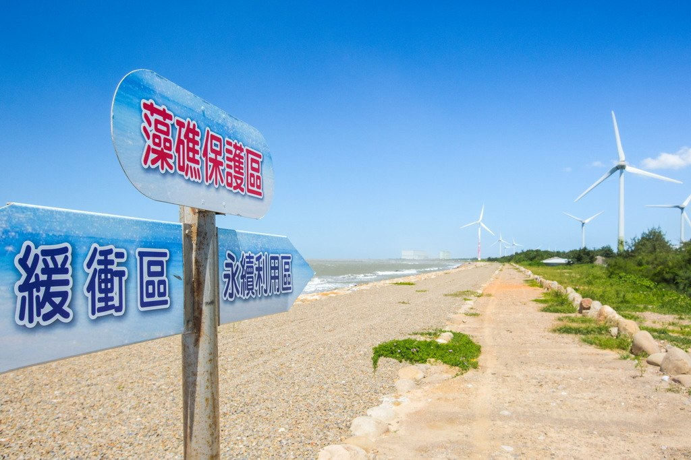

*圖：觀新藻礁生態系野生動物保護區｜來源：https://travel.tycg.gov.tw/content/images/attractions/47746/1024x768_attractions-image-wxxzumxlf0ooj41geujypa.jpg*

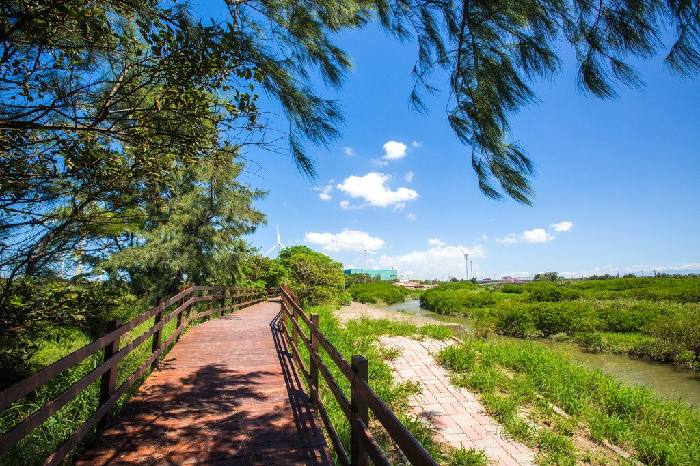

*圖：觀新藻礁生態系野生動物保護區｜來源：https://travel.tycg.gov.tw/content/images/attractions/47747/1024x768_attractions-image-fkota9dag0i9qjroyan66w.jpg*

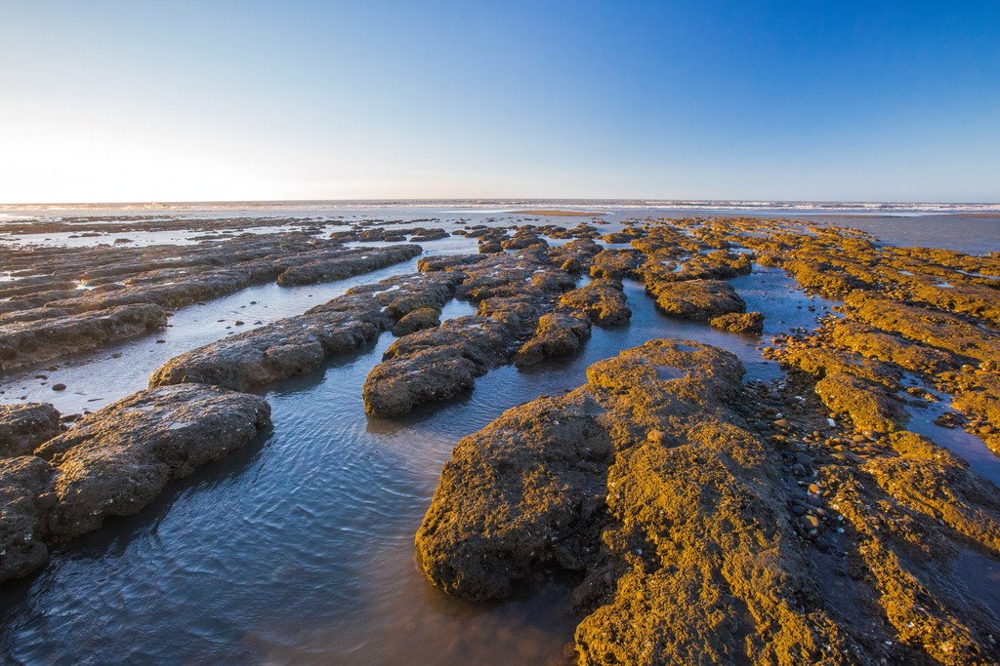

*圖：觀新藻礁生態系野生動物保護區｜來源：https://travel.tycg.gov.tw/content/images/attractions/47749/1024x768_attractions-image-pbxvwpsp-eotlooj0kzlpq.jpg*

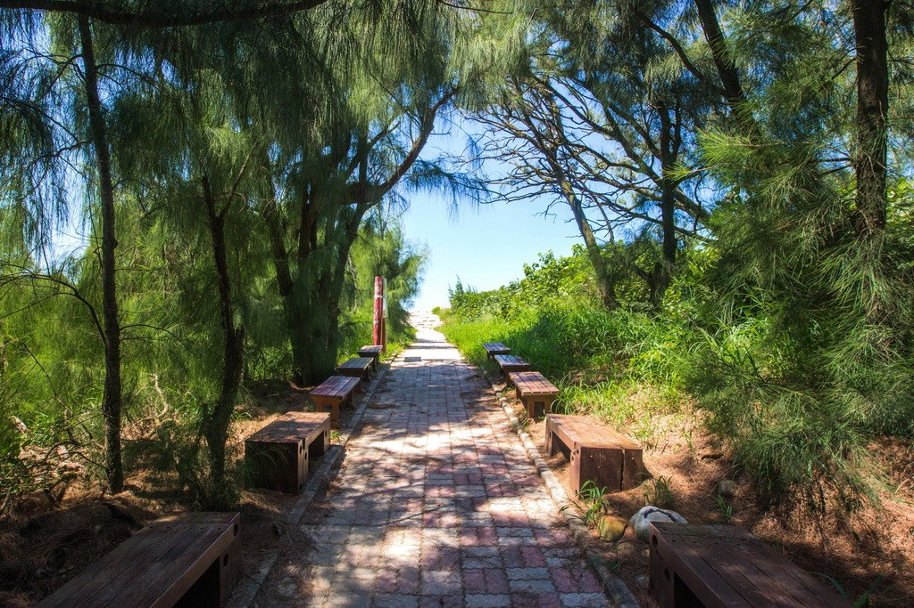

*圖：觀新藻礁生態系野生動物保護區｜來源：https://travel.tycg.gov.tw/content/images/attractions/47751/1024x768_attractions-image-h3o7pyclh0eza-ngnkplzg.jpg*

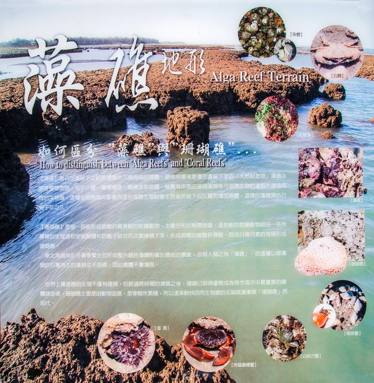

*圖：觀新藻礁生態系野生動物保護區｜來源：https://travel.tycg.gov.tw/content/images/attractions/47752/1024x768_attractions-image-nj4mcqlcseu_hmsrwbu3-g.jpg*

桃園市觀音區保生里、新屋區永興里

- 星期日：07:00 - 17:00
- 星期一：07:00 - 17:00
- 星期二：07:00 - 17:00
- 星期三：07:00 - 17:00
- 星期四：07:00 - 17:00
- 星期五：07:00 - 17:00
- 星期六：07:00 - 17:00

- 觀景台

■最適合觀察藻礁生態的月份為每年4～9月，此時藻類茂盛，風平浪靜，貝類活動頻繁；秋冬季節因東北季風增強，常形成大浪較不利參觀。

■本保護區採分區管制，核心區不開放申請進入，緩衝區(南區)及緩衝區(北區)每日各開放200名申請進入、永續利用區無需申請即可進入，如欲申請進入緩衝區內，請預先線上申請。

■全區開放時間為上午7時至下午5時，所有人員請於下午5時前離開保護區。

■潮汐預報請參考氣象局網站內容 (https://www.cwa.gov.tw/V8/C/M/tide.html)

■戶外導覽請洽永興社區發展協會(03)486-3911

### 周邊景點

- 4.4 藻礁生態環境教室 星期四：09:00 - 17:00 人氣 24085
- 3.9 新屋農博環境教育園區 星期四：09:00 – 17:00 人氣 83936
- 采禾蔬菜育苗場 需由企業、學校、機關等團體提前預約 人氣 233
- 後湖溪生態園區 📢 營業時間調整公告 自 4/21 起，舟日咖啡廳營業時間調整如下： 🔸 每週一公休 🔸 平日營業時間 10:00-18:00 🛶 獨木舟體驗 🔸 每週一公休 🔸假日自由行、自漫遊場次時間調整如下： 10:00 11:00 13:00 14:00 15:00 16:00 人氣 98357
