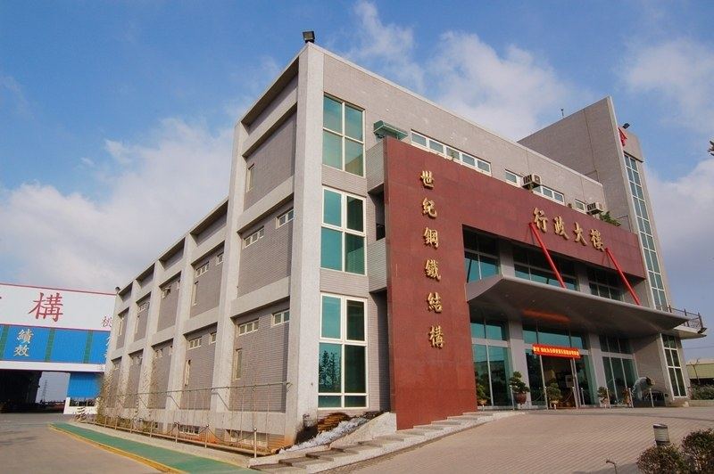
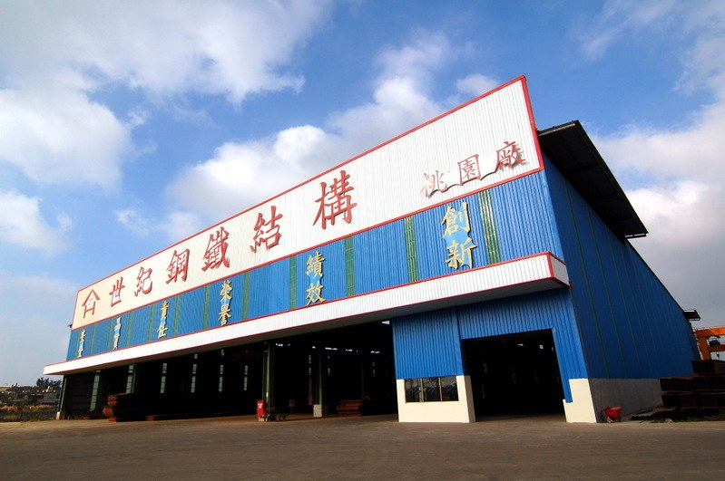
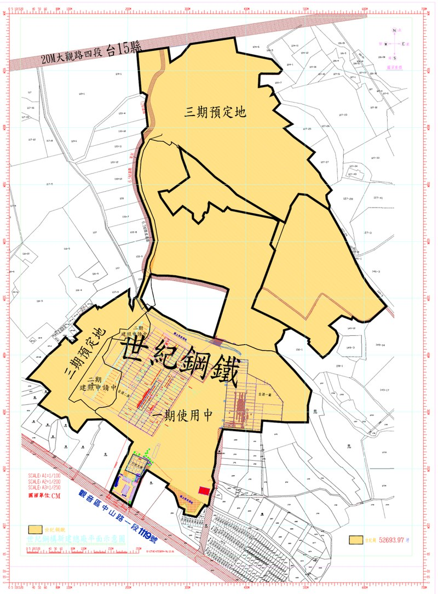

# 世紀鋼構

- 原始網址：https://www.century.com.tw/tw/about/3/
- 網站名稱：www.century.com.tw
- 作者：HomeMesh, Morgan, Roy, Century
- 發表日期：（未標示）
- 爬取時間：2026-11-05T16:37:21+08:00　取得方式：requests　正文定位：文字密度評分
- 圖片：3 張

---
#### 桃園廠區

桃園廠區(69,000坪)

世紀鋼構總部位於桃園觀音，主要從事各項鋼骨結構、焊接型鋼生產業務。最大競爭優勢，在於擁有垂直產業整合能力，而且機動性極強。從鋼料取得、電銲到切割、組成，都有強大的整合能力。

地址: 桃園市觀音區金湖村中山路一段1119號 電話: (03)473-0201

*圖：（原文無圖片說明）｜來源：http://www.century.com.tw/uploads/images/20200806/1596708667425539.jpg*

*圖：（原文無圖片說明）｜來源：http://www.century.com.tw/uploads/images/20200806/1596708667313709.jpg*

*圖：（原文無圖片說明）｜來源：http://www.century.com.tw/uploads/images/20200806/1596708667581689.png*

平面圖標示
