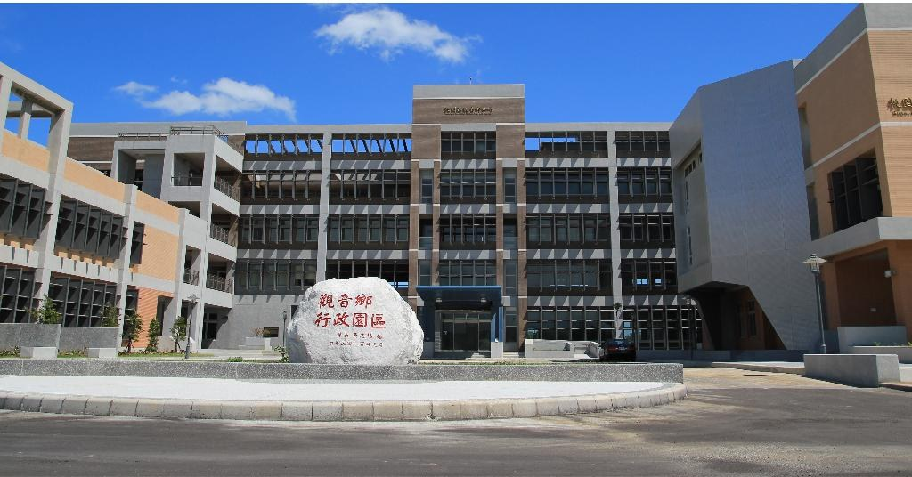

# 觀音意象

- 原始網址：https://www.guanyin.tycg.gov.tw/cp.aspx?n=6874
- 網站名稱：桃園市觀音區公所
- 作者：（未標示）
- 發表日期：（未標示）
- 爬取時間：2026-11-05T16:39:40+08:00　取得方式：requests　正文定位：通用規則 main
- 圖片：1 張

---
### 觀音意象

- 列印內容

觀音區簡介

本區為桃園市沿海四市區之一，東北鄰大園區，南邊為新屋區，東南邊為中壢區，西面為台灣海峽，海岸線長約15公里，面積達99.83平方公里，劃分24里、406鄰。地名的來源，相傳是在清咸豐年間，有一農民於溪流中撿拾一石塊酷似觀音菩薩像，稱之為「石觀音」，因築廟祭祀成為地名。並隨時代推移由觀音庄改為觀音鄉，改制後稱為觀音區。因地理環境與拓植時期種種因素，形成三大發展區域---觀音、草漯與新坡地區。閩、客族群在這三區域中各自呈現不同的文化風貌。

觀音的經濟產業概況，有台灣北部最大的觀音工業區、桃園科技工業區、桃園市環保科技園區、大潭濱海特定工業區等，為國內經濟發展挹注不少量能。其餘主要便是優良農田，輔以國家級重要濕地的埤圳系統，生產優良農作，是桃園重要米倉以及蔬果、花卉的重要產地，更有桃園市第1個蓮花園休閒農業區。在文化與景觀資源上有百年歷史的國定古蹟白沙岬燈塔，有台版撒哈拉沙漠之稱的「草漯沙丘」、海洋生物的育嬰房「千年藻礁」以及著名打卡景點「白千層林蔭大道」等。

在未來的發展方向上，本區在桃園市的國土計畫中屬「鄉村生活圈」的「新農經濟」、「鄉村生活」、「田園景觀」。在生產上，農村的未來應要對接聯合國永續發展目標，追求生態永續、環境永續以及資源永續，讓休耕的農田都能循環生產優質農產品，使用科技化生產技術促使品質提升，甚至結合農村休閒、農特產品銷售、旅遊與綠色消費的總體發展，保障農民的收入，讓留在農村的青年看得到未來與創造就業機會。在生活上環境要優化，包括不同年齡層各行各業生活需求與使用空間，提供安全、舒適、悠閒與富有文化意涵的生活環境，樂活在觀音。

觀音區公所連結網址： https://www.guanyin.tycg.gov.tw/

*圖：桃園市觀音區行政園區｜來源：https://ws.tycg.gov.tw/001/Upload/78/relpic/10697/1755/1.jpg*

河川水利

桃園區目前有一條主要河川、五條次要河川、六條普通河川及南崁溪與埔心溪支流，其中流經觀音區之河川為觀音溪、富林溪、大堀溪與新屋溪 ( 如下 )。

本區水資源之利用以農林漁牧用水居多，擁有全市最多之埤塘數，埤塘乃為漢人為解決農作水利灌溉所設，目前本區灌溉系統主為桃園大圳，引用水源為大漢溪。

| 河川等級 | 河川名 | 流經鄉鎮市 | 長度(KM) |
|---|---|---|---|
| 普通河川 | 富林溪 | 觀音 | 14.75 |
| 普通河川 | 大堀溪 | 平鎮、觀音 | 18.59 |
| 普通河川 | 觀音溪 | 新屋、觀音 | 7.80 |
| 普通河川 | 新屋溪 | 新屋、觀音 | 13.59 |

桃園市觀音區各里人口統計
