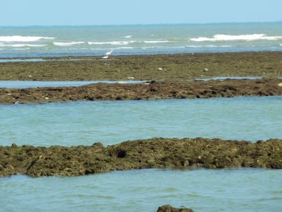
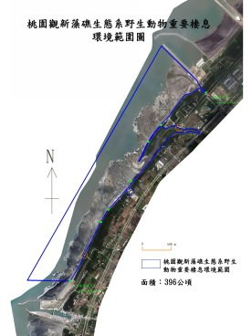

# 訂定桃園觀新藻礁生態系野生動物重要棲息環境之類別及範圍簡介(農業部全球資訊網)

- 原始網址：https://www.moa.gov.tw/ws.php?id=2501231
- 網站名稱：www.moa.gov.tw
- 作者：MOA
- 發表日期：（未標示）
- 爬取時間：2026-11-05T16:39:41+08:00　取得方式：requests　正文定位：通用規則 main
- 圖片：2 張

---
### 103年5月(第263期)

### 訂定桃園觀新藻礁生態系野生動物重要棲息環境之類別及範圍簡介

林務局 管立豪．黃群策．王中原

壹 . 緣起

位處海岸潮間帶之藻礁屬於無生命的礁體，依附其上生長之無節珊瑚藻為多細胞藻類，因能分泌石灰質，而使礁體逐年累積增厚形成藻礁，因具有多孔隙特性，也孕育了許多海洋生物，成為許多鳥類的覓食區。桃園觀音、新屋海岸擁有全臺面積最大的藻礁地形，退潮時礁體可露出水面高達 2 公尺，寬達 500 公尺，藻礁存在至今約 6,000 年，該區於 97年因臺灣中油股份有限公司埋設天然氣管線挖掘破壞，經農委會自然地景審議委員會組小組會勘後，於 97 年 8 月 26 日 依文化資產保存法施行細則第8條第2款規定作成列冊追蹤之決定，並請地方主管機關桃園縣政府進行劃設保護區域可行性評估及範圍劃設規劃，屆時視當地居民意見，再運用適當的法律對本地區進行保護工作。

經桃園縣政府於 101 年研究評估後，認為採野生動物保育法公告野生動物保護區來保育藻礁生態系為可行方案，將藻礁保育計畫於 103 年 4 月 7 日提經農委會野生動物保育諮詢委員會第 9 屆第 2 次會議認可野生動物保護區範圍後，農委會林務局於同年 4 月 15 日完成公告「桃園觀新藻礁生態系野生動物重要棲息環境」之類別及範圍，俾利桃園縣政府接續公告為「桃園觀新藻礁生態系野生動物保護區」。

貳 . 訂定重點說明

桃園觀新藻礁生態系野生動物重要棲息環境，是依照野生動物保育法第 8 條第 4 項規定訂定，面積 396 公頃，公告之類別屬於海洋生態系、河口生態系之複合型生態系，範圍以 桃園縣觀音鄉保生村大潭電廠進水口南堤以南至桃園縣新屋鄉永興村、永安村藻礁海岸，含小飯壢溪河口、新屋溪河口；保護區範圍界線係 緊連各堤岸構造物，各堤岸構造物主體不納入保護區範圍（如附圖）。本野生動物重要棲息環境之中央主管機關為行政院農業委員會，縣（市）主管機關為桃園縣政府，未來在區內經營各種建設或土地利用行為，應依野生動物保育法第 8 條規定，擇其影響野生動物棲息最少之方式及地域為之，不得破壞其原有生態功能，如再經桃園縣政府公告為野生動物保護區，則必須依照保育計畫之分區管制事項進行管制與經營管理。

參 . 結語

就藻礁礁體而言，如不發生人為開挖情事即無破壞之虞，觀新藻礁雖具獨特地質地形意義，但其形成的礁體屬於多孔隙環境，又位於潮間帶，因此恰巧提供鳥類覓食及海洋生物生長繁殖的棲地，所以藻礁所構成之潮間帶區域，具特殊生態代表性之潮間帶野生動物棲息環境，惟因桃園沿海工業區廢水污染等問題導致此潮間帶海洋生物大量消失，此潮間帶生態體系處於劣化狀態，亟需進行復育，而恢復其生態之最佳途徑，即為改善桃園沿海工業廢水污染與漂砂問題，桃園縣政府必須依野生動物保護區保育計畫落實執行，並應特別強化污染防治、取締及查緝，於藻礁整體生態系統之維護與保育始能具有成效。

*圖：圖 1 在藻礁上覓食的唐白鷺｜來源：https://www.moa.gov.tw/upload/images/web_structure/2501231/2501231_1.jpg*

圖 1 在藻礁上覓食的唐白鷺

*圖：圖 2 桃園觀新藻礁生態系野生動物重要棲息環境範圍圖｜來源：https://www.moa.gov.tw/upload/images/web_structure/2501231/2501231_2.jpg*

圖 2 桃園觀新藻礁生態系野生動物重要棲息環境範圍圖

本網站刊載之「農政與農情」其所有內容，包含文字、圖像等皆可轉載使用，惟須註明出處。
