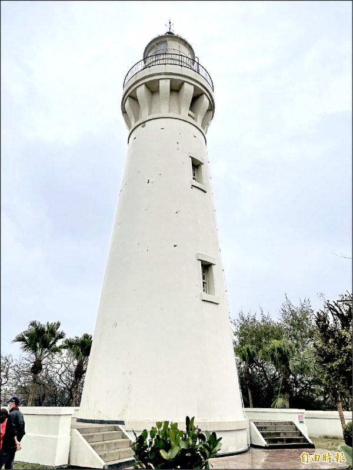

# 觀音白沙岬燈塔 列國定古蹟

- 原始網址：https://news.ltn.com.tw/news/Taoyuan/paper/1449571
- 網站名稱：自由時報電子報
- 作者：自由時報電子報
- 發表日期：2021-05-19T05:30:00+08:00
- 爬取時間：2026-11-05T16:39:43+08:00　取得方式：requests　正文定位：通用規則 [itemprop=articleBody]
- 圖片：1 張

---
## 觀音白沙岬燈塔 列國定古蹟

*圖：聳立於觀音海岸、闢建於日治時代的白沙岬燈塔，成為桃園第二座國定古蹟。（記者許倬勛攝）｜來源：https://img.ltn.com.tw/Upload/news/600/2021/05/19/135.jpg*

聳立於觀音海岸、闢建於日治時代的白沙岬燈塔，成為桃園第二座國定古蹟。（記者許倬勛攝）

聳立於桃園市觀音區海岸、闢建於日治時代的「白沙岬燈塔」，守望海上交通120年，保存完整，原為市定古蹟，經數年文化資產價值調查，今年5月10日獲文化部第8屆「古蹟歷史建築紀念建築審議會」過半數委員同意，成為時隔36年、繼大溪李騰芳古宅後，全市第2座國定古蹟。

白沙岬燈塔1900年竣工、1901年開燈啟用，採用台灣首見「二重殼複合構造」，迄今在鏡機旋轉台上仍留有法國巴比埃及貝納爾公司承製的明證，塔內保存裝飾精美的鏤空豎板鑄鐵迴旋樓梯，及層層套接的金屬製圓形塔心，以供鏡機旋轉的纜繩與砝碼運作，彌足珍貴。

桃園市政府文化局文化資產科長董俊仁表示，白沙岬燈塔塔高約37公尺，僅次於屏東縣鵝鑾鼻燈塔，是全國第二高的燈塔，為新竹至淡水間海域的航海重要指標，塔頂歷經第二次世界大戰戰機掃射及多次地震、風災，仍屹立不搖。

中央大學歷史學研究所教授鄭政誠認為，桃市古蹟幾乎以廟宇、私宅居多，較少公共或交通建設，白沙岬燈塔升格為國定古蹟，對於歷史、文化界而言是一大捷報。
