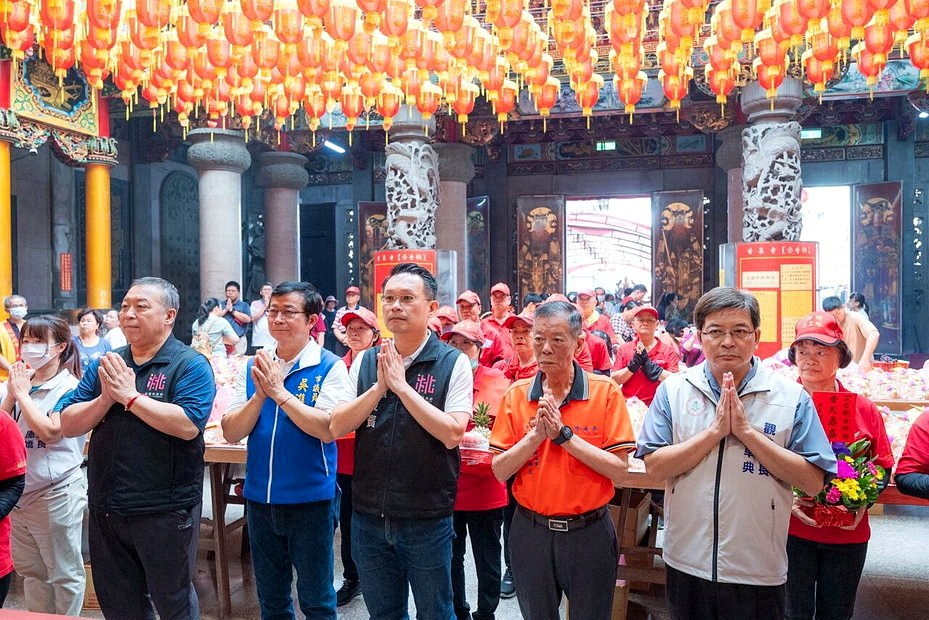

# 桃園甘泉寺石觀音震靈紀念日 上千契子契女共下轉妹家

- 原始網址：https://udn.com/news/story/7324/9551373
- 網站名稱：聯合新聞網
- 作者：聯合新聞網
- 發表日期：2026-06-07T17:42:36+08:00
- 爬取時間：2026-11-05T15:16:55+08:00　取得方式：requests　正文定位：通用規則 .article-content
- 圖片：1 張

---

*圖：桃園市副市長蘇俊賓（前排中）參加觀音區甘泉寺石觀音佛祖神尊震靈紀念日祈福。圖／新聞處提供｜來源：https://pgw.udn.com.tw/gw/photo.php?u=https://uc.udn.com.tw/photo/t3/2026/06/07/35021068.jpg&M=1&s=Y&x=0&y=0&sw=1280&sh=854&sl=W&fw=930&exp=3600&w=930*

桃園市副市長 蘇俊賓 今日前往 觀音 區甘泉寺，參加石觀音佛祖神尊震靈紀念日祈福，並表示每年農曆4月22日石觀音佛祖神尊震靈紀念日，許多契子、契女及契孫返寺參拜，如同「回娘家」，廟方統計歷年已超過萬人，今年更有上千名契子契女「共下轉妹家」，展現石觀音信仰深厚的凝聚力與人情味。

蘇俊賓指出，觀音區是台灣四個以宗教淵源命名的鄉鎮市區之一，其他還有台南關廟區、高雄彌陀區、澎湖馬公市舊稱「媽宮」，與 媽祖 淵源深厚，觀音區得名自甘泉寺的石觀音。地方上流傳「先有石觀音，才有觀音區」，觀音區與石觀音佛祖信仰密不可分。

蘇俊賓說明，甘泉寺不僅是地方重要信仰中心，更承載觀音地區的歷史記憶與文化脈絡。每年透過震靈紀念日祈福活動，讓宗教儀式延伸為地方團聚與世代交流的重要時刻，也持續傳承感恩惜福、飲水思源的精神。
