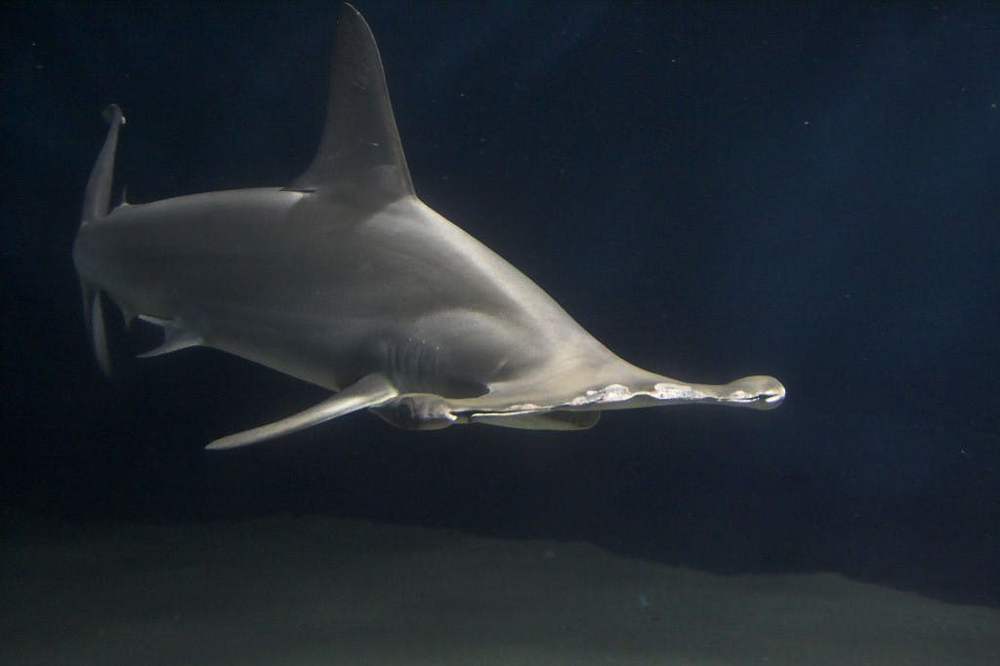

# 搶救大潭藻礁事件反思：環境受害者的矛盾情結，與公民參與的匱乏

- 原始網址：https://www.thenewslens.com/article/100189
- 網站名稱：TNL The News Lens 關鍵評論網
- 作者：巷仔口社會學
- 發表日期：2018-07-23T07:53:01+08:00
- 爬取時間：2026-11-05T16:39:45+08:00　取得方式：requests　正文定位：通用規則 .article-body
- 圖片：1 張

---
文：林君諭（國立台北大學通識教育中心）

#### 藻礁到底是什麼？又為何要搶救藻礁？

2018年4月28日，由多個關心桃園藻礁的民間團體共同組成的「搶救大潭藻礁行動聯盟」，在總統府前的凱達格蘭大道召開記者會，並且舉辦了藻礁永存音樂會。在這個活動中，多個關心生態的環保團體齊聲表達「保護藻礁永不妥協」的信念，藉以喚起社會各界對藻礁的重視與保護的必要。

對許多台灣人而言，藻礁可能是個陌生的名詞。藻礁是由無節珊瑚藻（也稱為殼狀珊瑚藻）在硬基質上生長造成的生物礁，由珊瑚藻一層層堆疊而成，十年才生長一公分，是極其珍貴的生態。日前經學者證實，桃園藻礁歷經約7,600年的孕育，蘊含生物上的多樣性與地質上的豐富性，其多孔隙的特殊性是海洋生物的育嬰房。2013年，世人更透過齊柏林導演拍攝的紀錄片「看見台灣」，看到台灣珍貴稀有的藻礁海岸壯闊之美。

台灣長達1,600公里的海岸線中，有藻礁分布的不到50公里。而座落於桃園市海岸線上的藻礁，北起大園區竹圍漁港，延伸到觀音海岸，南至新屋區永安漁港，則擁有連續約27公里長的地景。這不僅是全台面積最大，同時也是全世界少見的特殊景觀，更是目前發現最大、最完整的藻礁生態系。

可惜的是，桃園作為全台灣北部重要的工業區，幾乎全市三分之二的海岸皆已規劃為工商發展的開發地區。工業區的設置與工業廢棄物的不當排放，使得桃園海岸環境遭受嚴重污染，75%的藻礁目前已經遭到破壞，幾乎不再生長，而有些礁體則呈現死寂。目前僅有觀音區小飯壢溪口以南，新屋區後湖溪口以北的四公里海岸，在2014年由桃園縣政府依野生動物保育法公告為「 觀新藻礁 」保護區，投入經費與資源，保留比較完整的藻礁海岸。

然而，由於台灣面臨能源轉型，為了因應2025非核家園的期程，天然氣的發電比例目標將由現行的30%調高到50%目標。考量北部使用天然氣的需求，中油選址在桃園觀塘工業區投資，預備以填海造陸的方式開發第三座液化天然氣接收站，這使得大潭區的藻礁瀕臨活埋，其生態面臨嚴峻的生存危機。

#### 異地復育與異地建站的攻防戰

藻礁生態系統是個完整連續性的地形，不僅只有裸露在水面上的礁體，還包括水面下更大規模的結構。目前中油的開發案正在進行相關行政程序的審查，尚未有定案，但是中油已經備妥天然氣儲槽區的用地以及施工的碼頭。倘若中油在觀塘工業區的第三天然氣接收站開發案通過，將對藻礁開腸剖肚，台灣將再也沒有健康的藻礁，對自然環境的永續影響甚鉅。

然而，中油表示第三天然氣接收站是配合政府政策與人民的用電需求，興建的預定地已通過環評，確保興建的儲存槽每年有300萬噸的供氣量。中油也宣稱，第三天然氣接收站的預定地沒有與大潭藻礁保護區重疊，同意採迴避替代方案縮減開發規模，以降低工業區興建後對藻礁的影響程度。中油更承諾未來將採取「生態補償」措施，執行社區回饋、協助藻礁異地復育與投入監測藻礁生態與研究。

環保團體與學界對將蓋在大潭藻礁上的第三天然氣接收站則提出反對意見。他們依台電所提出的數據與資料表示，第三天然氣接收站興建幾年後將呈現供過於求的情況，並且設備的利用率也不高，質疑是否果真有必要犧牲七千多年的珍貴藻礁生態，來換取20年的天然氣使用。此外，上一次觀塘工業區的環評案是在民國89年通過，至今已經過了18個年頭了，當初還不了解藻礁的價值與一級保育類的存在，呼籲應該重啟環評，考慮異地建站的其他方案。

再者，中油的填海造地、圍堤造港對整個藻礁生態系的破壞範圍甚大，影響深遠。除了污染的考量之外，工業區的興建會帶來的淤積沙，將覆蓋住藻礁使其死亡。農委會特生中心的學者劉靜榆經實地探勘調查也發現，在第三天然氣接收站施工範圍的大潭藻礁，目前有生長狀況佳的殼狀珊瑚藻，有些地區可媲美、甚至更優於已列入保護區的觀新藻礁。然而，假如再興建工業港，桃園海岸僅存的25%藻礁體，也將逐漸受到影響而慢慢消失。

此外，因為中油預定興建的儲氣槽位置緊鄰潮間帶，除了藻礁以外，正是一級保育類柴山多杯孔珊瑚的分布點。最近幾個月，更發現被「國際自然保護聯盟瀕危物種紅色名錄」（IUCN）列為「瀕危」的雙髻鯊（或稱為 紅肉丫髻鮫 ）的幼鯊出沒在此，藻礁很可能是這些鯊魚在台灣西北海域重要的孵育場。學者與環保團體於是建議，中油應針對大潭藻礁周邊生態系進行更詳細的評估。對於中油所提出的異地復育方案，中研院學者陳昭倫表示可行性不高，柴山多杯孔珊瑚這些生物只要異地，便不可能繼續生長，全世界至今也沒有成功移植的報告。

*圖：圖為IUCN列為「瀕危」的雙髻鯊，其幼鯊在藻礁出沒，藻礁很可能是他們在台灣西北海域重要的孵育場。｜來源：https://bucket-image.inkmaginecms.com/version/desktop/1/image/2024/06/c617e8bd-70cd-481a-8593-5a4faef82ced.jpg*

suneko

從規劃中觀塘工業區之中油第三天然氣接收站的開發與沿岸藻礁生態系的保育爭論案例中，我們可以觀察到的是大多數國家在工商業發展過程中幾乎都會面臨到的能源開發與環境保育爭議，這類的衝突經常發生，而且往往事難兩全。

#### 受傷的土地與弱勢的沿海社區居民

桃園濱海偏鄉農漁村景致宜人，過往更是海洋資源豐富，有許多在地人孩提時期的美好回憶。但回顧這片土地的歷史，其實充滿著許多先民努力的痕跡與無奈的辛酸，尤其沿海的幾個社區，因為工業區開發等人為因素，漸漸增加這個地區的環境承載，居民被迫概括承受工業污染與廢棄物等嫌惡設施，他們的生活經驗是沿海環境惡化的最佳見證。

以防風林為例，防風林（木麻黃）具有雙重作用：一方面可以屏障海岸內陸的安全，擁有保障居民生活的功能，被認為是保安林；另一方面，因為有防風定沙及防鹽霧的功能，對維持自然生態功不可沒，素有「綠色長城」之稱。然而，基於經濟發達與產業發展的考量，桃園沿海土地陸續而且大規模地被開發，使得防風林大面積地減少。

由於台灣位在季風帶，失去綿延數十公里的綠色屏障後，冬天吹起的強勁東北季風，使飛沙漫天飛舞，沒有防風林就無法攔阻海風（風害）帶來的沙害與鹽分，沙土夾雜污染威脅沿海的聚落，並且入侵到內陸的村落，危及村民農作物的種植、生長與收成，稻作葉末和稻穗有燒灼枯黑的現象，收穫量銳減，土地漸漸廢耕、無法生產，也造成例如養殖業者的漁塭淤積，影響居民生活與生計的維持。

走訪觀音新屋的沿海幾個社區時，居民表示親身感受到原因不明的公害汙染。他們指出時常聞到工業區許多工廠排放出的廢氣，有時臭、有時酸。除了工業區帶來的空氣汙染，林口電廠燃煤發電產生的二氧化硫順著東北季風南下，導致下酸雨。環保署全國酸雨研究資料顯示，桃園地區是全國酸雨最嚴重的區域之一。有當地居民表示，他家菜園裡的十字花科都長不好，每一株都有白色的點點，但賣相不好就意味著賺不了錢。人民生活品質降低，生計受到影響，甚至有危及生命健康之虞。

工業區版圖的擴張，改變的是人與土地的依存關係。防風林枯死，汙染問題使漁獲減少，土地無法耕種，稻米農作欠收，沿海農民生活苦不堪言，人民被迫遷離居所，成為環境受害者（environmental victims）或環境難民（environmental refugees）。觀音新屋地區農業式微，產業轉型的結果導致人口逐漸流失，農業衰退，農村社區發展面臨困境。

#### 環境受害者們的矛盾情結：對藻礁價值的認知落差以及對企業的又愛又恨

因為工業區開發而蒙受直接間接災害的是觀音新屋地區沿海弱勢居民的生活品質及未來的發展。然而，當公共傳媒爭相報導過度人為開發所帶來的負面影響，並凸顯藻礁價值與開發取捨的爭論白熱化之際，當地的草根性力量卻是分岐的：有些居民選擇靜默無聲，有些則透露出些許無奈。

許多在地民眾對守護藻礁的行動並不積極，初步了解是與祖先的口述與經驗傳承有關。許多老一輩的在地居民認為，藻礁只是沒有價值的石頭。藻礁的客家語讀音似「Ou lou sha」，其中「Oh lou」的意思類似閩南話的「烏魯木齊」的「烏魯」，有「小嘍囉、很討厭」的意思。「sha」讀音似「剎」，指石頭。記憶中曾聽長輩說過，便以為藻礁沒有用處、是死的珊瑚礁，光是其名稱便含有貶低其價值、累贅多餘之物的意思。目前在當地為數不少的中高年齡層居民認知中，藻礁不僅不討喜，對它的印象也差，因為小時候赤腳在海邊玩耍時，多少都有被藻礁割傷的不愉快經驗。

最近這幾年透過相關生物學者的解釋，才了解桃園藻礁是水中生物重要的棲息地，是世界上獨特的珍貴地景。然而，學者們的大聲疾呼並沒有馬上反轉當地居民長久以來對藻礁的負面印象，也因為居民無法感受到藻礁與其生活生計的直接連帶關係，故未能有效轉化成驅使他們積極投身保護藻礁行動的動力。民眾的無感不僅反應出急需宣傳推廣與藻礁相關的知識，更顯示出國人的環境教育尚待加強。

有一些當地社區居民在受訪時表示，雖然對中油第三天然氣接收站的開發案不樂見其成，但認為興建的可能性極大，與其抗爭無疑是小蝦米對抗大鯨魚。由於桃園工業區各式工廠林立，許多業者進駐後造就台灣經濟的奇蹟，但同時也為當地帶來不少永久性的破壞。為了彌補社區，企業通常是以發放回饋金的方式提供居民福祉，當作敦親睦鄰的機制，因此，回饋金又稱為睦鄰金或促協金。例如，台電設有「台灣電力股份有限公司促進電力發展營運協助金執行要點」，長年支付九大民營電廠促進電力發展營運協助金，再由民營電廠回饋到地方鄉親。

又例如，在「桃園市新屋區台電大潭發電廠回饋金補助人民團體實施要點」中，也明確表示運用回饋金協助推展社區的社會服務、教育文化及公益性活動等。一些觀音新屋居民的經驗中，回饋金無所不在，充斥在日常生活之中，民眾也習以為常，舉凡學校添購教學設備、社區辦活動、學童營養午餐、重病喪葬補助等，都有這些企業的影子。然而，仍舊有多數人寧可不要拿業者給社區的回饋金廉價地換取自己未來幾十年居住的環境與生活品質。

不過，也有一些鄉親對反對業者的開發案心有顧慮。雖然他們也是工業區製造出來的廢棄物與污染的受害者，但是自己的家人或親屬就在工業區上班，因此這些居民也坦言，他們擔憂假如把工業區通通趕走，將大幅減少在地居民的就業機會，兒孫恐怕都得離鄉背井到外地謀生，徒留無依的老人獨守家園。由此可見，當地居民的無聲，其實是一種對工業區業者既埋怨卻又依賴的複雜情緒交錯而成。

#### 公民參與的匱乏與未來課題

有沿海社區居民便無奈地表示，中油的開發案尚未有明確結果，但是來自民間的聲音，長久以來不被重視。一位新屋沿海居民就表示，他們已經有好幾次被蒙在鼓裡的經驗：「就像當初2008年的英華威風機開發事件，我們完全不知情，到承包商動用機械鑽探，我們才知道要蓋風機。」民意沒有受尊重、來自基層的人民缺乏能夠掌握充分的環境資訊，這些都顯示在地社會的知情與自主的權力被剝奪，現行的環境問題決策不但缺乏公民參與，也不符合民主的基本精神。

相較於無聲與無奈的在地鄉親，由公民自發性組成的環保團體，例如: 桃園在地聯盟，便關懷多項公共議題，更參與搶救大潭藻礁行動。他們積極爭取出席公聽會等各項會議，並時常即時分享會議紀錄影片，致力於激發大眾對於這類公共議題的討論，期待能影響握有權力的決策者，並對政府和企業形成壓力。然而，因為中油在觀塘工業區的開發案爭議不斷，環保署不再開放一般民眾進入觀塘藻礁專家會議。這使得民眾喪失了多元意見交換的機會，也顯示出公民在決策過程中的極為有限的參與。常民百姓（lay citizen）被政府視為是不具有專業性的知識，民眾的發聲甚至被當作是決策過程中的干擾因素。長久以往，關係到民眾切身生活的重要公共議題，便受到政府與邀約的少數專家們代理和壟斷，來為當地居民做評估。

搶救大潭藻礁與中油第三天然氣接收站開發案當中所突顯的爭議，顯現出政府、企業、科學家的知識生產、以及公民等彼此間的利益，鑲嵌在一個連動的結構當中。我們都該審慎思考的課題是，壟斷的資訊應如何改善；民主的社區參與如何可能；產業發展的利益分配與永續環境能夠如何盡量達成雙贏的策略。

本文經 巷仔口社會學 授權刊登，原文 發表於此

責任編輯：潘柏翰 核稿編輯：翁世航
