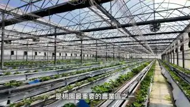
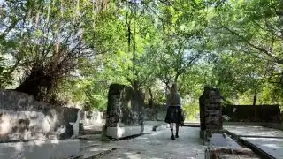
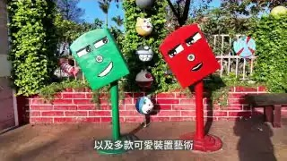
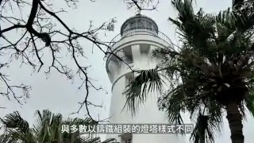
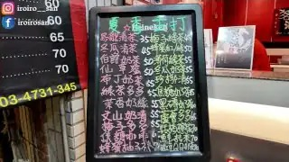

# 桃園觀音區探訪｜台版撒哈拉沙漠和百年燈塔藏在西海岸｜草漯沙丘・白沙岬燈塔・觀音飛機場【IROIRO】

- 影片網址：https://youtu.be/2hbu5n9VLZY?si=JC29M3MbFRsFELoU
- 頻道：IROIRO
- 上傳日期：2026-01-19　長度：00:38:15　觀看數：43441
- 字幕來源：Chinese (Taiwan)（zh-TW，上傳者提供字幕）
- 爬取時間：2026-11-05T16:38:31+08:00

## 影片說明

這集影片我們來到位於桃園西海岸的觀音區，一座融合濱海自然景觀與客庄文化的地方。
從龍貓公車站、林家古厝休閒農場、崙坪文化地景園區、甘泉寺 石觀音寺到草漯沙丘，這裡不僅能欣賞蓮花、沙丘與濱海燈塔的壯闊風光，還能品嚐在地老店的美味小吃。
就讓我們一起深入觀音，看看這座「蓮花之鄉」到底藏了什麼驚喜！

**吃什麼**：
全村的希望麵包工廠（手作麵包和披薩）
來來牛家莊（人氣牛肉麵店）
安可土雞城（必點鹹酥雞、白斬雞、剝皮辣椒雞湯）

**喝什麼**：
冰茶屋（在地傳統飲料、冰品）
茗潮精工茶房（招牌仙草奶凍、鮮芋頭奶茶）

**逛什麼**：
林家古厝休閒農場（古厝風情與農園體驗）
崙坪文化地景園區（日治時期受信所、地景藝術）
白千層綠色隧道（白千層樹綠蔭大道）
大樹土地公（大樹庇蔭的土地公廟）
觀音龍貓公車站＋和美幼兒園（特色打卡點）
觀音飛機（飛機、遊艇超狂收藏）
白沙岬燈塔（日治時期百年燈塔古蹟）
觀音白玉海堤、觀音風車豆腐岩（觀音海景）
紅塘埤（埤塘水景）
觀音草漯沙丘（台版撒哈拉沙漠）

**拜什麼**：
甘泉寺 石觀音寺（「石觀音」地名由來）

Ana Luisa 👉 https://shop.analuisa.com/zu-iroiro

🌍 English subtitles are available. Just turn on CC to enjoy the video in English! 
🌸 日本語字幕あります！設定から字幕をオンにして、ぜひ一緒に旅しましょう。
🇰🇷 한국어 자막도 있어요! CC 버튼 눌러 함께 여행해요

桃園系列已上線影片：
01．https://youtu.be/NwMo3nt8KL0

02．https://youtu.be/SUAo4DcHX3g

03．https://youtu.be/2hbu5n9VLZY

台灣系列完整播放清單：
https://www.youtube.com/playlist?list=PLSp7MXjFZS_SL-edcqqcmZrDckgxSJLC-

#觀音區 #草漯沙丘 #白沙岬燈塔 #桃園 #guanyin #茗潮精工茶房

## 代表畫面

> 畫面取自 YouTube 播放器公開提供的 storyboard 預覽圖（320x180），未下載影片檔、未繞過任何平台限制。

**00:01:59**　字幕：境內擁有北台灣最大的 觀音工業區 同時仍有近半人口從事農漁業 是桃園最重要的農業區之一 觀音更以蓮花之鄉聞名 每年夏季舉辦的蓮花祭盛會

**00:08:56**　字幕：對 真的是很棒的一個環境 崙坪文化地景園區前身為

**00:17:43**　字幕：借景校園大樹做背景 宛如走進宮崎駿動畫世界 可愛又逼真 公車站旁的幼兒園正門 也充滿童趣 像童話中的糖果屋 還有卡通版歪腰郵筒

**00:25:30**　字幕：塔頂風向儀的東西南北方位 更採用法文縮寫 Est Ouest Sud Nord代表 塔基以石材打造 塔身則是少見的雙層紅磚結構 上段以大石堆砌成托架 承載鑄鐵塔頂

**00:37:05**　字幕：我又回到甘泉寺了 由於我實在是太想喝這種 地方上獨有的飲料 再加上它的評分特別的高 不想要讓我們觀音的影片 留下遺憾 它就在甘泉寺的旁邊 走路大概三秒鐘就到了

## 逐字稿

**[00:00:00]** 正身門的上方也有TR磚代表這邊就是非常重要大家可以來找找林家古厝裡面究竟有幾處有TR磚ここ這個有金橘還有金棗謝謝哇 謝謝一人一半現吃哎觀音地區其實說真的本來就是需要被推廣

**[00:00:33]** 新鮮客人都看得到大家早安我是IROIRO今天我們來到了桃園西海岸的觀音區說到了觀音大家是不是第一個聯想到的就是觀世音菩薩以及蓮花呢沒有錯這邊除了觀音寺以及蓮花池我們也即將帶大家一起深入觀音區探訪探訪究竟還藏著什麼那在影片開始之前呢也別忘了我們的合作伙伴Ana Luisa那今天一整天我配戴的飾品也是Ana Luisa的關於Ana Luisa的詳細介紹大家可以看上一集西門町的影片或是點選說明欄的連結前往他們的官網瞧瞧吧GO怎麼覺得觀音隨時都會看到飛機

**[00:01:19]** 觀音區位於桃園市西部沿海東鄰大園區與中壢區南接新屋西鄰台灣海峽舊稱石觀音源自於1860年有農民在小溪拾得一顆酷似觀音佛像的天然石頭因而供奉並成為地名由來日治時期1920年改制為觀音庄戰後改為觀音鄉2015年桃園升格直轄市後改為觀音區全區人口約7.6萬人以客家族群為主境內擁有北台灣最大的觀音工業區同時仍有近半人口從事農漁業是桃園最重要的農業區之一觀音更以蓮花之鄉聞名

**[00:02:04]** 每年夏季舉辦的蓮花祭盛會與南部白河齊名有北觀音 南白河之美譽吸引各地遊客前來賞蓮並且桃園素有千塘之鄉的稱號境內分佈的埤塘及水圳數量密度之多也是世界罕見因此觀音區境內也有著不少埤塘成為當地獨具特色的水文地景之一再加上臨海與氣候因素孕育出壯闊的濱海和沙丘景觀這也使得觀音兼具了自然生態與人文底蘊

**[00:02:44]** 在林家古厝的外牆上大家可以看到這一面非常漂亮的TR磚TR磚是台灣煉瓦株式會社英文的縮寫代表著在日治時期最高品質的紅磚代表早期這種磚多用於公家機關的建築物上在民間有些人也會將TR磚砌於自己的建築物外側以彰顯個人或家族的財力雄厚那以後我們家要用IR磚嗎如果有的話大家全部砌起來以彰顯大家對我們頻道的支持與愛護

**[00:03:28]** 有一股味道哎香香的嗎含笑花 謝謝

**[00:03:36]** 所以如果要採含笑花是要採像這種盛開的嗎要有溫度它才會開要有溫度它才會香真的有一股香味就是很像有水果的香氣的味道感覺好像很好吃 謝謝您謝謝含苞待放謝謝您我們現在在林家古厝休閒農場林家古厝它是由紅磚所堆砌而成的閩式三合院至今已經有一百多年的歷史了依然保存得相當的完整那林家世代務農直到第五代才開始轉型將原有廣大的稻田改種荷花

**[00:04:22]** 並且結合古厝成為觀音地區首座發展的觀光休閒農場那它的園區佔地也非常的廣除了外面的古厝像我們後面有大片的蓮花池還有餐飲部 果園或是焢窯區再加上旁邊是桃園機場每隔幾分鐘就會有飛機從頭上飛過哎整個感覺超級愜意的林家古厝休閒農場展現樸實鄉村風貌並設置多元休閒體驗區讓遊客感受歷史建築與自然景觀之美此外依四季規劃不同體驗夏天主打蓮花不僅可賞蓮還能選購蓮花相關產品秋冬則提供草莓 哈密瓜 葡萄等採果活動

**[00:05:08]** 相當適合親子出遊朋友聚會及團體旅遊我們拍攝當天老闆特別向我們介紹園內果園和冬季草莓祭老闆說這裡的草莓園採AI智慧化管理是台灣目前規模最大的草莓園溫室大棚現場看真的是壯觀無比農場也會推出各式體驗活動感興趣的朋友務必到官網查詢查詢不會 我覺得已經很甜而且很多汁哎一咬下去那個它如果熟的話更甜一咬下去就是那個水果的汁爆出來在農場裡面有一間ㄚㄚ的家不過老闆說今天ㄚㄚ外出旅行了暫時不在家所以過來這邊想跟ㄚㄚ碰面

**[00:05:54]** 還必須要碰碰你們的運氣高難度設施勿輕易挑戰無膽不要走這絕對不是我們頻道的風格偏要走給大家看Let's go它這樣寫反而讓人想走激不得啊好像有點晃哎你小心 你小心小心 小心馬上就犁田了啦天啊難怪他說跌倒要自己負責回頭是岸 各位農場旁邊這條大崛溪以前其實是叫大窟據說是因為上游桃園台地中壢層面地勢陡峭那造成了長年的侵蝕作用形成大大小小的洞窟最後演變而來就叫它大崛溪

**[00:06:40]** 然後可以看到溪水上面有那個一層一層一格一格的它說是魚梯那是因為魚喜歡在上游水溫比較低的地方產卵所以就設置這樣一階一階然後幫那個溪水的高低落差不要太大這樣魚就可以順利的迴游去做產卵同時也可以進行魚的登階機訓練

**[00:07:08]** 逛完了來吃冰沒有錯它入園門票一百塊可以折抵餐費那我們就來換冰淇淋而且這個冰淇淋老闆他是使用義大利的機器完全天然沒有任何添加物吃起來非常的健康有蓮子也有草莓兩種口味是冰沙的口感很好吃很濃的草莓香我也迫不及待要趕快來吃吃看義大利機器做的冰淇淋純天然的就是它奶香中又有一點那種沙沙稠稠的那個蓮子的口感

**[00:07:49]** 我怎麼覺得它的口感綿密到有一點像綠豆沙冰的感覺對 蓮子比較像綠豆沙但你吃吃看草莓草莓我覺得就是比較冰沙口感它草莓的味道好濃郁而且真的是草莓味不是那種化學的味道而且我有咬到很像草莓籽的那種口感對哎 一顆一顆的裡面確實有一顆一顆的草莓的鼻頭粉刺這是真材實料滿好的 這樣子只要一百塊又有這麼好吃的冰淇淋然後你還有這麼舒服的大園區可以逛滿值得的我覺得老闆把這邊打造得很舒服而且很乾淨對 每一區都維護得很用心

**[00:08:35]** 因為有些人來農場不是會怕就是那種土味或是一些飼料味但農場這邊完全沒有沒有錯而且Eileen超級怕蚊子的今天Eileen完全沒有用到防蚊液目前我是Safe的對 真的是很棒的一個環境

**[00:09:00]** 崙坪文化地景園區前身為國際電話株式會社觀音崙坪受信所怎麼不講完啊其它的現在還在勉強しています它是負責電信業務的它在1986年的時候設施轉至交通部電信研究所之後就逐漸荒廢後來是桃園市政府都發局把它重新整建那就保留了建築遺址還有原始的森林那也在2018年登錄了歷史建築在2019年的時候就正式對外オープン しました園區內可見座落於茂密林間的地磁觀測站與受信所設施群猶如一座被遺忘的神秘古城成為熱門打卡點

**[00:09:46]** 同時園區也結合客家工藝館館內展示了傳統客家工藝並規劃多元手作課程提供遊客親身體驗讓遊客在認識台灣電信發展歷史的同時也能體驗客家文化藝文活動與悠閒的自然氛圍老婆妳不覺得這邊很像什麼城堡的遺蹟嗎對啊 而且你看它的牆角現在我們是叫踢腳嘛對不對 對它上面還有特別設計過的感覺是洗石子嗎這座碩大的龜殼劇場以仿生龜殼造型木結構打造榮獲2021年國家卓越建築獎

**[00:10:32]** 劇場以拱形曲線呈現開放又有秩序的空間感不定期舉辦活動展演市集與農特產展售兼具了建築美學與藝文功能遼闊的風神草原綠地適合散步野餐與親子遊憩不時可見飛機掠過天際草原四周保留了桃園國際雕塑創作展的地景藝術作品為自然景觀增添了不少藝術氣息剛剛遠看我覺得很像螺絲但近看怎麼比較像可樂果

**[00:11:16]** 好客食堂提供道地的客家料理與茶點室內古樸雅致戶外則環繞著蓮花池營造悠閒的用餐氛圍

**[00:11:33]** 全村的希望全村的希望的麵包來了

**[00:11:45]** 全村的希望麵包工廠這名字會不會太趣味了 對啊據說老闆以前是在大陸那邊經商非常中意這個名字於是回國之後就繼續沿用全村的希望當作它們的招牌聽起來相當有魄力對啊 很有霸氣不過它外觀根本不知道是賣麵包的它就是它很妙哎它就是一棟別墅就很像是你鄰居家或是就是一棟別墅然後招牌也是小小的但生意很好它好像就是把一樓客廳變成就是麵包店然後座位區這樣對 它裡面空間無敵巨大我剛剛看它檯上每個麵包也都很大都是做巨型麵包哎大家去麵包店有沒有試吃你看它給的試吃麵包

**[00:12:30]** 哇 也是試吃很佛心哎對啊 直接給你一整塊沒有在客氣哎然後這間店它們的麵包每天都是現烤的品項就是稍微有點不同然後也有在賣披薩或是咖啡飲料然後我覺得很棒的事就是如果在這邊吃麵包它會幫你切拿去烤哎現烤的喔對 而且我剛剛有嚇到它不是跟你用微波爐或什麼加熱小烤箱烤它是用披薩那個窯烤去烤的哎用窯烤幫各位加溫你看有沒有誠意怎麼感覺用窯烤箱就是特別厲害對 好像特別的香哎好期待整間店都是麵包的香氣不愧是全村的希望

**[00:13:15]** 那你要成為YouTube界的希望嗎我 !?那這個就要靠各位目前的觀眾大家用力的幫我們按讚 訂閱 分享出去才有希望沒錯 沒錯第一道當然是要先試試看熱騰騰的手工披薩窯烤的好快就出爐囉對 窯烤的時間比我想像中的還要快對啊牽絲哇 感覺就很好吃哎這個 墨西哥牛肉口味開動披薩乾杯起司好厚 好幸福對 它的起司蠻厚的吃起來就是非常的帶勁而且剛烤好這底下的皮是軟的哎然後旁邊就是披薩這個邊邊也是軟的

**[00:14:01]** 因為每次每次那種叫那種連鎖店的披薩邊邊我都不吃因為好硬喔怪不得平常跟老婆在吃披薩的時候我好像都沒吃到什麼料因為都在吃這個邊邊角角我吃中心他吃邊邊它邊邊真的是QQ的哎QQ的不會乾柴我老婆在提醒我啦把邊邊給我沒關係啦這個邊邊是軟的我可以酒釀桂圓桂圓香很濃而且歐式麵包最怕的就是有些很乾會刮嘴巴我覺得這個還好哎 可以2024年才開業的店面短短一年多便成為觀音新亮點

**[00:14:47]** 假日常常人潮不斷看來全村的希望真的是名副其實

**[00:15:00]** 在全村的希望附近一樣位於福新路上的白千層綠色隧道全長大約2.8公里沿途種植了將近700棵的白千層樹高聳的樹梢交織成美麗的林蔭大道非常的壯觀這裡非常適合來這邊散步騎單車或是拍照白千層是因為它的樹皮會隨著新皮不斷生長脫落然後再一層一層包裹在它原本的樹幹上就形成它外觀很斑駁又獨特的現象所以又叫脫皮樹

**[00:15:35]** 甜點的時間原來是甜點啊這間冰茶屋是觀音這邊在地的傳統飲料店我覺得在地傳統飲料店有幾個特色就是它的菜單種類超多琳瑯滿目每次都會看到不知道要點什麼就跟著招牌點就沒有問題了綠豆沙看是一定要點的然後刨冰和豆花也滿有名的只是胃實在太飽了點刨冰就好而且它這邊很特別的是它提供杯裝跟碗裝的選擇而且據說料多實在沒有錯期待期待黑糖的滋味哇 這個黑糖糖水它的黑糖香氣真的非常夠味好吃哎而且它一碗冰50塊四種配料

**[00:16:23]** 老婆妳知道大樹土地公這邊以前曾經有一個很有趣的事情嗎什麼以前旁邊這邊的農地都有設稻草人在這邊只是當地居民反應晚上經過的時候會嚇一跳略顯熱鬧想說怎麼有人在這邊開派對所以現在這些稻草人都撤掉今天就沒看到了怎麼不會認為是土地公顯靈沒想到觀音也有龍貓巴士哎沒有錯 我們現在是在和美幼兒園旁的龍貓巴士站那這邊比較特別的是這一間幼兒園它的外牆以及這個龍貓巴士站都是幼兒園的全體教職人員他們採用海邊漂流的垃圾利用回收再利用的方式來製造而成的那原本是為了社區美化

**[00:17:10]** 但因為太有特色就變成打卡景點但只是幼兒園裡面當然還是不對外開放所以拍照的話就只能在外面那大家拍照的時候也記得要留意不要打擾到人家

**[00:17:24]** 這裡的作品使用海邊撿拾的海漂垃圾環保再利用以保麗龍做成大小龍貓浮球拿來彩繪工業區的舊棧板製作成露營區跟木架子等借景校園大樹做背景宛如走進宮崎駿動畫世界可愛又逼真公車站旁的幼兒園正門也充滿童趣像童話中的糖果屋還有卡通版歪腰郵筒以及多款可愛裝置藝術非常適合拍照打卡

**[00:17:58]** 這邊蠻多農場的 對對其實因為觀音地區其實說真的本來就是需要被推廣北北基桃 但是也是屬於比較偏遠一點的地方因為那時候也是在想說國內好像也沒什麼飛機餐廳所以就朝飛機餐廳去做結果後來因為農地農用符合農地農用就做休閒農場瞭解瞭解所以這就是一個歷程很期待老闆這邊弄完的樣子超酷的

**[00:18:40]** 現在來到的是在觀音中山路前身是長美休閒農場的觀音飛機場它就曾經是結合民航元素跟農場的休閒園區現在是在施工整修中所以是不對外開放只是我們今天來的時候剛好碰到老闆在現場所以他有同意我們進來拍攝大家知道嗎老闆也是水林人太巧了吧 謝謝老闆對啊 所以我們才有機會這麼近距離看到這麼巨大的飛機超震撼的真的 這個龐然大物老婆妳有在這種視角之下看過飛機嗎完全沒有平常這種視角應該只有飛機的技師才能夠看到吧很震撼而且大家看我身後這一台747以前我小時候跟我家人出國的夢想大家有沒有看到它的二樓那一排窗戶

**[00:19:25]** 以前小時候的夢想就是希望能夠坐在二樓

**[00:19:33]** 這邊有一台空中巴士A300在這邊這就是我們現在比較常搭到的機型而且我覺得這邊還有一個很酷的亮點就是天空中有時候也不時有飛機飛過機上加機

**[00:19:59]** 廣大的場地內除了收藏退役的空中巴士A300及波音747還能看見機場常見的接駁車空橋以及遊艇等等不僅展現了老闆獨特且驚人的收藏也成為吸引航空迷與攝影愛好者的特殊打卡點這種地面與空中的雙重畫面享受真的很過癮期待未來整修完成後以全新面貌再次對外亮相

**[00:20:35]** 現在我們來到了位於觀音工業區裡面的來來牛家莊這是一間外觀極為低調但是內部卻臥虎藏龍的牛肉麵店然後它的菜單非常的簡單就只有清燉牛肉麵 牛肉湯 蔥油拌麵就這三樣它的牛肉麵的牛肉竟然是牛肋條而且它整個牛肋條鋪滿整個碗看起來超好吃看起來食慾大增而且它的麵條居然是使用那種疑似刀削麵但又不是刀削麵的這種很像皮帶麵條的麵清燉的湯頭好好喝很好喝哎它的牛味好重而且湯頭喝起來滿鮮甜

**[00:21:22]** 很清爽哎 好喝哎很舒服它這邊的湯頭只有清燉的湯沒有紅燒所以想吃辣的朋友就是可以自己去拿辣醬還有腐乳醬迫不及待 趕快吃肋條肋條乾杯乾杯 哇奢華的肋條乾杯先不論它的口感它的味道怎麼樣光它的體積吃起來就是一個爽快真的這就是大口吃肉就是這種感覺 對這是牛排麵嗎它的肉不是那種軟軟一吃就散開的但是它還是嫩然後又帶有一點口感很好吃 剛剛好好吃恰到好處還是要忍不住感嘆一下這個牛肋條哇 這個尺寸

**[00:22:07]** 等一下 等一等妳牛肉靠近你要幫它量喔你們看這個牛肉多大幾公分啊幾公分啊我看不到10公分嗎還是9公分10公分Very huge這好像是我第一次幫牛肉量對 我也是吃飯第一次吃到拿尺出來量那我來沾沾看辣的先沾一點點這哪叫沾我怕太辣沾了也不錯也不錯我覺得辣度是我可以接受的那我來示範一下我自己的加辣的方式嚇死人了這樣子沾起來鋪在上面

**[00:22:52]** 你以為在做握壽司喔它不會辣啊就是一點點沒有到很辣但它吃起來好香喔對 是香氣不一樣它的香氣很重你在幹嘛不趕快吃你看 都掉下去了不知道大家有沒有人像我一樣以前從小啊只要在吃麵有這種滷蛋我們都會把蛋黃夾出來壓碎讓它跟湯融化在一起喝有沒有人這樣子吃過這是我老爹的獨傳秘方變換湯頭啊沒有錯 妳喝喝看還不錯 是蛋那個沙沙的對 有蛋香可是這樣弄覺得我們這樣有點奢侈有點浪費蛋就沒了俗稱為金沙湯

**[00:23:39]** 對哎當初我老婆在規劃拍攝行程的時候坦白講我當初看到它的外觀想說為什麼要拍這間店現在終於知道它的厲害之處了是不是嗯 真的是好吃人不可貌相

**[00:23:57]** 白沙岬燈塔27.7公尺富貴角燈塔14.3公尺鼻頭角燈塔12.3公尺三貂角燈塔16.5公尺鵝鑾鼻燈塔21.4公尺花嶼燈塔12.5公尺漁翁島燈塔11公尺在此宣佈恭喜白沙岬燈塔勝出恭喜老婆挑戰一日多塔成功

**[00:24:35]** 位於桃園觀音海岸的白沙岬燈塔是於日治時期1898年開始興建至今已有百年歷史在台南國聖燈塔興建之前這裡曾經是台灣最西部的燈塔它在2001年入選為台灣歷史建築百景2002年公告為桃園縣第一座縣定古蹟2021年再升格為國定古蹟同時它也是台灣目前保存最完整的日治初期燈塔

**[00:25:06]** 白沙岬燈塔原高約37公尺二戰後受損重建為27.7公尺雖然高度減低但潔白的塔身在海天之間依舊醒目耀眼當年燈具多從法國進口塔頂風向儀的東西南北方位更採用法文縮寫Est Ouest Sud Nord代表塔基以石材打造塔身則是少見的雙層紅磚結構上段以大石堆砌成托架承載鑄鐵塔頂與多數以鑄鐵組裝的燈塔樣式不同歷經戰火與多次天災仍屹立不搖持續照亮台灣海峽園區內仍保存日治時期的日晷燈塔周邊也設有環形步道

**[00:25:54]** 公園與涼亭也能順遊至觀音濱海遊憩區享受遼闊的海岸風光

**[00:26:03]** 在停車場旁邊有兩棟白色的凸起建築物它是日治時期的防空洞由於白沙岬燈塔位居航運的要徑很容易成為轟炸的目標這個就成為燈塔守護者的避難所不過它跟燈塔有段距離這樣轟炸的時候來得及跑過來嗎不用擔心守護者他們登高望遠可以提早發現提早治療

**[00:26:52]** 紅塘埤為清治時期墾拓先民所開墾的它也是觀音地區歷史最悠久的埤塘之一同時在大桃園地區它的蓄水量也是排名前三大桃園素有千塘之鄉的稱號所以境內埤塘的數量相當多但其實埤塘的水源比較不穩定它的灌溉效益有限所以隨著石門水庫跟桃園大圳建成之後許多埤塘就開始轉型像是紅塘埤它就興建了環塘步道變成民眾休憩散步的空間妳知道為什麼這邊會叫紅塘埤嗎為什麼妳看夕陽西下湖面上看起來像不像紅糖的顏色很漂亮比較像蛋黃酥的顏色桃園位處台地地形因古石門溪沖積形成

**[00:27:39]** 古石門沖積扇後因淡水河溯源侵蝕發生台灣最大規模的河川劫奪奪走南崁溪中上游水源使台地上的溪流變成斷頭河加上地勢高降雨不易儲存紅壤透水性差地下水也不易取得早期居民便以開鑿埤塘來儲水灌溉逐漸形成桃園獨特的埤塘地景近年埤塘功能逐漸轉型逐漸成為景觀或農業利用這也讓這些老埤塘有了新生命

**[00:28:19]** 風好大啊各位對啊 你看頭髮都被吹成這樣子了草漯沙丘它是全台第一個沙丘地質公園也有台版薩哈拉沙漠之名的美稱蔓延8.1公里長的沙丘帶構成了全台海岸線中最寬廣最完整的沙丘地景推薦大家可以像我們一樣在傍晚的時候前來這時候夕陽西下然後旁邊還有整排的風力發電搭配沙灘跟海岸非常的漂亮 很有氣氛感這邊的氣勢完全不輸鳥取沙丘沒錯另外這邊很特別的是你看我們只要站在比沙丘的位置再低一點的地方那個沙子就直接毫不客氣的往我們臉上一直砸真的

**[00:29:04]** 都會覺得刺刺的 對啊沙丘是源於東北季風與南風吹拂下將飄沙推積至陸地而形成沙丘群北起大園區老街溪口南至觀音區大崛溪口歷經長時間堆積總面積約4平方公里沙丘高度最高可達15公尺呈現出壯闊又獨特的風貌也因此成為熱門攝影與觀光景點

**[00:29:40]** 下坡回去的路好像有點陡沒有錯坡度越陡讓你越快回到家是要滾下去嗎

**[00:29:54]** 在甘泉寺的後方有一幅寬11高18公尺的觀世音銅雕它也是全台唯一三層樓高的觀音壁雕也因為甘泉寺它是位於道路的中央它也象徵著化解道路直衝的煞氣甘泉寺前身為福龍寺起源於清乾隆年間大約1780年左右據傳早期有位農夫在溪邊拾獲一塊石頭外形長得跟觀世音菩薩很像因此將它原地供奉又尊稱為石觀音這也是我們影片開頭提到觀音區這個地名的由來那後來信眾發現這個石像所在地的泉水具有治療百病的功效於是建廟供奉

**[00:30:40]** 後來就將這個泉水命名為甘泉井寺廟也改名為甘泉寺甘泉寺為三層樓宮殿式廟宇一樓主祀石觀音佛祖二樓供奉玉皇大帝三樓則供奉少見的道教無極大天尊等共18尊神像展現儒 釋 道三教並容的宗教特色甘泉寺每年有三大重要祭典分別是農曆2月19日的觀世音佛誕辰農曆4月22日的石觀音顯聖日及農曆7月17和18中元普渡祭典此外每年也會結合觀音佛誕舉辦石觀音文化節成為地方重要的宗教與文化活動

**[00:31:30]** 寺廟內外的藝術裝置與文物也相當豐富廟門口的雄獅口含石珠雌獅腳逗小獅兼具裝飾與鎮煞作用四大天王常見於佛寺的護法神象徵風調雨順 國泰民安位於甘泉寺旁的自流井水質清澈 流量穩定據說能治百病廟方在觀音塑像的寶瓶中引入井水甘泉寺也貼心提供甘露瓶供信徒現場取水走 來去裝水

**[00:32:15]** 下課十分鐘 喝水現在我們來裝我們的甘泉它這裡的甘泉它這邊的告示牌是寫說已經是過濾過的所以潔淨無慮但是建議大家煮沸之後再飲用不過我怎麼看到旁邊有個自助加水站什麼意思啊隨著時代科技的進步現在提供多樣化的選擇不過瓶子好大好像要裝一段時間順便訓練大家的臂力好像快要裝完了對 終於快要裝滿了這樣子這個姿勢很像在跟觀音求水求平安水回去給全家人喝平安的還要誠心祈求才有好水可以喝

**[00:33:02]** 位於草漯沙丘附近的這間安可土雞城大家不要看它的外觀低調的跟民宅一樣內部生意可是好到不得了真的 高朋滿座而且它就是在大馬路旁然後它的外觀也沒有什麼明顯的招牌但一進來熱鬧得很另外比較特別的是這間店平常日只有賣午餐想要吃晚餐的朋友只有假日想過來的朋友強烈建議你們一定一定要訂位才會有位置不然會要等很久因為他們今天好像人手不足就是他們也有公告說建議善用電話預約訂位的同時如果想要吃白斬雞或剝皮辣椒雞就也可以在訂位的時候順便跟他們預定而且它的雞湯上來我嚇到哎好大鍋喔非常大一鍋直接給你整鍋的

**[00:33:48]** 沒有再客氣但它們就只有半隻雞跟整隻雞的選擇那我們兩個就選一半的它上來的時候我嚇到想說怎麼喝得完沒有錯 不止我們嚇到相信各位也一定被我們嚇到什麼 你們只有兩個人嗎對 我們就是兩個人製作全部的影片對啊 然後除了雞湯很大鍋它的鹹酥雞我端起來一下它的鹹酥雞也是超大的這是一份喔它只有一份跟兩份的選擇我們是點一份這麼大盤這個感覺很像小時候我們在南部吃辦桌一次給你的份量就是滿滿滿沒有再客氣的對 然後這個鹹酥雞也是它們這邊的招牌料理我看人家說沒點就等於沒來吃過那我們今天一定要吃一吃啊它不僅整盤大

**[00:34:35]** 每一塊切得也好大喔肉都很大外酥內嫩馬上來嚐一口它的炸皮很薄然後裡面的肉咬下去是有多汁的很多汁怪不得是沒有吃過就沒有來過安可土雞城真的是好吃糟糕了又變成我吃過最好吃的鹹酥雞它馬上升格為妳這輩子吃過最好吃的鹹酥雞嗎對不錯不錯那這樣這一趟來就值得真的來個韭菜花吃了炒韭菜整個味道又翻了一倍了那再來換換剝皮辣椒雞覺得剛剛在沙丘那邊被風吹得那個寒意已經不見了

**[00:35:21]** 剝皮辣椒的那個辣就是涮一下就沒了沒什麼辣然後很舒服很清爽話說IROIRO以前是不吃剝皮辣椒的對以前看到剝皮辣椒我都很納悶奇怪辣椒加雞這個味道能吃嗎從來沒吃過但是認識我老婆之後她煮給我吃才發現原來剝皮辣椒雞湯這麼好吃人間極品的美味極品啊 錯過很多年啦它這邊給的不論是湯或者是炸這種雞雞肉給的都很扎實很大塊都是切大塊的好吃Q的既然是Q的那我爸媽應該很愛我覺得這間可以帶他們來吃然後份量又很大那我們今天觀音的影片

**[00:36:06]** 到這邊也差不多啦老婆妳對於今天的行程哪一個印象最深刻呢其實我覺得今天行程都還不錯然後其實我覺得觀音這邊好像滿適合就是全家大小一起來玩因為這邊很多的休閒農場然後之後還有飛機可以看然後像吃的像是今天晚上這家份量很大很適合很多人一起來吃一起分食全家餐一日遊包套沒有問題希望大家也喜歡我們今天的影片也請大家多多幫我們按讚 訂閱 分享出去謝謝大家我們下集影片見掰掰

**[00:36:46]** 好可惜喔就在我們裝完甘泉露之後呢本來我們有排定這一間茗潮精工茶房不過我們來的時間有點晚了已經打烊這次沒有喝到只能夠下次再訪啦殘念我又回到甘泉寺了由於我實在是太想喝這種地方上獨有的飲料再加上它的評分特別的高不想要讓我們觀音的影片留下遺憾它就在甘泉寺的旁邊走路大概三秒鐘就到了馬上去買起來吧

**[00:37:22]** 新鮮客人都看得到沒想到IROIRO Eats也可以點到觀音奶茶這是必須要的啊哇 太驚喜了一回家下班就有奶茶可以喝這次買了他們的招牌仙草奶茶還有鮮芋頭奶茶而且它好酷喔它居然是用這樣畫的哎是有芋頭的喔沒有錯 它是新鮮芋頭哇 裡面好多料喔我覺得很好喝哎最主要是芋頭的香氣茶就是一點淡淡的所以讓你整個芋頭喝起來不會說太膩不錯 不錯不錯哎不愧是招牌啊而且這個喝完應該會很有飽足感換喝仙草的試試看也不錯 仙草清爽的感覺這兩杯是完全不同的風格一個是濃郁一個是清爽

**[00:38:08]** 沒有錯 任君選擇

