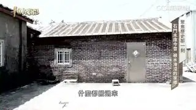
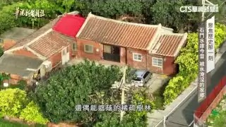
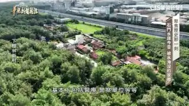
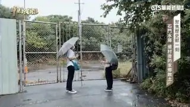
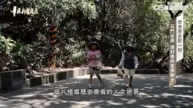

# 歷史那一刻 石門水庫遷村故事｜華視新聞雜誌｜精選

- 影片網址：https://youtu.be/AWP_v5I0zYA?si=0RkOhrRUMGU9zJfu
- 頻道：華視新聞雜誌
- 上傳日期：2026-01-28　長度：00:13:36　觀看數：50494
- 字幕來源：無
- 爬取時間：2026-10-29T16:08:17+08:00

## 影片說明

【首播】2022年9月2日 #華視新聞雜誌 第2328集 
【記者】李婉婷 盧松佑 柯冠丞 蘇韋宣

#石門水庫 #歷史那一刻 #遷村 #移民 #家園 #觀音 #沿海
#灌溉 #發電 #給水 #防洪 #土地徵收 #海邊 #村落 #颱風 #汙染
#歷史 #文化 #地景 #家鄉 #華視

► ►內容重點：
石門水庫在1964年興建完工，如今已有60多年歷史。它曾經是東亞第一大壩，更兼具灌溉、發電、給水、防洪等效益，但您知道嗎？這項工程背後，卻隱藏著兩千多位居民，家園被水淹沒的心酸故事。當年為了興建石門水庫，有278戶不得不接受土地徵收，遷移到觀音沿海一帶，重建家園，也就此開啟了許多人的家園遷徙故事，歷史那一刻，帶您回顧。

💖💖華視新聞雜誌FB粉絲專頁
歡迎按讚、追蹤、分享或留言
👉https://www.facebook.com/newsmag.cts/
📺請鎖定@華視新聞雜誌
▌52新聞資訊台：週六晚間20:00
▌華視主頻12台：隔週五下午15:55

## 代表畫面

> 畫面取自 YouTube 播放器公開提供的 storyboard 預覽圖（320x180），未下載影片檔、未繞過任何平台限制。

**00:01:33**　畫面描述：紅磚平房外觀與鐵捲門，片中燒錄字幕：「什麼都搬過來」（人工判讀）

**00:02:43**　畫面描述：空拍紅瓦磚造合院，四周為樹林與菜園（人工判讀）

**00:06:25**　畫面描述：空拍聚落全景，遠方可見道路與工廠廠房（人工判讀）

**00:09:13**　畫面描述：兩位撐傘人士站在鐵絲網圍籬的大門前（人工判讀）

**00:11:17**　畫面描述：兩位戴帽女性走在林蔭小徑，片中燒錄字幕：「這片極富歷史意義的人文地景」（人工判讀）

## 逐字稿

無法取得文字：TranscriptsDisabled：此影片未提供字幕或逐字稿；本組未取得該影片音訊的使用授權，依作業規範不下載音訊做語音辨識
